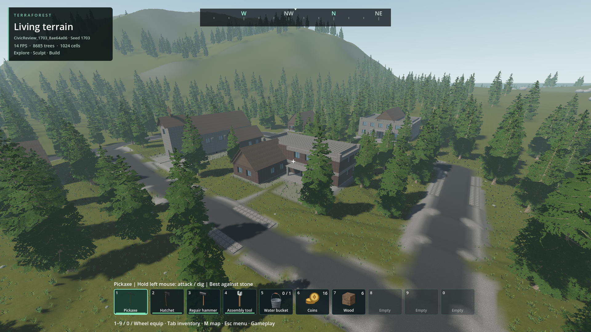
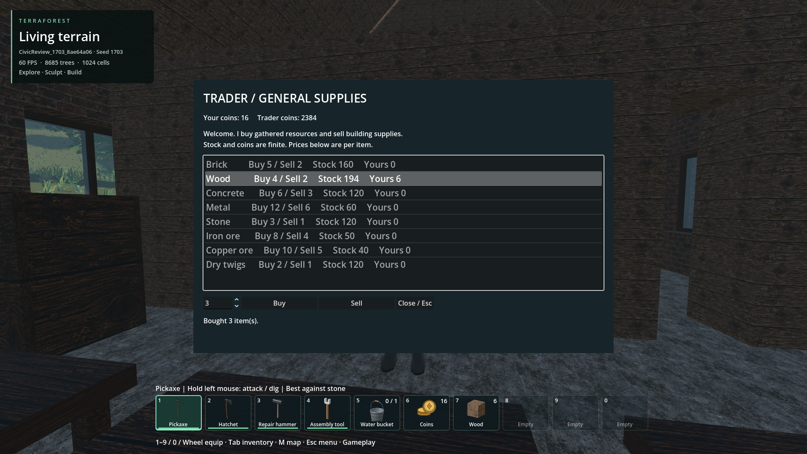

# Trader, civic buildings and terrain standards — final review

2026-10-30 · branch `codex/trader-civic-buildings` · code `79d38271` · **Approved by the user, 2026-10-30**.
The trader and five-building review world are implemented. The recurring
terrain/block contact defect has a shared correction and mandatory generation /
export checks. The requested shape, display and general-texture assessments are
complete as a decision-ready proposal. New shape/texture packs are not implied
by completing that assessment.

## Approval recorded — 2026-10-30

The user approved all five exact R1 designs, the submitted trader/contact work
and the proposed expansion direction: “I approve all.” The expansion itself
requires a later review and approval demonstrating justified improvements in
real-world situations. The mandatory evidence is recorded in
[the expansion acceptance requirements](BUILDING_EXPANSION_REVIEW.md#verification-and-remaining-limitations).
Follow-up: the exact E2 expansion revisions and older-texture retention were
approved on 2026-11-01; see the [final expansion approval](BUILDING_EXPANSION_REVIEW.md).
The existing performance findings remain facts; approval does not change their
measurements. This records design acceptance without altering saved worlds.

## The review world

`CivicReview_1703_8ae64a06`, seed 1703, civic plan 29. All buildings use individually
addressable/destructible native cells with working attached doors, furniture and
storage. Three connected streets fit separate surveyed grades; the forest remains
between lots. Each large building has a medium partial basement.

| Approved design | Cells / attached objects | Features | Basement |
| --- | ---: | --- | ---: |
| Trader T1 R1 | 1,019 / 21 | Covered entrance, public sales room, counter, stockroom, one idle current-player-based NPC | None requested |
| Town Hall T1 R1 | 3,028 / 59 | Portico, public hall, upper council room, stairs and storage | 99 m² |
| Church C1 R1 | 3,011 / 20 | Tower and supported cross, tall nave, aisle, side vestry | 99 m² |
| School S2 R1 | 2,615 / 67 | Two-storey classrooms, corridor and library wing | 81 m² |
| Warehouse W1 R1 | 3,505 / 39 | Three roof bays, two five-metre vehicle entrances, storage | 99 m² |


Actual full-world view. The [captioned ground, trader and basement gallery](../issues/civic-buildings/README.md)
also preserves rejected preparation and isolated design iterations.

The trader buys and sells brick, wood, concrete, metal, stone, iron ore, copper ore
and dry twigs. Quantity, price, stock and both coin balances are visible. Native
atomic transfers reject stale offers, insufficient money/stock and full storage
without partially changing either inventory. Range, wall occlusion, UI focus,
activation and retirement are checked. Coin balance and finite stock survive a
fresh process; returning to the house does not refill them. No automatic starter
coins, restocking, equipment exchange or quests are part of this catalog.



## Terrain/block standards now enforced

The shared [contract](TERRAIN_BUILDING_CONTRACT.md) addresses the underlying
failure paths: a single soil datum, whole-footprint/approach surveys, level ends
for sloped access beds, explicit earthworks phase ordering, and subtractive
clearance compiled from the same native shape hulls used by picking/collision.
Native exposed-top samples close the old gap between below-floor support and
above-floor room-air tests. Attachment bounds cannot impersonate actual grounded
cells. Failed or incomplete validation prevents generated publication. Export
runs debug, release and current-catalog checks automatically.

The reproduction, rejected attempts, fixes and recurrence procedure are in the
[stable terrain/block issue](../issues/terrain-building-contact/README.md).
Existing saved terrain is not repaired on load; individual player block placement
retains its existing freedom. Finite probes remain bounded verification, not a
claim that every possible mesh/LOD configuration is mathematically proven clear.

## Verification and limits

[Retained commands, hashes, logs and measurements](evidence/civic_buildings/world/README.md):

- Complete generated-world routes/trade: **73 checks, zero failures**. Player and
  native NPC reach each interior from its street; stairs/landings and both actual
  warehouse vehicle entrances pass. All five saved native cell sets match R1.
- Fresh-process exact stock/player restoration: **18 checks, zero failures**.
  Actual descent to all four basement floors and final photographs: **18 checks**.
- Terrain contact: **30 debug + 30 release checks**, and **64 catalog checks**
  covering 46 buildings and six sidewalk sets on two seeds. The existing approved
  large house passes **56 checks**; grading, preparation and planner regressions pass.
- Whole-game PCK startup and six civic resource/currency checks pass. Merged doors
  pass **58 source + 58 packaged checks**. Thirteen Python package/runner tests pass.
  Distribution is approximately **410 MiB** with its required external native DLLs.
- A short unchanged-quality 1080p ABBA comparison: merchant hidden mean **7.983 ms**,
  visible **8.041 ms**; visible p95 **8.754 ms**, worst **11.860 ms**. This indicates
  a small measured incremental cost in this view; it is not a hardware-wide guarantee.

**General world performance remains open:** capped moving-camera p95 is
21.744–24.262 ms, worst 27.145–33.770 ms. This is not steady 60 FPS qualification.
The other chat continues vegetation/frame-pacing work. Snapshot FPS labels are
not timing evidence. Broader endurance, dense populations and weak hardware need
their own checks.

Codex inspected the exteriors, overviews, actual basement rooms and trader UI.
The warehouse apron is clear of the reproduced soil patch. Remaining visual
review targets are the noisy concrete, repeated brown roofs, school wing roof
proportions, raw/irregular street shoulders, vegetation near approaches and overall
site composition. These do not become accepted world quality because traversal
passes. The five architectural candidates and the complete layout can receive
separate decisions.

## Proposed expansion direction

[Full shape, rendering/display and general-texture assessment](BUILDING_EXPANSION_REVIEW.md).
Recommended first pack: thin 1:2 roof slopes with matching ridge/eave/hip/valley
joints, cornice/coping corners, then beams/braces and multi-cell arch parts.
First prove complete joined fixtures, all rotations, UV continuity, picking,
collision, local damage and save/LOD behavior before assigning new shape IDs.

Improve the current palette with searchable families and baked orientation /
assembly previews. Compare a review-only four-slot warm-brick/plaster/timber/slate
palette before designing a versioned eight-appearance system. The current two
material bits cannot store eight choices safely. Keep original assets CC0, code
0BSD, shared arrays/batches and exact saved identities. Update existing buildings
through individually approved A/B revisions, with no automatic repainting.

## Open the approved review world

From this worktree's TerraForest directory:

```text
python tools/review_civic_world.py
```

This opens the exact generated review slot. M shows named building markers; E
near the trader opens trade; Escape closes it. `--create` generates another unique
review world if needed. The package is `dist/TerraForest.pck`, with `dist/addons`
kept beside it. No normal-generation default has been changed to these candidates.

**Approved:** Trader T1 R1, Town Hall T1 R1, Church C1 R1, School S2 R1 and
Warehouse W1 R1, plus the expansion direction. Do not ask for these same design
approvals again. Default integration can use these exact revisions; changed
buildings and the finished expansion still need their own evidence and approval.
The current package remains the reviewed opt-in build; approval recording does
not itself change generator defaults or merge concurrent implementation work.

## Coordination and provenance

All work stays in this isolated worktree. Completed prop rendering `19fef843` and
door content `17398657` were merged; the original checkout's unfinished grass /
frame-pacing changes remain there. Nothing was pushed. New code is 0BSD and new
building arrangements/coin art CC0; retained player models, textures, engine and
libraries keep their recorded terms and unresolved provenance qualifications.
[Asset sources and hashes](../reviews/civic_buildings/provenance.json).

Integration snapshot: later concurrent commits `13788225` (retained model visuals)
and `cce00e89` (residency notifications) landed after this review baseline. They
are preserved in the original checkout and are not included in this package or
its timing results. Their eventual merge requires matching binary/package and
world checks; do not transfer either branch by copying over files.
