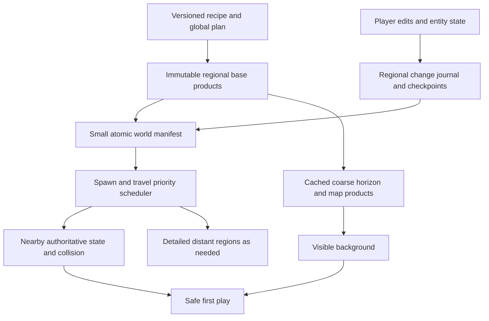

<!-- SPDX-License-Identifier: CC0-1.0 -->
# World generation, loading and storage audit

2026-11-02. Investigation and proposed architecture, **not a completed performance
rewrite**. New original analysis/data are CC0-1.0; diagnostic code is 0BSD.
Source baseline: `788892f7` plus the shared checkout's existing location-reset
work. That unrelated work was neither changed nor included in this audit's commit.

The largest opportunity is to stop doing whole-world presentation work on the
path to first play. Storage has a second, specific asymmetry: terrain and buildings
already use regional references, but ordinary generated water remains a large
inline snapshot. More threads or a different database alone would leave these
dependencies intact.

## Evidence and limits

[Machine-readable audit](evidence/world_startup_audit/audit.json) and
[reproduction/provenance](evidence/world_startup_audit/README.md) retain the inputs.
These are four recent successful generator-29, seed-1703 runs, not controlled
repetitions of one binary/cache state. The normal Emerald_Meadow world is included.
No user world was written. No new native build, export or full-world benchmark ran
while another chat was changing this checkout. A small lossless-compression
experiment and focused diagnostic regressions were run separately.

| Retained run | Creating phase | Earthworks worker | Water bake | Photograph pipeline | Verification |
| --- | ---: | ---: | ---: | ---: | ---: |
| Quests_1703_202c741e | 81.43 s | 8.02 s | 2.82 s | 24.58 s | 0.897 s |
| Emerald_Meadow | 93.25 s | 8.88 s | 3.10 s | 25.93 s | 0.869 s |
| Quests_1703_796e068b | 70.82 s | 9.38 s | 2.98 s | 24.45 s | 0.876 s |
| Quests_1703_eaa2ed4f | 82.85 s | 8.98 s | 2.76 s | 23.50 s | 0.962 s |

Creating includes earthworks, water and photographs. Do not add these columns as
independent end-to-end phases or treat worker time as exclusive CPU time.
Creating excludes subsequent coordinator verification/publication and entry into
the playable scene. The publication record counts sidecar-store bytes only; it
does **not** include the root archive or preview images.

One previously verified installed-package menu-transition receipt records about
**31.54 s of opening frames**: resource preparation 7.00 s, scene instantiation
0.021 s, setup 2.30 s, then about 22.22 s until the loading barrier clears.
The latter is a residual wall interval, not attribution to a particular subsystem;
workers overlap setup. The largest opening frame was 309.931 ms. This is an
offscreen, warm-cache observation with zombies disabled by that harness, not a
new benchmark or a cold-start guarantee. Source: `reports/menu_transition/20261102T144641939776Z`.

The prior startup work improved responsiveness, but did not establish lower total
loading time. See [the browser issue](../issues/browser-responsiveness/README.md).

## Why the critical path is long

1. **Whole-map readiness gates.** `demo/world.gd` sets `terrain.nearby_first=false`
   and `ecosystem.world_coverage=true`. Terrain loading checks coverage of every
   root, plus the nine local collision probes. Forest readiness requires all
   1,024 owners with no outstanding reconciliation/resampling. Additional readiness
   also requires boulders, every distant building region, world-wide model visuals,
   nearby model rendering, water and local actors. Some work is regional internally,
   but the release barrier is global. Larger worlds will enlarge this barrier.
2. **Generation performs a rendered sightseeing pass.**
   `generate_world_task.gd:bake_photographs` teleports through north/road/market,
   waits for loading and nearby vegetation, then performs image readback/encoding.
   The first view alone waits 16.44–18.42 s for loading. All photos cost 23.50–25.93 s,
   or 28–35% of these creating phases. This is not all avoidable time: some first-view
   work could be reused for first play, but dropping photographs without preserving
   that residency would move work into the next load.
3. **The generator constructs the gameplay scene and later destroys it.**
   It prepares `demo/world.gd` resources, registers services, creates forest/player/UI
   infrastructure, generates authoritative data, renders photographs, saves, caches
   map layers, shuts down and frees the scene. `world_session.gd` then opens another
   world scene after publication. The window persists; scene/native residency does
   not. This creates architectural opportunities for a smaller data builder and an
   explicit handoff of immutable products or selected resident state.
4. **Threaded resource loading is still issued serially.**
   `startup_resources.gd` requests one asset, polls it to completion, retrieves it,
   then advances. Its elapsed budget can add another frame yield after the poll.
   Many recorded resource intervals are approximately 33 ms at 60 FPS. The loader
   avoids one long blocking call but does not pipeline independent assets. Scripts
   still need the established owner-thread grouping; earlier broad threading trials
   leaked resources and must not be repeated blindly.
5. **Baking uses many durable intermediate checkpoints.** These four worlds each
   record 7,007 earthwork commands, 111 checkpoints and 664 region reads. The sample
   terrain directory has 110 packs and 111 indexes. The logged storage worker count
   is one. That counter does not imply that every native operation is single-threaded;
   the existing helper can run bounded parallel batches. Checkpoint frequency,
   overlap, rereads and packing granularity deserve measurement before raising
   thread limits or weakening durability.

## A storage model that is only partly regional

The audited Emerald_Meadow root is **43,170,851 bytes**, of which water is
**42,690,700 bytes (98.89%)**. Terrain is a 40-byte checkpoint reference; structures
are a 2,481-byte reference. Water is a `VRW1` v8 payload. Its `.water` directory has
only a zero-byte lease marker.

This follows the current code: `NativeWaterRegionStore::merge_water_snapshot`
returns the original snapshot when there are no edited/deferred region entries.
Regional water persistence currently addresses edited/deferred ownership; it does
not remove ordinary generated water from the root. The worker validates/restores
water through several layers. That is a candidate for decode-once ownership, but
the audit does not assign an unmeasured number of seconds to those passes.

| Sample storage | Logical bytes | Files |
| --- | ---: | ---: |
| Root plus backup | 86,341,702 | 2 |
| Terrain | 35,115,054 | 222 |
| Model stores | 303,098 | 619 |
| Building regions | 277,576 | 69 |
| Location baselines | 576,638 | 5 |
| Preview photographs | 8,171,648 | 3 |

Total above: 130,785,716 bytes (124.73 MiB), excluding shared derived caches and
reports. File lengths are not allocated disk usage. The model store contains 487
region blobs with median length 245 bytes. Their per-file open/metadata/flush costs
are plausible overhead, not measured attribution. Publication currently copies and
flushes each sidecar file individually before publishing the root.

An in-memory Python zlib experiment reduced the same water bytes to **13.67 MB** at
level 1 or **10.05 MB** at level 6, both byte-exact after decoding. One run took
164/750 ms to compress and 89/109 ms to decode. This only establishes compressibility;
it is not a native codec benchmark, implementation choice or loading-speed result.
Compressing the whole root would still require full decompression and restoration.
The 64 MiB component ceiling is also a structural limit, not a scalable water budget.

## Proposed architecture

**Separate world data from the scene.** A native world builder should produce the
plan, terrain edits, block/model records, static water and versioned metadata
without constructing the player, menus, renderer or complete gameplay tree.
Keep whole-world planning for connected roads/sites, but materialize spatial
products in bounded jobs. Initial placement and collision acceptance remain
mandatory. Render previews after readiness, at an idle budget, or reuse a cheap
map thumbnail; do not remove approved visible world quality to shorten a timer.

**Make readiness a declared local dependency set.** Require validated root/recipe,
the saved player state, an adequate terrain/building/tree collision envelope, nearby
water interactions and usable departure paths. Include fly-in/waking camera
coverage in the visual envelope. Show a validated coarse horizon immediately;
stream higher detail behind it. Cache distant buildings, vegetation placements and
water surfaces by regional input hashes. Do not merely flip `nearby_first` while
leaving holes or hidden collision dependencies. Travel and teleport admission must
retain explicit unavailable states until their required regions are ready.

**Finish regional storage across components.** Put generated water as well as
edited water in immutable region packs. A root should contain identities, schema
versions and checkpoint references, with small global player/recipe metadata.
Use indexed packs for tiny model records, independent lossless compression per
region/page and bounded read/decode/upload queues. Extend the terrain pack/index
pattern before introducing another unrelated storage protocol.

**Persist changes incrementally.** Keep immutable generated base records and a
versioned journal or copy-on-write regional overlay. Save only changed regions;
compact under byte/time budgets. Atomically publish one manifest generation after
all referenced data are durable. Retain current/backup roots, pins, epochs, exact
checksums and failure recovery. A cross-component edit needs one commit identity;
independently publishing terrain and water can otherwise restore incompatible
versions. Garbage collection must mark from all retained roots/checkpoints and
baselines before reclaiming unreachable blobs. Existing saves require an explicit,
verified migration with their original data preserved.

**Treat generated and derived data differently.** A seed alone is not a save: old
generator and asset revisions must retain their exact realized world. Immutable
base content can be shared by content hash across clones if ownership and reference
tracking are defined. Meshes, collision recipes, map layers and thumbnails are
rebuildable caches keyed by generator/asset/schema and touched-region revisions.
Invalidate affected owners and their dependency halos, not every world product
after a local edit. Bound memory by resident bytes plus queued/captured/upload
bytes, not only by region counts.

**Schedule bounded parallel work.** Use a persistent native worker pool with
priority for spawn/travel/collision and lower priority for distant visuals,
photographs, map layers and compaction. Keep scene-tree/GPU installation on its
owner thread with incremental APIs. Pipeline a measured number of independent
resource requests instead of waiting for each one before issuing the next.
Worker count must respect captured memory and the user's Quiet Mode; no FPS/VSync
or power-setting change is part of this proposal. Godot documents both asynchronous
[resource retrieval](https://docs.godotengine.org/en/stable/tutorials/io/background_loading.html)
and the [scene/resource threading constraints](https://docs.godotengine.org/en/stable/tutorials/performance/thread_safe_apis.html).

A SQLite-backed regional store is a credible comparison implementation: its
documented application-format advantages include incremental updates and atomic
transactions ([primary reference](https://www.sqlite.org/appfileformat.html)).
Benchmark identical region payloads, random reads, save bursts and crash recovery
against the existing pack/index approach. It would not solve the global readiness
barrier. No database/library is imported or admitted by this audit; any dependency
choice still follows the repository's exact-version provenance rules.

## Implementation order and acceptance

| Priority | Work | Evidence needed before claiming improvement |
| --- | --- | --- |
| 0 | Complete timing attribution | Full trace from Generate/Play through control release; stable stage IDs, queue/wait/CPU/install time, bytes/files, cache outcomes, publication and handoff included |
| 1 | Local first-play contract plus cached horizon | Matched repeated cold/warm source and packaged runs; nearby collision/travel and fly-in intact; no visible holes; first-play time improves, later travel does not regress |
| 2 | Generated-water regional storage and decode-once handoff | Exact quantities/contacts/edits after fresh-process reopen; missing/corrupt-region behavior; bounded resident/peak memory; root size independent of distant water volume |
| 3 | Data-only generation and bounded asset prefetch | Equivalent plan/world digests, same accepted buildings/terrain, cancellation and clean teardown; separate generation, previews, first entry and subsequent load timings |
| 4 | Packed tiny records and incremental checkpoints | Per-phase I/O counters, fewer durable file operations, bounded saves, interrupted publication/recovery, edits spanning components and compaction tests |
| 5 | Parallel generation graph and regional cache reuse | Multiple sizes/seeds and worker budgets; reproducibility, peak memory, p95/worst frame, save time and travel residency under sustained load |

The measured photograph span is an opportunity ceiling, **not a promised 24-second
net saving**. Water compression offers a demonstrated byte reduction, **not a
4x loading claim**. Preserve the existing physical/visual standards and track
first play, total background completion and total generation separately so that
work cannot disappear into an unmeasured later hitch.

## Diagnostic changes completed in this audit

`generation_progress.gd` formerly treated each changing activity label as a timing
stage. Its 64 records filled during asset loading, omitting 83–96% of the elapsed
profile in these four successful runs. Timing schema 2 aggregates stable stage
names, retains revisits, and reports overflow counts/time explicitly. UI activity
text and progress remain unchanged. The isolated regression checks 180 resource
updates, later bake/save stages, revisits, bounded overflow and complete elapsed
accounting. It passes on Godot 4.7.2. Historical missing timing cannot be recovered.

The read-only `tools/audit_world_startup.py` verifies the outer archive checksum,
measures component/file sizes and summarizes retained timings. Six Python tests
cover valid input, corruption, bounds, order/duplicates, missing terrain and
trailing bytes. Native component-schema checks remain with the native codecs.
The source diagnostic fix is not yet exported; no runtime speedup is claimed.
All larger changes and the controlled full trace remain open.
