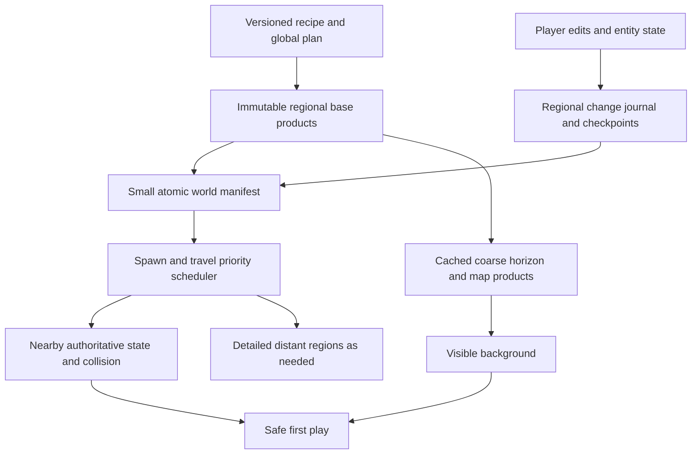
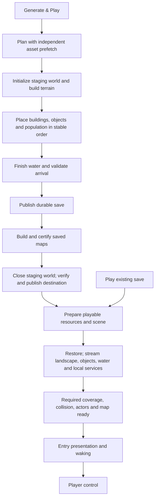

<!-- SPDX-License-Identifier: CC0-1.0 -->
# World generation, loading and storage audit

Current stage/ownership review: [27 November generation and loading flow](#generation-loading-and-generate--play-flow--2026-11-27). The earlier audits below are historical; use the latest measurements and scoped follow-ups before choosing another optimization.

2026-11-02. Investigation and proposed architecture, **not a completed performance
rewrite**. New original analysis/data are CC0-1.0; diagnostic code is 0BSD.
Source baseline: `788892f7` plus the shared checkout's existing location-reset
work. That unrelated work was neither changed nor included in this audit's commit.

The largest opportunity is to stop doing whole-world presentation work on the
path to first play. Storage has a second, specific asymmetry: terrain and buildings
already use regional references, but ordinary generated water remains a large
inline snapshot. More threads or a different database alone would leave these
dependencies intact.

## Evidence and limits

[Machine-readable audit](evidence/world_startup_audit/audit.json) and
[reproduction/provenance](evidence/world_startup_audit/README.md) retain the inputs.
These are four recent successful generator-29, seed-1703 runs, not controlled
repetitions of one binary/cache state. The normal Emerald_Meadow world is included.
No user world was written. No new native build, export or full-world benchmark ran
while another chat was changing this checkout. A small lossless-compression
experiment and focused diagnostic regressions were run separately.

| Retained run | Creating phase | Earthworks worker | Water bake | Photograph pipeline | Verification |
| --- | ---: | ---: | ---: | ---: | ---: |
| Quests_1703_202c741e | 81.43 s | 8.02 s | 2.82 s | 24.58 s | 0.897 s |
| Emerald_Meadow | 93.25 s | 8.88 s | 3.10 s | 25.93 s | 0.869 s |
| Quests_1703_796e068b | 70.82 s | 9.38 s | 2.98 s | 24.45 s | 0.876 s |
| Quests_1703_eaa2ed4f | 82.85 s | 8.98 s | 2.76 s | 23.50 s | 0.962 s |

Creating includes earthworks, water and photographs. Do not add these columns as
independent end-to-end phases or treat worker time as exclusive CPU time.
Creating excludes subsequent coordinator verification/publication and entry into
the playable scene. The publication record counts sidecar-store bytes only; it
does **not** include the root archive or preview images.

One previously verified installed-package menu-transition receipt records about
**31.54 s of opening frames**: resource preparation 7.00 s, scene instantiation
0.021 s, setup 2.30 s, then about 22.22 s until the loading barrier clears.
The latter is a residual wall interval, not attribution to a particular subsystem;
workers overlap setup. The largest opening frame was 309.931 ms. This is an
offscreen, warm-cache observation with zombies disabled by that harness, not a
new benchmark or a cold-start guarantee. Source: `reports/menu_transition/20261102T144641939776Z`.

The prior startup work improved responsiveness, but did not establish lower total
loading time. See [the browser issue](../issues/browser-responsiveness/README.md).

## Why the critical path is long

1. **Whole-map readiness gates.** `demo/world.gd` sets `terrain.nearby_first=false`
   and `ecosystem.world_coverage=true`. Terrain loading checks coverage of every
   root, plus the nine local collision probes. Forest readiness requires all
   1,024 owners with no outstanding reconciliation/resampling. Additional readiness
   also requires boulders, every distant building region, world-wide model visuals,
   nearby model rendering, water and local actors. Some work is regional internally,
   but the release barrier is global. Larger worlds will enlarge this barrier.
2. **Generation performs a rendered sightseeing pass.**
   `generate_world_task.gd:bake_photographs` teleports through north/road/market,
   waits for loading and nearby vegetation, then performs image readback/encoding.
   The first view alone waits 16.44–18.42 s for loading. All photos cost 23.50–25.93 s,
   or 28–35% of these creating phases. This is not all avoidable time: some first-view
   work could be reused for first play, but dropping photographs without preserving
   that residency would move work into the next load.
3. **The generator constructs the gameplay scene and later destroys it.**
   It prepares `demo/world.gd` resources, registers services, creates forest/player/UI
   infrastructure, generates authoritative data, renders photographs, saves, caches
   map layers, shuts down and frees the scene. `world_session.gd` then opens another
   world scene after publication. The window persists; scene/native residency does
   not. This creates architectural opportunities for a smaller data builder and an
   explicit handoff of immutable products or selected resident state.
4. **Threaded resource loading is still issued serially.**
   `startup_resources.gd` requests one asset, polls it to completion, retrieves it,
   then advances. Its elapsed budget can add another frame yield after the poll.
   Many recorded resource intervals are approximately 33 ms at 60 FPS. The loader
   avoids one long blocking call but does not pipeline independent assets. Scripts
   still need the established owner-thread grouping; earlier broad threading trials
   leaked resources and must not be repeated blindly.
5. **Baking uses many durable intermediate checkpoints.** These four worlds each
   record 7,007 earthwork commands, 111 checkpoints and 664 region reads. The sample
   terrain directory has 110 packs and 111 indexes. The logged storage worker count
   is one. That counter does not imply that every native operation is single-threaded;
   the existing helper can run bounded parallel batches. Checkpoint frequency,
   overlap, rereads and packing granularity deserve measurement before raising
   thread limits or weakening durability.

## A storage model that is only partly regional

The audited Emerald_Meadow root is **43,170,851 bytes**, of which water is
**42,690,700 bytes (98.89%)**. Terrain is a 40-byte checkpoint reference; structures
are a 2,481-byte reference. Water is a `VRW1` v8 payload. Its `.water` directory has
only a zero-byte lease marker.

This follows the current code: `NativeWaterRegionStore::merge_water_snapshot`
returns the original snapshot when there are no edited/deferred region entries.
Regional water persistence currently addresses edited/deferred ownership; it does
not remove ordinary generated water from the root. The worker validates/restores
water through several layers. That is a candidate for decode-once ownership, but
the audit does not assign an unmeasured number of seconds to those passes.

| Sample storage | Logical bytes | Files |
| --- | ---: | ---: |
| Root plus backup | 86,341,702 | 2 |
| Terrain | 35,115,054 | 222 |
| Model stores | 303,098 | 619 |
| Building regions | 277,576 | 69 |
| Location baselines | 576,638 | 5 |
| Preview photographs | 8,171,648 | 3 |

Total above: 130,785,716 bytes (124.73 MiB), excluding shared derived caches and
reports. File lengths are not allocated disk usage. The model store contains 487
region blobs with median length 245 bytes. Their per-file open/metadata/flush costs
are plausible overhead, not measured attribution. Publication currently copies and
flushes each sidecar file individually before publishing the root.

An in-memory Python zlib experiment reduced the same water bytes to **13.67 MB** at
level 1 or **10.05 MB** at level 6, both byte-exact after decoding. One run took
164/750 ms to compress and 89/109 ms to decode. This only establishes compressibility;
it is not a native codec benchmark, implementation choice or loading-speed result.
Compressing the whole root would still require full decompression and restoration.
The 64 MiB component ceiling is also a structural limit, not a scalable water budget.

## Proposed architecture

**Separate world data from the scene.** A native world builder should produce the
plan, terrain edits, block/model records, static water and versioned metadata
without constructing the player, menus, renderer or complete gameplay tree.
Keep whole-world planning for connected roads/sites, but materialize spatial
products in bounded jobs. Initial placement and collision acceptance remain
mandatory. Render previews after readiness, at an idle budget, or reuse a cheap
map thumbnail; do not remove approved visible world quality to shorten a timer.

**Make readiness a declared local dependency set.** Require validated root/recipe,
the saved player state, an adequate terrain/building/tree collision envelope, nearby
water interactions and usable departure paths. Include fly-in/waking camera
coverage in the visual envelope. Show a validated coarse horizon immediately;
stream higher detail behind it. Cache distant buildings, vegetation placements and
water surfaces by regional input hashes. Do not merely flip `nearby_first` while
leaving holes or hidden collision dependencies. Travel and teleport admission must
retain explicit unavailable states until their required regions are ready.

**Finish regional storage across components.** Put generated water as well as
edited water in immutable region packs. A root should contain identities, schema
versions and checkpoint references, with small global player/recipe metadata.
Use indexed packs for tiny model records, independent lossless compression per
region/page and bounded read/decode/upload queues. Extend the terrain pack/index
pattern before introducing another unrelated storage protocol.

**Persist changes incrementally.** Keep immutable generated base records and a
versioned journal or copy-on-write regional overlay. Save only changed regions;
compact under byte/time budgets. Atomically publish one manifest generation after
all referenced data are durable. Retain current/backup roots, pins, epochs, exact
checksums and failure recovery. A cross-component edit needs one commit identity;
independently publishing terrain and water can otherwise restore incompatible
versions. Garbage collection must mark from all retained roots/checkpoints and
baselines before reclaiming unreachable blobs. Existing saves require an explicit,
verified migration with their original data preserved.

**Treat generated and derived data differently.** A seed alone is not a save: old
generator and asset revisions must retain their exact realized world. Immutable
base content can be shared by content hash across clones if ownership and reference
tracking are defined. Meshes, collision recipes, map layers and thumbnails are
rebuildable caches keyed by generator/asset/schema and touched-region revisions.
Invalidate affected owners and their dependency halos, not every world product
after a local edit. Bound memory by resident bytes plus queued/captured/upload
bytes, not only by region counts.

**Schedule bounded parallel work.** Use a persistent native worker pool with
priority for spawn/travel/collision and lower priority for distant visuals,
photographs, map layers and compaction. Keep scene-tree/GPU installation on its
owner thread with incremental APIs. Pipeline a measured number of independent
resource requests instead of waiting for each one before issuing the next.
Worker count must respect captured memory and the user's Quiet Mode; no FPS/VSync
or power-setting change is part of this proposal. Godot documents both asynchronous
[resource retrieval](https://docs.godotengine.org/en/stable/tutorials/io/background_loading.html)
and the [scene/resource threading constraints](https://docs.godotengine.org/en/stable/tutorials/performance/thread_safe_apis.html).

A SQLite-backed regional store is a credible comparison implementation: its
documented application-format advantages include incremental updates and atomic
transactions ([primary reference](https://www.sqlite.org/appfileformat.html)).
Benchmark identical region payloads, random reads, save bursts and crash recovery
against the existing pack/index approach. It would not solve the global readiness
barrier. No database/library is imported or admitted by this audit; any dependency
choice still follows the repository's exact-version provenance rules.

## Implementation order and acceptance

| Priority | Work | Evidence needed before claiming improvement |
| --- | --- | --- |
| 0 | Complete timing attribution | Full trace from Generate/Play through control release; stable stage IDs, queue/wait/CPU/install time, bytes/files, cache outcomes, publication and handoff included |
| 1 | Local first-play contract plus cached horizon | Matched repeated cold/warm source and packaged runs; nearby collision/travel and fly-in intact; no visible holes; first-play time improves, later travel does not regress |
| 2 | Generated-water regional storage and decode-once handoff | Exact quantities/contacts/edits after fresh-process reopen; missing/corrupt-region behavior; bounded resident/peak memory; root size independent of distant water volume |
| 3 | Data-only generation and bounded asset prefetch | Equivalent plan/world digests, same accepted buildings/terrain, cancellation and clean teardown; separate generation, previews, first entry and subsequent load timings |
| 4 | Packed tiny records and incremental checkpoints | Per-phase I/O counters, fewer durable file operations, bounded saves, interrupted publication/recovery, edits spanning components and compaction tests |
| 5 | Parallel generation graph and regional cache reuse | Multiple sizes/seeds and worker budgets; reproducibility, peak memory, p95/worst frame, save time and travel residency under sustained load |

The measured photograph span is an opportunity ceiling, **not a promised 24-second
net saving**. Water compression offers a demonstrated byte reduction, **not a
4x loading claim**. Preserve the existing physical/visual standards and track
first play, total background completion and total generation separately so that
work cannot disappear into an unmeasured later hitch.

## Diagnostic changes completed in this audit

`generation_progress.gd` formerly treated each changing activity label as a timing
stage. Its 64 records filled during asset loading, omitting 83–96% of the elapsed
profile in these four successful runs. Timing schema 2 aggregates stable stage
names, retains revisits, and reports overflow counts/time explicitly. UI activity
text and progress remain unchanged. The isolated regression checks 180 resource
updates, later bake/save stages, revisits, bounded overflow and complete elapsed
accounting. It passes on Godot 4.7.2. Historical missing timing cannot be recovered.

The read-only `tools/audit_world_startup.py` verifies the outer archive checksum,
measures component/file sizes and summarizes retained timings. Six Python tests
cover valid input, corruption, bounds, order/duplicates, missing terrain and
trailing bytes. Native component-schema checks remain with the native codecs.
At the audit checkpoint the diagnostic fix was not yet exported and the larger
changes remained open. The implementation and measurements below supersede that
status; they still do not establish faster startup.

## Local landscape readiness and generated-water packs — 2026-11-03

This first implementation is installed and engineering-verified. **Storage is
smaller; generation/loading wall time has not meaningfully improved.** The
[versioned measurement receipt](evidence/world_startup_optimization/results.json)
records inputs, hashes, timing samples, memory peaks, checks and review scope.
UTC report timestamps are November 2; local completion is November 3.

Normal play requires forest/boulder owners intersecting a 640 m circle around the
player, including pending surface reads and invalidations. Distant owner admission
waits until first play, then resumes through existing bounded queues. Boulders
fill omitted shared-query owners once that individual forest owner is ready,
avoiding duplicate reads and the former global forest barrier. Outside the owner
grid, admission and readiness both fall back to full coverage. Normal generation
photographs retain full coverage. `--whole-landscape-readiness` restores the
previous behavior for diagnosis. Terrain, object horizons, water, actors, map and
nearby collision retain their existing barriers; this is not yet local terrain
or a lazy-water runtime.

The volumetric world remains editable. "Immutable" describes completed files on
disk: edits change live state, and saving publishes new file versions/references
without overwriting the previous checkpoint's dependencies. It does not freeze
water, terrain, or gameplay.

New worlds publish `TFWG` version 1 water references. The root contains the lake
catalog, index identity and a digest of the reconstructed native snapshot. An
immutable `.windex` contains sorted coordinates, pack identity, offsets, compressed
and decoded lengths, and a per-region decoded checksum. Independently Zstandard-
compressed native region records share content-addressed `.wpack` files targeted
at 1 MiB. Regions retain density, quantities, contacts, vacancies and ownership.
The engine supplies compression; no new dependency was imported.

Blobs and index are flushed and verified before the outer compound checkpoint
is published. Existing roots/backups and their referenced blobs remain immutable;
there is no migration or deletion pass. Legacy inline/TFWS worlds retain their
storage family on normal save, and transient edited-ocean receipts retain their
existing protocol. Missing/corrupt dependencies fail loading and disable writes.
The decoder caps 4,096 regions, 64 MiB decoded input, 16 MiB packs and 8 MiB records;
it checks lengths/indices, native records and reconstructed full snapshot identity.

The reader reconstructs the full native snapshot on the worker, preserving current
simulation/rendering behavior. Storage intermediates skip runtime mesh/query
admission and avoid revalidating an already validated per-region catalog. Regional
disk storage does not yet mean bounded water residency or decode-once live handoff.
Changed records currently require recompression and can change the containing
pack's identity. The index supports future independent region admission; that
runtime work remains open.

### Before/after measurements

The ordinary browser recipe used seed 1703, unique `StartupBench_` worlds and
read-only fresh-process reopens. Godot 4.7.2 ran frozen exported packs with debug
native variants at 1920x1080/60 FPS in nonactivating offscreen windows. Existing
OS/shared derived caches were retained: **not a forced cold-cache comparison**.
First-ready excludes intro completion and optional background observation. The
baseline precedes the unrelated quest UI and teardown commits; final artifacts
include them. Treat these as scoped observations, not an isolated causal study.

| Metric | Before | Final |
| --- | ---: | ---: |
| Generate through first-ready, one run | 97.516 s | 100.681 s |
| Load median, three fresh processes | 25.257 s | 25.245 s |
| Load samples | 24.890 / 25.257 / 27.152 s | 26.351 / 24.701 / 25.245 s |
| Water bytes including index/packs | 42,690,700 | 11,388,874 (-73.32%) |
| Whole compound root bytes | 43,170,851 | 481,003 |
| Generation peak private commit | 3.722 GiB | 3.787 GiB |
| Load peak private commit | 3.360 GiB | 3.441 GiB |

The generation difference is +3.2% in a single sample; no generation speedup or
statistically established regression is claimed. Load timing is effectively
unchanged. The lower root size does not establish a total-world RAM improvement.
Final water is an 852-byte reference plus 11,388,022 bytes in 11 packs and one index.
Terrain and structure sections match byte-for-byte. The reconstructed water hash
also matches the baseline exactly. The original Emerald_Meadow root still matches
its audit hash; all readonly reopen fixtures retain their root hashes.

Measured PCK: `465f36fd853330e97a775925df17b78e425bca502cef6cc88db5c949aeb8da83`.
Baseline PCK: `988aa6eb008de18926d33d1c45fe6f423c5d7c3f7f2359ab3c7f844e7bfa7bba`.
Both manifests include 14 matching external DLLs. Final generation receipt:
`reports/startup_optimization/20261102T221520843140Z`; final loads:
`20261102T221046472745Z`, `20261102T221338100942Z`, `20261102T221405838534Z`.
Legacy readonly reopening passed at 24.847 s in `20261102T221705506851Z`.

In the observed final load, all 282 local owners and nearby collision were ready
at release; the other owners completed 7.921 s later. The following 20-second
sample had 18.124 ms p95 and 51.376 ms worst frame time. This is offscreen sampled
behavior, not foreground/high-speed travel qualification. The seated first-play
image and an elevated nearby landscape view were inspected: terrain, nearby
trees, lake and buildings are present. Broader world-quality approval is unchanged.
All final runs passed sampled RAM/VRAM budgets and zero-pointer-capture checks.

### Validation and rejected candidate

Nine focused suites pass in `reports/startup_optimization/qualified_codec/run.json`:
local ownership/admission boundaries and invalidations; real generated-water
byte-exact pack/reopen in debug and release; legacy snapshot compatibility;
generated-water ownership; both-format production load/save failure protection;
streaming save, deferred save and compound checkpoint backup retention. Tests
cover malformed roots, missing indices, corrupt packs, explicit empty catalogs,
repeat publication identity and unchanged source data. Export's building/catalog,
release contract, asset provenance and PCK startup gates passed.

The first candidate merely changed readiness and started boulder work earlier.
It regressed load median to 29.019 s versus its own whole-landscape control at
26.632 s. Its build and all six receipts remain retained. It was corrected by
also deferring distant admission and removing storage-only render preparation;
it is not the final installed build. This finding matters: relaxing a barrier
without reducing competing work does not guarantee faster entry.

Earlier failed diagnostic receipts remain retained: `20261102T211501295041Z`
was stopped due to concurrent world testing; `20261102T212834585528Z` exposed a
benchmark focus-setting reset. Neither is a passing baseline. The harness restores
offscreen mode at handoff. The separate quest check's pre-checkpoint timeout is
tracked with its successful clean repetition in the gameplay-expansion contract;
it is not hidden or attributed to water without evidence.

### Remaining architecture and reproduction

The first audit attributed roughly 14-15 seconds to whole-map terrain coverage
from the displayed stage label. The later sampled readiness trace below corrects
that attribution: water publication remained unfinished after terrain was ready.
Whole-map terrain coverage still requires a valid fallback before its gate can
be removed. Derived-cache accounting and cold-cache behavior remain separate
qualification work.

True regional water residency needs independently validated admission, neighbor/
solver availability, save inheritance of unloaded regions and bounded render
products. Data-only generation and eliminating duplicate scene/resource startup
remain the larger generation tasks. Incremental pack publication/compaction,
cold-cache repetitions, broader seeds, weak-hardware foreground frame times and
sustained travel remain open. Close them with matched repeated timing, memory,
quantity, corruption/interruption and inspected visual/collision evidence; do not
infer completion from this first storage/readiness implementation.

Reproduce with the installed pack using
`python tools/benchmark_world_startup.py --freeze --build reports/startup_optimization/<new-name>`.
Use the reported owned slot with `--slot StartupBench_<id> --repeat 3` to measure
readonly loads; `--observe` records background completion and local collision,
and `--whole-landscape` selects the prior barrier/admission behavior for a load.
`tests/generated_water_packs.gd -- --water-fixture=StartupBench_<legacy-id>` checks
an owned legacy fixture; production failure checks are in
`tests/water_storage_failure.gd`. Do not substitute a user save for test fixtures.

### Paused-focus integration follow-up

A subsequent reset check exposed a mismatch when the player moved while physics
was paused: readiness used the player position but new work used the older
terrain focus. Admission now uses the same player position, preserving the full
640 m requirement. The failing check is retained at
`reports/quests_world/20261102T221830324520Z`; its synchronized-focus repetition
passed 56 + 15 fresh-process checks in `20261102T222352609734Z`.

Integration PCK `aae87e1ffd96d0fbaf9538549f5e05323a269eccad0fba80ebfd725ab5946c81`
contains the center correction and the other chat's trader-list labels. The timing
table intentionally retains the earlier exact measured artifact. A new-format
world passed generation/save/fresh-process reopening (88 + 90 checks) in
`reports/quests_world/20261102T223211692663Z`. Its live trader/reset/cancellation
check deliberately offset terrain focus by 40 m, verified player-centered owner
admission, and passed reset/save/fresh-process reopening (60 + 15 checks) in
`reports/quests_world/20261102T223552833125Z`. Both receipts passed sampled
RAM/VRAM budgets. These are correctness checks, not additional startup samples.

## End-to-end speed follow-up — 2026-11-03

The user's target is one continuous wait: **Generate & play through player
control**, including generation, verified publication, opening, fly-in and waking.
The earlier storage result did not address that target. The speed changes below
keep normal world contents and readiness gates, and add no save migration.

Implemented and exported:

- Keep up to four imported resources loading concurrently, retain dependency order,
  compile scripts on the main thread and drain submitted requests on cancellation.
- During loading, publish up to 16 water mesh packets / 4 ms per call, returning to
  the existing 4 packets / 1 ms gameplay budget afterward. Complete mesh/query
  batches still publish atomically; water quantity and editing are unchanged.
- Pass up to 192 MiB / 512 terrain mesh results from generation to opening within
  the same process. Accept only the exact verified terrain checkpoint and matching
  native/codec/style/meshing signature. Canonical world restoration still runs.
  Edits, checkpoint mismatches and cancellation invalidate reuse; fresh processes
  reconstruct normally. No scene, live world or disk format is retained by this cache.
- Queue up to eight distant-building results / 32 MiB between the native worker
  and main thread. Drain at most four per frame within a 1 ms soft upload slice,
  preserving chunk versions, stale-result rejection and editable block ownership.
- Start map preparation after verified restoration while visual work completes.
  The existing final map readiness/error handling remains in place.

A sampled trace corrected the earlier displayed-stage interpretation: terrain was
ready around 16 seconds into a diagnostic load while water still built until
roughly 27 seconds. After addressing that bottleneck and duplicate terrain work,
serial distant-building delivery and late map preparation became visible. In the
qualified generation, map warming overlaps building reconstruction; both finish
before the final barrier. 233 terrain mesh results were reused in the earlier
handoff candidate; exact hit counts and final queue statistics are in the receipt.

| Timed boundary | Before | Qualified |
| --- | ---: | ---: |
| Generate & play through control | 101.283 s (one run) | 83.911 / 83.176 s; median 83.543 s |
| Generate & play through first-ready | 93.228 s | 75.877 / 75.152 s |
| Normal saved-world reopening through control | 36.664 s | 30.438 s |
| Normal reopening through first-ready | 33.501 s | 27.281 s |

The combined median is 17.740 seconds / 17.5% lower; ordinary reopening is
6.226 seconds / 17.0% lower (one paired sample). These are observed warm-cache
results, not a statistical or universal hardware claim. Both combined repetitions
include the normal eight-second fly-in/waking sequence. All qualified runs pass
sampled RAM/VRAM limits; the observed combined run peaks at 3.732 GiB private commit
and 1.406 GiB dedicated GPU allocation versus 3.714 / 1.403 GiB before. There is
no claimed memory reduction. Reopening has zero process-local terrain handoff hits,
confirming independent reconstruction rather than dependence on generation's cache.

The normal reopening comparison makes a unique full copy of the same owned
generated fixture for each run, with normal map preparation. The source fixture
hash remains unchanged; the disposable copy may checkpoint normal entry state. Older read-only load samples
remain in the evidence but set the session temporary and skip map preparation;
they are **not** substituted for ordinary opening. The first attempted combined
control receipt (20261102T230316965713Z) accidentally triggered entry inside the
generation viewport, consuming waking early. It is retained and excluded. Correct
generation runs require one fly-in, one waking and unblocked player controls.
Ordinary reopening of an already-entered save correctly has no first-entry waking.
Receipt 20261102T233049529346Z failed the initial overly strict test assertions
for waking and root immutability. It changed only its owned benchmark fixture.
Subsequent normal-load runs use independent copies and verify the source hash.

Machine-readable [speed receipts](evidence/world_startup_optimization/speed_results.json)
record exact frozen manifests, driver hashes, run hashes, native checks, save
identities and sampled resource measurements. Before PCK: `7b153c9a...66baac6`;
qualified PCK: `a465003a...89bd801`, with matching external native libraries.
The intervening queue-free handoff candidate took 91.130 seconds through control;
it is retained as an intermediate result, not the installed candidate.

Verification: startup resource/cancellation checks pass; the 64-region water test
needs 50 gameplay publication calls versus 13 loading calls with identical water,
mesh faces and queries, and subsequent editing still works. Fourteen real terrain
handoff checks cover exact arrays/collision recipes, owned columns, incompatible
checkpoints, changed terrain, epochs and limits. Thirty-four building-horizon
checks pass with both debug and release DLLs, including edits, undo, paging,
replacement, disable/re-enable and teardown. Export/catalog/release gates pass.

Generated terrain and structure sections match the before world byte for byte;
the reconstructed water identity also matches. Emerald_Meadow retains its original
root SHA-256 `f6b8f026...20cfa`. The final observed run has full 64/64 terrain roots,
9/9 local collision coverage, local forest/boulder readiness and no map error.
The room and elevated landscape screenshots were inspected: nearby interiors,
terrain, lake, trees and distant buildings are present. This is coverage evidence,
not approval of the existing settlement layout or tool animation. The 20-second
sample **after control** had 17.025 ms p95 / 18.451 ms worst frame time. It does not
qualify foreground responsiveness, high-speed travel or weaker hardware.

The remaining wait is substantial. In one qualified run, generation itself takes
63.725 seconds, including 20.479 seconds of preview photographs, 8.161 seconds of
earthworks, 7.250 seconds placing buildings, 8.106 seconds saving and 6.395 seconds
caching the map. These are observations, not additive estimates for every run.
The next major architectural work is data-only generation and reuse/deferment of
derived preview/map work, with immutable checkpoint ownership, cancellation,
publication and visual checks before changing that pipeline. Regional water
residency, snapshot decode reuse, persistent cache indexing, cold-cache and broader
seed/hardware qualification remain open. Return to these with matched full-control
measurements; the user's reported two-plus-minute case is not reproduced by this
warm-cache seed1703 sample and is not declared solved.

Reproduce the combined metric with `tools/benchmark_world_startup.py --build
reports/startup_optimization/speed_qualified_build --through-control --profile`.
Add `--observe` for post-control collision/image/frame evidence. For normal opening,
add `--slot StartupBench_<owned-id> --normal-load --through-control`. The harness
accepts only owned StartupBench slots and retains receipts; never use a user save.

## Optional photographs and local generation validation — 2026-11-03

Normal Generate & play no longer takes launcher photographs. Previously it loaded
three scenic destinations, waited for their terrain/vegetation and read back PNGs
before publishing the world. That was presentation work on the path to player
control. My worlds already had a separate capture task; the action now reads
**Create / refresh photographs**, and empty previews explain that action. Existing
photographs remain usable. There is no automatic capture competing with gameplay.

Generation validates only the actual starting area: native urgent terrain
collision with its required coverage bridges, structure/model collision, local
tree/boulder owners and the existing floor-ray/capsule check. The observed local
validation took about 0.18 seconds. It explicitly saves the starting pose without
pretending the generation scene satisfies the full playable-world loading gate.
Map data warms without opening the interactive map UI. After publication, ordinary
opening still requires full terrain coverage, local landscape/collision, water,
distant buildings, map and normal fly-in/waking. Explicit developer photograph/
traversal review tasks retain their opt-in capture path.

| Complete Generate & play boundary | Before | After |
| --- | ---: | ---: |
| Player control, repeated samples | 86.535 / 95.697 s | 66.623 / 59.073 / 57.579 s |
| Median through control | 91.116 s | 59.073 s (-35.2%) |
| Latest exact final pack, first-ready / control | — | 49.561 / 57.579 s |

The exact final pack is `d1d51ed749c57581d55fcc1c85d6abc35b7bdcb1298eeddb399ef82c70ec73db`. The earlier two after samples
use the same generation scheduling with the later optional-photo cancellation and
early-diagnostics fixes absent. All three require one fly-in and one waking. The
normal browser recipe creates no PNGs before control. Generation itself dropped
from 66.249 seconds in the first matched baseline to 38.465 / 38.084 seconds in
the first two after runs. Photography took 23.410 seconds in that baseline; some
required mesh work moves to ordinary opening, so the end-to-end figure remains
the primary result. Run variation is visible rather than hidden by quoting only
the fastest sample. The previous 83.543-second result belongs to the earlier
speed-pass artifact; these fresh before/after builds both include door integration.

Normal saved-world opening through control was 26.089 s before and 26.411 s
after in a fresh-process pair using separate copies of the same owned checkpoint.
There is no standalone reopening speedup in this pass. Both source-fixture hashes
remain unchanged; the generation-to-control reduction comes from removing the
pre-publication photo tour and its duplicate scene preparation.

The paired builds include the same verified door integration. They use seed 1703,
Godot 4.7.2, 1920x1080/60FPS and retained OS/shared derived caches. This is not a
cold-cache or weak-hardware claim. No user save is used for generation or capture.
Full manifests, hashes and receipt scopes are in
[preview speed evidence](evidence/world_startup_optimization/preview_results.json).

The first cancelled candidate exposed a hidden dependency: `bake_map_layers` tried
to open an interactive map while the scene was still loading, so map processing
never started. Receipt `20261102T235327147626Z` and its unpublished staging remain
retained; it is excluded from timing. The corrected path enables map-data warming
directly. The first optional-photograph test produced all images and preserved the
save, but failed the clean-error/teardown gate: diagnostics ran before structures
initialized, and cancellation freed a cooperatively initializing scene. That failed
receipt is `preview_photographs_20261103T000108Z`. Capture now waits for cooperative
construction before graceful cancellation, and reports initialization diagnostics
without dereferencing unfinished services. Failures are not counted as passes.

The optional browser photography check passes all 15 assertions on the final pack:
cancel during startup, return to browser, three lossless 1920x1080 images, updated
metadata/thumbnail, unchanged canonical save and zero pointer capture. No script
errors or exit-leak diagnostics remain. Receipt:
`reports/startup_optimization/preview_photographs_20261103T000934Z`. Its browser
thumbnail was inspected. The first-play room and elevated landscape in the first
after run were also inspected; terrain, water, local trees and buildings are
present. Existing world-quality and animation judgments remain unchanged.

Resource/cancellation checks, metadata tests, 636 native terrain-planner assertions,
photograph-view helper tests, all export/catalog/release gates and normal integrated
generation pass. Terrain and structure sections and decoded water identity match
the before fixture. Original Emerald_Meadow still matches its original SHA-256.
The first observed after run had full 64/64 terrain coverage and local collision,
no map error, and post-control 20-second frame sampling of 16.948 ms p95 / 19.734 ms max.
Peak sampled private commit was 3.591 GiB / dedicated GPU 1.390 GiB, versus 3.738 / 1.414
in the first baseline. These are sampled observations, not hard memory guarantees.

Reproduce with `python tools/benchmark_world_startup.py --build
reports/startup_optimization/preview_final_build --through-control --profile
--no-photographs`. `--observe` adds post-control collision/images/frame sampling.
`tests/deferred_world_previews.gd` operates only an owned StartupBench fixture with
`--preview-slot` and `--preview-output`; it invokes the real My worlds controls.

Generation still performs earthworks, object placement, verified saving and map
caching. Those remain measurable costs. Persistent derived-cache indexing, regional
water residency/decode reuse, broader seeds, cold caches, foreground responsiveness
and sustained travel remain open as documented above. Optional preview capture is
now outside the play wait; this does not establish universal startup performance.

## Parallelism review — 2026-11-26

Status: audit complete; production scheduling unchanged. Source baseline
`3fc47338` plus existing local inputs, with only the diagnostic construction wait
changed for this review. [Current measurements and source hashes](evidence/world_startup_audit/parallelism_20261126.json)
record the exact inspected files. Analysis/data are original AI-assisted CC0-1.0;
the diagnostic retains 0BSD. No external code or assets were imported.

### Existing concurrency

- `startup_resources.gd` already keeps **four non-script resource requests in
  flight**. Script compilation and ordered dependency consumption stay on the
  owner thread, with cooperative yields. Cancellation drains submitted requests.
  The old one-request-at-a-time resource-loader finding no longer applies.
- Generation planning runs on a background thread. Terrain has a persistent
  worker, and native generation/storage helpers use up to four workers when
  batch thresholds justify them. Large resident terrain work can dispatch up to
  eight workers across fields using private reader caches; this is not evidence
  that initial mesh loading uses eight workers. Water preparation, meshes and
  occupancy also have worker jobs. Native storage reporting one worker for a
  particular flush does not mean the whole engine is single-threaded.
- Terrain and component restoration are prepared off the scene thread. Scene,
  collision and GPU attachment remain budgeted owner-thread operations. The
  terrain worker prepares registered component restores sequentially. Native
  terrain planning methods also share a core mutex: extra script threads calling
  the same mutable core would not automatically create useful parallelism.
- Map warming can overlap ordinary restoration/presentation after the verified
  world is available. Forest/boulder readiness is local by default now. Terrain
  still requests all 64 coarse landscape areas, and building/object horizon,
  local collision, water, actors/vehicles and map readiness remain release gates.

### Measured generation bottlenecks

Existing `Homestead_Valley` generation report
`42ba0b21b127adaba2a2f5c052e0dc1f` records a **160.077 s creating phase**
(159.641 s in stage timings), 52 buildings, 35 furnished lots and 684 outdoor
objects. These are wall-clock stage totals, including waits, from one existing
run; no new world was generated for this audit.

| Stage | Wall time | Current dependency or constraint |
| --- | ---: | --- |
| Planning, cache hit | 26.042 s | Prefab expansion/fingerprinting precedes cache lookup; cached recipes are reconstructed. Native town/site reservations remain ordered. |
| Resource/setup initialization, two visits | 20.460 s | Game resources start only after planning completes; subsequent scene setup is cooperative but mostly sequential. |
| Roads/foundations | 9.530 s | Background earthworks; this report's storage flush selected one worker. |
| Buildings/interiors | 7.261 s | Ordered placement and attachment publication. |
| Outdoor objects | 44.335 s | Surface candidates are batched per lot, but each viable object awaits its own density-support query before insertion. |
| Save | 25.330 s | Capture, encoding, checkpoint/publication and storage; not measured as pure CPU work. |
| Saved map cache | 17.895 s | Runs after save completion in the generation task. |

`outdoor_generation.gd` has at least one support-query wait per accepted object,
plus rejected candidates. The 44.335 s includes other placement work; it is not
all proven query waiting. The terrain request supports 4096 samples, paged in
512-sample pieces. Batch candidate support probes within that limit, then accept
and insert in deterministic order while rechecking conflicts with prior inserts.
Launching hundreds of separate asynchronous requests into the same worker queue
would retain the avoidable dispatch/wait cost.

The complete create-and-enter observation was 216.044 s. The difference from
creating includes verification/publication/handoff/loading; it is **not a
separately measured 56-second load**. The original creation driver retained one
stale UI-label assertion failure in `reports/checks/20261126T174619035076Z`.
Fresh read-only restoration subsequently passed 19 checks in
`reports/checks/20261126T175554049707Z`; do not relabel the earlier test as passed.

The generated root is now 574,721 bytes and water is regional, unlike the old
42 MB inline-water example above. Publication covered 53,303,176 bytes across
2929 files. Additional save workers should be justified by CPU/I/O/flush timings,
not by the historic root-size diagnosis.

### Fresh read-only load

[Fixed run receipt](../reports/checks/loading_parallelism_20261126T201830261855Z/fixed/run.json):
Godot 4.7.2, RTX 4050, 12 logical processors, Forward+, 1920×1080, 60 FPS,
existing OS/import/derived caches, isolated rendered desktop. Ground cover,
actors, vehicle fleet and gameplay construction were enabled. All original
world files checked against the pre-run hashes remained unchanged; no save copy,
new world, export or native build was created.

- Direct diagnostic entry to ready: **39.790 s**; process lifetime including
  launch/teardown: **41.529 s**. Initialization completed at 12.104 s, including
  4.595 s registering building parts. Stage timers exclude cooperative yields;
  the initialization total also includes resource loading/scene construction.
- Aggregate process CPU: **66.125 CPU-seconds**, averaging **1.59 busy logical
  cores**, with a 250 ms sample peaking at **10.64**. The 30–40 s tail averaged
  roughly one core. These include renderer/engine work and do not identify how
  many terrain workers were active or prove that every idle core can help.
- Samples show landscape coverage at 17.115/22.126 s, then **world-wide object
  visuals** at 27.143, 32.159 and 37.176 s, before ready at 39.790 s. Five-second
  progress samples do not establish exact stage boundaries.
- Object horizon archive reads are asynchronous but limited to **two in flight**.
  `NativeModelHorizon::advance()` has defaults of 1024 records, two uploads and
  1500 microseconds per frame. A region read can span multiple budgeted advances.
  This is a concrete throughput constraint during loading, not evidence that
  its gameplay frame budgets should simply be removed. First instrument read
  latency, records/pages and time-budget exhaustion, then consider bounded
  loading-specific concurrency and native snapshot preparation.
- Backend startup reports about 893 ms reading/generating the terrain root,
  224 ms metadata and 51 ms cache configuration. Its later `published` phase
  age is not a single 28-second blocking operation. Peak private commit was
  3.98 GB and dedicated GPU memory 1.78 GB, within recorded budgets.

Scope limits: this script directly instantiates the world rather than running
normal browser resource prefetch. Read-only/temporary mode bypasses the normal
map-ready gate. It is therefore a diagnostic of this restoration path, **not a
normal Play-to-control benchmark**, OS-cold test or foreground frame-pacing claim.

The first probe failed because the old diagnostic accessed water/loading controls
before cooperative construction completed; its owned process was stopped and
its failed receipt remains in the parent bundle. The fixed probe waits for
`startup_complete`, records initialization/backend phases, exits zero and reports
`REGIONAL_LOADING_TRACE failures=0`. The admitted bundle is pinned, bounded, and
contains CPU samples, commands, logs and original-world hashes.

### Implementation order and closure evidence

1. **Batch outdoor support queries.** Implemented in the
   [follow-up below](#batched-outdoor-support-queries--2026-11-26). Original closure
   criteria: preserve candidate order, deterministic IDs,
   occupancy/road/tree/vehicle/water checks, revisions and cancellation. Compare
   exact accepted placements and unchanged save/reload behavior, then repeat the
   same generation/options with stage timings and memory limits.
2. **Remove plan-cache reconstruction overhead and overlap independent setup.**
   Repeated recipe reconstruction and independent presentation-asset overlap are
   implemented in the [follow-up below](#cached-planning-and-resource-overlap--2026-11-26).
   Preserve cache invalidation, deterministic plans and cancellation teardown.
   First recipe construction and identity hashing still cost time; wider overlap
   needs an ownership audit and matched measurements before expanding it.
3. **Improve object-horizon loading throughput.** The completed-read frame delay
   is removed in the [follow-up below](#object-read-completion-without-an-extra-frame--2026-11-26),
   retaining the two-read window and existing publication/memory limits. Wider
   throughput changes still require attribution and bounded memory. Normal
   Play-to-control, foreground cadence and first movement remain separate gates.
4. **Parallelize independent restore/mesh work and overlap save/map preparation
   where measured.** Use private immutable inputs and stable ordered publication;
   do not share mutable terrain caches or bypass native locking. Map data may be
   prepared against a frozen snapshot, but publish only with its matching durable
   checkpoint. Verify snapshot equivalence, failure recovery, cancellation and
   RAM/VRAM/IO costs before claiming a benefit.

The audit confirms remaining serialization and underused CPU time; it does not
claim a runtime speedup. Return when implementing the above stages, with matched
cache-state/end-to-end measurements. The separate post-reboot cold-launch check
and ordinary foreground/exported-package acceptance remain pending.

## Batched outdoor support queries — 2026-11-26

Implemented and verified for the ordinary furnished-world recipe. Terrain
support samples are grouped per lot into requests of at most 4096 points; native
evaluation retains its 512-point pages. Static filtering precedes these reads.
Publication still visits the original candidate order, rechecking building/model
and vehicle conflicts after every earlier insertion, and stops at the original
16-object lot target. Skipped-candidate accounting is unchanged. Revision/epoch
checks reject changed terrain across the complete lot; failed or incomplete
support batches cannot publish that lot. No threading, terrain, world-recipe,
object geometry or placement policy changed.

Generation reports now retain each placement's exact 48-byte float32 transform
as base64, together with model key, native ID, position and lot. This permits
strict comparisons without relying on rounded coordinates or screenshots.

[Machine-readable comparison](evidence/world_startup_audit/outdoor_batches_20261126.json)
retains source hashes, commands/receipt links, limits and memory checks.
One sequential pair on Godot 4.7.2 / RTX 4050, Forward+, isolated 1920×1080 at
60 FPS, seed 1703 / generator 29, untouched Frontier expedition options and
retained OS/import/plan/derived caches:

| Measurement | Individual queries | Batched queries | Time reduction |
| --- | ---: | ---: | ---: |
| Outdoor placement | 44.577 s | 16.628 s | 27.950 s / 62.7% |
| Coordinator creating phase | 154.030 s | 129.840 s | 24.189 s / 15.7% |
| Generate to loading barrier release | 198.304 s | 176.133 s | 22.170 s / 11.2% |

All **684 placements across 13 model types match exactly**, including native IDs,
order and every transform byte; both runs skip 919 visited candidates. The batched
pass submits 50 density requests / 64,770 samples, compared with at least 684
individual requests in the original path. Surface sampling is unchanged. Both
normal Generate & play runs save, validate, publish, reopen and shut down cleanly.
The loading measurement includes normal map readiness but stops before intro
completion. Other stage variation explains why the total saving differs from
the outdoor-stage saving; this is not a multi-run statistical speed guarantee.
Peak process private commit is 4.176 → 4.169 GB and dedicated GPU memory 1.775 GB
in both runs, within recorded budgets. Player saves are not benchmark inputs.

The focused headless regression passes 11 checks: equality with 48 individual
queries across mixed supported/unsupported/nonfinite samples, request boundaries,
empty input, short replies, stale revisions, replaced epochs, cancellation and
oversized footprints. Existing general-world image source/export warnings remain
visible in the benchmark logs; no new script/runtime errors occurred. No visual,
generation-UI frame-pacing, additional-seed or cold-cache acceptance is claimed.

Reproduce the optimized run with `python tools/benchmark_outdoor_generation.py
--label after --compare <before-report-directory>`. Labels do not select an
implementation. Baseline reproduction needs the exact `outdoor_source.gd.txt`
from the before receipt (the original per-object path with the same transform
logging), restored for that run and replaced with current source afterward.
The runner never switches source files itself. Run the focused regression with
`python tools/run_godot_check.py outdoor_support_batches --headless --timeout 40
--require "OUTDOOR_SUPPORT_BATCHES checks=11 failures=0"`.
The benchmark uses the existing two-ready startup-world archive lifecycle and
bounded admission; no source tree copy, native build or export is allocated.

This closes the per-object terrain-query batching item for the tested recipe.
Plan-cache hydration/setup overlap is addressed in the follow-up below.
Object-horizon throughput and save/map parallelism retain their closure gates.

## Cached planning and resource overlap — 2026-11-26

A cache hit previously rebuilt the complete furnished recipe for every district.
The headless baseline attributed 17.084 of 19.095 seconds to this hydration.
`custom_world_plan.gd` now builds each distinct recipe once per validated cache
read: four builds and two reuses for the default six districts. Reused sites get
deep copies of their asset resources, preserving aliases inside a recipe without
introducing shared mutable assets across repeated districts. Cached origins,
grades, variants and roads remain authoritative. Recipe version 52, key,
checksum validation and serialized plan payload are unchanged; profiling fields
are observations added only to the returned result and generation report.

During the existing planning worker, `startup_resources.gd` loads independent
player art, authored audio and two standalone textures, bounded to four pending
requests. Scripts, structure/exploration assets and prefab factories stay outside
this overlap. Ordered preparation then uses the retained resources. Cancellation
joins planning and drains every submitted resource handle before releasing the
job; unsubmitted assets are left for ordinary preparation. The normal rendered
run completes 59 independent requests, at least 55 during the planning loop.

[Machine-readable evidence](evidence/world_startup_audit/planning_overlap_20261126.json)
records one retained warm-cache baseline and one optimized normal Generate & play
run, seed 1703 / generator 29, untouched Frontier expedition defaults, fresh
processes, Godot 4.7.2, Forward+, RTX 4050, isolated 1920×1080 / 60 FPS.

| Measurement | Before | After | Time reduction |
| --- | ---: | ---: | ---: |
| Cached planning stage | 26.707 s | 16.809 s | 9.898 s / 37.1% |
| Planning plus initialization | 42.517 s | 34.252 s | 8.265 s / 19.4% |
| Coordinator creating phase | 129.840 s | 121.050 s | 8.791 s / 6.8% |
| Generate to loading barrier release | 176.133 s | 163.333 s | 12.800 s / 7.3% |

Initialization alone rises 15.810 → 17.442 s. This is a combined change with stage
variation, not an isolated proof of the prefetch benefit. The corrected headless
comparison observes worker 19.095 → 11.756 s and recipe hydration 17.084 → 9.497 s.
First-ready includes normal map readiness but precedes intro completion; it does
not measure time to player control or walking performance. Peak private commit
is 4.169 → 4.165 GB; dedicated GPU memory stays 1.775 GB, within recorded budgets.

The plan digest/key and all 50 hydrated lot-prefab fingerprints match. The normal
run retains all 684 exact outdoor transforms, model keys, native IDs and order,
plus 919 skipped candidates. Parking, locks, door reinforcement, exploration,
lights, sleepers, original locations and reported generated-water content match
when only observation timings and water iteration count are excluded. Existing
native saved-terrain comparison expands both regional snapshots and compares
the complete TerrainCore snapshot bytes: zero differences. Hashes of all 5,590
root/sidecar files across both benchmark worlds remain unchanged by verification.
This does not assert byte equality of volatile save metadata or simulated water.
Both normal creation/save/validation/publication/reopen flows pass. The final
resource/cancellation regression passes 13 checks on the refreshed dependency
index, including cancellation of the actual generation task during planning.

The initial optimized probe `reports/checks/20261126T205036122625Z` remains failed:
its harness compared JSON float types to live integer types and incorrectly
required resource isolation between different recipe factories. The corrected
comparison normalizes JSON numeric types and checks newly reused recipe kinds;
`20261126T205234142487Z` passes without changing production behavior. An initial
index-freshness check also failed: moving a declaration reordered three direct
preloads. The full benchmark ran with the prior index; its exact snapshot/hash
is preserved. The regenerated index has identical nodes/dependency sets, and
the reordered loader was already cached by SceneJob. Final focused checks and
source preparation use the refreshed index. The runner now gates launch on index
freshness before admitting storage. Neither failed check is counted as passing.

Reproduce with `python tools/benchmark_outdoor_generation.py --family planning
--label after --compare <baseline-report-directory>`. Labels do not change code.
The committed baseline is `6d051bb9`; its retained timing receipt predates that
commit while the outdoor batching change was dirty. The new receipt preserves
production source witnesses and hashes. Use `cached_world_plan --headless` with
`--overlap-resources` and `--plan-reference=<baseline cached_plan.json>` through
the existing check runner for exact cache identity; run `startup_resources` for
cancellation. The native terrain comparison reads the two existing owned worlds.
No additional world copy, native build or export is needed for these checks.

Repeated cache hydration and safe presentation-asset overlap are implemented for
the tested recipe. Remaining first-recipe/identity cost, object-horizon throughput
and save/map work require their own measurements. Broader seeds, OS-cold caches,
UI frame cadence, foreground/package qualification and visual acceptance remain
outside this pair. The separately tracked post-reboot launch check still awaits
the user's Windows restart.

## Object read completion without an extra frame — 2026-11-26

The native object visual loader previously returned “no progress” after taking a
completed archive read. With both read slots holding decoded pages, its round-robin
stall guard could end the frame before consuming either page. The furnished-world
trace showed an idle archive worker and about 60 regions completed per second,
with only 0.14–0.34 ms of owner-thread work in most sampled steps.

`NativeModelHorizon::advance_seed` now consumes the first record immediately when
its read completes. The ordinary caller still limits every advance to 1,024
records, two uploads and 1.5 ms; the read window stays at two. Checkpoint checking,
mutation precedence, memory charging, collision residency and scene/GPU ownership
are unchanged. The resulting trace sustains roughly 120 regions per second. This
removes an unnecessary frame boundary without adding workers or raising budgets.

[Machine-readable results](evidence/world_startup_audit/object_read_completion_20261126.json)
retain before/after source and DLL hashes, exact commands, memory and verification
scope. One fresh-process read-only browser-load pair on the same owned furnished
fixture improves first-ready **41.838 → 33.948 s (18.9%)**. Both represent exactly
4,750 objects across 136 collections and 826 render pages, with 228,000 GPU
transform bytes and 15,324,304 charged bytes. Peak private commit is 3.986 →
3.938 GB; dedicated GPU memory stays 1.778 GB. Every root and sidecar hash is
unchanged. The scene-registration stage varies 4.674 → 8.537 s, so the end-to-end
saving is smaller than the removed object-visual wait. These are local samples,
not a repeated or cold-cache guarantee. Read-only loading skips the writable
map-preparation gate; the normal generation flow below exercises that gate.

All 70 existing object-horizon regressions pass, including exact transforms,
in-flight mutation/removal, snapshot reset, cancellation/lease release, 100,000
objects, capacity recovery and teardown. Seven capture-retention tests pass,
including two-ready selection, pins, mismatched output ownership and source-save
protection. The new profiling records are bounded developer output only.

Rebuilding the structures DLL correctly invalidates the plan cache. The rekey
check verifies that only the structures-library hash changes in the cache key,
all 50 hydrated prefab fingerprints match, and the complete binary plan payload
matches after removing the key and the two stored `exploration.worker_ms` /
`watchtowers.worker_ms` observations. The first cold and warm comparison attempts
failed because the extended harness compared these elapsed values; their receipts
remain under the optimized load's `plan_rekey` and `plan_rekey_warm` directories.
The corrected `plan_rekey_verified` run passes and retains ordinary cache-hit
resource-isolation checks. This does not weaken production cache validation.

Reproduce read-only timing with `python tools/benchmark_outdoor_generation.py
--family planning --label before --load-slot StartupBench_<existing-owned-slot>`,
then `--label after` against the same fixture after rebuilding. Labels do not
select source/native binaries. The normal generation comparison uses the existing
runner and two-ready world lifecycle. Existing player saves are never writable
targets. No export or full source copy is created.

The subsequent normal Generate & play run improves the creating phase
**121.050 → 116.760 s** and Generate-to-loading-barrier time
**163.333 → 149.580 s (8.4%)**. All 684 ordered outdoor transforms/IDs and 919
skipped candidates match, along with parking, locks, door reinforcement,
exploration, lights, sleepers, original locations and generated-water records.
The separate rekey proof accounts for the changed plan digest. Stage variation
also contributes: this loader change is not an isolated explanation of the
4.290-second creating-phase saving. Peak private commit falls from 4.165 to
4.108 GB; GPU memory remains 1.775 GB. Normal saving, verification, publication
and reopening pass with all ordinary actors enabled, before intro completion.
The final native expanded-terrain snapshots are byte-identical; all 5,592 fixture
root/sidecar hashes remain unchanged by verification. Thirteen resource/cancellation
checks pass. Both debug and release libraries rebuild incrementally; runtime
verification uses the source/debug library. Final source preparation passes and
its ready record is current. No export or packaged-runtime acceptance is claimed.

Remaining work: wider throughput changes, save/map preparation, normal
Play-to-control/first movement, foreground frame cadence, broader seeds and
final-package qualification keep their earlier closure criteria. This change
claims the measured loading improvement and scoped correctness, not universal
regression freedom or world-quality approval.

### Bounded saving and map preparation — 2026-11-27

The new phase profile identified 23.875 s in serial model publication and
15.865 s in map source enumeration. Independent model stores now save through
at most four native workers, including the existing publication owner. Each
worker owns one store/result; shared dictionaries are merged only after every
worker joins. Validation, checkpoint pins, canonical/backup protection and the
single atomic root publication remain in place. An error drains all workers
before returning. A nine-model failure/retry test verifies this behavior.

Map warming now permits sixteen small source steps per frame instead of four,
retaining the existing 1 ms yield check. The interactive-map ceiling remains
four. Visibility, native terrain queries, cache identities, certification and
pixels are unchanged. Save and map preparation remain sequential; this change
does not introduce a save/map race or weaken the saved-identity barrier.

| Measured stage | Baseline | Candidate |
| --- | ---: | ---: |
| Save completion | 25.403 s | 10.803 s |
| Generation map preparation/certification | 16.631 s | 4.915 s |
| Creating the world | 137.089 s | 105.885 s |
| Generate to loading-ready | 168.847 s | 135.871 s |
| Explicit reload map-ready gate | 4.731 s | 1.326 / 1.301 s |

The two targeted generation stages save 26.316 s; total creation improves
31.204 s (22.8%) and Generate-to-ready improves 32.976 s (19.5%). Other stage
variation contributes to the totals. These are fresh source processes with
retained OS/import/derived caches, one normal generation pair, default Frontier
expedition options, seed 1703/generator 29, all ordinary actors and an offscreen
1920x1080/60 FPS viewport. The loading barrier precedes intro/player control.

Whole read-only reload timings are **31.230 s before, 35.349 and 28.401 s after**.
Furniture registration varied substantially; do not claim a reliable total-load
speedup from these samples. Both candidate reloads pass, reuse all four map
layers and preserve every source file. Water can enumerate sources before using
its content-key cache fallback; zero source calls are required only for terrain,
blocks and models. The first baseline harness wrongly rejected that valid water
fallback. Its original failed receipt remains retained, with matching pixels
and cache hits visible; the corrected candidate assertions pass.

All 684 ordered outdoor transforms/IDs and 919 skipped candidates match, together
with parking, locks, reinforcement, exploration, lights, sleepers and original
locations. Rebuilding the native library correctly changes the plan key/digest.
The explicit rekey proof links both digests, compares the complete cached plan
excluding only that key and two elapsed-time observations, and checks all 50
prefab fingerprints. The benchmark requires this proof before accepting a rekey.
Expanded terrain and all structures/object snapshot bytes match exactly. All
four generation and reopened-map pixel hashes match exactly.

The expanded water archives differ by nine extra baseline ocean-cap records at
40–44 m elevation. They contain no water, pending replacement/settling or removed-
water vacancies. Every common region's full record, contacts, structure occupancy
and vacancy bytes matches, as do the lake catalog and total water. The semantic
check reports these empty caps explicitly and rejects wet/lower-ocean overrides,
changed common records or changed vacancy history. **Raw water archive equality
is not claimed.** Earlier strict-byte failure and diagnostic logs remain under
`reports/startup_optimization/save_map_verification_20261127/`.

Ninety-five publication and 84 archive-read checks pass, including interrupted
catalog/root publication, retry, backup and partial-region restoration. Thirteen
resource/cancellation assertions pass with the production renderer. The headless
attempt passed its assertions but emitted one DummyTexture RID leak on shutdown;
that run remains failed. Headless cancellation teardown is unqualified: revisit
it with a controlled headless reproduction before claiming that path is clean.
Peak private commit is 4.119/4.123 GB and dedicated GPU allocation 1.775/1.775 GB,
within the existing sampled budgets. Both native configurations were rebuilt;
runtime tests use the source/debug library.

[Machine-readable measurements, receipts and limitations](evidence/world_startup_audit/save_map_20261127.json).
Reproduce with `tools/benchmark_outdoor_generation.py --family planning --label
after --compare <baseline> --native-plan-proof <cached_plan.json> --verify-map
<baseline generation_save_map.json>`. Read-only loading uses `--load-slot` with
the same `--verify-map` profile. Labels do not select binaries. Storage admission
and receipt-owned archiving remain mandatory; no player save, export or full
source copy is allocated. An older ordinary startup/FPS fixture was cold-retained
with verified archives to stay within the existing budget.

This completes the measured saving/map work. Wider seed/cache coverage, stable
whole-load timing, foreground cadence, first player movement and packaged/cold-
launch acceptance retain their separate gates. No world-quality approval is
implied. Final verification/source-preparation status is recorded in the linked
receipt; the earlier failures remain visible.

Final source preparation passes and its ready record is current. Verification
leaves all 5,592 fixture files unchanged (lock files excluded).

### Reusing object mesh source reads — 2026-11-27

Pack render preparation now retains surface bounds from its initial LOD scan,
reuses each surface's arrays, and reads each source texture image once per mesh.
These temporary caches expire when the synchronous call returns. Existing
persistent cache behavior, surface eligibility, material ordering, full-detail
geometry, LOD generation and collision metadata remain unchanged. No world
recipe, native library or saved-world format changed.

| Scoped measurement | Original | Optimized |
| --- | ---: | ---: |
| Rendered pack mesh preparation | 10.068 s | 2.730 s |
| Explicit renderer surface reads | 1,202 | 441 |
| Same saved world to loading-ready | 39.398 s | 33.394 s |
| First Generate-to-ready pair | 135.871 s | 123.431 s |
| Original-code control / optimized repeat | 117.452 s | 130.521 s |

The rendered comparison passes 238 assertions: all 110 mesh buffer/LOD
fingerprints match, as do all four comparison PNG files byte for byte. The
442 authored surfaces still produce 208 render surfaces and 735 LOD levels.
The load preserves all 4,750 objects, 136 collections, 826 pages and every
fixture file. Map pixels match in every complete-world run; sampled RAM/VRAM
remain within their existing budgets. These are fresh source processes with
retained caches, normal seed 1703/generator 29/default Frontier expedition,
ordinary actors and the first loading barrier. They are not cold/package or
first-player-control measurements. The loading pair is an observation, not a
stable throughput guarantee. The later control reverses the whole-generation
timing result, so **an overall generation speedup is not established**.

The saved-water gate was **partially unqualified** in this measurement set.
The first optimized run matched terrain, structures, placements, baked lake
definitions and map pixels, but retained 27,360,855,499 ml versus 27,362,980,416 ml.
Twelve shared coastal regions differed only in water quantities. The original
control and optimized repeat passed; that did not erase the failed run or prove
determinism. Its water-map miss and 13.198 s map preparation remain recorded.

The subsequent [initial sea-fill fix](#fixing-initial-sea-fill-ordering--2026-11-27)
reproduces two sampling-order errors and closes this consistency requirement for
the measured recipe with two full saved-content comparisons. The failed earlier
attempt remains failed. Wider seeds, foreground cadence, first control and
packaged/cold launch retain their separate gates. The mixed historical timings
still do not establish a mesh-only whole-generation speedup.

[Measurements, control, repeat, archived failure and verification receipts](evidence/world_startup_audit/mesh_preparation_20261127.json).
Reproduce mesh comparisons with `tests/object_pack_render_mesh.gd` and
`--mesh-reference=<prior render_mesh.json>`; compare complete saves separately
with `tests/generation_saved_equivalence.gd`. The generation benchmark's ordinary
content checks alone do not prove expanded saved-water equality. Older owned
fixtures were hash-verified and cold-retained through the existing lifecycle;
no player save or native build was changed.

Final source preparation passes; its reusable ready record is current.

### Fixing initial sea-fill ordering — 2026-11-27

Construction could claim an ocean region before its first terrain sample, which
prevented initial filling. Even after correcting that ownership check, a building
hull arriving before the sample reduced the capacity used to create the initial
sea quantity. Both cases depended on worker/construction ordering.

Initial filling now recognizes uninitialized edited ocean regions while retaining
existing water and removal history. A bounded, temporary per-patch map preserves
the terrain-only capacity beneath the sea surface before hull subtraction. An
early building therefore receives the same owned water as a building added after
sampling. Occupancy still includes its hull, and conservative displacement keeps
ownership of any excess. No generation wait, equilibrium scheduling change,
recipe change or save-format change is retained.

| Matched fixed-water run | Original mesh code | Optimized mesh code |
| --- | ---: | ---: |
| Generate to loading-ready | 126.518 s | 123.549 s |
| World creation | 94.105 s | 91.784 s |
| Saving | 11.046 s | 10.568 s |
| Generation map preparation | 5.548 s | 4.932 s |
| Explicit renderer surface reads | 2,404 | 882 |

Both runs pass the unchanged full saved-world comparison against the protected
pre-optimization fixture. Terrain, structures, catalog and all common water
records (quantities, geometry, density, contacts and vacancies) match. Both retain
27,362,980,416 ml. The baseline contains four/five additional empty above-sea
caps, allowed by the existing comparison; raw snapshot-byte identity is not
claimed. No wet or lower ocean record is ignored. Each verification leaves all
5,592 compared fixture files unchanged, excluding locks only. All 684 outdoor
placements, 919 skips, plan identities, ordinary generation metadata and map
pixels match; the loaded world contains 4,750 objects, 136 collections and 826
pages. Sampled RAM/VRAM stay within their existing budgets.

The optimized 123.549 s run is **26.8% faster** than the earlier 168.847 s
pre-save/map baseline. This is a cumulative warm-cache observation, including
previous saving/map improvements. The 3.0 s difference in the matched mesh
control is smaller than the earlier variability; a stable mesh-only generation
gain remains unqualified. First loading-ready precedes introduction completion
and player control. These are ordinary source runs, not cold/package results.

The new native regression first fails on each reproduced race, then passes exact
saved-byte comparisons across admission budgets 1, 16 and 32, early/late building
notification, actual building hulls, pending restore and existing owned water.
All 166 focused water assertions pass, and cached planning preserves all 50
prefab identities and the original plan digest. Debug and release libraries are
rebuilt; runtime checks exercise the debug library.

Rejected attempts remain in the evidence: a full initial preparation wait and a
sampling-only wait with settlement deferred both preserved total volume but
changed shared lake cells by 1 ml and retained additional lower ocean records.
The ownership-only native fix passed two worlds but failed a third with the
original 2,124,917 ml deficit. None is accepted or used in the final code. An
`ocean_edit_reopen` harness attempt omitted its required `--ocean-record` argument;
it failed before world creation and is not counted as passed.

[Measurements, negative controls, rejected approaches and verification receipts](evidence/world_startup_audit/water_initial_fill_20261127.json).
Reproduce the focused case with `tests/generation_water_preparation.gd`; use
`tools/benchmark_outdoor_generation.py --family planning` for ordinary creation
and `tests/generation_saved_equivalence.gd` for the separate full-content gate.
The original-mesh control restores optimized source in a `finally` block. All
worlds use existing admission/receipt-owned archival retention; failed worlds
remain inspectable through their archives. No player save, export or source copy
is changed. Wider seed/cache coverage, foreground cadence, first control,
post-reboot cold launch and package acceptance remain separate requirements.

Final source preparation passes (37.3 s), its reusable ready record is current,
and Godot generated the new regression UID. No engine error was reported.

### Retaining prefab inputs during planning — 2026-11-27

Prefab factories repeatedly loaded the same raw furniture meshes. Each factory
released its inputs after producing native block/attachment records, and Godot's
resource cache did not retain them. A scoped startup owner now loads the validated
pack inputs plus four base furniture meshes before the planning worker starts.
It retains them through generated-world initialization. Preview owns them until
its worker joins. The existing four-request window, UI yields and cancellation
drain remain in use; no global permanent input cache is added.

| Warm-cache source measurement | Before | With scoped retention |
| --- | ---: | ---: |
| Planning, including input preparation | 15.143 s | 2.711 s |
| Generated-world initialization | 18.577 s | 8.162 s |
| World creation | 91.784 s | 70.729 s |
| Generate to loading-ready | 123.549 s | 102.812 s |
| Final standalone saved-world load | 28.715 s | 27.404 s |

The full generation sample improves **16.8%**, about 20.7 seconds. A separate
rendered factory diagnostic reduces 14.186 s to 2.780 s including input loading,
with every factory fingerprint unchanged. Cached-plan verification takes 0.616 s
plus 2.491 s of input preparation, preserves all 50 prefab identities and the
original plan digest, and overlaps 59 independent presentation loads.

A broader attempt also prefetched the inputs during ordinary loading. That run
was slower (31.743 s); render preparation already retains its source meshes.
The final code removes that branch and keeps ordinary loading's previous path.
The full generation measurement predates this narrowing: generation preparation
and saved content are unchanged, while final standalone loading and regressions
verify the narrowed path. No second world was allocated just to repeat that
post-generation loading change. The final 1.3 s loading difference is small
relative to previous variability; **a reliable whole-load speedup is not claimed**.

All 684 outdoor placements, 919 skips, generation metadata and four map layers
match. Expanded saved terrain, structures and every common water record match,
including quantities, density, geometry, contacts and vacancies. Water remains
27,362,980,416 ml. The existing comparator permits three additional empty
above-sea ocean-cap records in the candidate; raw water-byte identity is not
claimed, and no lower/wet record is ignored. All 5,592 compared files remain
unchanged, excluding locks only. The loaded world still has 4,750 objects,
136 collections and 826 pages. Sampled RAM/VRAM remain within existing budgets.

All 20 final startup checks pass, including cancellation during authoring and
planning, bounded submitted handles, and release of raw meshes after the complete
asynchronous preparation scope returns. Two earlier lifetime assertions inside
an active caller scope failed and remain retained; the final independent scope
checks actual owner lifetime. An older loading fixture failed its warm-map gate
because terrain cache data was stale after the native rebuild. The comparison
uses the latest certified fixed-water fixture instead; no cache assertion was
weakened. The existing source-image export warning also remains in the generation
log; these source checks do not establish package acceptance.

[Receipts, source hashes, rejected attempts and exact scope](evidence/world_startup_audit/authoring_retention_20261127.json).
Normal seed 1703/generator 29/default Frontier expedition and actors, fresh source
processes, retained OS/import/plan/derived caches, offscreen Forward+ at 1920x1080
and 60 FPS apply. Loading-ready precedes introduction completion/player control.
This is one full generation pair, not a statistical throughput guarantee.

Outdoor placement (~15.9 s), saving (~10.7 s), earthworks (~9.8 s) and landscape
loading (~13 s) remain substantial. Further native scheduling changes require
repeated matched timings and the same saved-content gates. Wider seeds/cache
states, first control, foreground cadence, post-reboot cold launch and package
acceptance remain open. Existing admission and verified archival retention
preserve older/failed evidence; no player save, export or source copy is changed.
Final source preparation passes (36.4 s) and its reusable ready record is current.

## Generation, loading and Generate & Play flow — 2026-11-27

**Audit outcome:** the dependency order is defensible and important work already
uses workers, but initial landscape reconstruction still has a substantial serial
path. Asynchronous operation keeps the UI responsive; it does not by itself make
that work multicore. No runtime scheduling, readiness, save or recipe changes are
made in this review. Reuse the latest captures instead of allocating another
world to benchmark unchanged code. [Source hashes and derived measurements](evidence/world_startup_audit/stage_flow_20261127.json).

Normal loading overlaps map warming with visual restoration. The read-only
fixture skips that writable gate and tests it separately after loading-ready.
The staging scene is closed before destination verification/publication. The
process/window stays alive and resources plus bounded, verified terrain mesh
packets transfer; the entire scene and native residency do not transfer.

| Current observation | Seconds | Interpretation |
| --- | ---: | --- |
| Full Generate to loading-ready | 102.812 | Latest measured generation path, down from earlier 123–130 s observations. |
| Creating phase | 70.729 | Includes the ordered construction, save and map work below. |
| Planning, including raw inputs | 2.711 | Background planner; bounded independent presentation loads overlap it. |
| Generated-world initialization | 8.162 | Cooperative scene/catalog work and resource preparation. |
| Roads/foundations | 9.762 | Background terrain work; some native batches use bounded helpers. |
| Buildings/interiors | 6.950 | Ordered native publication and attachment integration. |
| Outdoor placement | 15.898 | 50 density batches / 64,770 samples; filtering and insertion still need separate attribution. |
| Save | 10.670 | Frozen capture and asynchronous durable publication; four model workers. |
| Saved map preparation | 5.068 | Actual map pipeline; its 5.983 s UI stage also includes later work. |
| Standalone saved-world load | 27.404 | Read-only fixture, before introduction completion/player control. |

Do not add the generation sub-stages to the whole-generation total. The **32.083 s
residual** between creation and loading-ready includes bootstrap/coordinator,
verification, publication and playable loading; it is not an independently timed
32-second load. Verification reports 0.836 s, but destination publication has no
isolated duration in this receipt. That missing boundary should be recorded in
the next capture, not guessed from the residual.

Loading spends 5.140 s preparing resources and 6.554 s in cooperative scene setup
(plus 0.019 s instantiation). Roughly 15.691 s remains for readiness and other
boundaries. Terrain, objects and services overlap here. The observed landscape
label lasts 12.999 s: **64 distinct coarse root jobs total 12.875 worker-seconds,
including 10.870 s of native construction**. All 64 roots first appear ready in
the 25.83 s sample; objects are also ready then. The full mesh trace additionally
contains small jobs after the barrier, so its larger aggregate must not be called
exclusive startup time. GPU mesh attachment totals only about 0.218 s in this
capture; it is not the dominant identified mesh cost.

### Concurrency and ordering decisions

- Resources: four non-script loads in flight; script compilation, scene attachment
  and GPU publication remain on the owner thread. The previous broad raw-input
  prefetch experiment was slower and was removed. More requests are not a proven
  gain. Planning is now a small part of the total and needs no further work first.
- Terrain: one persistent owner executes ordinary mesh jobs. Native build methods
  lock the mutable terrain core. The separate parallel edit/resident-field path
  does not make ordinary cold landscape loading parallel. More threads calling
  the same core would mostly contend on its lock.
- Saves: the 5.7 ms main-thread capture is small. Model-store opening takes about
  2.125 s; 136 asset publications take 7.061 s with four participating workers.
  Those intervals include filesystem/metadata/durability work. Increasing threads
  is not justified by the remaining wall time alone.
- Maps and water: independent map layers already progress together, and normal
  loading warms them during restoration. Generation certifies maps against the
  durable save. Finishing water before saving and preserving stable insertion
  order are correctness dependencies, including the recently repaired sea fill.
- Generate & Play: the second playable scene takes about 6.360 s to initialize;
  resource preparation is only 0.150 s because process caches survive. Handoff
  supplies 14 terrain jobs while 260 builds are observed at readiness. This is
  not a duplicated-work percentage: generation deliberately pauses general
  landscape streaming, so much of that landscape was never built there.

Process captures average 1.45 logical cores for generation and 1.84 for loading,
with sample peaks of 8.84 and 9.99 on this 12-logical-processor machine. This
includes renderer, post-ready work and teardown. It confirms multicore activity
and uneven utilization, not that every unused core can safely reduce latency.
The derived cache is only partially warm: 220 hits / 1,212 misses, incomplete
accounting and optional writes disabled at observation. Reported limit usage is
conservative while accounting is incomplete; do not assume physical fullness or
raise its budget as an optimization.

### Bounded next steps; larger work deferred

1. **First performance experiment: coarse landscape mesh construction.** Try two
   private readers of a frozen revision, bounded output/memory and unchanged
   64-root/local-collision readiness. Require exact geometry/collision, stale-job
   rejection, cancellation/shutdown and repeated end-to-end gains. Shared mutable
   native caches cannot be handed to arbitrary threads. This is a promising,
   measured target, not an implemented speedup.
2. **First instrumentation improvement: outdoor attribution and phase boundaries.**
   Split survey waits, filters and ordered insertion. Record verification,
   publication, map readiness, loading release, intro end and first player control.
   Only then choose another batching or CPU change. Keep identical candidate order,
   IDs/transforms, support/conflict results and saved contents.
3. **Save/map overlap and model-store opening follow-up.** The November 27
   Metropolis native-outdoor capture below satisfies the outdoor-attribution
   prerequisite and leaves these stages dominant; their ownership design is now
   the next investigation, rather than waiting for outdoor attribution again.
   Use independent frozen survey/store ownership;
   publish maps only against the matching durable checkpoint. Preserve recovery,
   cancellation, old saves and memory limits. Competing IO can erase the benefit.
4. **Defer live scene transfer.** It needs explicit transfer of destination leases,
   stores, services and recovery state. Keeping the generation scene, bypassing
   verification, or pre-rendering everything during generation is not a small
   scheduling fix; work can merely move earlier or compromise recovery.

Do not reduce landscape readiness, collision guarantees, object/population counts
or durability to produce a faster number. Current captures retain their original
scope and failed attempts. They are warm-cache source/debug observations, not
cold/package, full normal writable Play-to-control or foreground acceptance.
The explicit read-only map check takes 1.325 s; do not add it mechanically to a
normal load where it overlaps. The generation capture predates removal of the
redundant ordinary-load prefetch branch, as documented in the prior section.
No new speedup or universal regression result is claimed by this audit.

### Large-city generation critical path — 2026-11-27

The smaller-world numbers above remain historical evidence. The corrected
Metropolis run `reports/metropolis_world/20261127T175949980230Z` records 109.224 s
creation after native outdoor generation: 5.993 s for that job, with identical
1,230 outdoor placements. See [native generation](NATIVE_GENERATION.md) for exact
output evidence and the separate inherited cleanup warning.

| Creation stage | Seconds |
| --- | ---: |
| Planning | 4.950 |
| Generation scene initialization | 15.160 |
| Roads/foundations | 21.792 |
| Buildings/interiors | 16.730 |
| Save | 16.864 |
| Map stage | 18.051 |

The earthworks job processes 12,202 commands, 192 checkpoints and 54,417,717
written bytes across 383 files; native worker time is 21.719 s. These counters
justify investigating checkpoint/region reuse, not blindly increasing threads
around the same mutable terrain owner. Map work totals 16.681 s, with blocks
ready at 15.381 s; model and water layers overlap it. Their individual times
must not be added. The survey path already handles resident block regions without
reopening their store; adding another resident fast path would duplicate it.
Archived regions still travel through a request/next-frame/poll sequence in
`survey_blocks.gd`, one region at a time. Visibility similarly submits 256-sample
batches through the scene bridge. A native generation-only survey job should
retain the checkpoint lease and source ordering while consuming these batches
without a frame boundary per read. Compare every certified output pixel and
source signature before replacing this path; asynchronous IO alone does not
remove caller-imposed frame waits.

Building publication now uses a native job that removes editor palette updates
and per-page frame handoffs. Final-source Metropolis creation records 6.097 s
for buildings and 96.088 s overall (`20261127T184548795600Z`), with the same
creation-time section hashes except the deliberate random baseline identity.
Save/map overlap still requires
independent ownership: save can unload regions while maps read them. Closure
requires frozen revision/lease handling, matching certified pixels and complete
save/restore equivalence, bounded memory, cancellation and repeated end-to-end
improvement. Generation-only scene preparation is another measured candidate;
do not initialize editor services merely to publish authored templates.

Less than 30 s remains an unverified target. Define and measure authoritative
world creation, durable publication, map readiness and first player control
separately. No readiness or persistence work may be excluded from the user-facing
Generate-to-control measurement merely to meet that target.
