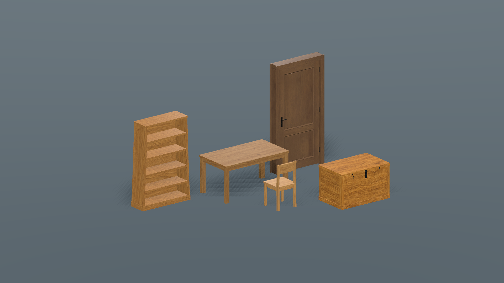
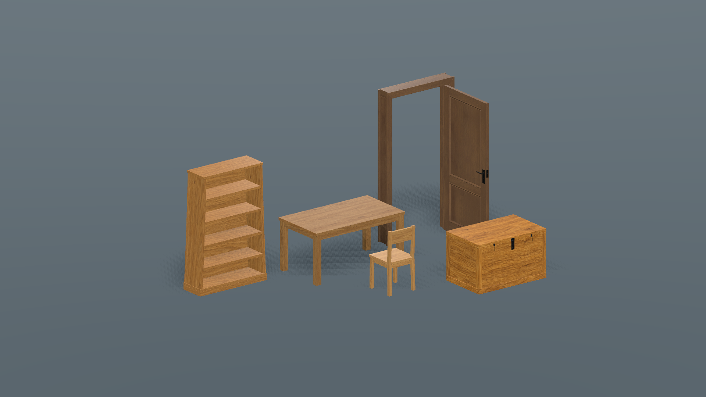

# BG5 runtime conversion evidence — 2026-10-31

Godot 4.7.2 Windows, RTX 4050, asset changes based on `cce00e89`. The existing
combined native libraries are unchanged. Run manifests retain the dirty-source
revision, driver and PCK hashes; the bake receipt identifies exact model outputs.

| Check | Result and retained evidence |
| --- | --- |
| Source assets | [74 checks, zero failures](source/console.log), [manifest](source/run.json): six real loose GLBs, shared meshes, material consolidation, mipmapped VRAM textures, geometry LODs, legacy packets, dimensions and native registration. |
| Exported assets | [75 checks, zero failures](pack/console.log), [manifest](pack/run.json): same checks from the PCK plus exclusion of editable masters. Test driver and historical save fixtures are external; runtime code and assets resolve from the PCK. |
| Existing door/mod contract | 58 checks each in [debug](content_debug/console.log), [native release](door_content_release.log) and [exported pack](content_pack/console.log). Both door types retain native storage, independent IDs and exact closed transforms. |
| Actual disk saves | Separate-process [create](save_create/console.log), [missing mod](save_missing/console.log) and [reopen](save_reopen/console.log). Missing content blocks writes and preserves the original save hash; re-enabled content restores both opened doors and saves them closed. Only a unique disposable fixture slot was used. |
| Existing interaction/collision | [Native component](door_component/console.log) and [normal-world second door](mod_world/console.log) pass. The noncapturing world fixture exercises catalog, paid placement, interaction service, native hinge, health, zombie permission, dismantling and cleanup; it does not simulate physical keyboard focus. |
| Packaged rendered preview | [Log](preview_pack/console.log), [manifest](preview_pack/run.json), images below. Native door opens/closes and the separate frame stays fixed. Peak sampled process private commit 1.04 GiB, dedicated GPU allocation 0.38 GiB. |
| Normal-world resource budget | [Manifest](mod_world/run.json): peak sampled process private commit 2.50 GiB and dedicated GPU allocation 1.14 GiB, within current project budgets. |
| Distribution | [Startup smoke](pack_smoke.log) and [budget](distribution_budget.json): 469,003,819 bytes for the measured runnable distribution, including the 439,576,052-byte PCK. |
| Standalone full-addon ZIP | **Failed**: [resource-loading log](failures/standalone_bundle/load.log), [result](failures/standalone_bundle/result.json). Existing packaging rules omit presentation, world-generation, ecosystem and vehicle dependencies of unchanged runtime scripts. This does not qualify the current standalone structures ZIP. |

The asset test stores 10,000 supplied door leaves without per-placement scene
children. Furniture AABBs match the prior mesh sizes and their collision-box
metadata was compared exactly against `cce00e89`. No native source, DLL, stable
model ID, hinge packet or save format was changed by this conversion.

These are scoped engineering checks. They preserve batching, LODs and bounded
work; they do not establish identical frame times to the old box art or qualify
every dense world. Human art approval is still open. Automatic frame placement
and chest lid animation are excluded from this conversion, as recorded in
[the contract](../../BG5_RUNTIME_ASSETS.md) and foundation status.

## Inspected packaged images

Closed door, separately registered stationary frame, bookshelf, table, chair and
chest. All five replacement meshes render with their supplied materials. This
isolated inspection stage demonstrates fit and materials, not settlement design.

The moving leaf turns around the historical hinge axis; the frame is unaffected.
The existing world does not gain this frame automatically. Images were captured
from the supplied CC0 assets with the repository's original diagnostic stage.

## Rejected intermediate checks and corrections

- [Initial constructor error](failures/initial_basis_constructor.log): replaced
  an unsupported scalar Basis constructor with an exact axis rotation.
- [Initial merge](failures/initial_surface_merge.log): direct ImporterMesh merge
  retained nine surfaces for the three-material leaf. SurfaceTool now normalizes
  vertex formats before consolidation; the leaf has three surfaces.
- Windows destination publication failed both during a
  [concurrent preview](failures/concurrent_preview_file_lock.log) and a later
  [serial attempt](failures/windows_publication_lock.log). The bake now stages
  outputs; Python publishes after the engine exits. The evidence does not prove
  concurrency was the sole cause. The final [mesh bake](mesh_bake.log) passed.
- [Furniture registration fixture](failures/sealed_registration/console.log):
  the test registered furniture after restoring/sealing the model registry.
  Registration now precedes restoration, matching the real world lifecycle.
- [First packaged GLB check](failures/scene_remap_export/console.log): Godot's
  scene import omitted the raw GLB files, despite the include filter. Portable
  GLBs now use `importer="keep"`, and the bake checker rejects scene remaps.
  All six loose GLBs subsequently passed from the exported PCK.
- [Full-addon ZIP](failures/standalone_bundle/load.log) remains unresolved:
  `tools/package.py` and the failing preload sites are unchanged from the base
  revision. The runtime GLB pack and game PCK pass independently. Repairing the
  broader addon dependency closure is tracked in foundation status; no claim of
  complete standalone-addon validation is made here.

Reproduction commands are in [BG5 runtime assets](../../BG5_RUNTIME_ASSETS.md).
Logs from earlier unsuccessful checks remain visible; later passes do not erase
their scope or imply user visual acceptance.
