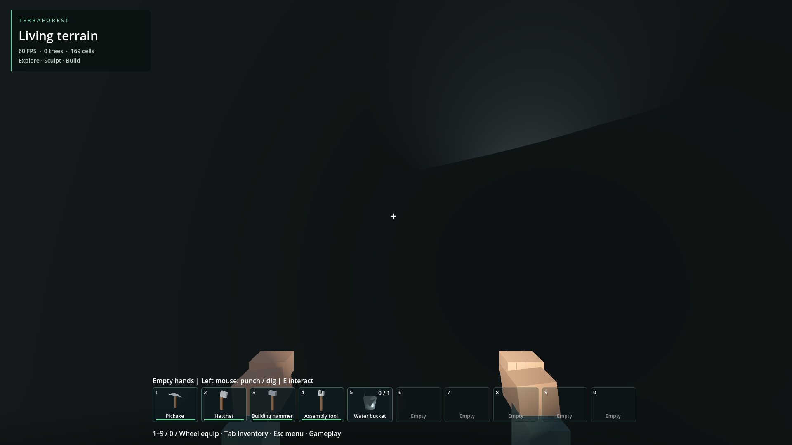
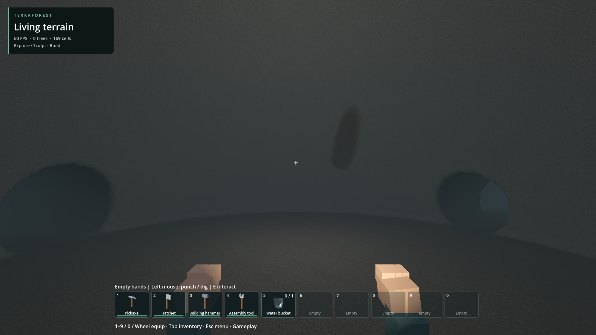

# Regional chamber world, generator 8

The new immutable base profile keeps regional road/site layout, existing ore fields and lake basins, and replaces the pipe/bowl cave composition with four networks of three domed chambers each. Main rooms have radius 32–39 m, secondary rooms 22 m, alcoves 18 m. Four arched passages connect the entrance and rooms per network: 28 primitives total. A shared floor datum clips chamber volumes into domes; passage floor heights interpolate between endpoints to meet room floors. Density, meshing, collision and lighting queries use this same native field. Conservative capsule envelopes remain valid around the clipped volumes. No separate cave mesh or runtime scene objects are introduced.

Generator 8 has its own save/cache identity. Existing profiles 1–7 retain their fields. Generator 1–5 binary fingerprint checks, generator 6 identity checks and generator 7 regional checks pass. Native tests verify supported wide chamber floors, high domed ceilings, seeded variation, save restoration and regional metadata. Debug/release binaries rebuilt against prebuilt godot-cpp.

The full regional preparation creates and freshly reopens the sixteen furnished buildings, roads and residents under generator 8. The verified save is copied without overwrite to generated_world_v3; Prepare/Play Generated World.cmd now use that slot. Prior generated_world and generated_world_v2 remain intact. No in-place migration of existing terrain is attempted.

An actual saved-world chamber check streams the chamber through the normal loading gate and confirms nine collision rays across a 30 m square find a level floor within 0.2 m, normals above 0.98. Main chamber centre for seed 1703 is (603,60,398). The normal headlamp view is very dark; the separately labelled geometry inspection uses a test-only unshadowed point light to reveal the dome and passage openings. That light is not part of gameplay or the saved world.

Limits: entire entrance-to-room routes and other seeds are not walk-qualified. Dome shapes and broad flat floors are still simple; natural detail, lighting, destination design and ore accessibility need work. Existing small lakes are unchanged. No cave performance qualification is claimed; startup and arrival hitches remain in retained logs. The screenshot HUD is not performance evidence.

## Normal gameplay headlamp

## Geometry inspection only: added test light

