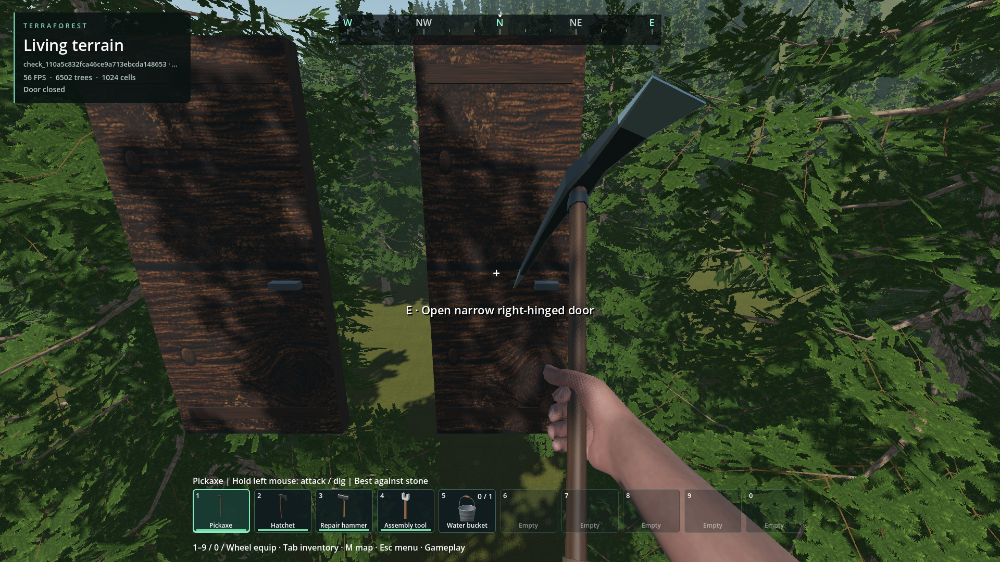

# Door content verification — 2026-10-30

Scope: Godot 4.7.2 Windows, isolated door checkout based on `19fef843`, with
door changes listed in each run manifest. Native source build records include
library hashes. These checks precede the concurrent model-horizon integration;
its combined binaries require their own validation after the source handoff.

| Check | Result and evidence |
| --- | --- |
| Native/content debug | 58 checks, zero failures: [log](content_debug/console.log), [manifest](content_debug/run.json). |
| Extracted native release | 58 checks, zero failures: [log](door_content_release.log), [result](door_content_release.json). |
| Exported pack | 58 checks, zero failures: [log](content_pack/console.log), [hashes/manifest](content_pack/run.json). Built-in JSON, example and addon code come from the PCK; a disposable loose GLB loads at runtime. Only the test driver and historical binary fixtures are external. |
| Real disk saves, separate processes | [Create](save_create/console.log), [missing mod](save_missing/console.log), [reopen](save_reopen/console.log). Both open doors restore exact model/hinge bytes; close to original transforms and save again. Missing content disables writes and preserves the original file SHA-256. |
| Existing door | [Native collision/component](door_component/console.log) and [world E interaction](door_world/console.log) pass. |
| Second door in main world | [Log](mod_world/console.log), [manifest](mod_world/run.json): catalog, paid five-wood placement, HUD, E open/close, 75 health profile, explicit zombie restriction, two-wood dismantling and hinge cleanup pass. |
| Existing NPC interaction | [Zombie attack/destruction](zombie/console.log) and [actor route contract](actor_routes/console.log) pass. |
| Export startup | [Smoke](pack_smoke.log), [distribution budget](distribution_budget.json). |

Content checks include an actual legacy model/hinge packet generated with the
pre-change DLL (see [fixture provenance](../../../tests/fixtures/door_legacy/provenance.json)),
independent placement ID 7 in two types, old worlds with no mod type, changing
hinge-profile rejection, strict replacement/admission failures, nested static
GLB transforms and embedded textures, visual-only replacement followed by save
restore, 150-degree intermediate sweep obstruction and 100 drift-free cycles.
10,000 placements add no scene nodes. This verifies retained native storage and
bounded click-time work, not a dense-world frame-time guarantee. Future supplied
GLBs require their own cost and appearance checks.



The inspected 1920×1080 integration fixture shows the original door at left and
the narrower mod door at right, with its correct HUD prompt. The test places
them above the forest to isolate interaction; it is not settlement composition
or replacement-art acceptance. Screenshot created from the existing project
assets; their existing provenance/licenses remain unchanged.

## Reproduce

Use the repository Godot launcher and an installed Godot 4.7 Windows engine:

```text
python tools/build_native.py --addon structures --target all
python tools/run_godot_check.py door_content --headless --timeout 40 --require failures=0
python tools/test_native_release.py --addon structures --test door_content --godot <engine>
python tools/run_godot_check.py door_component --headless --require failures=0
python tools/run_godot_check.py door_world --require failures=0
python tools/run_godot_check.py door_mod_world --require failures=0
python tools/run_godot_check.py zombie_door_interaction --timeout 120 --require failures=0 -- --zombies
python tools/run_godot_check.py actor_route_contract --headless --require failures=0
python tools/export_pack.py --godot <engine>
python tools/check_door_content_pack.py
```

Run `door_content_storage` headless three times with the same NEW
`--door-content-slot=door_content_check_<unique>` argument (after `--`): first
create, then add `--missing-doors`, then `--reopen-doors`. The test refuses an
existing slot on create, writes only that owned fixture and removes it after a
successful reopen/shutdown. Never substitute a real world slot. Existing door
world checks use temporary worlds. The GLB fixture is generated from two boxes
and a 2×2 embedded texture, then removed; no replacement GLB is shipped.

## Retained failures and corrections

- [Release dependency](failures/release_missing_dependency.log): the extracted
  test project omitted `fullscreen_policy.gd`; the release harness now copies it.
- [Headless input](failures/headless_input/console.log): the integrated simulated
  E/HUD driver requires a rendered viewport. Rendered reruns pass.
- [Zombie disabled](failures/zombie_disabled/console.log): persisted developer
  settings disabled spawning; rerunning with explicit `--zombies` passes all 14 checks.
- [Save-fixture cleanup](failures/fixture_cleanup/console.log): the test removed
  its sidecar before shutdown/resave. Cleanup now follows completed shutdown;
  the full three-process sequence passes. No user world was involved.
- [Pack report path](failures/pack_report_path/console.log): importer assertions
  passed, but the external test tried writing its report into read-only `res://`.
  The package runner now redirects only test output and binary-fixture paths;
  the full packaged run exits successfully.

Other platforms, arbitrary GLB extensions, new artwork, general scripted objects,
hot reload and automatic save migrations are outside this verification.
