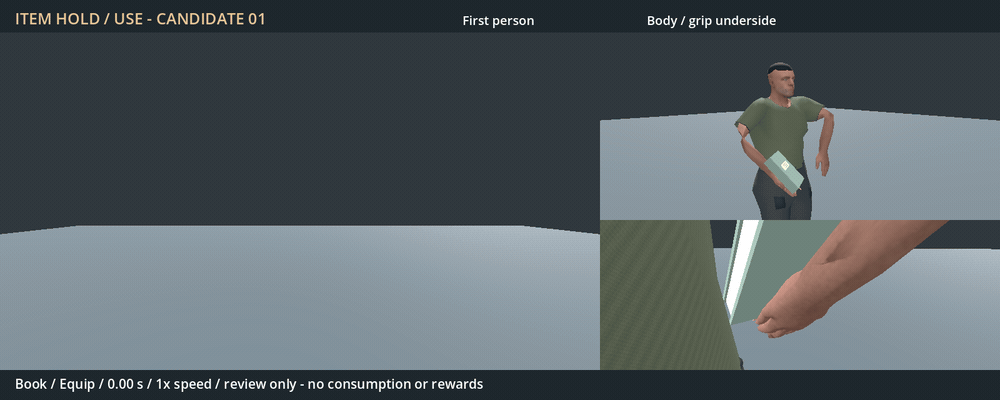

# Generic-item hold/use candidate 01 — 2026-11-04

Status: authored and checked; player visual approval pending. Gameplay remains
unchanged. The new actions are deliberately kept in the excluded authoring
folder and loaded only by preview/validation tools.



[Full-resolution MP4](Generic-item.preview.mp4): 9.6 seconds at normal speed.
Book 0–3.2 s, bread 3.2–6.4 s, neutral object 6.4–9.6 s. Each appears in the
right hand through a short equip, holds, lifts for use/inspection, then returns.
Left is first person; upper right is side/front body motion; lower right tracks
the hand/object underside to show support and attachment.

Captured in Godot 4.7.2 Forward+ on RTX 4050, in a controlled neutral stage with
75-degree, 16:9 first-person framing. No world/seed or player save. This samples
authored motion and does not measure real-time performance.

## Authored behavior and scope

- `FP_Item_Hold`: 2.0-second loop with a subtle carry motion.
- `FP_Item_Equip`: 0.45-second raise from below the view into the hold.
- `FP_Item_Use`: 1.3-second lift/present/return, keeping the wrist aligned with
  the forearm and the elbow below the shoulder.

The hand is an open palm-up cradle, with soft fingers and an opposed relaxed
thumb. The original 59-bone R11 rig and repaired hand body are reused. Upper-arm
roll is preserved from the fitted reference; forearm and hand supinate together.
The left hand, body and feet retain their carry pose. Objects use a RightHand
attachment, with one fixed local transform per object. The preview fits each
mesh's actual underside against the cradle once on selection, preserving the
book/bread's existing authored dimensions. It does not refit every frame.

The book and bread are the existing CC0 assets, unchanged. The blue neutral box
is an original demonstration proxy. These demonstrate a shared hold and lift;
they do not prove an automatic grip for every future shape. The book remains
closed and the loaf remains whole. Opening/reading pages, taking bites, actual
consumption, rewards, item removal and gameplay dispatch are outside this
review candidate. The original sleeve/skin finish is retained.

## Verification

24 scoped checks pass. The importer verifies all 59 rest bones against the
unchanged runtime skeleton, maximum error 0.000000241. The audit samples 453
keys/half-keys at 120 Hz across all three clips: wrist bend below 0.001°, maximum
joint half-key step 2.32°, elbow at least 97.04 mm below shoulder, stable fingers,
fixed root/body/free hand, and matching hold/use/equip endpoints.

Actual CPU-skinned runtime hand geometry is also checked at hold, mid-equip and
raised use for all three props. The closest skin/underside distance stays about
1 mm, without sampled penetration or attachment drift. This checks the actual
mesh underside, including the bread's curved base, instead of an AABB alone.
[Full results](checks.json), [conversion results](import.json) and
[exact sources, geometry and hashes](evidence.json) retain the evidence.

Early local staging placed the hold too low and used a shared plane that made
the curved loaf float. The candidate now raises the carry and fits each actual
underside. These checks support the preview; they do not substitute for player
approval or establish universal anatomical/third-person quality.

## Remaining / resume here

Player review of hand appearance, item position and the simple lift/use is the
next requirement. Return on approval or requested changes. After approval,
separately connect inventory/catalog item presentation and the existing native
use/consumption/reading events, with cancellation, item ownership and transition
checks. Retain the universal drop/persistence behavior and actual item metadata.
No item schema, game input, consumption behavior or runtime library has changed
in this candidate. Dedicated open-book/eating behavior needs its own decision.

## Reproduce

From `TerraForest`, using the existing external Blender, Godot and FFmpeg:

```powershell
& 'C:/Program Files (x86)/Steam/steamapps/common/Blender/blender.exe' --background --disable-autoexec addons/characters/authoring/Human.torch.blend --python-exit-code 1 --python tools/author_item_use.py
godot --headless --path . --script res://tools/import_item_use.gd
godot --headless --path . --script res://tests/item_use_candidate.gd
godot --path . --resolution 960x600 --script res://tools/preview_item_use.gd
python tools/encode_item_use_preview.py
```

Editable source: `addons/characters/authoring/Human.item_use.blend`. Animation
library: adjacent `Human.item_use.res`. Exact asset paths, retained inherited
provenance, original motion CC0 dedication and separate 0BSD code terms are in
`Human.item_use.LICENSE.txt`. No native build, package export or user-save change.
