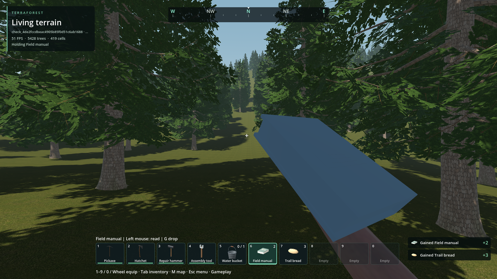

# Generic held-item baseline integration — 2026-11-04

The user explicitly requested retaining and integrating candidate 01 as a
baseline despite its stiff appearance, then trying to improve it separately.
Original source/preview commit: `bc5de4ae`. The runtime library is an unchanged
copy, SHA-256 `83e0a9008d4661a97809874f8d72b82617e6eedada52485d8d53ef583efb1c15`.

Existing six book/food meshes now appear in the hand. Other non-tool items get
a neutral visual fallback, including future registered IDs. Real tool/gun/bucket
presentation is preserved. Existing lower-body walk/run/jump/crouch is composed
with the baseline upper hold so third-person legs remain functional. The motion
is an explicitly imperfect art baseline, not finished hand/third-person quality.

Left-clicking a held book/food starts the 1.3-second gesture. One completed
gesture calls the existing native HUD/survival/inventory transaction once.
Opening UI, changing equipment, losing focus, changing native slot ownership or
reloading cancels pending use without consuming/granting anything. The full-food
refusal skips the gesture and keeps the ration. Inventory-dialog use retains its
existing immediate native transaction. No save schema, native reward or inventory
item definition changed. Arbitrary fallback objects do not gain invented uses.

Temporary native forest fixture, Godot 4.7.2 Forward+ / RTX 4050, ordinary belt
selection and mouse use. No seed override or saved-player world. This shows the
integrated baseline, not a new art acceptance. Exact inputs and logs are in
[qualification](qualification.json).

## Verification and limits

- Presenter integration: 68/68, all six meshes, generic/future IDs, equip/use
  timing, one completion, cancellation, tool switching and lower-body carry.
- Real world: 24/24, book visibility, mouse use, native XP/food, final-stack
  disappearance, full-food refusal, equipment/UI/focus/ownership cancellation.
- Native survival: 31/31. Animation/skin baseline audit: 24/24.
- Universal drops 440/440, physical drops 77/77, actual G-input 32/32.
- Shared tool/torch attack timing 39/39 remains valid.

The broader existing survival UI test still fails its trader purchase/scroll
assertion (19/20); its food/reading assertions pass. That separate HUD/trader
code was not changed, and both headless and graphical failed logs are retained.
This failure is not claimed resolved by the hand integration. The first world
attempt also exposed the old tool-only ID filter, which passed ordinary objects
as empty hands. The filter was removed; the subsequent real-world run passed.

Remaining art: [stiff hand issue](../../../../issues/generic-item-hand-pose/README.md).
The separate revised asset must be inspected and reviewed before replacing this
runtime library. No native rebuild, package export/install or player save change
is claimed. Godot identity import uses the existing temporary raw Kaino audio
exclusion, removed immediately afterward; unrelated WAVs are not qualified here.
