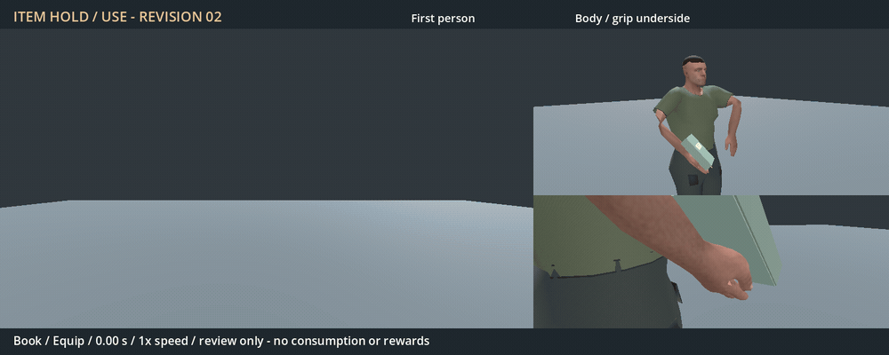

# Generic item motion — revision 02, first version preferred

Review decision, 2026-11-04: the user found the first version better as an
animation and requested keeping it active. Revision 02 is not selected for
integration. Its sources, preview and checks are preserved as a comparison;
capture metadata below retains its original pre-review status.

The requested baseline is integrated in `26f332e1`; the original authoring and
preview remain unchanged. This revision is stored separately in
`addons/characters/authoring/Human.item_use_v2.*`. Runtime still loads the exact
candidate 01 bytes, as selected by the user.

[Full-resolution video](Generic-item.preview.mp4), 11.4 seconds at normal speed:
book 0–3.8 s, bread 3.8–7.6 s, neutral object 7.6–11.4 s. Each equips, holds,
uses and returns. Left: 75-degree 16:9 first person. Upper right: body mechanics.
Lower right: tracking hand/underside view. Controlled neutral stage, Godot 4.7.2
Forward+ on RTX 4050; no world, seed override or player save. This renders
authored timelines and does not measure gameplay performance.

## Changes from the retained baseline

- The wrist flexes during the lift, with a small palm roll and torso turn.
- Fingers gently settle during equip and readjust during hold/use. Curls are
  deliberately small so a broad book does not pass through the fingertips.
- The free hand approaches beneath the item, pauses, then releases and returns.
  The arm is solved continuously from its resting wrist position.
- Equip takes 0.6 s, hold loops over 2.4 s, and use takes 1.6 s. Their endpoints
  join the same hold pose. Root, hips, feet and legs remain fixed in these clips.

The item has one fixed RightHand attachment. Its underside is fitted once per
mesh against the swept hand-skin envelope. There is no per-frame item sliding,
scale animation, reward, method or inventory event authored into these clips.

## Verification and remaining limits

The [28 scoped checks](checks.json) pass: 555 key/half-key poses, continuous arm
joints, fixed lower body, animated fingers, the free-hand approach and matching
endpoints. Maximum right-wrist flex is 10 degrees; elbows stay at least 10 cm
below the shoulder. The existing 59-bone rest rig matches within import tolerance.
Across 17 geometry samples per object, 1,091 actual runtime right-hand skin
vertices give at least 0.7 mm underside clearance; nearest contact stays within
3.5 mm. The sampled left-hand skin also clears the objects. Attachment drift is
below a micrometre. These are bounded geometric checks, not universal collision
or visual acceptance.

Earlier contact failures are retained in `contact-failure.log`,
`expanded-contact-failure.log` and `curl-failure.log`. The initial single-pose
mount let fingers enter the book. Fitting the swept envelope removed clipping;
wider sampling exposed excess book separation. Reducing curl/opposition kept
the same 5 mm contact criterion and produced the passing result. No acceptance
threshold was relaxed. [Exact inputs and hashes](evidence.json).

The assisting hand approaches rather than forming a fitted grip on every mesh;
it retains a small gap. The book remains closed and the food remains whole.
This generic gesture does not author page turning, biting or object-specific
finger closure. Passing these checks did not establish animation preference:
the user selected candidate 01. Further tuning is deferred until new feedback
in the [hand-pose issue](../../../../issues/generic-item-hand-pose/README.md).
Any future replacement needs explicit review and live item-use verification.
No package export is claimed.

New motion/data and review derivatives use CC0, with inherited body/rig and
existing consumable provenance retained in `Human.item_use_v2.LICENSE.txt`.
New author/import/preview/test/encoding code uses 0BSD. Blender, Godot and FFmpeg
are existing external development tools; no external assets were imported.
