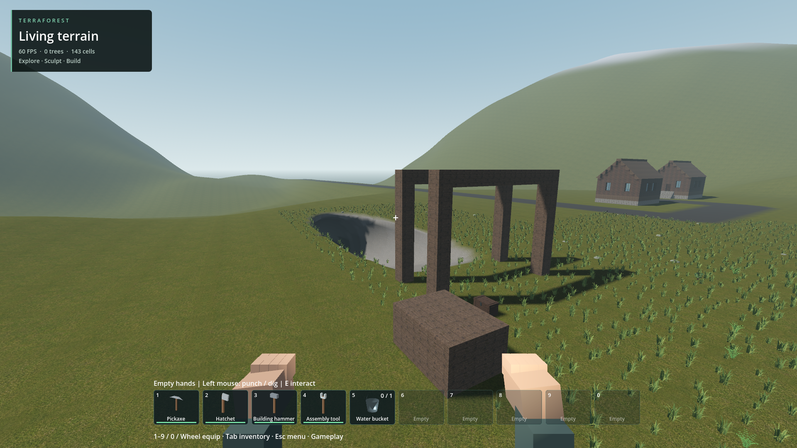

# POI-owned mine integration (partial)

Profiles 10/11 replace standalone networks with one mine owned by eastern site 2.
Metadata is shared by terrain and offline prefab placement. Profile 11 surveys the
underground footprint once to lower the floor below low terrain; profile 10 retains
its original identity. Common terrain meshing, native block batching and compound
save/reload are reused. No flow or water implementation was changed.

Four-seed field checks cover ownership, floor routes, roof material, exact save
restoration and shared layout. Full world create/reopen contains sixteen buildings,
a 74-block entrance/yard prefab and chest (10,637 total cells). Fresh-process
signatures match. Actual player descent and return pass at 1920x1080/cap60 in about
49 seconds: 1,841 physics ticks, 1,821 grounded. This is not frame-time qualification;
logs retain startup/streaming hitches. Branch traversal and interior visuals remain
unverified. Exterior screenshots retain both the original roof failure and fix.

The entrance is visually basic, vegetation encroaches into the work yard, and the
surrounding cottages are not yet an industrial location. Cellars remain unfinished.
Wider seed coverage and invalid siting handling remain open. Public launchers remain
on generated_world_v3; the reviewed development save is poi_covered_20261018.

Reproduce creation without replacing any existing save:
`python tools/prepare_combined_world.py --layout poi --destination my_mine_review`

