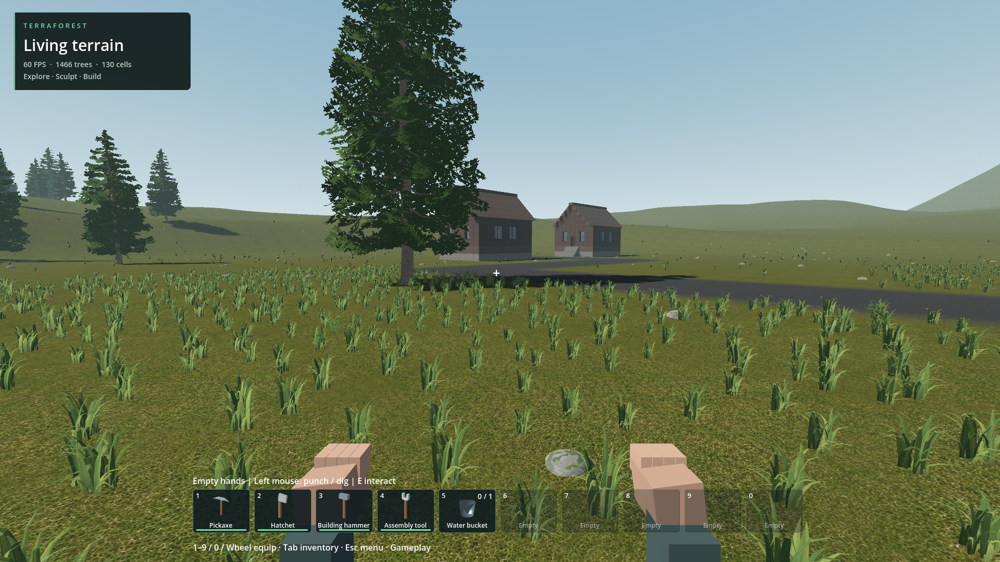

# Normal-world ground-cover density integration

2026-10-18. The nine nearest 32 m cells now use sixteen deterministic batches of 64 candidates, approximately one clump per square metre before exclusions. Forty surrounding cells retain the original sparse layer. Maximum procedural residency is 11,776 candidates plus existing authored placements. Added density is grass only; original flowers, stones, plants, shrubs and twigs keep their abundance and IDs. All original candidate positions and IDs remain unchanged; new IDs append a separate range below authored IDs. Saved removals can include those new IDs, and legacy snapshots remain readable.

Native C++ generates candidates, validates and packs each 64-item batch, persists removals and performs picking. Scene orchestration accumulates bounded batches and publishes one cell only after all layers pass support and exclusions. Terrain work remains one outstanding 64-query request. Movement changes density ownership; stale epochs, terrain revisions and exclusion revisions reject accumulated work. No grass physics bodies are created. Picker capacity is 1,280 per cell (1,024 natural plus 256 authored), with 49 cells maximum.

Checks pass: legacy scatter across all map owners; uniqueness and saved removal of added identities; streaming, edit invalidation, collection, teleport and adjacent-cell density changes; persistence validation; bounded picker queries and oversized-owner rejection. Existing tests' previous maximum-ID and 320-proxy boundaries were updated to the new documented limits after they correctly rejected the changed expectations. Native debug/release rebuilt using the existing prebuilt SDK.

The actual generated_world_v2 was opened read-only at 1920x1080. All nine near cells completed, 10,017 items were resident after exclusions, and zero batches were rejected. Ground-level screenshot inspected: visibly denser grass with the asphalt clear. Short stationary 180-frame sample after settling: median 16.664 ms, p95 16.785 ms, max 16.844 ms. This is not a travel, GPU power, older-laptop or endurance qualification. Density boundaries can still visibly transition; loading arrives in batches and is not instant. Full art direction and ecological distribution remain unfinished.

No save regeneration required. Existing object removals persist. Older binaries cannot read removals from the added ID range; use the updated addon binaries with updated saves.

