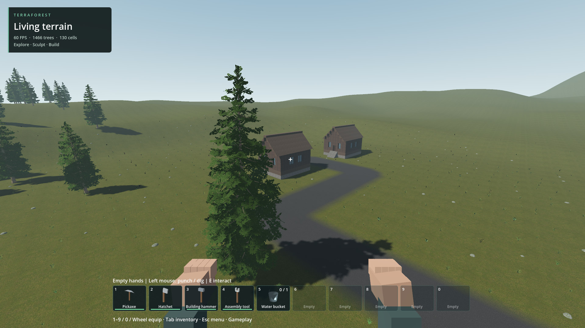

# Regional temperate ground

The original terrain shader divided the map into four demonstration quadrants near x/z=1000: grass, gravel, sand and snow. Regional settlement sites straddled that material boundary, producing broad grey/white ground unrelated to their woodland setting.

Generator 7 now selects temperate grass for natural lowland surfaces and enables the existing altitude-based mountain snow blend. Asphalt and exposed substrate/ore retain their existing paths. Older generator profiles retain the quadrant palette. The selection is applied on successful startup/reload using the saved generator identity. No geometry, persistence identity, textures, runtime passes or native DLLs change. Lowland natural terrain samples one triplanar texture instead of blending demonstration quadrants near their boundary; no GPU savings claim is made without an A/B benchmark.

Actual saved-world read-only view at the western site passes with no engine/script errors. Before/after images confirm the grey quadrant is removed and asphalt retained. First run records a roughly nine-second controller-loading stall; its cause is not established. Repeat stationary sampling after 120 settling frames: 180 frames, median 16.665 ms, p95 16.798 ms, max 16.922 ms. This short capped stationary view does not qualify travel, startup, sustained performance or older laptops.

Ground-cover scarcity remains: native candidates currently use 64 points per 32x32 m cell on a jittered four-metre grid, before species selection and exclusions. That default is much sparser than the accepted density review and needs a compatible native scatter revision with stable editable identities, bounded residency and combined rendering checks.

