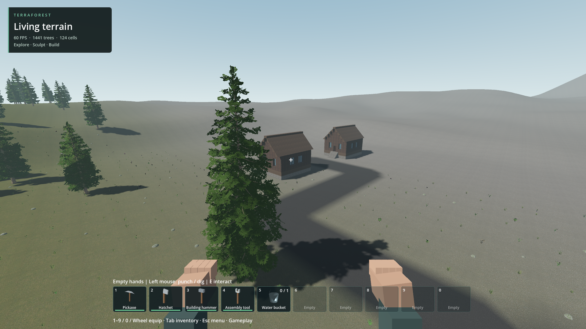

# Five-site regional generation

2026-10-18. The regional preparation workflow now adds two furnished cottages at each of four outer sites, retaining the central eight-building district: sixteen buildings and 10,563 authored block cells. Each local street connects to the native arterial through explicit graded asphalt segments. The immutable generator 7 base is unchanged.

The verified run creates the world, returns to the central spawn, saves, and reopens in a fresh process. Exact per-region block checksums, furnishings, street anchors, two central patrol residents/orders and spawn match. Canonical region checksums compare resident and unloaded data, so paging cannot masquerade as missing blocks. The verifier covers the current generated map's 0..2048 horizontal and 0..256 vertical domain; it is not a universal unbounded-world snapshot verifier.

Read-only visual check of the saved western site passes at 1920x1080. It displays both cottages and the street connection. It also exposes sparse vegetation, broad bare-looking graded terrain and simple repeated buildings. These are two-house settlement starts, not finished towns. The screenshot's 60 FPS is not sustained performance evidence; startup, travel and offline grading hitches remain in the logs.

The updated Prepare/Play Generated World launchers use generated_world_v2. The verified regional_towns_20261018 save was cloned there without overwrite. The previous generated_world and human saves remain available. Explicit offline preparation defers periodic autosave until the batch's normal final compound save; gameplay autosave is unchanged.

Two failures are retained: the original resident-only block signature failed after paging; a subsequent run collided with autosave between survey and grading. Both were rejected before publication. The final full create/reopen run passes. This does not qualify full-map driving, all-seed generation, crowds or older-laptop thermals.

Next priorities remain integrated world quality: distinct destinations and meaningful settlement layouts; chamber caves and substantial lakes under versioned generation; normal-world vegetation coverage; short combined travel and frame-tail checks. Water implementation and food remain deferred.

