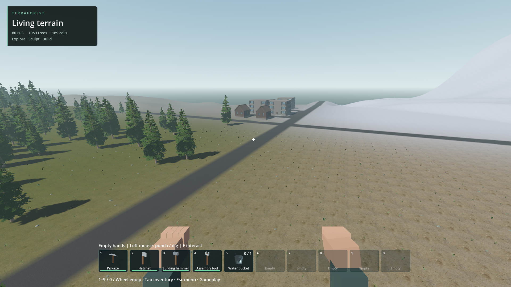

# Regional world generation: first integrated stage

2026-10-18. Generator 7 adds a native seeded layout of five graded settlement sites and four asphalt arterials. This is an incomplete map foundation, not a completed city/world or performance qualification.

## Verified

- Seed 1703: 3,080.13 m of roads; 196 road samples reject natural vegetation roots; maximum sampled grade 3.06%. Five sites have level central footprints. Native mesh contains asphalt material.
- Base layout saves in 36 bytes with no authored terrain pages. Layout survives native serialization and changes deterministically with seed. Existing generator 1–5 fingerprints and generator 6 cave checks pass; existing asphalt paint persistence passes.
- Actual fullscreen 1920x1080 creation and fresh-process reopening pass. The central district contains eight furnished buildings, 6,771 block cells and two patrol residents. Checkpoint compares stored structures, furnishings, roads, patrol orders and player spawn.
- Created in a unique staging slot, reopened before publication as regional_review_20261018, then cloned without overwriting to generated_world. Existing gameplay saves are untouched.
- Read-only visual inspection confirms the arterial crossing and district in the saved world. Play Generated World.cmd dry-run passes. Prepare Generated World.cmd creates a fresh generated_world only when that destination is absent.

## Limits and next work

Four outer sites remain empty. The central district needs proper local street connections and richer destinations. The existing four small basins and twenty cave capsules are retained, not redesigned into large lakes or chamber caves. Vegetation remains too sparse in the normal world. The launcher browser's generator 7 preset creates terrain/layout only; the preparation launcher adds the furnished district.

Preparation takes about 66 seconds in this run. Logs retain startup/teleport stalls and long offline authoring calls; a screenshot at 60 FPS does not qualify runtime frame tails, high-speed travel, older laptops or thermal sustainability. Only seed 1703 receives the full integrated check. Native debug and release build with the prebuilt SDK; runtime checks use debug.

Next: populate outer settlement sites, connect local streets and distinct exploration locations, then extend coordinated caves/lakes/vegetation with short combined traversal checks. Changing the published native base field requires a new generator identity to preserve saves.

Failed attempts are retained: opcode 31 conflicted with an existing water query (new metadata now uses 34); the mouse-aimed district survey crossed the arterial and failed. Explicit shared-layout placement fixed that failure. Neither failed staging run was published.

