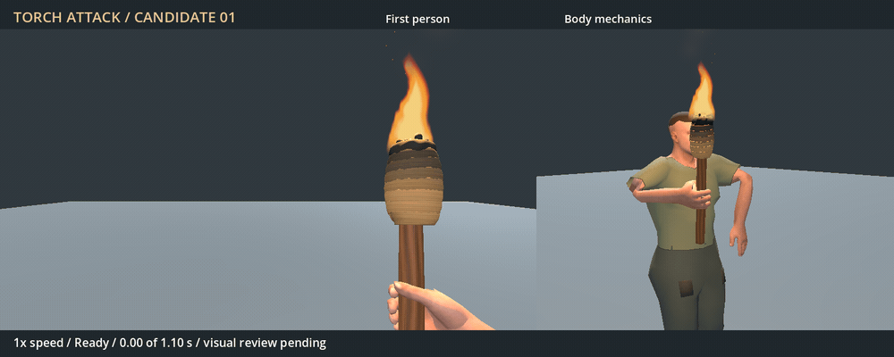
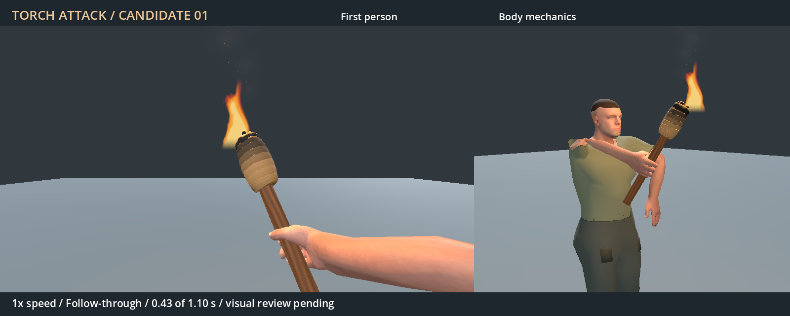

# Torch attack candidate — 2026-11-04

Status: authored and checked; player visual review pending. Gameplay integration
waits for acceptance of this specific preview. This is a simple 1.10-second
right-hand diagonal strike: pullback to 0.25 s, strike to 0.433 s, follow-through
to 0.533 s, then recovery to the existing carry pose. Frame 26 is a proposed
visual contact pose, with no embedded gameplay event.



[Full-resolution MP4](Torch-attack.preview.mp4) shows two normal-speed swings
followed by a half-speed swing. Left: existing runtime first-person character,
75-degree FOV and 16:9 view. Right: the same motion viewed from the side/front
to inspect the grip and elbow. Captured in Godot 4.7.2 Forward+ on RTX 4050,
in a controlled neutral stage. Frame stepping renders authored motion; it is
not a performance measurement or recording from a saved world.



The static equipment mesh and existing carry library remain unchanged. The new
`FP_Torch_Swing` is in a separate authoring-only AnimationLibrary, loaded only
by the review tools/test. There is no attack dispatch, damage, fire spread,
target response or new audio. Original low-poly character/clothing and the
existing billboard flame are retained; the flame stays upright during the swing.
The earlier carry-hand review remains pending in the existing
[hand issue](../../../issues/torch-hand-deformation/README.md).

## Verification and remaining review

`tests/torch_attack_candidate.gd`: 11/11 checks pass. Samples 133 keys and
half-keys at 120 Hz using the actual runtime body and hand-mounted torch:

- Maximum wrist bend 32.91 degrees; maximum joint half-key step 6.60 degrees.
- CPU-skinned hand clearance at least 0.223 mm outside the authored shaft.
- All five finger pads stay near the grip; rigid attachment drift below 0.001 mm.
- Both endpoints match carry, and body, feet and left hand retain their poses.
- One non-looping 1.1-second clip with pose tracks only; no gameplay events.

The importer verifies all 59 R11 rest bones (maximum error 0.000000241).
[Full sampled checks](checks.json) and [artifact hashes](evidence.json) retain
the scoped evidence. Early local drafts were adjusted after first-person
cropping, a high elbow and a rapid elbow-plane turn were observed. Bounding
the bend-plane orbit resolved the turn while retaining the fitted grip.

Required next step: player acceptance or requested visual changes to this
preview. After acceptance, separately integrate attack dispatch/contact timing
and verify cancellation, equipment changes and gameplay behavior. Those checks
are not claimed here. No player save, native library or game package is changed.

## Reproduce

From `TerraForest`, use the existing external Blender, Godot and FFmpeg:

```powershell
& 'C:/Program Files (x86)/Steam/steamapps/common/Blender/blender.exe' --background --disable-autoexec addons/characters/authoring/Human.torch.blend --python-exit-code 1 --python tools/author_torch_attack.py
godot --headless --path . --script res://tools/import_torch_attack.gd
godot --headless --path . --script res://tests/torch_attack_candidate.gd
godot --path . --resolution 960x600 --script res://tools/preview_torch_attack.gd
python tools/encode_torch_attack_preview.py
```

Editable source: `addons/characters/authoring/Human.torch_attack.blend`.
New motion is CC0-1.0; new scripts are 0BSD; inherited assets retain their
existing notices. Exact provenance and the request are retained in
`Human.torch_attack.json` and `Human.torch_attack.LICENSE.txt`.
