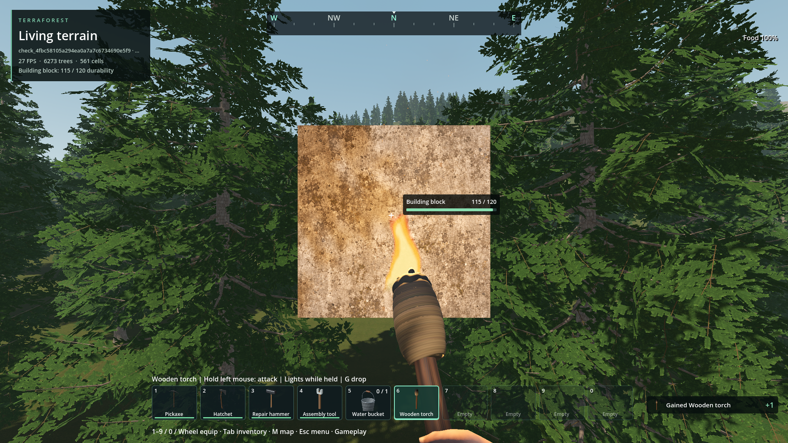

# Torch attack integration — 2026-11-04

The user requested integration of revision 02 for first-person use, while
explicitly deferring third-person fixes. The existing human/tool presenter now
loads `runtime/assets/Human.torch_attack.res`; promotion verifies the reviewed
revision's SHA-256 and copies its animation library byte-for-byte. No motion,
carry library or equipment mesh was changed during integration.

Hold left mouse to attack. Contact occurs once at frame 26 (0.433 s), with a
1.10-second complete recovery. The shared world adapter performs the live
reach/occlusion query at that contact, applying base damage 5 to stone/wood and
10 to other targets/zombies, subject to existing skill modifiers. Zombie impact
type is ordinary blunt melee. No fire status/spread, new audio, fuel consumption
or durability schema is added; the existing non-durable torch remains intact.



Source-world controlled fixture in the generated forest, Godot 4.7.2 Forward+
on RTX 4050, 1920×1080. Temporary unique check slot, no seed override or saved
player world. A real native concrete block shows 115/120 durability after one
5-damage hit. The test pauses the motor for this airborne fixture; the ordinary
mouse event, attack admission, AnimationPlayer, live query and native durability
are used. This is gameplay integration evidence, not a terrain/art/performance
acceptance claim. The zombie fixture uses actual streamed ground and normal
skinned zombie picking. [Images and exact artifacts](evidence.json).

## Checks

- Torch live-world integration: 31/31, including real left mouse, harmless windup,
  exact single contact, recovery, misses, repeated held input, real zombie health,
  and cancellation on equipment, inventory and focus changes.
- Shared animation timing: 39/39, including all authored tools, torch equip lock,
  slowed playback, contact timing, recovery and hidden-tool cancellation.
- Animation/skin review audit: 15/15; runtime library matches the reviewed library.
- Torch carry/effects: 28/28; carry-hand deformation/transitions: 36/36.
- Universal item drops: 440/440; physical drops: 77/77; real G-input standard: 32/32.
- Runtime addon bundle includes the animation and its adjacent notice; offline
  notices match their retained sources. Icon/drop dependency receipts refreshed.

[World results](world-checks.json), [retained logs and qualification](qualification.json).
The first world fixture left zombies disabled and failed its admission check;
that failed run is retained, then the fixture was corrected and rerun. The final
31-check run verifies zombie damage and held repeat. No native rebuild or package
export/install is claimed. Editor identity import used the existing temporary
Kaino raw-audio exclusion, restored immediately afterward; it does not qualify
those unrelated WAVs for import.

## Remaining / reproduce

Third-person presentation is explicitly unfinished. The shared functional clip
still plays in that view. Resume on a dedicated third-person art request, retain
first-person behavior/contact timing, inspect multi-angle full-body skin/pose,
then seek third-person acceptance. Track this in the
[motion issue](../../../../issues/torch-attack-motion/README.md).

```powershell
godot --headless --path . --script res://tools/import_torch_attack.gd -- --promote-approved-first-person
godot --headless --path . --script res://tests/attack_animation_timing.gd
godot --headless --path . --script res://tests/torch_attack_candidate.gd
python tools/run_godot_check.py torch_attack_world --timeout 180 --require 'TORCH_ATTACK_WORLD checks='
```

The runtime asset's CC0 motion and inherited provenance are identified in its
adjacent `Human.torch_attack.LICENSE.txt`; new source/test/tool code is 0BSD.
