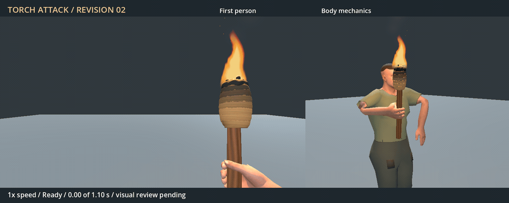

# Torch attack revision 02 — 2026-11-04

Status: accepted for first-person integration at the user's request on
2026-11-04; third-person presentation explicitly deferred. Replaces the rejected
first draft while preserving [candidate 01](../README.md) and its images.
These captures/checks describe the review milestone before gameplay integration.
[Integration evidence](../integration/README.md) and
[issue / third-person follow-up](../../../../issues/torch-attack-motion/README.md).

[Full-resolution MP4](Torch-attack.preview.mp4): two normal-speed swings followed
by half speed. The controlled Godot 4.7.2 Forward+ stage uses the existing R11
body, hand attachment and torch mesh. First person is 75-degree FOV, 16:9;
the side/front camera uses the same placement as candidate 01. RTX 4050.
Deterministic pose capture, no world or player save, no performance claim.

The elbow now follows a low outward path independent of the tool angle. Upper
arm and forearm keep the carry pose's bone roll, instead of rebuilding the
upper-arm frame from a changing hinge. The torch follows the resulting hand,
with a bounded wrist flex. This removes the raised elbow and severe shoulder
pinching seen in the first draft; it also keeps the forearm out of the large
first-person bulge. The torch sweeps forward/down, with modest torso rotation
and free-arm counter motion. Continuous Hermite tangents carry velocity through
contact instead of easing to a stop at every authored waypoint.

## Verification

All 15 scoped checks pass across 133 key/half-key samples. The expanded checks
also evaluate 389 actual CPU-skinned shoulder/sleeve triangles, instead of only
checking the hand. The rejected first candidate fails four of these checks.

| Measurement | Rejected 01 | Revision 02 |
| --- | ---: | ---: |
| Maximum upper-arm turn from carry | 142.52° | 39.38° |
| Minimum elbow drop below shoulder | -147.52 mm (above) | 98.42 mm (below) |
| Shoulder edge length / carry edge | 0.075–4.879 | 0.596–1.638 |
| Minimum shoulder triangle area / carry area | 0.0084 | 0.3345 |
| Maximum joint step at 120 Hz | 6.60° | 2.93° |
| Maximum wrist bend | 32.91° | 29.43° |
| Minimum crown speed near contact | 0.47 m/s | 2.36 m/s |

Grip clearance remains at least 0.223 mm outside the shaft. Root/hips/feet stay
fixed; both endpoints match carry. Torso rotation peaks at 6.39° and free-hand
travel at 4.80 cm. The library contains one non-looping 1.10-second pose-only
clip with proposed contact at frame 26 (0.433 s).

[Current checks](checks.json), [rejected baseline with the expanded checks](rejected01-checks.json),
and [artifact hashes](evidence.json) preserve the measured evidence. The baseline
failure is expected and demonstrates that the new checks catch the reported
deformation; it is not a current candidate test failure.

## Remaining / reproduce

The user requested first-person integration; gameplay dispatch/contact,
cancellation and equipment transitions are now qualified in the linked record.
Third-person art still requires a future pass and explicit review. The inherited
low-poly character/sleeve finish and upright flame remain. These scoped bounds
do not establish universal anatomy or third-person art approval. No fire spread,
new audio, native build or package export is included in this task.

Use the author/import/test/render/encode commands in the [original record](../README.md#reproduce).
The encoder now writes to this revision directory, leaving rejected evidence
untouched. For the rejected check, extract its `.res` from `b7acbe0c` to
`reports/torch_attack/rejected01.res`, then run the test with
`-- --rejected-baseline`. The expected exit code is 1, with four failures.
Source JSON records revision, request, parent hash and the external Blender
version. Existing asset provenance and the new motion's CC0 dedication remain
in `authoring/Human.torch_attack.LICENSE.txt`; new code remains 0BSD.
