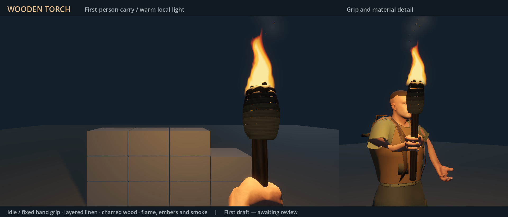
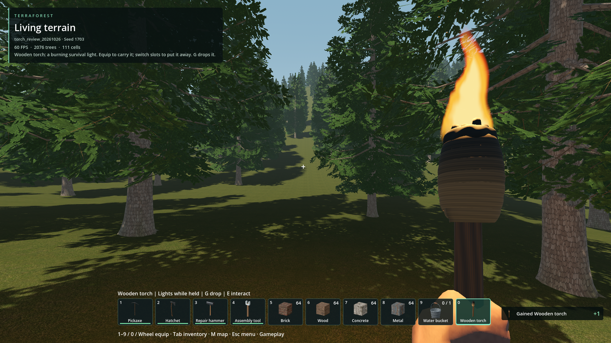
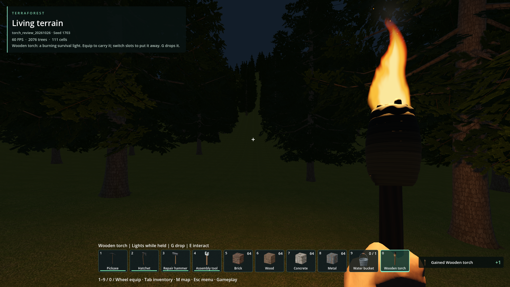

# Wooden torch — first draft for review

**Hands rejected by the user on 2026-10-26.** This original evidence is preserved.
Its grip-consistency checks missed the folded wrist and shaft intersections.
The [hand repair record](../../../issues/torch-hand-deformation/README.md)
contains the revised poses, stronger checks and new preview awaiting review.

Captured 2026-10-26 in Godot 4.7.2 Forward+ on RTX 4050. Blender 5.2.3 authored
the geometry and motion on the existing R11 skeleton. Original hands rejected.

[Eight-second preview](Wooden-torch.preview.mp4): idle 0–3 s, walk 3–5 s,
run 5–6 s, idle 6–8 s. First-person and third-person views render the same actual
asset. A controlled dim stage shows local light and grip; it is not a world replay.
The third-person shot retains the original character's clothing/skin finish.

Temporary native world, seed 1703, slot `torch_review_20261026`, 1920×1080.
No saved player world was changed. The daylight image follows real crafting,
inventory equip and native drop/persistence/recollect operations.

The same temporary scene with the sun disabled, ambient energy .08, flashlight
off and fog off. [Torch off](night_off.png) is the comparison. These lighting
settings are test-only; game world defaults are unchanged. Mean sampled terrain
brightness rises from .07816 to .08616, excluding the flame, hands and HUD.

Checks: `runtime.json` has 26 passing checks (120 Hz grip/finger sampling,
crouch, motion dispatch, bounded flicker, hidden/unequipped/placement cleanup,
PBR geometry and no accidental combat). `world.json` has 16 passing checks
(crafting, old/new inventory snapshots, native pickup ownership restoration,
no duplicate collection, actual equip and lighting comparison).

Regression logs cover pickaxe locomotion 24/24, bucket presentation 63/63,
native crafting 15/15 and inventory drop 16/16. The targeted character package
dependency check and current icon receipt pass. See `qualification.json` for
commands, hashes and the final inventory UI check.

Reproduce visuals with `tools/preview_wooden_torch.gd -- --video`, then Blender's
`tools/encode_wooden_torch_preview.py`. Full-resolution frames remain under
`reports/wooden_torch/frames`. Editable source and scope:
[authoring notes](../../../addons/characters/authoring/WOODEN_TORCH.md).
