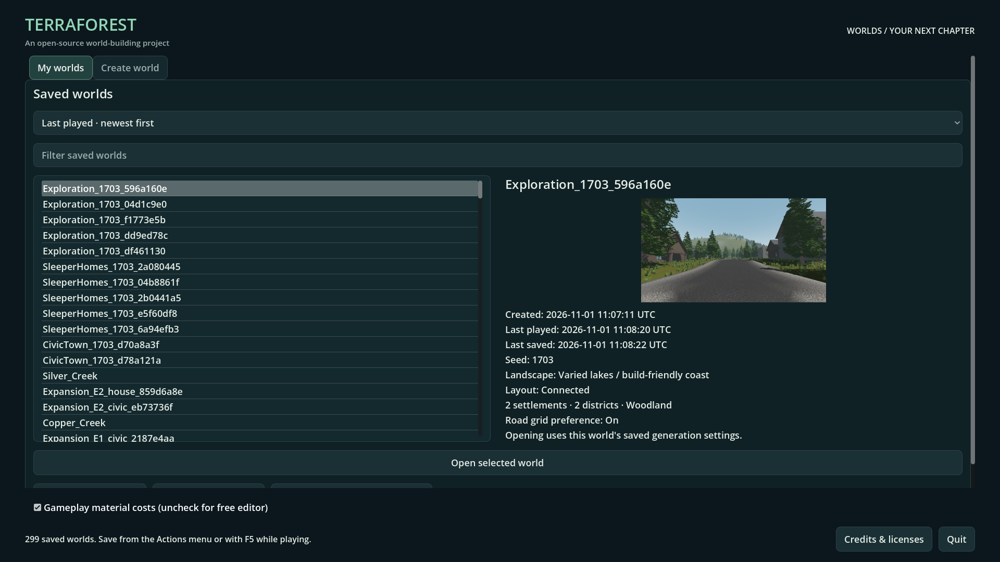

# Startup and saved-world browser latency

- Status: Improved-partial / complete source launch measured; post-reboot cold-cache test pending.
- Updated: 2026-11-26. First-UI changes build on `09974c9a`; earlier fixes include `83f09d30` and `39f97200`.
- User review: Pending.
- Symptom: Startup waits for save/photo work; filtering or changing worlds hitches.

## Images



After: 1920×1080 source browser, Forward+, 299 existing saves. Selected photograph
is the existing Exploration_1703_596a160e preview. UI layout and thumbnail were
inspected; a still image does not demonstrate latency. Source/hash and retained
asset provenance are in [the manifest](images/manifest.json).

## Changes and verification

One read worker handles the catalog and thumbnail decoding; an eight-entry cache
avoids repeat reads. Stale refresh/selection results cannot replace current UI.
Generation scripts load on demand on the owner thread. Continue-last waits for
the catalog. Save files and full-resolution photographs remain intact.

Three alternating rendered source comparisons: median first browser frame
1.75 → 1.24 s, filter update 45 → 2 ms. See [timings, commands, passing checks and
limitations](../../docs/evidence/browser_responsiveness/README.md).

The earlier matching installed package passes all 42 browser assertions and the rendered
credits check. Normal source/package exploration-world create and restore checks
also pass. The numbers above remain source-run observations.

### Staged world entry — 2026-11-02

Play now paints its cover before warming an indexed dependency graph. Assets load
through the threaded resource loader; script groups remain on the owner thread.
World setup yields between real named stages; private forest asset work uses a
joined worker. Generation cancellation, single-window ownership, elapsed time and
the 94% generation handoff are preserved. No runtime source scan, extra process,
gameplay-HUD performance rewrite, FPS-cap change or power-mode change.
[Implementation contract](../../docs/STARTUP_RESOURCES.md).

Same read-only seed-1703 fixture, fresh processes, Forward+, 1920×1080, 60 FPS:

| Measurement | Previous installed pack | Current installed pack |
| --- | ---: | ---: |
| Largest opening frame interval | 5427.535 ms | 596.857 ms |
| Largest preview frame interval | 143.220 ms | 70.923 ms |
| Largest selector frame interval | 63.519 ms | 133.574 ms |
| Play callback | 5.312 ms | 11.955 ms |
| Entire harness duration | 26.417 s | 29.210 s |
| Sampled private commit / dedicated GPU | 3.257 / 1.372 GiB | 3.225 / 1.380 GiB |

Receipts: [previous](../../reports/menu_transition/20261102T115638944118Z/run.json),
[current](../../reports/menu_transition/20261102T121246298821Z/run.json) and
[stage samples](../../reports/menu_transition/20261102T121246298821Z/latency.json).
Both pass cleanup, zero mouse captures and unchanged saved-world hash. This is a
matched offscreen pair with warm OS/plan caches, not a statistical speedup claim
or foreground presentation measurement. Total time did not improve in this pair;
the large uninterrupted stall did. Resource-wait time is not blocking-frame time.

Current pack SHA-256:
`fcafbcee37ecb0eb33a94c7efcf162d0b93b2a8822064b09755167ad39a9360a`.
All 14 native files match source/dist; the user's executable is unchanged.
Normal packaged generation and durable reload also pass; see
[player notices](../player-notices/README.md). Source startup loading/cancellation
passes five assertions in `reports/checks/20261102T120319454199Z`.

Rejected whole-script-thread and individual-script warming trials leaked native
or script references on exit. Retain their evidence, notably
`reports/menu_transition/20261102T114701427873Z` and
`reports/frontier_expedition/20261102T114941576580Z`. The latter passed 190 functional
route assertions but failed shutdown cleanliness, so it is not an overall pass.
Grouped owner-thread loading replaces those approaches; final package checks
have no reported engine errors or leak warnings.

## Remaining / resume here

### Follow-through, 2026-11-02

The earlier "structure materials" label grouped actor/vegetation/pickup setup too.
Splitting it measured pickup initialization at 400 ms. The fixed pickup meshes
are now warmed through the authoring-time index; texture mipmaps are baked once,
byte-verified, and reused. Developer catalog construction yields between groups.
Graphical texture readback passes all 17 checks in
`reports/block_texture_bake_gpu/console.log`; startup/cancellation passes five in
`reports/checks/20261102T144302281206Z`, and atomic pickup initialization passes in
`reports/checks/20261102T144310741363Z`.

Installed pack `5b8c7c63...638920`: read-only seed-1703 test, 1920x1080 Forward+,
60 FPS, zero captures, clean teardown, unchanged world hash. Play callback 6.065 ms,
largest opening interval 309.931 ms, selector 91.150 ms, preview 93.063 ms; entire
harness 36.339 s. Pickup setup 62.685 ms, structure material setup 41.852 ms.
Sampled private commit 3.37 GiB / dedicated GPU 1.39 GiB, within configured budgets.
Receipt: `reports/menu_transition/20261102T144641939776Z/run.json` and `latency.json`.
This is another warm-cache/offscreen observation, not a matched statistical speedup
or reduced total-time claim. Resource/setup/restore calls still reach about 0.3 s.

Rejected broad literal-`load()` indexing leaked one RefCounted on shutdown:
`reports/menu_transition/20261102T141939119237Z`. Restricting the added warmup to
the explicit pickup catalog restores clean shutdown. Both this failed trial and
earlier failures remain evidence, not passing qualification.

Not instant: the previous package had a roughly 0.6-second opening interval. Its recorded main-thread
steps include structure materials (595 ms), menu construction (341 ms), terrain
initialization (296 ms) and first-person setup (260 ms). The forest phase's 591 ms
includes yielded worker waiting and is not itself a blocking-frame measurement.
An 8 ms soft budget cannot interrupt a single engine/native call. Return for
incremental native material/setup APIs or measured asset prebaking; require
matched repeated package timings, cancellation/clean teardown and foreground
review before calling entry seamless. Do not move scene-tree work onto workers.

The source launcher's icon preflight remains. Pause/inventory performance is
excluded from this task; existing HUD processing has not been redesigned.
Broader seeds, cold filesystem caches, repeated exported filter/continue timings
and user review remain unqualified. Saves and test evidence were not deleted.

## Reproduce / history

Open My worlds with a substantial save library, type in the filter, switch worlds,
refresh and use Continue last. The regression uses a unique disposable fixture
and checks saved bytes. Source benchmarks read the existing library without
opening worlds; no player save is overwritten.


## Generation photographs removed from the wait — 2026-11-03

Normal Generate & play now reaches control in 57.579–66.623 seconds across three
warm-cache exported runs (median 59.073), versus 86.535 / 95.697 seconds in two
matched before runs. The previous scene toured three photograph destinations
before publishing. Photos are now optional through My worlds → Create / refresh
photographs. Existing photos and canonical saves remain intact. Nearby arrival
validation, verified publication and the full playable-world readiness gates remain.
Saved-world reopening alone is unchanged at roughly 26 seconds in the paired test.

All 15 optional-photo browser checks pass, including cancellation during startup,
clean teardown, full-size PNGs, thumbnail refresh and unchanged saved bytes.
The initial map-UI warmup dependency and early-cancellation cleanup failures were
corrected; their failed receipts remain visible. Repeated full-control generation,
fresh-process opening, resource and export gates pass.
[Exact builds, timings, evidence and remaining work](../../docs/WORLD_STARTUP_ARCHITECTURE.md#optional-photographs-and-local-generation-validation--2026-11-03).

[After: inspected browser with an optional captured thumbnail](../../reports/startup_optimization/preview_photographs_20261103T000934Z/browser.png).
The image renders existing inventoried project assets in Godot 4.7.2 on an owned
benchmark world; no new external assets were imported. Its hash and scope are in
[the performance evidence](../../docs/evidence/world_startup_optimization/preview_results.json).
This still does not qualify cold caches, broader seeds, foreground frame pacing,
weak hardware or general world quality. Those remain open in the linked contract.

## First visible and responsive UI — 2026-11-26

The separate launcher now paints before starting preparation. Executable/native
hashing and log validation join the existing background work; Close responds immediately and keeps
the checkout lease until the active worker exits, without launching the next stage.
Godot rejects hiding its main window, so handoff and pending Close now minimize it.
The browser loads only its selected built-in UI design. Custom designs retain
full discovery. Last-played dates come from the catalog worker, removing metadata
file reads from drawing. Invalid selections return empty details.

Matched source observations, Godot 4.7.2, RTX 4050, Forward+, 1920×1080, 60 FPS,
Survey UI and 415 existing saves, sequential processes on an isolated Windows desktop:

| Measurement | Before | After run 1 | After run 2 |
| --- | ---: | ---: | ---: |
| Engine clock to first browser paint | 2034.684 ms | 1370.943 ms | 1389.934 ms |
| Browser scene construction | 487.322 ms | 306.823 ms | 263.313 ms |
| First filter input through next frame | 4.712 ms | 3.838 ms | 4.175 ms |
| Largest subsequent sampled frame | 16.903 ms | 16.936 ms | 17.164 ms |

[Comparison admission and source hashes](../../reports/checks/first_ui_20261126T191351710067Z/run.json),
[before](../../reports/checks/first_ui_20261126T191351710067Z/before/first_ui.json),
[after 1](../../reports/checks/first_ui_20261126T191351710067Z/after_1/first_ui.json),
[after 2](../../reports/checks/first_ui_20261126T191351710067Z/after_2/first_ui.json).
The four UI scripts were compared against `09974c9a` in the same checkout and
restored before subsequent checks. These are warm OS-cache observations, one
before and two after; engine ticks exclude the time before engine initialization.
They do not measure the full launcher preparation interval or cold boot.

The rendered GL Compatibility launcher contract observed first paint at
621.106 ms and Close dispatch at 1.599 ms during a controlled worker. A final run
with worker log-validation coverage recorded 614.814 ms / 2.872 ms. Native
preparation/import/icon checks still run normally; this does not claim they finish
sooner. The actual native build/import pipeline was not timed again here.
[Launcher contract](../../reports/checks/first_ui_20261126T191351710067Z/launcher_log_final/receipt.json),
[browser contract](../../reports/checks/first_ui_20261126T191351710067Z/browser_final/receipt.json),
[72 rendered UI-set checks](../../reports/checks/first_ui_20261126T191351710067Z/ui_sets_final/receipt.json) and
[six dependency-loading/cancellation checks](../../reports/checks/first_ui_20261126T191351710067Z/startup_index_final/receipt.json)
pass. The authored dependency index was refreshed for the already committed
object packs and other runtime additions; no graph scan is added to menu startup.
The final launcher suite emits four expected error logs for intentional failure cases.
Twelve Python launcher/retention tests and dependency-index freshness also pass.

Retained failed trials: `launcher_contract` exposed the unsupported main-window
hide; `browser_contract` exposed invalid-slot details and obsolete expectations
that an asynchronous preview loads immediately; `ui_sets` attempted real GUI
activation without a rendered window. Final checks above cover the corrections.
These failed receipts remain in the same pinned bundle.


Inspected after: Survey browser with the existing Homestead_Valley photograph,
415 saves; no world opened or modified. This image is captured after the initial
180-frame observation, not at first paint. The still demonstrates layout only;
input/cadence evidence is in the timing records. [Image provenance](images/manifest.json).

Reproduce the bounded source observation with the normal admission/retention runner:

```text
python tools/run_godot_check.py world_browser_responsiveness --isolated-render --require failures=0 --timeout 45 -- --measure-first-ui
```

Remaining: first UI is not literally instant. Engine/window initialization remains,
and native preparation can keep the launcher visible before the browser opens.
Cold filesystem/driver caches, the final exported package and ordinary foreground
launch-to-input timing are unqualified. Return when preparing that package or when
foreground startup remains noticeably delayed; require repeated launch-to-paint
and first-input measurements plus cancellation/clean teardown on the same build.
This scoped work does not close the world-entry and broader hardware limitations above.

## Complete source launch — 2026-11-26

The normal launcher previously ran native checks, a full import pass and preview
checks before every menu process. The measured baseline needed 40.488 s from
external process creation to the first successful menu input. Its preparation
phases took about 5.3 s native, 7.3 s import, 25.1 s previews and 0.7 s identity.
The first run refreshed stale item/shape previews against existing local inputs.

Windows now reuses successful preparation through `tools/source_launch_cache.py`.
Directory enumeration supplies file sizes and high-resolution timestamps without
opening every asset. Changed/new/deleted source, DLLs, assets or imports invalidate
reuse; small import-index contents and engine identity also participate. Only the
completed native/import/bake pipeline records readiness. Input edits during that
pipeline reject the record. The metadata cache has an explicit `--force-prepare`
escape for tools that preserve size and timestamps. Checkout ownership, immediate
Close and visible preparation failures remain enforced.

| Full process-to-menu measurement | Initial baseline | Reuse run 1 | Reuse run 2 |
| --- | ---: | ---: | ---: |
| First menu paint | 40484.159 ms | 2723.235 ms | 2063.489 ms |
| First successful menu input | 40488.159 ms | 2727.235 ms | 2067.489 ms |
| Input dispatch through next frame | 4.135 ms | 4.183 ms | 4.183 ms |
| Largest subsequent sampled frame | 16.746 ms | 16.840 ms | 17.766 ms |

[Admission and scope](../../reports/checks/full_launch_20261126T192359792537Z/run.json),
[baseline](../../reports/checks/full_launch_20261126T192359792537Z/before/first_ui.json),
[reuse 1](../../reports/checks/full_launch_20261126T192359792537Z/after_1/run.json), [reuse 2](../../reports/checks/full_launch_20261126T192359792537Z/after_2/run.json).
These are fresh launcher and game processes, using the actual local
`TerraForest.exe` and normal source preparation, Godot 4.7.2, RTX 4050,
Forward+, 1920×1080, Survey and 415 existing saves. The test substitutes a read-only
menu driver for the child scene entry to inject one filter key, observe 180 frames
and close. The external wall clock includes launcher startup and all preparation.
No world is opened or saved. Windows filesystem and driver caches were retained;
this is not yet a post-reboot cold-cache result or an instantaneous-launch claim.

The forced preparation path still passes and takes 15.65 s to menu input with
already-current previews. [Final forced preparation](../../reports/checks/full_launch_20261126T192359792537Z/native_guard_prepare/receipt.json)
and [launcher failure/cancellation contracts](../../reports/checks/full_launch_20261126T192359792537Z/launcher_contract/receipt.json)
pass. [All 22 Python checks, dependency-index freshness and ready-record verification](../../reports/checks/full_launch_20261126T192359792537Z/checks.json)
pass, including invalidation, edits during preparation, corrupt records, missing
imports, active native-build ownership and receipt-owned two-ready capture retention. The launcher suite's four
intentional failure logs are expected. No engine errors were reported by the two
complete reuse runs.


Inspected after: the actual Survey menu and existing Homestead_Valley photograph,
with 415 saves. Captured after the timing observation; a still does not demonstrate
latency. [Image provenance](images/manifest.json). Normal source preparation also
updated three existing preview artifacts against the pre-existing local settings;
they remain unstaged with those inputs. Their before/after hashes are retained in
[the generated-preview receipt](../../reports/checks/full_launch_20261126T192359792537Z/generated_previews.json).

Reproduce from `TerraForest` after closing the game:

```text
python tools/benchmark_source_launch.py
python tools/benchmark_source_launch.py --force-prepare
```

The runner admits its bounded output before starting the external clock, uses an
isolated rendered desktop, preserves player saves and archives old owned captures
after process exit. The prepared record remains local; first use in a new checkout
still performs required preparation.

**Pending actual cold-cache test:** restart Windows once, return to this chat
without opening TerraForest, record Windows uptime, then run the first command
before any engine/version/hash probe. A restart clears OS file-cache residency;
retain the normal on-disk imports, prepared record and driver caches. Require the
full launch-to-paint/input receipt, no errors, correct cache invalidation and clean
exit before recording that result. Restart is deferred to the user because it
interrupts other applications. Ordinary foreground review and exported-package
startup remain unqualified. The remaining roughly two seconds include launching
two Godot processes and graphics-device initialization; removing that cost needs
a separate bootstrap/renderer architecture change, not skipping validation.
