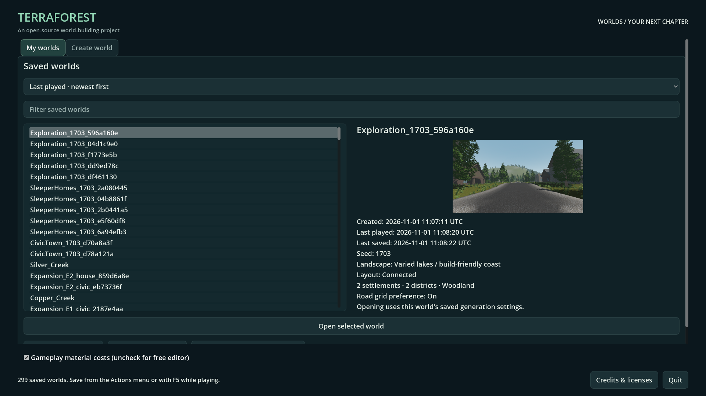

# Startup and saved-world browser latency

- Status: Improved-partial / installed, source and package functional checks pass.
- Updated: 2026-11-02. Earlier fix: `83f09d30`; current startup changes build on `39f97200`.
- User review: Pending.
- Symptom: Startup waits for save/photo work; filtering or changing worlds hitches.

## Images

After: 1920×1080 source browser, Forward+, 299 existing saves. Selected photograph
is the existing Exploration_1703_596a160e preview. UI layout and thumbnail were
inspected; a still image does not demonstrate latency. Source/hash and retained
asset provenance are in [the manifest](images/manifest.json).

## Changes and verification

One read worker handles the catalog and thumbnail decoding; an eight-entry cache
avoids repeat reads. Stale refresh/selection results cannot replace current UI.
Generation scripts load on demand on the owner thread. Continue-last waits for
the catalog. Save files and full-resolution photographs remain intact.

Three alternating rendered source comparisons: median first browser frame
1.75 → 1.24 s, filter update 45 → 2 ms. See [timings, commands, passing checks and
limitations](../../docs/evidence/browser_responsiveness/README.md).

The earlier matching installed package passes all 42 browser assertions and the rendered
credits check. Normal source/package exploration-world create and restore checks
also pass. The numbers above remain source-run observations.

### Staged world entry — 2026-11-02

Play now paints its cover before warming an indexed dependency graph. Assets load
through the threaded resource loader; script groups remain on the owner thread.
World setup yields between real named stages; private forest asset work uses a
joined worker. Generation cancellation, single-window ownership, elapsed time and
the 94% generation handoff are preserved. No runtime source scan, extra process,
gameplay-HUD performance rewrite, FPS-cap change or power-mode change.
[Implementation contract](../../docs/STARTUP_RESOURCES.md).

Same read-only seed-1703 fixture, fresh processes, Forward+, 1920×1080, 60 FPS:

| Measurement | Previous installed pack | Current installed pack |
| --- | ---: | ---: |
| Largest opening frame interval | 5427.535 ms | 596.857 ms |
| Largest preview frame interval | 143.220 ms | 70.923 ms |
| Largest selector frame interval | 63.519 ms | 133.574 ms |
| Play callback | 5.312 ms | 11.955 ms |
| Entire harness duration | 26.417 s | 29.210 s |
| Sampled private commit / dedicated GPU | 3.257 / 1.372 GiB | 3.225 / 1.380 GiB |

Receipts: [previous](../../reports/menu_transition/20261102T115638944118Z/run.json),
[current](../../reports/menu_transition/20261102T121246298821Z/run.json) and
[stage samples](../../reports/menu_transition/20261102T121246298821Z/latency.json).
Both pass cleanup, zero mouse captures and unchanged saved-world hash. This is a
matched offscreen pair with warm OS/plan caches, not a statistical speedup claim
or foreground presentation measurement. Total time did not improve in this pair;
the large uninterrupted stall did. Resource-wait time is not blocking-frame time.

Current pack SHA-256:
`fcafbcee37ecb0eb33a94c7efcf162d0b93b2a8822064b09755167ad39a9360a`.
All 14 native files match source/dist; the user's executable is unchanged.
Normal packaged generation and durable reload also pass; see
[player notices](../player-notices/README.md). Source startup loading/cancellation
passes five assertions in `reports/checks/20261102T120319454199Z`.

Rejected whole-script-thread and individual-script warming trials leaked native
or script references on exit. Retain their evidence, notably
`reports/menu_transition/20261102T114701427873Z` and
`reports/frontier_expedition/20261102T114941576580Z`. The latter passed 190 functional
route assertions but failed shutdown cleanliness, so it is not an overall pass.
Grouped owner-thread loading replaces those approaches; final package checks
have no reported engine errors or leak warnings.

## Remaining / resume here

Not instant: a roughly 0.6-second opening interval remains. Recorded main-thread
steps include structure materials (595 ms), menu construction (341 ms), terrain
initialization (296 ms) and first-person setup (260 ms). The forest phase's 591 ms
includes yielded worker waiting and is not itself a blocking-frame measurement.
An 8 ms soft budget cannot interrupt a single engine/native call. Return for
incremental native material/setup APIs or measured asset prebaking; require
matched repeated package timings, cancellation/clean teardown and foreground
review before calling entry seamless. Do not move scene-tree work onto workers.

The source launcher's icon preflight remains. Pause/inventory performance is
excluded from this task; existing HUD processing has not been redesigned.
Broader seeds, cold filesystem caches, repeated exported filter/continue timings
and user review remain unqualified. Saves and test evidence were not deleted.

## Reproduce / history

Open My worlds with a substantial save library, type in the filter, switch worlds,
refresh and use Continue last. The regression uses a unique disposable fixture
and checks saved bytes. Source benchmarks read the existing library without
opening worlds; no player save is overwritten.
