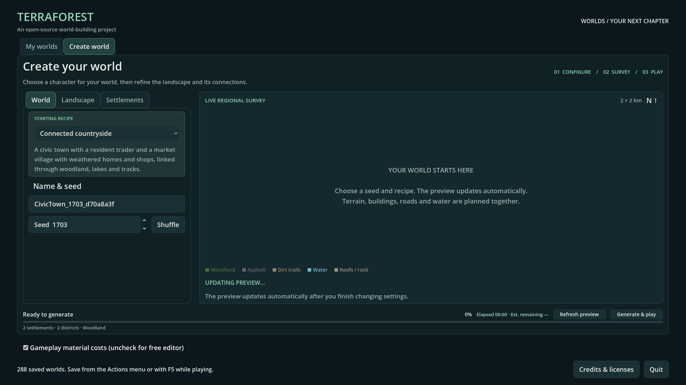
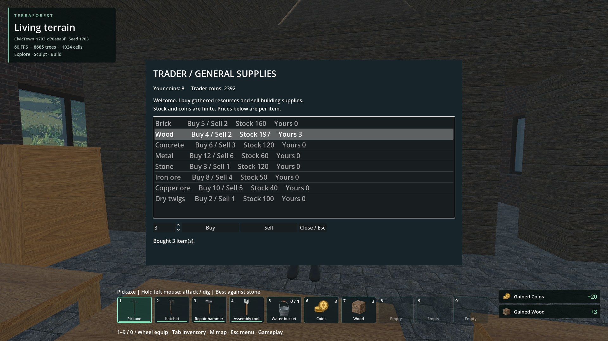
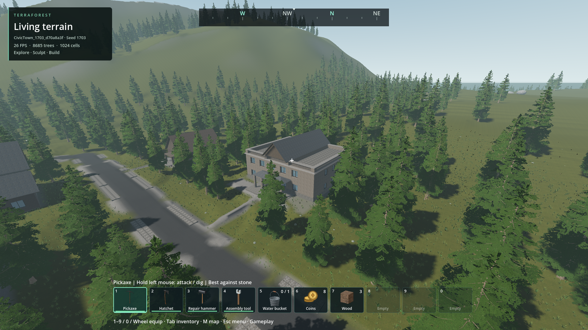
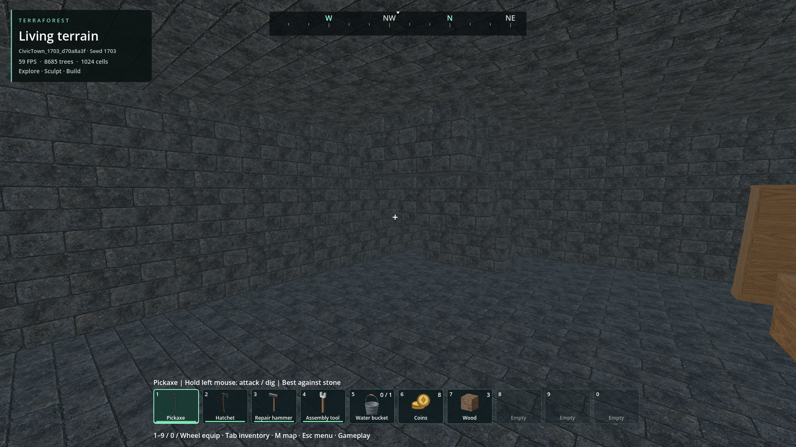

# Building expansion: materials, roof joints and construction display

- Status: E2 reviewed scope approved; documented wider limitations remain open.
- Updated: 2026-11-01. Integrated into the main checkout and package; concurrent work retained.
- User review: Direction approved 2026-10-30. User rejected E1's clean, bright
  procedural materials and questioned pattern correctness. Exact E2 changes approved
  2026-11-01: “I approve the new changes.” See the [approval record](../../reviews/building_expansion/approval.json).
- Symptom: Expansion materials lost the existing grim, weathered appearance;
  generic dominant-axis UV projection could run roof courses down the slope.

Implementation commit: `1be69743a253545cbf83cfc6c02f4cad5bec500d` (native, assets, tools and regression coverage).

## Production integration correction — 2026-11-01

The user correctly identified that approved content was still gated behind review
paths. Approval recording did not complete production integration. Normal catalogs
now select the exact E2 resources and expose all nine building choices. Each normal
recipe includes one civic district and one resident trader. Larger recipes preserve
their residential first district and fit the civic district separately. Cache v32
invalidates earlier plans; existing worlds are not regenerated.

Source/release standards pass in `reports/building_standards/20261101T031454535569Z`.
All five UI recipes pass seed-1703 planning (44 checks) in
`reports/checks/20261101T031332333318Z`. Normal Generate & play passed six checks
in `030806878627Z`; interaction and basement checks exposed the missing B2 palette
entry in `031015549342Z` (52/53). That entry is fixed; ordinary fresh-process reopen
and stock/inventory restore pass 22 checks in `031233426776Z`. Earlier larger-layout
failures remain in `031120999290Z` and `031223385201Z`; no earthwork limit was relaxed.

Combined committed baseline `1adcce5a` (Steam, mouse focus and BG5) is merged in
`ffff300c`. Its source/release gate passes in `reports/building_standards/20261101T031758222874Z`;
the exported PCK passes all 45 asset checks and three actual GUI processes: normal
creation **6/6**, full play/trade/four basement descents **53/53**, and fresh stock/
inventory restore **22/22**. There are no engine errors in these runs.
[Exact package, reports and scope](production_verification.json). Reproduce with
`python tools/check_production_buildings.py`. The historical review artifact in
`verification.json` retains its earlier identity; this is a separate production build.

Use **Create world → Connected countryside → seed 1703 → Generate & play**.
M → Places → Resident trader locates the merchant; approach and press E. A new
world is required to obtain generated content; existing worlds are not retrofitted.
All five recipe planners include the civic group; larger recipes keep their first
residential district and place the civic group in another district.

The unchanged default recipe now names the content it generates.

Real finite-stock buy/sell transactions through the normal interaction and UI.

Approved E2 town hall, actual terrain and neighboring buildings. Broader foliage
and landscape presentation remain under their existing qualification.

Actual player capsule settled on the basement floor. [Capture hashes](images/production/manifest.json).

Installed in the main checkout after the other chat granted a safe merge window.
All **51** pre-existing changed/untracked files retain their exact bytes. The main
`TerraForest.exe` passes **22/22** normal reopen, interaction and persistence checks.
The final source and PCK each pass **48/48** catalog/five-recipe checks; all nine
prefab cache identities match across processes. The final package passes **45/45**
asset checks and the source/release standards gate. See the installation entry in
[production_verification.json](production_verification.json) for exact artifacts.

The cache follow-up hashes loaded cells, attachments and planning metadata, because
PCK resources remap raw `.tres` paths. StringName metadata keys are converted to
lexically sorted strings and nested dictionaries canonicalized. This avoids both
missing exported identities and process-dependent ordering. Earlier failed fixtures
and fingerprint comparisons remain recorded in the verification file. No building
cells, artwork or native libraries changed during this follow-up.

The release gate checks the production catalog; `check_production_buildings.py` also
compares source/PCK identities before its normal GUI and restore cases. A review save
alone cannot satisfy production reachability. Broader terrain/foliage, NPC navigation
and performance qualifications remain separate; the other chat resumes its work.

## Older texture retention — 2026-11-01

The user requires all older textures to remain available as optional alternatives,
even when unused, and specifically values the earlier wood and brick in some uses.
All eight PNGs across `textures/original/` and `textures/terraforest/` are
byte-identical to pre-expansion baseline `63337456`. The palette's `Original
material` appearance and existing set selector retain access alongside E2.
No prefab, building or save was repainted for this request. The existing GPU
texture/switching check passes in `reports/checks/20261101T023833189351Z`.
This continuing requirement is recorded in the [material standard](../../docs/BUILDING_MATERIAL_STANDARD.md#retain-earlier-materials-alongside-additions).

## Changes and current evidence

E2 uses eight individually generated imagegen materials, with retained masters,
prompts, the rejected eight-board timber trial, and the selected four-board edit.
Native roof mapping follows local drainage and rotates with the part. Original
approved resources and their legacy appearance words remain unchanged. New
candidate prefabs cannot inherit their originals' approval flags.

The native pack adds 18 individual shapes, per-cell appearances separated from
crafting material, version-3 styled archives, palette search/families and baked
orientation/assembly previews. Published geometry and authoritative convex hulls
share the same source. Closed gable ends use structural material on end faces
and the selected roof finish on slopes in a single shared mesh.

Earlier source and release contact/expansion gates passed in
`reports/building_standards/20261031T061345365698Z`: 30 contact checks per target,
80 source catalog checks and 469 expansion checks per target. These include
65,536 word decoding, legacy identity, every new shape/mount, roof UV direction,
structural costs, atomic persistence rejection, paging and local undo.
Eight source-image identity/dimension checks passed in
`reports/checks/20261031T061323630756Z`; all eight 3×3 repeats in
`reports/building_expansion/materials_1793427204_061` were visually inspected.
The completed populated-world comparisons are in the [gallery](GALLERY.md);
user visual acceptance was recorded on 2026-11-01 for the exact reviewed E2 scope.

## Preserved rejected and failed evidence

- E1 materials: `reviews/building_expansion/rejected_e1/textures/`; authoring source
  `tools/bake_building_appearances.py`. E1 prefabs/provenance also retained in
  `reviews/building_expansion/rejected_e1/`.
- Rejected bright world views: `reports/building_expansion/E1_1793381132_198`;
  matched R1: `reports/building_expansion/R1_1793380974_602`.
- E1 also exposed a protruding cornice corner and roof/gable color bands; these
  led to the corrected corner hull and split gable-face finish.
- `reports/checks/20261031T061158963429Z`: UV test incorrectly required an
  upward sloped face on underside-only seam infills. Those are covered by hull
  and winding tests; roof-direction checks apply to exposed sloped faces.
- `reports/checks/20261031T061242844249Z`: review loader attempted extension-based
  PNG loading for raw `.trtex`; corrected to PNG byte decoding.
- Paired world attempts `20261031T061555191848Z`, `20261031T061652813693Z` and
  `20261031T114715046912Z` remain under `reports/building_expansion/paired_/`.
  They exposed review-script shutdown/legacy entrance assumptions. Original save
  bytes were preserved. Fixing a fixture is not evidence that a route passed.

- `paired_/20261031T115104417609Z`: R1 passed, interrupted E2 had four
  readiness failures. The reused route fixture had retained the photography
  camera offset and disabled controller physics before teleporting. Restoring
  both before route checks cleared those failures; no readiness gate was relaxed.
- `paired_/20261031T174725964794Z`: 129/132 route checks passed. All five civic
  player/NPC routes, their stairs and basements, and both warehouse vehicles passed.
  Market players passed, but three older market NPC plans did not finish.
  `reports/building_expansion/nav_probe_run` reproduces Shop B1's NPC planning
  failure on unchanged R1. Its actual player route and small-step native motion
  guard pass. This remains a baseline route-planning limitation; no claim of
  universal NPC access or hidden fallback movement is made.
- That E2 image set exposed mixed slate/zinc strips at warehouse gables and slate
  painted on school roof undersides. The final recipe uses zinc consistently;
  native roof shells now use structural finishes beneath roofing. The four-way
  hipped shop conversion also now preserves every old slope direction, with
  independent solid-volume equivalence checks for all yaw directions.
- An intermediate native focused check was 483/483 in
  `reports/checks/20261031T180123409387Z`; palette 8/8 in `180126109655Z`;
  actual gallery/placement/rotation/destruction checks 30/30 in `180940250743Z`.
  Earlier UI failures `180128407067Z`, `180444312571Z`, `180652384800Z` exposed
  fixture assumptions about startup mode, asynchronous collision publication
  and focused-window mouse ownership. Tests now explicitly start gameplay,
  await publication and retain the focus-aware capture policy.

## Final verification

- Source/release mandatory export gate: `reports/building_standards/20261101T022117085387Z`.
  Contact 30 each; expansion 490 each; source catalog 80, materials eight,
  candidate assets 45. This includes joined surfaces without collision slivers.
- Final matched civic/market pass: `paired_/20261031T220224276185Z`, R1 21/21,
  E2 53/53. C1 matched views: `paired_/20261101T021932077386Z`, R1 8/8, E2 11/11.
  [Gallery and captions](GALLERY.md); [frame/memory/geometry costs](PERFORMANCE.md).
- C1 player/NPC/stairs/basement pass: `paired_/20261031T220048889486Z`, 30/30.
  `paired_/20261031T215431041202Z` is retained as a failed run: its routes passed
  but Jolt rejected an empty collision piece. A focused probe found 1618 clipped
  sliver triangles in the actual placed house. Coplanar classification now snaps
  float residuals within 10 micrometres before splitting; the probe reports zero
  slivers and 4698 valid triangles. Four joined-roof regressions and all nine
  actual candidate meshes enforce this at source and export.
- `paired_/20261031T215223920142Z` verified the corrected town-hall coping after
  earlier close-ups exposed notches and missing side caps. The final full pass
  repeats the intact/remove/restore sequence and retains exact cell identities.
- Actual player travel: `paired_/20261031T220908578512Z`, R1 25/25, E2 49/49;
  221.22 m, zero readiness holds, no unsupported fall. This is separate from
  camera-only distance screenshots.
- Fresh save/reopen: `persistent_/20261031T221148056059Z` for civic/market and
  `persistent_/20261031T221305373220Z` for C1. Both phases pass; originals unchanged.
  The review launchers verify candidate/native/save hashes and open read-only clones.
- Export starts successfully; packed assets 45/45 in `packed/20261101T022208946118Z`.
  Regression checks: modular 1978/1978 (`reports/checks/20261101T022212562137Z`),
  construction 26/26 (`022308880333Z`), actual gallery/placement 30/30 (`022309537265Z`).
  The preceding construction runner `022216133539Z` used the wrong expected
  summary marker; its 26 assertions passed. Correcting the invocation passes.
- [Verification identities](verification.json) record exact artifacts and source reports.

All `paired_`, `persistent_` and `packed` references above are beneath
`reports/building_expansion/`. The earlier failure/rejected evidence remains retained.

## Remaining / resume here

The reviewed scope is approved, including exact E2 buildings, the 512-pixel
material choice and retention of all older texture alternatives. The separate
approval record preserves the exact bake identities. Runtime exposure remains
opt-in in this branch; generation defaults and saved worlds are unchanged.
Three older market NPC route plans remain an existing open
limitation; Shop B1 reproduces it on unchanged R1. Return to the native route planner
with those retained fixtures before claiming universal NPC access. Full-world frame
pacing and terrain/foliage quality remain separate project issues.

Valley shapes 26/27 remain optional prototypes. Promote them only after a useful
actual building joint, traversal and cost comparison exists. Normal/roughness and
secondary beam/chamfer/arch families were assessed as follow-ups; they are outside
this first albedo/roof/trim proposal. The 20 m resolution-study views are obscured
by foliage and do not establish distant material equivalence.

Reproduce with `tools/check_building_expansion_world.py` (add `--house`, `--routes`,
`--travel` or `--persist` as needed); `tools/review_building_expansion.py` opens the
verified civic/market clone and `--house` opens C1. The [material contract](../../docs/BUILDING_MATERIAL_STANDARD.md)
and [final expansion review](../../docs/BUILDING_EXPANSION_REVIEW.md) define acceptance.
