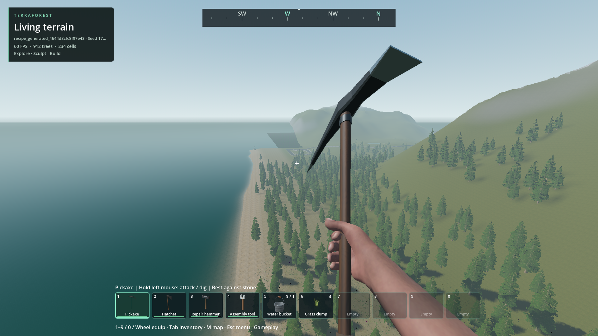
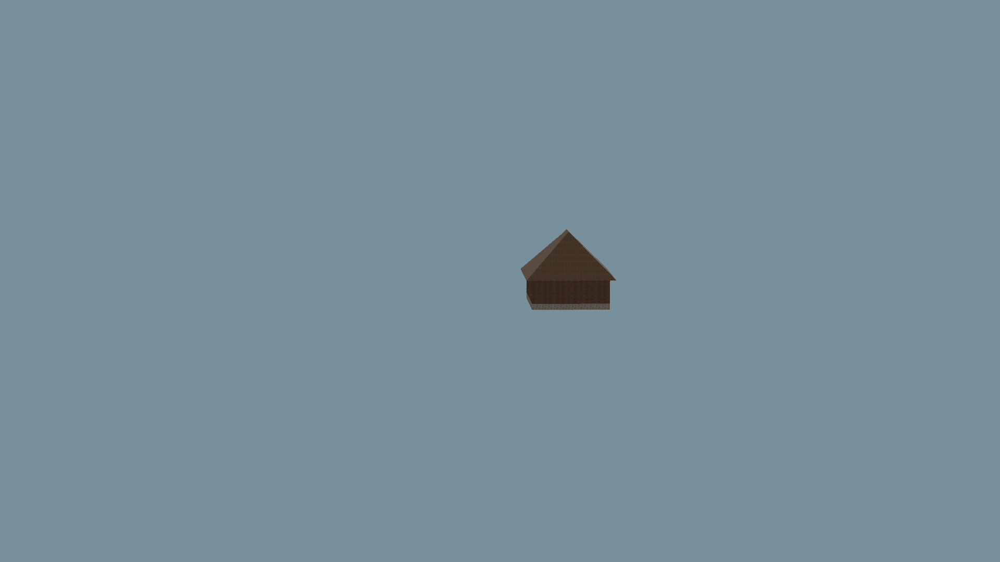

# Building geometry LOD

- Status: Implemented and installed / scoped checks; player visual approval pending.
- Updated: 2026-10-30. Previous geometry baseline: `6cad0491`; horizon baseline: `9daef660`.
- Default on; ESC → Graphics → Building distance detail (LOD). Existing saves work without regeneration.
- Authoritative cells, approved houses, materials, full-detail collision and picking stay intact.

## Images

Matched 1080p cameras: four pixels differ by one channel step; distant houses use LOD, nearby surfaces retain detail.

24-house rendering fixture, not a proposed settlement layout. A2/B1/B2/C1 designs and attached models are unchanged.
Visible draw triangles: 147,428 → 130,604. 90 pixels differ; no visible silhouette/roof change in inspected images.

18-shape, four-material gallery. Near full-detail and LOD images are byte-identical.
Hashes, build and source provenance: [manifest](images/manifest.json).

## Changes and verification

- Native worker bakes up to three error-controlled index levels; renderer selects them without script polling or double-drawing fades.
- Preserve chunk borders, material/UV seams and disconnected parts. Integer-period UV normalization joins compatible coplanar faces; no texture repainting.
- Exact vertex deduplication only on meshes receiving LOD. Full-detail faces/collision remain unchanged; seven legacy byte-reference fixtures still pass.
- Edits invalidate local LODs; eight cached away/return cycles submit no new bakes. LOD buffers count against existing upload/cache/residency budgets.
- [Installed pack: six passing checks, zero diagnostics](../../reports/checks/20261028T135000186386Z_minerals_pack/summary.json): native LOD (40), worker, modular shapes (1,978), thin roof (19), visual (10), actual-world Graphics UI (5).
- [Camera evidence](../../reports/checks/20261028T135000186386Z_minerals_pack/building_lod_visual/evidence/building_lod_visual/result.json): 180 approach frames per mode; far draw triangles 108,140 → 91,316 (15.6% fewer). Mesh block triangles 93,930 → 77,106 at lowest levels.
- [17 matched comparisons](../../reports/checks/20261028T135000186386Z_minerals_pack/building_lod_visual/evidence/building_lod_visual/comparison.json): 0–90 changed pixels per 1920×1080 image. Sparse image samples complement, not replace, the moving-camera test.
- RTX 4050 Laptop GPU: capped median frame intervals 16.669/16.667 ms, p95 17.109/17.320 ms (full/LOD). No measured FPS improvement claimed. Capturing PNGs is excluded from these timed passes.
- LOD work: 145.171 ms total background bake, maximum 3.650 ms/chunk in that fixture. Extra geometry buffers trade memory for fewer drawn triangles; budgets are not enlarged.
- Debug and release DLLs built; final pack SHA256 `0aba7d1a8f9964dddde103d9e23a6680150993b9a3590b2eb28453ea342c5e9b`.

## Remaining / resume here

- User visual review and full populated-world / lower-end GPU endurance remain open. Compare the same route with the Graphics toggle.
- The former distance-cutoff disappearance now has a separate native horizon layer (below). Broader populated-world driving/weak-hardware endurance and player visual acceptance remain open.
- Already-minimal meshes and chunks above 65,536 triangles retain full detail. Separate furniture/doors keep their original models; no whole-house impostors or draw-call aggregation.
- Before more aggressive reduction, require unchanged openings, roof profiles, material alignment, edits and collision plus measured GPU benefit.
- Broader checks retained: [C1 generation](../../reports/checks/20261028T133417912351Z/run.json) reports two soil/slab clearance assertions; [old headless session check](../../reports/checks/20261028T133354557408Z/run.json) expects mouse capture after ESC. Neither is marked fixed by LOD.

## Reproduce / history

- `python tools/run_godot_check.py building_lod --headless --timeout 90 --require BUILDING_LOD`.
- `tests/building_lod_visual.gd`: temporary fixture only; launch in a nonactivating offscreen 1080p window for automated evidence. `tools/check_building_lod_images.py <evidence-folder>` compares captured pairs.
- Source: `addons/structures/native/block_lod.cpp`, `block_worker.cpp`, `block_world.cpp`, `block_streaming.cpp`; startup/UI: `building_lod.gd`, `session_menu.gd`.
- Earlier [fixture placement failure](../../reports/checks/20261028T132226971590Z/run.json) used the block-only API on attached prefabs; fixed the test to use records/combined transactions respectively.
- Earlier [visual draw-count failure](../../reports/checks/20261028T132926048761Z/run.json) sampled before attached-model publication settled. Warm-up fixed; source-stage captures remain in `reports/building_lod_visual/`.
- Unconditional vertex compaction broke legacy byte fixtures; [failure retained](../../reports/checks/20261028T134339409975Z/run.json). Compaction is now limited to actual LOD meshes; [all seven original references pass](../../reports/checks/20261028T134612086733Z/run.json).

## World-wide distant buildings — 2026-10-30

- Cause: geometry LOD only reduced resident meshes. The 384 m / 256-chunk renderer and regional pager still removed whole distant buildings, including never-visited regions.
- Default-on native horizon uses compacted lowest-detail meshes of the actual authored blocks, shapes, materials and roofs. No replacement boxes or new building designs. It has no distance cutoff; normal frustum, terrain occlusion, fog and pixel size still apply.
- Nearby meshes replace their distant counterpart in the same frame; no doubled surfaces. Evicted near meshes bridge unfinished horizon work. Physics, picking, storage and editable-cell residency remain nearby-only.
- One native worker, one completed chunk awaiting publication, one archive read at a time. Exact-version region reads use the existing asynchronous archive service and do not admit far cells into gameplay. Whole-world reloads reject stale jobs; edits/undo invalidate affected derived geometry.
- Loading reports completed/total building regions and mesh payload. Play starts after horizon coverage finishes, rather than making buildings appear only after visiting them. Camera clipping no longer temporarily removes everything beyond 320 m; its far plane covers the finite terrain world even when viewing it from outside.
- Mesh payload ceiling: 128 MiB, separate from unchanged near/cache limits. Exhaustion or archive failure is explicit, not silently advertised as complete coverage. This is not an unlimited authored-content guarantee. No extra persistent terrain cache or saved-world format is introduced.
- Attached furniture, doors and windows retain their original nearby model streaming. This change guarantees the building-block fabric, not every small attached prop at horizon distance.

### Horizon evidence

Read-only generated seed 1703, ordinary 75-degree view from roughly 524 m above/across the selected town. Same build/camera; only the distant layer is hidden for the baseline. The small buildings at the coast remain visible with the horizon layer. Animated foliage and HUD values need not match between frames.

Controlled four-house fixture, 12-degree inspection FOV, no fog/terrain/attached props. Actual approved block roofs/materials, not a replacement settlement. Original before frames and the 1.2 km pair remain in the linked test run.

Build hashes, original images, run paths, measurements and scope: [horizon manifest](images/horizon-manifest.json).

- 32 native/render assertions: initial far coverage, negative coordinates, 100 km focus displacement, eight near/far handoffs without rebaking, edits/undo, metadata-only reload without resident cells or physics, world replacement and teardown.
- Populated-world test: every one of 19 archived regions / 151 block mesh chunks represented; 2.76 MiB horizon payload. No authoritative far chunks were loaded for the view. Source save remains byte-identical; automated window does not capture the mouse.
- Scoped source regressions: [40 geometry LOD checks](../../reports/checks/20261030T054646231592Z/run.json), [paging](../../reports/checks/20261030T054930816468Z/run.json), [collision streaming](../../reports/checks/20261030T054934473349Z/run.json), [native worker lifecycle](../../reports/checks/20261030T055704863445Z/run.json), [1,978 modular-shape checks](../../reports/checks/20261030T055708677960Z/run.json).
- Initial horizon teardown double-deletion was caught and corrected; [failed run retained](../../reports/checks/20261030T054520218540Z/run.json), [corrected lifecycle run](../../reports/checks/20261030T054625385811Z/run.json). The first world harness used a nonexistent nested save path; [failure retained](../../reports/building_horizon_checks/20261030T054848340981Z/run.json), corrected to the existing flat archive path.
- Reproduce: `python tools/check_building_horizon.py --pack`; then `python tools/check_building_horizon.py --pack --world`. The latter requires the existing disposable generated fixture or an explicit read-only `--slot`.
- Remaining: user visual acceptance, denser custom worlds approaching the payload ceiling, long fast-travel runs and lower-end GPU qualification. Return on a missing silhouette, visible handoff, stale edited geometry or budget failure; require saved reproduction, matched cameras, edit/reload checks and resource/frame evidence. The 128 MiB failure path is not claimed as stress-tested by the small fixture.
