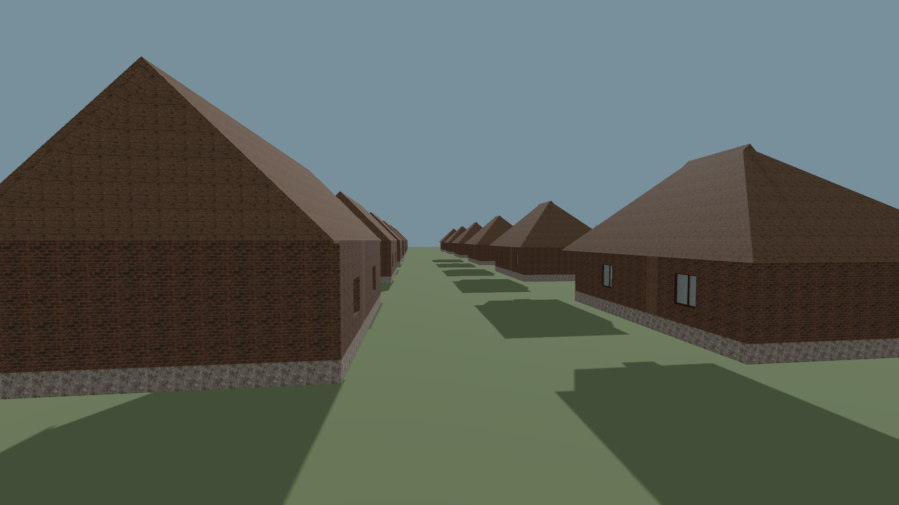
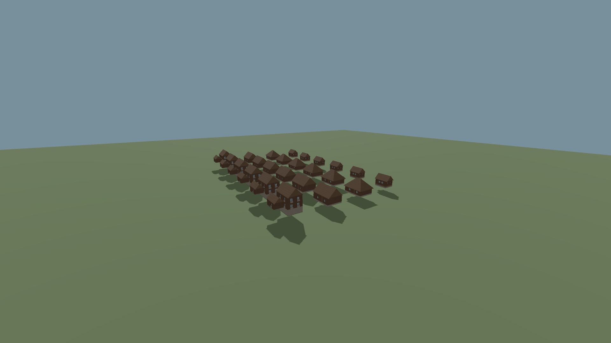
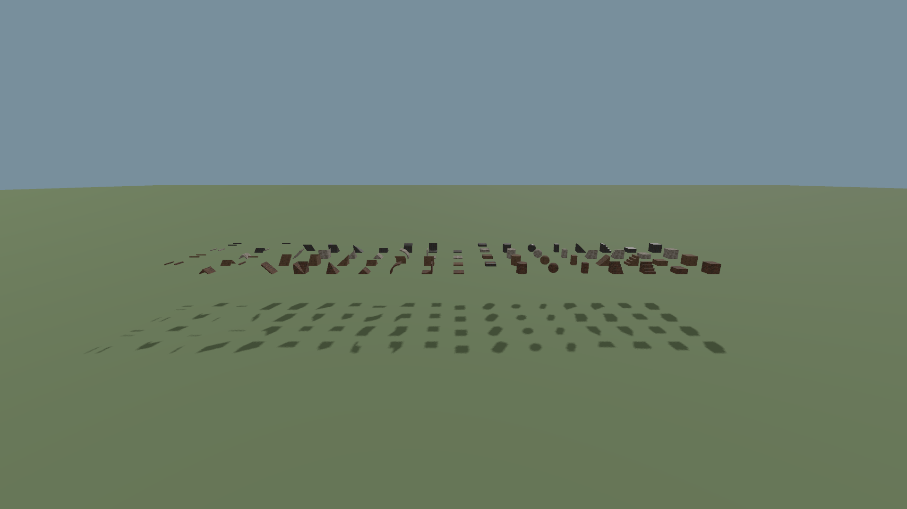

# Building geometry LOD

- Status: Implemented and installed / scoped checks; player visual approval pending.
- Updated: 2026-10-28. Previous baseline: `6cad0491` had greedy meshes and paging, no building LOD.
- Default on; ESC → Graphics → Building distance detail (LOD). Existing saves work without regeneration.
- Authoritative cells, approved houses, materials, full-detail collision and picking stay intact.

## Images

Matched 1080p cameras: four pixels differ by one channel step; distant houses use LOD, nearby surfaces retain detail.

24-house rendering fixture, not a proposed settlement layout. A2/B1/B2/C1 designs and attached models are unchanged.
Visible draw triangles: 147,428 → 130,604. 90 pixels differ; no visible silhouette/roof change in inspected images.

18-shape, four-material gallery. Near full-detail and LOD images are byte-identical.
Hashes, build and source provenance: [manifest](images/manifest.json).

## Changes and verification

- Native worker bakes up to three error-controlled index levels; renderer selects them without script polling or double-drawing fades.
- Preserve chunk borders, material/UV seams and disconnected parts. Integer-period UV normalization joins compatible coplanar faces; no texture repainting.
- Exact vertex deduplication only on meshes receiving LOD. Full-detail faces/collision remain unchanged; seven legacy byte-reference fixtures still pass.
- Edits invalidate local LODs; eight cached away/return cycles submit no new bakes. LOD buffers count against existing upload/cache/residency budgets.
- [Installed pack: six passing checks, zero diagnostics](../../reports/checks/20261028T135000186386Z_minerals_pack/summary.json): native LOD (40), worker, modular shapes (1,978), thin roof (19), visual (10), actual-world Graphics UI (5).
- [Camera evidence](../../reports/checks/20261028T135000186386Z_minerals_pack/building_lod_visual/evidence/building_lod_visual/result.json): 180 approach frames per mode; far draw triangles 108,140 → 91,316 (15.6% fewer). Mesh block triangles 93,930 → 77,106 at lowest levels.
- [17 matched comparisons](../../reports/checks/20261028T135000186386Z_minerals_pack/building_lod_visual/evidence/building_lod_visual/comparison.json): 0–90 changed pixels per 1920×1080 image. Sparse image samples complement, not replace, the moving-camera test.
- RTX 4050 Laptop GPU: capped median frame intervals 16.669/16.667 ms, p95 17.109/17.320 ms (full/LOD). No measured FPS improvement claimed. Capturing PNGs is excluded from these timed passes.
- LOD work: 145.171 ms total background bake, maximum 3.650 ms/chunk in that fixture. Extra geometry buffers trade memory for fewer drawn triangles; budgets are not enlarged.
- Debug and release DLLs built; final pack SHA256 `0aba7d1a8f9964dddde103d9e23a6680150993b9a3590b2eb28453ea342c5e9b`.

## Remaining / resume here

- User visual review and full populated-world / lower-end GPU endurance remain open. Compare the same route with the Graphics toggle.
- Existing streaming range/budget disappearance is separate; this patch does not promise seamless horizon residency.
- Already-minimal meshes and chunks above 65,536 triangles retain full detail. Separate furniture/doors keep their original models; no whole-house impostors or draw-call aggregation.
- Before more aggressive reduction, require unchanged openings, roof profiles, material alignment, edits and collision plus measured GPU benefit.
- Broader checks retained: [C1 generation](../../reports/checks/20261028T133417912351Z/run.json) reports two soil/slab clearance assertions; [old headless session check](../../reports/checks/20261028T133354557408Z/run.json) expects mouse capture after ESC. Neither is marked fixed by LOD.

## Reproduce / history

- `python tools/run_godot_check.py building_lod --headless --timeout 90 --require BUILDING_LOD`.
- `tests/building_lod_visual.gd`: temporary fixture only; launch in a nonactivating offscreen 1080p window for automated evidence. `tools/check_building_lod_images.py <evidence-folder>` compares captured pairs.
- Source: `addons/structures/native/block_lod.cpp`, `block_worker.cpp`, `block_world.cpp`, `block_streaming.cpp`; startup/UI: `building_lod.gd`, `session_menu.gd`.
- Earlier [fixture placement failure](../../reports/checks/20261028T132226971590Z/run.json) used the block-only API on attached prefabs; fixed the test to use records/combined transactions respectively.
- Earlier [visual draw-count failure](../../reports/checks/20261028T132926048761Z/run.json) sampled before attached-model publication settled. Warm-up fixed; source-stage captures remain in `reports/building_lod_visual/`.
- Unconditional vertex compaction broke legacy byte fixtures; [failure retained](../../reports/checks/20261028T134339409975Z/run.json). Compaction is now limited to actual LOD meshes; [all seven original references pass](../../reports/checks/20261028T134612086733Z/run.json).
