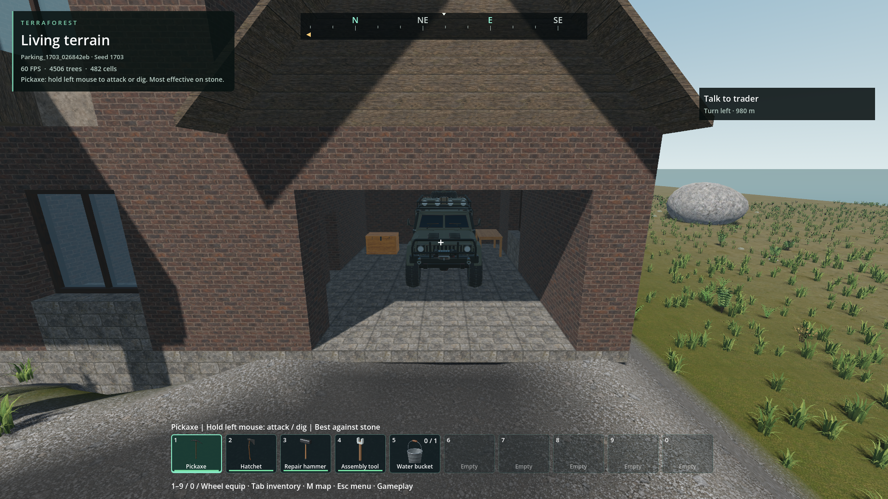
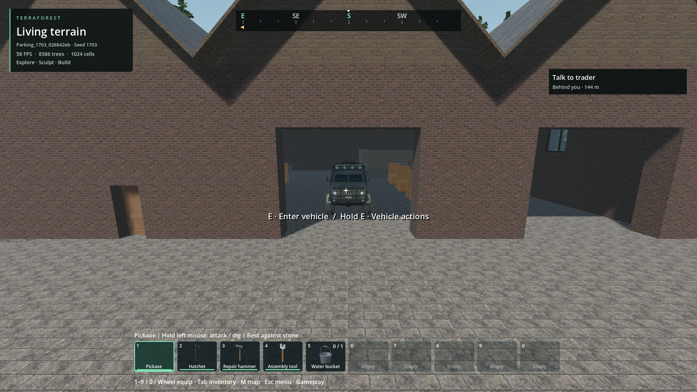

# Vehicles in garages and warehouses

- Status: Installed / scoped engineering verification; broader world acceptance remains open.
- Updated: 2026-11-03. User visual review: pending.
- Scope: Ranger vehicles in the approved, unchanged C1 garage and W1 warehouse.

## Changes and verification

- Generation-only bay selection; existing player saves are not retrofitted.
- Native block/model overlap and solid-support queries check chassis, straight
  departure, supported pedestrian exit and public-road separation. Sleepers and
  resettable quest locations reserve their space before vehicle placement.
- Native fleet owns identity, binary saves, bounded near activation and far rendering.
  No per-building nodes or continuously running parking script; maximum 32 new cars.
- [Initial fixture](../../reports/checks/20261103T000526074221Z/run.json): 77 checks,
  zero failures, all four rotations of both actual approved resources. This is not
  populated-world, visual, driving or performance acceptance.

- Final native admission: [93/0](../../reports/checks/20261103T062820623630Z/run.json),
  including C1 sleeper room support and garage separation in four rotations.
  Sleeper registry/planning [28/0](../../reports/checks/20261103T063134580297Z/run.json);
  actual sleeping/waking collision [80/0](../../reports/checks/20261103T063136303118Z/run.json).
- Packaged normal default Generate & play, seed 1703:
  [34/0 create and 12/0 fresh reopening](../../reports/building_parking_world/20261103T063617512537Z/run.json).
  Actual capsule walking, vehicle entry/interior exit/re-entry, native drive-out,
  braking, exterior exit and save pass for both buildings. Source fresh reopening
  passes 12/0 in that report's `source-reopen/console.log`. Interaction availability
  is test-overridden to avoid capturing the user's mouse; focused E input is unqualified.
- New C1 sleepers use the supported main room, not the garage lane. Existing saves
  and approved building cells/furniture remain untouched. Ranked alternatives are
  tried before giving up; C1 car quota is one per three homes, rounded upward.
- Saved positions, identities, next ID and module bytes are exact. Quaternion/basis
  float conversion uses a declared 0.000002 basis tolerance: package error 2.98e-8,
  position error zero. Re-encoded tilted poses are **not byte-identical**.
- Installed PCK `d218c056e5c4ec274cc9bff7b9605ebd14fb723a005ce100ccdc33817e2429c0`,
  471181252 bytes; 14 matching DLLs, no feature-specific native rebuild. Export
  building gates/smoke pass; root EXE untouched.
- Package parking work: 9.188 ms, three candidates, two cars. Short offscreen bay
  departures had zero readiness holds; C1/W1 p95 17.219/17.063 ms, worst 17.792/17.663 ms.
  Peak private commit 3.63 GiB and dedicated GPU 1.40 GiB are within provisional
  budgets. These samples do not establish foreground headroom or full street access.

## Images

Actual packaged default seed 1703, 1920x1080; both bay views inspected. Review
cameras exclude first-person-only body layers. User visual approval and surrounding
terrain-quality acceptance are not implied. [Sources and hashes](images/manifest.json).

## Retained failed trials

- `reports/building_parking_world/20261103T062316017036Z` selected a blocked garage;
  W1 drive-out passed. Ranked fallback trial `20261103T062537993727Z` found both C1
  sleeper conflicts; the new-world anchor correction resolves that conflict.
- `20261103T062833659611Z` and `20261103T063139806157Z`: both physical journeys passed,
  raw quaternion-byte equality failed. Decoded comparison established identical
  positions/identities with float basis rounding, now checked explicitly.
- The latter report's `diagnostic-reopen` was stopped after collecting comparison
  data because a headless photographic wait requires rendering. It is not a pass.
  Earlier logs and images stay at their original paths.

## Remaining / resume here

- Broader seeds, full street-to-bay journeys, NPC coexistence and long-drive focused
  performance remain open. Return with populated travel tests and user visual review.
- New vehicle providers need their own qualified bay envelopes/exit routes. The
  current catalog deliberately does not assume every installed vehicle fits Ranger bays.
- Quest-owned locations remain excluded: resetting a location does not yet own or
  recreate parked vehicles. Do not bypass the existing vehicle reset exclusion.

## Reproduce

- `python tools/run_godot_check.py building_parking --headless --timeout 30 --require 'BUILDING_PARKING checks='`
- `python tools/check_building_parking_world.py --pack` (owned `Parking_` worlds only).
- Relevant implementation: `addons/vehicle_runtime/building_parking.gd`.
- No new art or external dependencies. New original code follows the repository's 0BSD policy.
