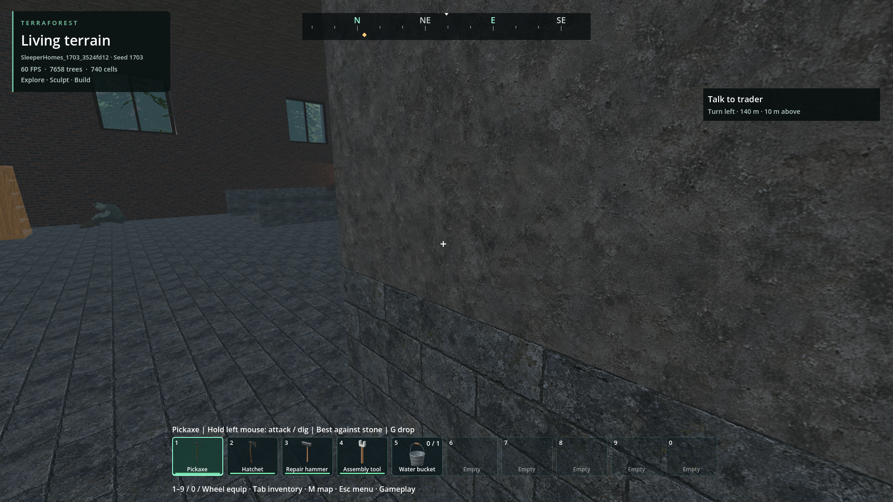

# Empty larger buildings

- Status: New-world change implemented; source and packaged checks pass; player review pending.
- Updated: 2026-11-05.
- User review: Requested at least a few zombies in larger buildings; explicitly chose new worlds only.
- Symptom: Most large buildings lacked authored inhabitants and the sparse outdoor population did not fill them.

## Changes

Three persistent seated sleepers are assigned to large two-storey houses, town
halls, schools, warehouses, police, medical and research buildings. Factories and
apartments receive four, spread among floors/rooms. The church keeps its existing
ten. Small cottage selection, trader and initial forty-metre sanctuary stay as
before; a large house inside that sanctuary can remain empty deliberately.

The generation hook runs only while publishing a new world. Existing saves are
not repopulated. Stable keys and native death records prevent duplicates, reset
waking or resurrection on republication, retirement and save/reload. The existing
256 authored record capacity and sixteen active encounter bodies are retained.
Ordinary outdoor residency stays six. More bodies can be dormant than active;
this is not a claim that every building in the whole world simulates at once.

Near authored residents can enter behind complete opaque cover instead of being
rejected only for proximity. Visible rooms cannot gain new residents in view.
Far unseen idle/sleeping residents can retire, with their state synchronized, to
make room for nearer groups. No elapsed-time spawn/refill loop is introduced.

## Verification and images

[Evidence](evidence.json) links every result and retained setup failure. The full
physical fixture places actual furnished resources in all four rotations, checks
support/indoor roof, sleeping-pose clearance and the entire guarded stand-up path.
A fresh process restores the population and confirms a killed resident stays dead.
The normal browser creates the Frontier expedition recipe, verifies groups in the
actual saved population, then reopens, kills, reopens again and admits hidden
residents through ordinary runtime paths.

Exported build, seed 1703, normal Frontier expedition generation, Forward+
1920×1080. One resident is visible at the left; the foreground pillar obscures
part of the view. Image inspected for room/pose context, not group count or player
visual approval. The live identity assertion establishes all three residents.
[Source, hash and retained asset provenance](images/manifest.json).

Original code and test changes were authored with OpenAI Codex for this request
under 0BSD. No third-party assets, animations or code were imported. Existing
building, character and dependency notices remain authoritative.

## Remaining / resume here

Player review of encounter placement/difficulty remains pending. The starting
sanctuary exemption and new-world-only scope are intentional. Existing cross-floor
routing, tight crawling spaces and broader crowd performance remain the limits in
the navigation standard and zombie aggression issue. Revisit on missing occupants,
visible spawn-in or refill after a cleared building: retain world/seed/building,
authored IDs, admission queue/capacity and geometry/readiness traces. Require a
normal browser-created world and fresh-process replay before closing that report.
