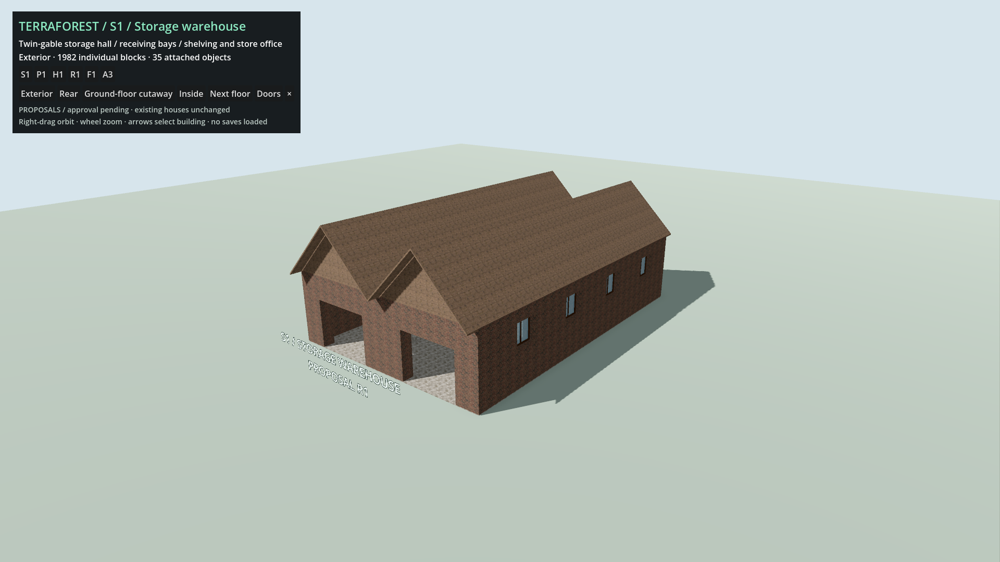
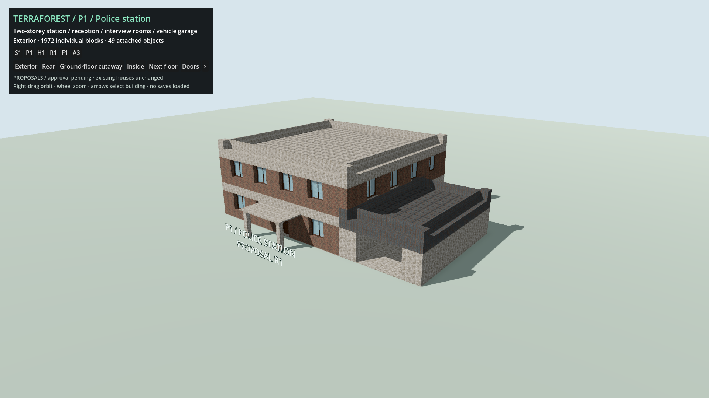
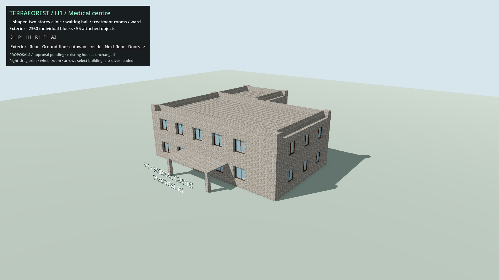
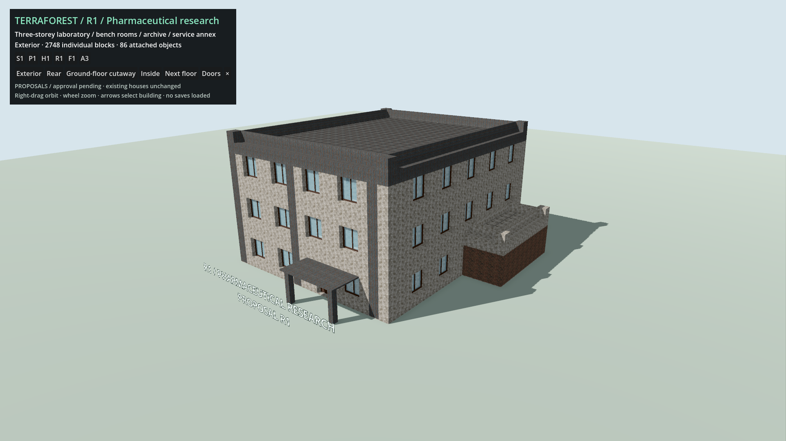
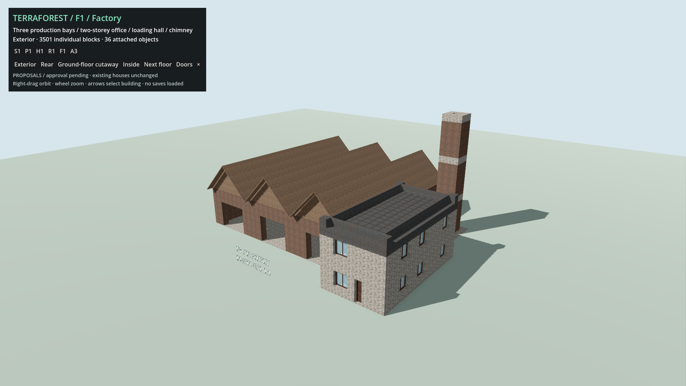
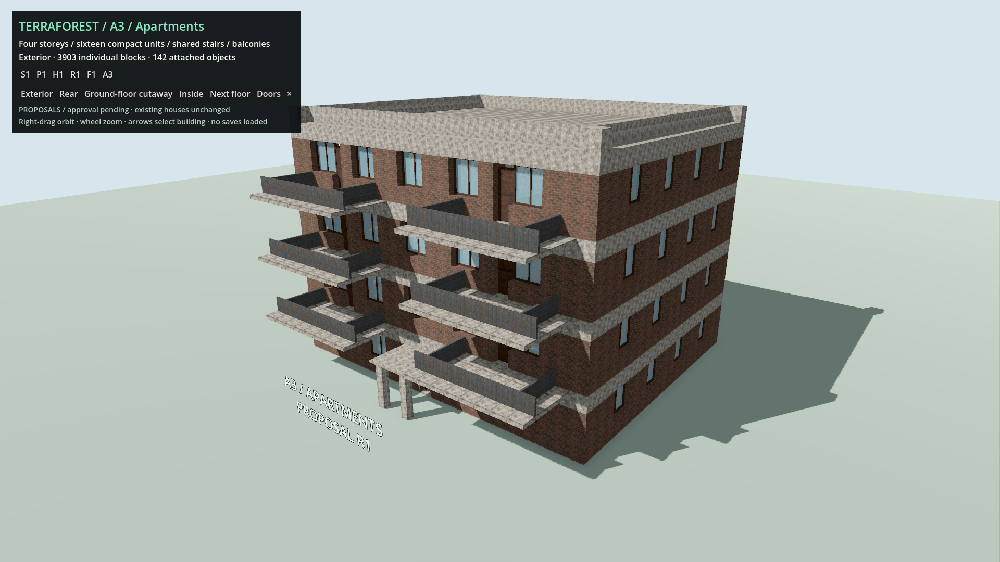
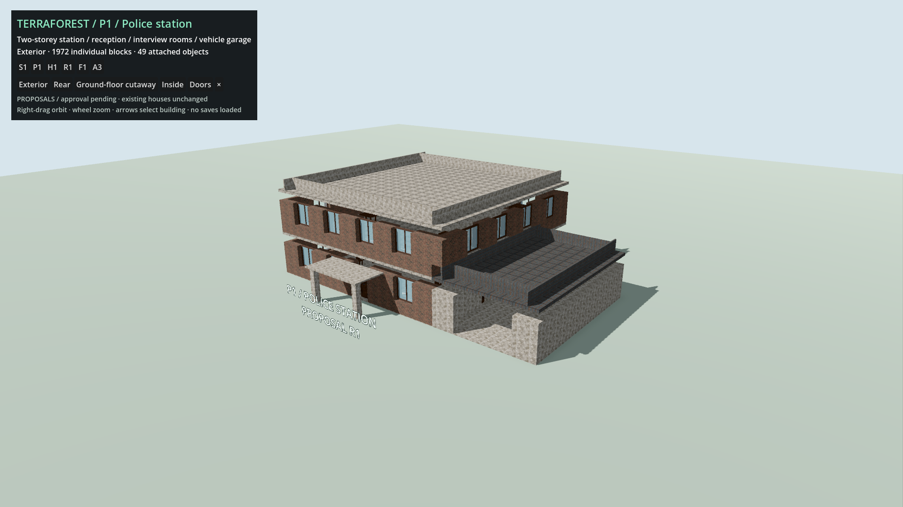
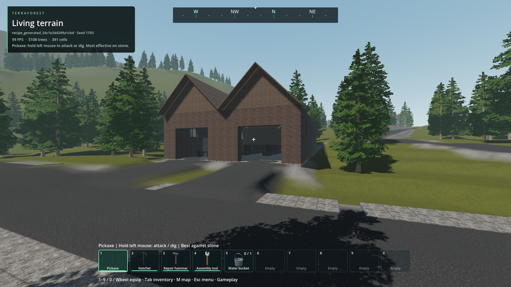
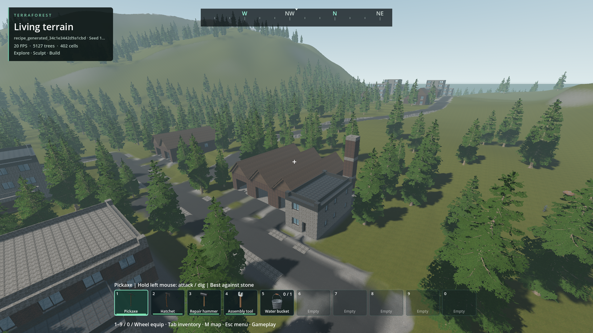
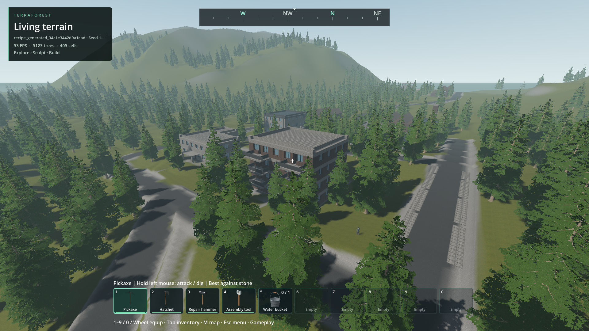

# City building proposals

- Status: All six designs approved; generation integration installed / scoped checks.
- Updated: 2026-10-28. R1 geometry from `643e33d9`; integration follows `e2d0e548`.
- User review: S1, P1, H1, R1, F1 and A3 approved 2026-10-28. Generated-site appearance remains unapproved.
- Scope: Six additional medium/large designs in newly generated larger settlements. Existing approved houses and player saves remain intact.

## Designs

| ID | Building | Main footprint | Layout | Native cells |
| --- | --- | --- | --- | ---: |
| S1 | Storage warehouse | 18 × 27 m | Two loading bays, high storage hall, receiving office, shelves/chests | 1,982 |
| P1 | Police station | 27 × 19 m | Two-storey station, reception, interview/holding room, attached vehicle garage | 1,972 |
| H1 | Medical centre | 25 × 25 m L-plan | Two storeys, waiting area, consultation/treatment rooms, ward, rear stair wing | 2,360 |
| R1 | Pharmaceutical research | 23 × 23 m including annex | Three storeys, separated bench rooms, sample/archive storage, service annex | 2,748 |
| F1 | Factory | 35 × 29 m overall | Three production/loading bays, two-storey dispatch office, separate chimney | 3,501 |
| A3 | Apartments | 23 × 19 m plus balconies | Four storeys, sixteen compact studio layouts, common stairs, six balconies | 3,903 |

Footprints describe the main building envelope, not the future lot requirement.
Canopies, balconies, roof overhangs and a three-metre clearance are included in
each prefab's actual bounds/`lot_clearance`. Furniture is provisional existing
table/chair/shelf/chest models and grid-built bed platforms. These are architecture
proposals, not implemented medicine, research, manufacturing, policing or apartment
simulation. The industrial bays are deliberately open, not working roller shutters.

## Review images

Actual 1920×1080 Godot renders from the R1 isolated architecture stage, not a
generated world/seed. Same daylight and material settings; framing changes with
building size. The flat green stage and floating labels are review aids, not
proposed city terrain, roadside strips or persistent building components.
Current exteriors and floor cutaways were inspected and approved by the user on
2026-10-28. Original pixels and hashes are retained in `images/manifest.json`.

### S1 / Warehouse

[Ground-floor cutaway](images/storage_s1_2.png): receiving office and storage aisles.

### P1 / Police

[Ground-floor cutaway](images/police_p1_2.png): station separated from the garage.

### H1 / Medical centre

[Ground-floor cutaway](images/medical_h1_2.png): waiting space, treatment rooms and rear stair wing.

### R1 / Research centre

[Ground-floor cutaway](images/research_r1_2.png): lab bench rooms, circulation and service annex.

### F1 / Factory

[Ground-floor cutaway](images/factory_f1_2.png) · [Production hall](images/factory_f1_3.png).

### A3 / Apartments

[Ground-floor cutaway](images/apartments_a3_2.png) · [Fourth-floor cutaway](images/apartments_a3_floor_4.png).

### Rejected internal draft

Earlier uncommitted draft, same stage/camera. Thin floor cells mistakenly replaced
perimeter wall cells and left horizontal facade gaps. Corrected by closing the
floor perimeter, not by adding a cosmetic facade mesh. This image is not a candidate.

[Rejected factory valley](images/rejected_factory_valley.png): the earlier overlapping
gable modules left a visible strip of sky. Separate adjacent nine-cell bays now
meet without overwriting each other's slope cells. The archive retains both views.

## Implementation and checks

- [Offline recipes](../../reviews/city_buildings/recipes.gd) bake six native resources under `reviews/city_buildings/baked/`. No authoring loop runs during normal gameplay.
- Fabric, roof slopes, floor slabs, stairs, balconies and chimney remain individual native grid cells. Furniture, windows and doors use existing native model collections.
- Uses existing chunk baking, cache, geometry LOD, collision and combined block/model persistence. No new renderer or per-block scene nodes. Integration adds native access-path planning and sidewalk cutouts.
- [Review viewer](../../reviews/city_buildings/viewer.gd) loads one prefab at a time; exterior/rear/interior and per-floor cutaway views, door toggle, orbit/zoom. Cutaway changes restore exactly. No mouse capture, cursor warp, save loading or world regeneration.
- [Tests](../../tests/city_buildings.gd) compare every baked record/model, native publication, byte-identical combined persistence, independent top-block destruction, facade closure, roof seams, both directions through every door, all stair flights, their return landings and loading-bay walking routes.
- Corrected draft issues: overlapping windows at door cuts, inward double-door hinge obstruction, shelves intersecting beds, floor perimeter gaps, and overlapping gable modules leaving open valleys. Roof tests also require a solid vertical wall at intentional annex roof-height changes.
- [Rendered checks](../../reports/checks/20261028T143542520020Z/run.json): 86 assertions, zero diagnostics; 32 exterior/rear/interior/per-floor images in `reports/city_buildings_r1_release_images/`.
- [Final full regression](../../reports/checks/20261028T144026493626Z/run.json): 247 assertions, zero failures or runtime diagnostics. [Factory roof/route check](../../reports/checks/20261028T143706719072Z/run.json): 22 assertions, zero diagnostics.
- Launcher dry-run and actual headless `--city` startup pass. Godot generated the three new script UIDs. Its editor import retained existing nested-ZombieLab/archived-ramp duplicate-UID warnings in `reports/city_buildings_uid_import.log`; these are outside the city prefab work.
- Earlier failures retained: [doors/furniture](../../reports/checks/20261028T141611436888Z/run.json), [attachment isolation](../../reports/checks/20261028T141817060199Z/run.json), and [roof test initially rejecting a solid stepped annex junction](../../reports/checks/20261028T143303901161Z/run.json). Images exposed additional defects after basic engineering checks; passing checks alone is not design approval.

## Generated-world integration

- Production assets under `addons/structures/prefabs/city_*.tres` preserve every approved cell/model. Only approval/site metadata changes. `city_catalog.gd` adds industrial, civic/research and medical/residential pairs to the second district of larger settlements.
- Native full-envelope/apron surveys retain 2 m fill / 3 m cut. Separate pedestrian paths and six five-metre loading/garage approaches are baked during generation. Native paving omits both plate cells and terrain beds at access crossings; trusted plate shapes are unchanged.
- A bounded eastern-half fallback fixes the reproduced maximum inland seed-1703 fit failure. Nine districts now contain 86 buildings, including 18 city buildings. Default one-district villages and existing saves are unchanged.
- [Plan regression](../../reports/checks/20261028T154736525012Z/run.json): 79 checks, two seeds, exact geometry, all foundation columns, clear interiors, six driveways and maximum inland layout. [Paving](../../reports/checks/20261028T154817069858Z/run.json): 87 checks; release-DLL rerun also passes. Seven-seed lot planning and 19 site-standard checks pass separately.
- [Production generation](../../reports/checks/20261028T154835639010Z/console.log) publishes 86 buildings, 5,309 edits and twelve lakes. That run later stopped during faulty traversal-fixture checks; it is not a full passing run. [Fresh-process traversal](../../reports/checks/20261028T160224631632Z/run.json) passes 128 checks: all six exact resources, player street/interior/return routes, native NPC entrance routes, upper-floor player routes, all six driven vehicle bays, collision readiness and unchanged saved bytes.
- [Gameplay capture](../../reports/checks/20261028T161307969389Z/run.json): 83 checks; repeats resource/streaming verification with normal gameplay HUD, not the route exercise. Tests never capture the desktop pointer. Saved evidence JSON lives in each run's `evidence/` subfolder.
- RTX 4050 Laptop GPU, 1080p Forward+, capped at 60: six 180-frame approaches report frame p95 18.96–21.08 ms, maximum 38.45 ms, GPU p95 5.73–6.92 ms in the traversal run. Gameplay-HUD repeat: p95 19.24–22.16 ms, maximum 35.46 ms. Screenshots are outside timed samples. These are short scoped measurements, not a smooth-60-FPS or weak-hardware claim.
- At these locations 149–194 structure meshes, 22–47 collision chunks and 391–405 vegetation owners remain resident; 61–65 chunks have cached geometry LOD. Authoritative cells and existing admission/job limits are unchanged.
- Installed pack startup and [20 packed-resource assertions](../../reports/city_pack_resources.log) pass; all 14 external DLL hashes match source. [Release recipe checks](../../reports/city_release_world_recipe_native.log) pass 26 assertions. Pack hash is recorded in `images/generated_manifest.json`.
- Retained failures: access fixtures initially used a blocking observer, wrong packed door translation and synthetic input missing its logical key; research NPC fixture also overshot its target. These were test defects, not evidence that every blocked route was a generator bug. `20261028T155603142260Z` retains the one-failure NPC run. `20261028T154944546408Z` retains two unrelated stale recipe-size assertions; its planning checks pass. Initial pack-probe parse failure remains in `reports/city_pack_resources_initial_parse.log`.

### Populated-world images

Unaltered Godot captures of disposable seed-1703 slot
`recipe_generated_34c1e3442d9a1cbd`, three settlements × three districts, woodland,
looped roads, extensive trails, material veins and grid preference enabled.
Actual generated slopes, roads, forest and neighboring buildings, not the flat
review stage. Doors were opened for route checks; first-person meshes are hidden
only for evidence cameras. Camera positions differ from the original architecture
reviews. Provenance and hashes: `images/generated_manifest.json`.




[Police exterior](images/world_police_p1_generated.png) ·
[Research exterior](images/world_research_r1_generated.png) ·
[Medical exterior](images/world_medical_h1_generated.png) ·
[Medical interior](images/world_medical_h1_interior.png).

Inspected engineering evidence, not user visual acceptance. Rounded/uneven road
shoulders and lot transitions remain visible and reviewable; successful access
does not resolve the separate terrain/road grid-fit issue or the rejected legacy pad.

## Reproduce

From TerraForest's project directory:

```text
python tools/review_modular_buildings.py --city
python tools/run_godot_check.py city_buildings --headless --timeout 420 --require "failures=0"
python tools/run_godot_check.py approved_city_generation --headless --timeout 180 --require "failures=0" -- --full-plan
python tools/run_godot_check.py approved_city_world --timeout 900 --require "failures=0" -- --city-recipe --city-integration
```

Use S1/P1/H1/R1/F1/A3 or the arrow keys to select a building; right-drag to orbit,
wheel to zoom, Next floor for upper cutaways, Doors to operate hinges, ×/ESC to exit.
Explicit `-- --bake-city` regenerates review resources only; it is not a gameplay step.
For normal gameplay use Worlds → Create → Regional belt, or a custom recipe with
at least two districts. New city additions are not injected into existing saves.

## Remaining / resume here

- All six approvals and scoped integration checks are satisfied. Generated-site visual acceptance, maximum layouts across more seeds, all-district route coverage and weak-hardware/endurance remain open.
- Existing rejected saved single-pad districts are not migrated by this work. No redesign of approved building cells or attached models is authorized here.
- Functional room furnishing, bathrooms/kitchens, equipment, loot balance and service gameplay remain separate work. Roof access and garage roller doors are not implemented.
- Return trigger after integration: generated-site visual feedback or measured access/streaming defects, using this folder's original assets and comparisons.
