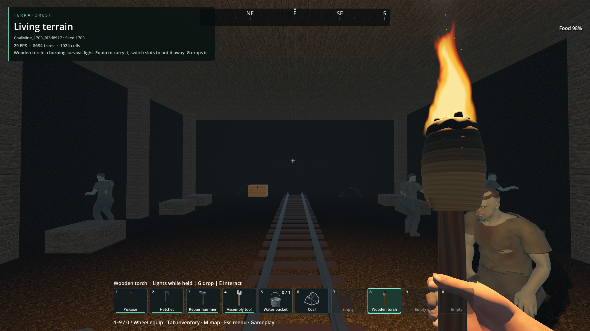
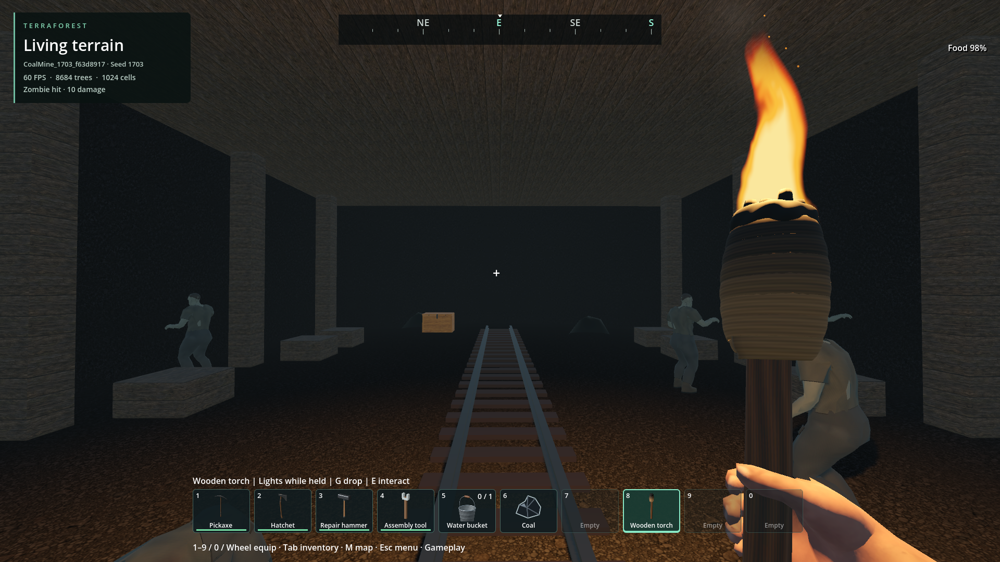
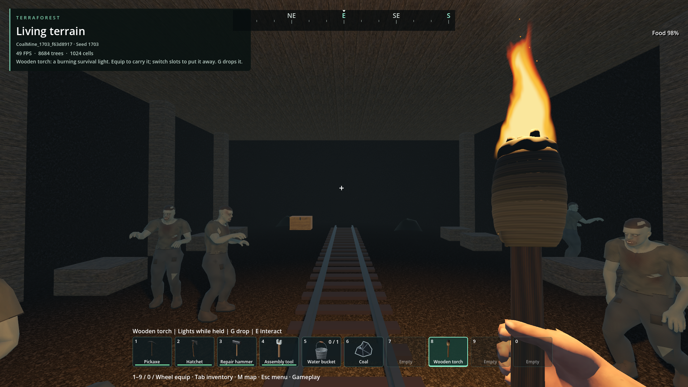
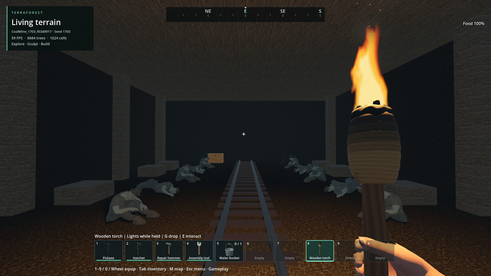
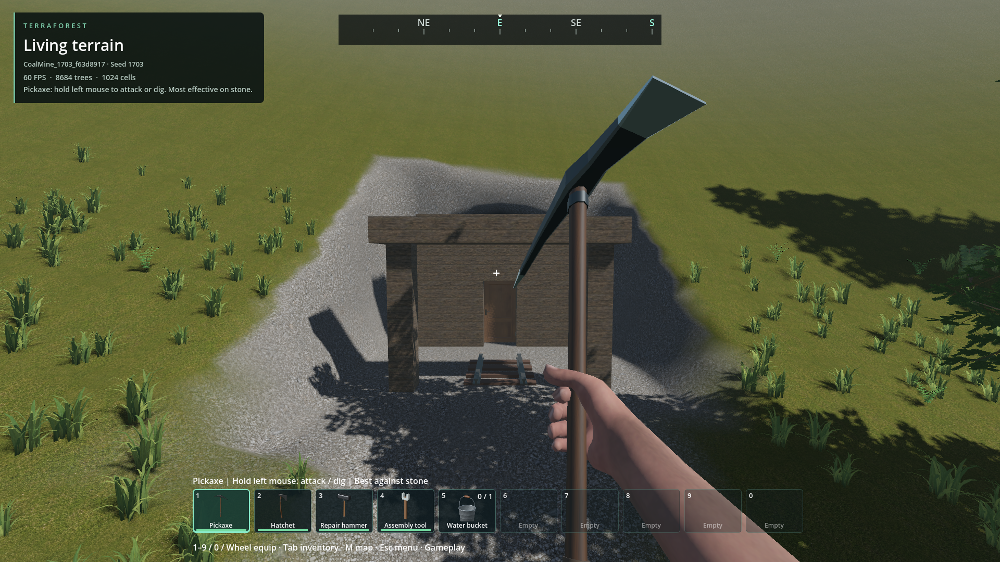
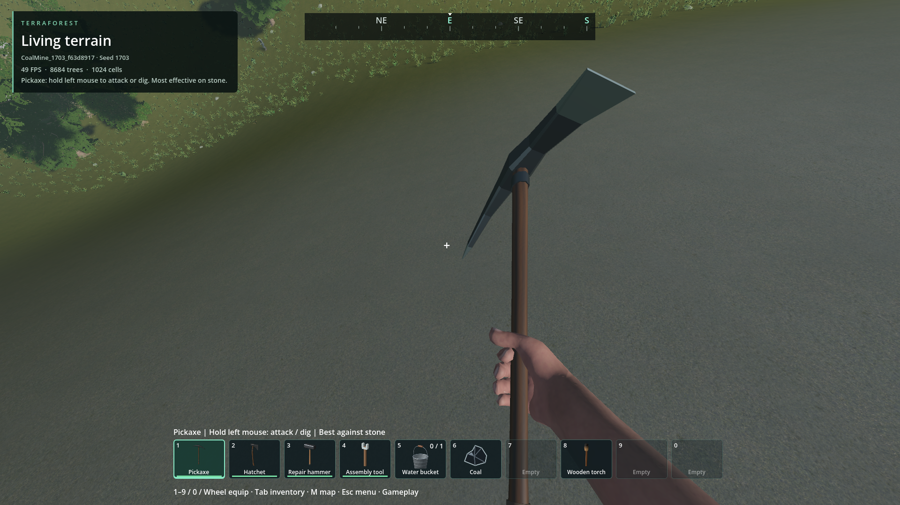

# Blackridge coal mine

- Status: Installed prototype; scoped source/package checks pass. Visual acceptance pending.
- Updated: 2026-11-01. User visual review: not reviewed.
- Brief: a mountain-embedded mine, short sleeper/chest dead ends, a longer rail
  loop, varied chambers, and a deeper station structure containing ten zombies.

## Images




Updated installed PCK `2bf75c9e6afd2f62f6891e309fa941aa07f23d5fb7e5589b1d253730f9907d72`
passes 59 physical re-entry checks and 46 genuine underground reopen checks.
All nine survivors have physical bodies after the test killed one of the original
10 station zombies. Player position restores exactly from the torch-held save;
the torch stays in inventory, while the existing load selection is the pickaxe.
Both images were inspected; the driver re-equips the torch for visibility.
Exact phase timings, package/native hashes and scope: [verification record](verification.json).



Source fix `016e3ffb`: re-entry 59/0 and fresh underground reopening 46/0 checks.
The saved torch-held player position restores exactly; all nine surviving station
residents are physically instantiated. The torch remains in inventory; existing
loading behavior selects the pickaxe, and the test then re-equips the torch.
The native v1 pose format remains unchanged. This inspected source image is
retained alongside the later successful package captures above.




Installed PCK `4295d8f9717cda70175cba36671fc10b259f39e0b8b6454f2fed6211d3a14afe`,
new default world `CoalMine_1703_f63d8917`, seed 1703, 1920×1080 offscreen.
The uninterrupted journey passed 59 checks, followed by 41 data-restore checks.
Both images were inspected. HUD FPS is not a frame-pacing measurement.



The original restore driver called normal teleport at the underground station,
which resolves the surface height plus two metres. All persisted data assertions
passed, but this image does **not** show station re-entry. It is retained as
rejected presentation evidence. The corrected test approaches outside, walks
through the saved doorway and requires nine surviving station bodies.


Fresh default generation, seed 1703, `CoalMine_1703_2db6d4b4`, source build,
1920×1080. Inspected after real chest transfers and rail construction. This run
completed the inside route; the final hillside elevation assertion was corrected
and checked in a separate continuation below. HUD FPS is not a benchmark.


The same owned world, targeted final-exit continuation and fresh-process reopen:
13 and 41 checks pass. Depleted chest contents, dead station resident, ten stable
station identities, harvested coal and exact rail transforms restore.

Historical captures follow; their original failed-run scope is preserved.


Default Generate & play, seed 1703, `CoalMine_1703_23e94d31`, source build,
1920×1080 offscreen capture. Ten station residents and the timber loading canopy
are physically present. The assistant inspected this image. This capture belongs
to the retained run that later hit a test-script error; it is not full-run or
performance acceptance. Screenshot HUD FPS is not a benchmark.


Native natural-hillside fixture, seed 1703, origin `(536,139,445)`, rotation 3,
1920×1080. The shared foundation/grounded-model publication checks pass. These
fixture images were inspected for rail continuity, station clearance and terrain
contact. They omit surrounding vegetation and normal world presentation.
Sources, captions and hashes: [image manifest](images/manifest.json).

## Implementation

The default new-world recipe now surveys a third underground layout through the
existing bounded native hillside planner. It fits only where the roof stays
covered, the approach remains dry and within earthwork budgets, and other sites
are excluded. A failed search records a skipped layout; it does not force a site.
Existing saves retain their contents and are not repopulated.

The mine has 16 authored excavation passages, two short supply branches, a
return loop, a large working chamber and a loading station roughly 50 m inside.
The portal door, timber frames and station roof/posts/benches are native block
and model placements. Five stocked chests and 13 keyed inhabitants belong to the
location: three side encounters and exactly ten station residents. Stable keys
use bit 42 for this mine and bit 43 for station residents, in addition to the
existing underground ownership bit. Quest ownership uses the existing registry.

Rails are five reusable construction models: 4 m straight, 2 m straight,
90°/45° bends at 4 m radius and a turnout. The gauge is 1 m. Curves are sampled
offline, with thin foot/web/head profiles and timber ties. Low compound proxies
are inset at joins and all models share native batched rendering, damage,
salvage and persistence. The portal and chamber transfer have intentionally
broken track. Coal heaps are original harvestable models; item 220 is Coal.

The station requirement needs more than the previous six-body cap. Native
awareness/navigation reserve a bounded 16 slots; ordinary population admission
stays at six. A nearby coal-mine key enables up to 16, enough for all 13 mine
residents and three other residents. Route search work budgets are unchanged.
This is not a general increase in ambient population or a dense-crowd performance
approval. No independent AI controller or new movement integrator was added.

New code is 0BSD; original model/layout/icon data is CC0-1.0. Editable source and
exact asset scope: [provenance](../../addons/exploration/COAL_MINE_PROVENANCE.txt).
Inherited timber, chest, door and character terms remain intact.

## Verification and retained failures

- `reports/checks/20261101T173801885550Z`: 38 native coal-mine assertions pass,
  including native publication, paired 45-degree rail joins, exact rail/population
  restoration and explicit awareness capacity rejection above 16. The earlier
  36-check report remains at `reports/checks/20261101T171259467558Z`.
- `reports/exploration_native/20261101T171924310635Z`: release arched excavation,
  all-layout/five-seed/all-rotation terrain checks, and model-only publication pass.
- Awareness: 34 debug and 34 release checks pass, including admitting sixteen
  station slots and rejecting seventeen. Debug evidence:
  `reports/checks/20261101T173808804319Z`. The original six-slot configured fixture
  still rejects a seventh record.
- `reports/coal_mine/20261101T171449512743Z`: rendered fixture passes all support,
  placement, sleeping-envelope and actual wake checks, including all 13 residents.
- `reports/coal_mine/20261101T171812493734Z`: normal Generate & play created and
  durably published the mine; physical player walks reached both loot branches,
  completed the loop, opened the door, and reached the deep station. All ten
  station bodies were present and completed waking. Later failed on the driver's
  nonexistent `inventory.count` call, now replaced by counting native snapshot
  slots. Its owned save was reused by the next retained run.
- `reports/coal_mine/20261101T173811247298Z`: paid rail placement, chest transfers,
  loop, ten station bodies/wakes and coal harvesting pass. The straight return
  hit an awake resident frozen in the central aisle by the test. This is retained
  crowding evidence; it is not a performance or combat pass.
- `reports/coal_mine/20261101T174028166898Z`: fresh default generation and the
  complete mine route pass using the existing station side lane. The last exterior
  walk reached its X/Z target and stood on the hillside at Y138.07, but the test
  incorrectly required the tunnel's Y139. That assertion failed; the owned world
  saved durably. Exterior checks now require grounded arrival instead of a flat
  tunnel elevation. The failed report is retained, with a separate continuation
  for the exit and fresh-process persistence checks.
- `reports/coal_mine/20261101T171539657228Z`: stopped after repeated concurrent
  terrain script/DLL signature mismatch; the source native terrain build was
  brought into agreement. This is a failed run, not mine traversal evidence.
- Initial native reports retain the rejected curved-proxy joins and insufficient
  full-envelope floor excavation. Those failures were corrected by clamping
  endpoint proxies and authoring larger turning chambers; acceptance checks were
  retained. The first rendered review also used a stale six-capacity native
  awareness build. No failed logs or screenshots were discarded.

- `reports/coal_mine/20261101T174529753475Z`: targeted exterior continuation
  passes 13 checks; fresh-process reopening passes 41 checks. The preceding
  ordinary generation and all interior movement remain evidenced by the retained
  `174028166898Z` run. This is combined functional evidence, not an uninterrupted
  all-green generation-to-reopen run. The continuation loaded concurrent combat
  hooks without errors; a frozen packaged build remains a separate gate.
- Sampled source resource peaks across generation/exit/reopen stayed within the
  repository gates: at most 3,907,481,600 bytes private commit and 1,493,803,008 bytes
  dedicated GPU allocations. Offscreen samples do not establish frame pacing.

- `reports/coal_mine/20261101T184507896315Z`: installed PCK fresh default
  generation/full journey passes 59/0 checks in 132.062 s, then data restoration
  passes 41/0 in 30.155 s. PCK hash and all 14 native DLL hashes match before/after.
  Pointer captures are zero. Sampled peaks stay within gates: 3,881,525,248 bytes
  private commit and 1,477,021,696 bytes dedicated GPU allocation. The restore
  image above exposed a driver presentation gap; do not infer physical re-entry
  from the 41 saved-data checks. The later physical checks exposed the runtime
  defects below.

- Corrected physical re-entry `restore185639` in the same package report reaches
  the station through its persisted doorway, but 48 checks include one failure:
  fewer than nine surviving station bodies are instantiated. Native identities,
  death, loot and rails still pass. The actual station image is retained separately
  as `coal_station_restored_population_rejected.png` in the report.
- `inside_restore185833` has 11 checks and one failure: the reopened player pose
  differs from the inside pose. Read-only inspection found that the world adapter
  passes torch item 6 to the v1 native pose codec, which accepts only tool IDs 0–4;
  the empty result retains `_saved_pose`. The saved archive confirms the older
  surface position `(579,169.06,445.5)` instead of the station floor near Y139.
  Source fix `016e3ffb` maps later held items to v1 pose mode 0 and rejects an
  invalid active capture, preserving inventory and the existing loading fallback.
- Source diagnostics `restore190620` identified the missing resident: saved feet
  beside a rail were rejected by the oversized `.32 m / 1.8 m` admission capsule,
  although the actual standing movement body is `.24 m / 1.74 m`. The final fix
  uses that exact physical shape for authored/restored standing clearance. It
  retains exact saved positions, the original `.18 m` support reach, masks,
  water/readiness checks and conservative ambient admission.
- Temporary six-centimetre retry experiments are retained in
  `reports/checks/20261101T190945735251Z`, `20261101T191034789502Z`, and source
  `restore191036`. They were removed after the actual shape mismatch was proven;
  no position nudge or support-range expansion is in the final implementation.
- `reports/checks/20261101T191340874017Z`: 15 physical assertions pass using the
  baked rail proxy and an actual initialized zombie. Both recorded saved edge
  positions restore exactly; real rail/wall/ceiling/character overlap, missing
  residency, water and unsupported positions still reject.
- `source_restoration_pass.json` in the package report retains source re-entry
  `restore191448` (59/0, 38.559 s) and `inside_restore191527` (46/0, 27.940 s).
  It exercises every current tool catalog selection, invalid active capture,
  loading/waiting fallback, actual doorway walking, nine surviving bodies and
  exact no-teleport underground pose restoration. Held torch6 maps to pose mode0;
  inventory keeps the torch and normal load selection is pickaxe1. Both resource
  gates pass. The later updated package evidence follows.
- Updated PCK `2bf75c9e...907d72`, same owned world: `restore192411` passes
  59/0 checks in 51.026 s; `inside_restore192502` passes 46/0 in 29.961 s.
  Summary: `package_restoration_pass.json` in the report. This closes the two
  discovered restoration defects in the installed package: all nine survivors
  instantiate and saved feet `(578.7599,139.184,445.4368)` restore exactly without
  teleporting. PCK and all 14 source/dist native hashes match before/after.
  Zero pointer captures; sampled peaks are 3,763,073,024 bytes private commit and
  1,502,715,904 bytes dedicated GPU allocation, within gates. Both station images
  were inspected. The initial new-world journey remains qualified to the earlier
  PCK; it was not repeated on this restoration-focused export.

## Remaining / resume here

The package restoration gate is closed for PCK `2bf75c9e...907d72`. Earlier
package failures and rejected images remain part of this record. Use the normal
`world --pack` command after future runtime/layout changes to obtain a new full
journey and both restoration phases on one package; `--resume` is a targeted
restoration check on the retained owned slot, not a fresh-generation substitute.

Player review should assess station repetition, mine dressing and branch variety.
The inspected prototype has a deliberately simple timber canopy and symmetric
station seating; this is not final location-art acceptance. Foreground frame
pacing with all ten awake, combat/crowding, broader generated-world seeds and
long-run performance remain unqualified. Native route and sleeper checks alone
do not qualify whole-world pursuit or every possible terrain encounter.

## Reproduce

Use a new default **Generate & play** world, seed **1703**, then find **Blackridge
coal mine** on the map. Existing worlds do not acquire it automatically.

Safe owned test commands, run from the project directory:

```text
python tools/run_godot_check.py coal_mine --headless --timeout 90 --require "COAL_MINE checks="
python tools/check_exploration_native.py --release
python tools/check_coal_mine.py review
python tools/check_coal_mine.py world
python tools/check_coal_mine.py world --retry reports/coal_mine/20261101T174028166898Z --complete-return
```

The world driver creates only `CoalMine_*` test worlds, uses ordinary browser
generation/loading, disables desktop pointer capture and runs nonactivating.
Travel from the town to the mine is not tested: it streams to the approach, then
uses the real walking controller through the mine. Existing player saves are not
used. The retry option validates ownership before opening a retained test world.

The diagnostic `--complete-return` mode checks only a retained journey’s final
exterior walk and persistence. It does not relabel that earlier failed run. The
regular `world` mode exercises the corrected full route from a new default world.
