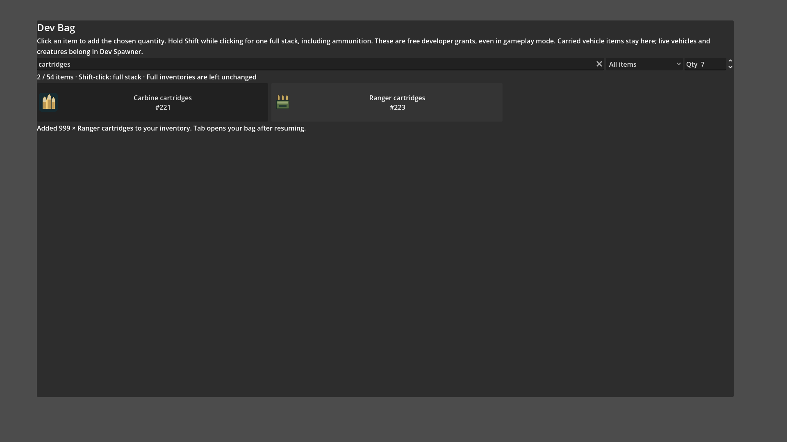

# Dev Bag full-stack shortcut

- Status: Installed; scoped source and actual-executable checks pass.
- Updated: 2026-11-01. Source: `a10207af`. User visual review: not reviewed.
- Request: holding Shift while taking an item should give a whole stack, including ammo.

Actual existing executable and installed PCK, isolated live Dev Bag UI with real
native inventory. Qty 7 remains selected while Shift-click adds 999 Ranger rounds.
Agent reviewed; this staging panel is not the complete in-world menu arrangement.
The earlier source image and its identity remain in images/manifest.json.

Normal clicks use the quantity box. Shift-click uses the same stack limit as
native inventory registration: 999 for ammo/materials/resources, one for weapons,
clothing, buckets and vehicles, and the existing 1,000,000 coin limit. Existing
partial stacks fill first; the remainder uses another slot. If there is not enough
room for the whole amount, nothing is added.

Verification: 12 source checks (`reports/dev_bag_shift/20261101T203701/run.json`)
and 12 actual-executable checks (`reports/dev_bag_shift/20261101T204445/run.json`).
The final check routes mouse motion/down/up through the viewport with actual
injected Shift key state. Both ammo types, materials, nonstackables, coin limit,
modifier release, partial-stack merge, atomic capacity rejection and loading guard
pass. No diagnostics or pointer capture; strict sampled resource gates pass.
PCK: `c0e972a0edeec4f99d35b0af028d6355f161e89f3f85e7e57723ecb000cc6f98`.
All fourteen DLLs match; exact executable/native/script identities are recorded in
verification.json.

Earlier headless fixture runs 203613/203633 did not route synthetic GUI clicks.
The initial correction invoked the live button signal directly; the final fixture
uses the correct menu layer and viewport routing. Those failed fixture reports
remain in reports/dev_bag_shift. Runtime code needed no further change.

No requested implementation or installation work remains. Reproduce with
Esc → Dev Bag: set Qty 7, Shift-click Ranger cartridges, then release Shift and
click again. Counts increase by 999, then 7, provided enough inventory space exists.
