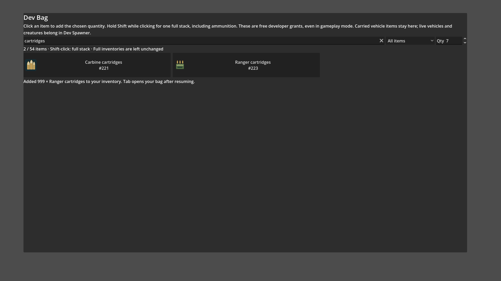

# Dev Bag full-stack shortcut

- Status: Source implemented and checked; combined package verification pending.
- Updated: 2026-11-01. User visual review: not reviewed.
- Request: holding Shift while taking an item should give a whole stack, including ammo.

Isolated live Dev Bag UI with real native inventory, source build. The quantity
box remains at7 while Shift activation adds999 Ranger cartridges. Agent reviewed;
this staging panel does not represent the complete in-world menu arrangement.

Normal activation retains the quantity box. Shift activation uses the same item
stack limit as native inventory registration:999 for ammunition/materials/resources,
1 for weapons/clothing/buckets/vehicles, and the existing1,000,000 coin limit.
Existing partial stacks fill first; the remainder uses another slot. If there is
not enough room for the whole requested amount, nothing is added.

Focused report: `reports/dev_bag_shift/20261101T203701/run.json`,12 checks pass,
including both ammo types, materials, nonstackables, coin limit, modifier release,
partial-stack merge, full-inventory atomic rejection and loading guard. The check
uses real injected Shift state and the live Button.pressed handler. No pointer
capture. Screenshot provenance is in images/manifest.json.
Earlier headless fixture runs203613/203633 did not dispatch synthetic GUI clicks;
those failed fixture reports remain in reports/dev_bag_shift. The corrected
focused fixture directly activates the live button signal; runtime code unchanged.

Remaining: include this source in the coordinated combined export, rerun the focused
check with the actual executable and matching DLLs, and record its PCK identity.
Reproduce manually with Esc → Dev Bag: set Qty7, Shift-click Ranger cartridges,
then release Shift and click again. Counts should increase by999, then7.
