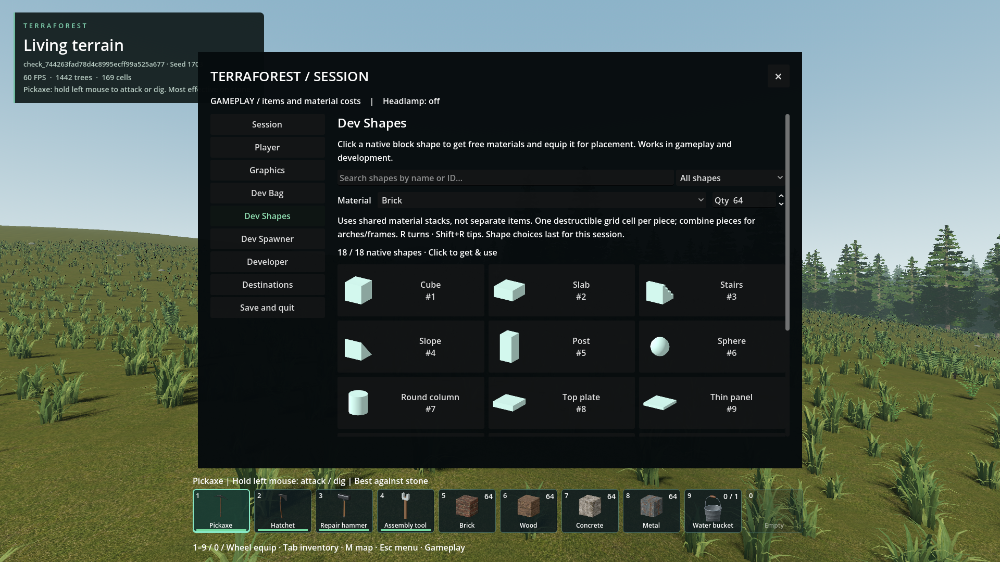
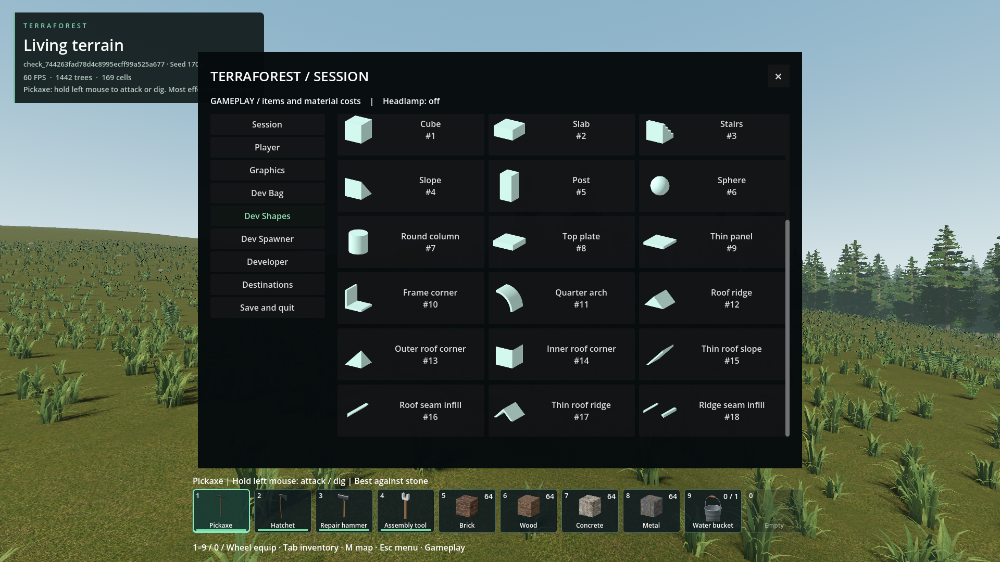

# Dev Shapes catalog

- Status: Implemented / installed; scoped checks pass. User UI review pending.
- Updated: 2026-10-27. Baseline: `96f1a1cd` plus this change.
- Request: browse the integrated building-shapes addon like Dev Bag and immediately obtain/use its pieces.

## Changes and use

- ESC → **Dev Shapes**, beside Dev Bag and Dev Spawner. All 18 integrated native shapes have named, numbered thumbnails; search by name/ID or filter blocks, frame/arch pieces and roofs.
- Choose Brick/Wood/Concrete/Metal and quantity, then click a shape. It grants that many normal material units and immediately equips the chosen native geometry. Gameplay/development mode is unchanged; gameplay spends one material per placed cell, development remains free.
- Shapes share existing material inventory items, not separate collectible shape-item IDs. Choices are remembered per material during this play session, so switching to a weapon and back does not reset a chosen catalog shape to a cube. Placed cells use normal persistent native block words; catalog selection memory itself is not saved.
- Each shape is one independently destructible grid cell. Quarter arches/frame corners assemble into larger features from multiple blocks. No existing houses, roads, world generation or grid rules change.
- Existing Alt construction controls and R / Shift+R rotations remain available. Full bags leave items, selection and mode unchanged; unavailable worlds, active construction and vehicle driving reject before granting.
- One shared 768×384 baked atlas, 18 cached texture regions, no live 3D icon viewports. Thumbnails are rendered from `NativeBlockWorld.preview_mesh`, not hand-drawn substitutes. Launcher/export icon checks refresh on geometry/catalog/native-library/baker changes, and skip current outputs. Runtime only loads the baked image; no source hashing or baking runs per frame.

## Images

Actual packaged 1920×1080 captures in a temporary seed-1703 / generator-23 world; same page at top and lower scroll positions. Neutral thumbnails show geometry, not the chosen material's final texture. The placed blocks still use the selected normal world material. Sources and hashes: `images/manifest.json`.

## Verification / history

- [verification.json](verification.json) records focused package checks, source/test/native/pack hashes and cache evidence. New integration checks cover every native shape's real player placement, one-material cost and independent damage/removal, four materials, actual mouse activation, search shortcut ownership, categories, per-material selection memory, full-bag rejection, development free placement and ESC capture restoration.
- **94 packaged assertions pass**: catalog 27, existing Dev Bag/Spawner 19 and player/menu/map 48. Test worlds are temporary; no player save or house is opened or replaced.
- An additional legacy developer-belt check ran **35/37**, not a passing suite. Two assertions still expect the former ESC-during-Alt behavior; the existing accepted ESC policy now closes Alt access first, rather than opening pause immediately. Its follow-on Alt/Tab assumption then also fails. No ESC policy was changed for this feature. The failed run/driver remain in `reports/checks/20261027T105833426584Z_player_navigation_pack/developer_belt`; leave this visible for a separate historical-policy test update, not a product-input rewrite.
- Initial source run `reports/checks/20261027T105151409658Z_player_navigation/developer_shapes` exposed a genuine layout defect: an auto-wrapping Material label compressed into a vertical column and enlarged its whole row. Its [rejected capture](images/rejected-layout.png) is retained. The label now has non-wrapping minimum width, and the one-click UI check passes.
- `reports/checks/20261027T105327808229Z_player_navigation/developer_shapes` retains the subsequent typed-label parse failure; corrected with an explicit Label type. Passing source catalog run: `20261027T105521936395Z_player_navigation/developer_shapes`.
- Cold missing-atlas refresh generated all 18 native icons automatically (`reports/item_icon_refresh/shapes.log`). Warm checks and atlas/receipt hashes are retained in `reports/checks/shape_icon_warm_20261027`.

## Remaining / resume here

- User review of browser clarity and thumbnail readability remains pending. This exposes the integrated 18 native pieces, not every rejected/unported shape in the original downloaded addon. No house redesign is implicitly approved.
- Separate persistent, shape-specific inventory items are not introduced: the existing game uses material stacks plus tool geometry. If that representation is later requested, review inventory/crafting/save compatibility separately rather than silently changing current item identities.
- Resume UI work in `addons/player_runtime/developer_shapes.gd`; native names in `addons/structures/shape_catalog.gd`; icon pipeline in `tools/shape_icon_cache.gd` and `tools/bake_shape_icons.gd`.
- Reproduce with `python tools/check_player_navigation.py --pack --checks developer_shapes developer_tools player_navigation`. Export via `tools/export_pack.py` to refresh stale icons first. Evidence here does not qualify every future shape, display scaling or hardware configuration.
