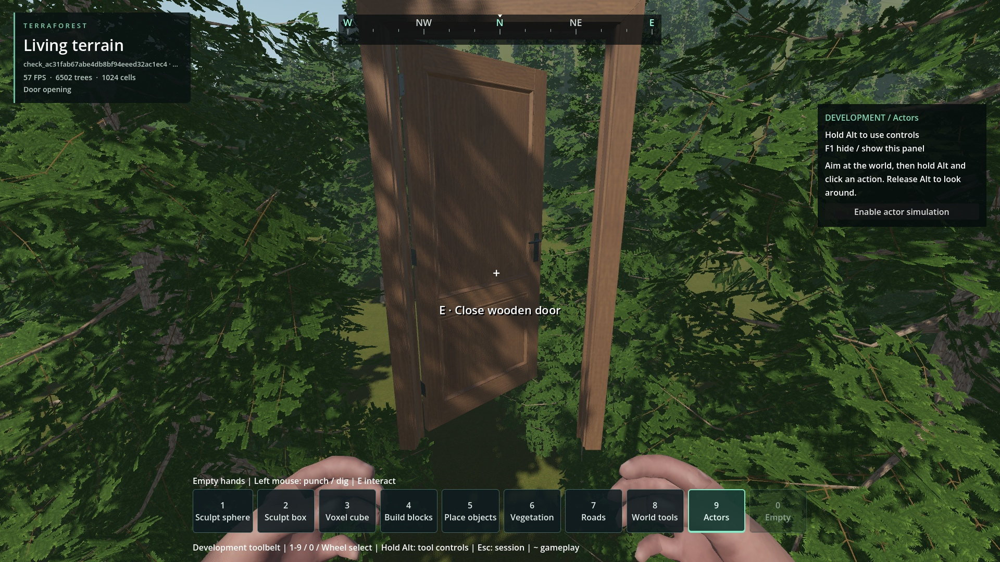

# Authored door opening and closing

- Status: Fixed for reproduced case; source/release checked, package integration pending.
- Updated: 2026-11-01. Fix/build: door animation source milestone on `codex/trader-civic-buildings`.
- User review: Not reviewed. User explicitly requested the existing GLB animation.
- Symptom: E changed the native door placement immediately; the supplied GLB's
  Open/Close, handle and latch channels were discarded by the static art bake.

## Changes and verification

The unchanged `authoring/bg5/BG5.Door.Parts.glb` supplies two 1.15-second clips.
The compact runtime derivative retains both handles and the latch, and extracts
the authored 60 Hz leaf curve for native motion. Its original 105-degree range
is retargeted to the configured hinge angle, preserving the established exact
90-degree open pose and closed save bytes. Frame art remains stationary.

Idle placements stay batched. Only moving built-in doors instantiate a small
hardware rig. Native collision bodies remain registered with the same RIDs;
entering actors/vehicles/ragdolls pause the swing. Existing operating-player
overlap permission remains. A mid-animation TDR3 save retains original pose,
target, time and curve identity; settled TDR1/TDR2 saves remain compatible.
Unloaded motion pauses, and its persistent visual remains visible without
loading gameplay records. Grass exclusion refreshes once when the swing settles.

- Source animation: [26 assertions](../../reports/checks/20261101T131239049174Z/console.log).
- Release library: [26 assertions](../../reports/door_animation_release.log).
- Actual compound disk [save](../../reports/checks/20261101T125634763063Z/console.log)
  and fresh-process [reopen](../../reports/checks/20261101T125636581323Z/console.log)
  pass for both built-in and right-hinged mod doors saved mid-swing.
- Legacy component and content checks pass after importing the missing local
  Torch cache; the earlier cache-only failure remains in
  [125335940443Z](../../reports/checks/20261101T125335940443Z/console.log).
- Retained test-driver failures: initial indentation error
  [125624128214Z](../../reports/checks/20261101T125624128214Z/console.log);
  synchronous PNG capture stalled playback past the test's deadline
  [130438229900Z](../../reports/checks/20261101T130438229900Z/console.log).
  Captures now buffer at most 30 rendered FPS and encode after all interaction checks.
- [130631364237Z](../../reports/checks/20261101T130631364237Z/console.log) completes
  both clips but misses one aimed interaction after restoring the collection;
  the recorder froze the game clock between interaction assertions. The same
  ordinary test without capture passes [131753168998Z](../../reports/checks/20261101T131753168998Z/console.log),
  and the corrected recorder passes [131952201456Z](../../reports/checks/20261101T131952201456Z/console.log).
  A headless normal-world attempt could not finish
  rendering-dependent startup: [131006301918Z](../../reports/checks/20261101T131006301918Z/console.log).
- Export freshness also exposed an existing stale BG5 receipt: commit `9ceb87f0`
  changed only `detect_3d/compress_to=1` to `0` in 20 import sidecars. Each old hash
  was reconstructed and verified before refreshing those receipt hashes. The
  meshes, texture bytes, compression/mipmap settings and master remain unchanged.

- Persistent GPU model ownership passes 62 assertions in [debug](../../reports/checks/20261101T132039266926Z/console.log)
  and [release](../../reports/model_horizon_release.log), including mask/unmask
  after gameplay records unload, no duplicate leaf and no forced hydration.
- An earlier release wrapper lacked the test JSON report even though all 26
  assertions passed; the driver now writes it and the wrapper passes.

## Images



Temporary forest fixture at (800, 57.725, 1307), ordinary E, 1920×1080 Forward+,
60 FPS cap and VSync retained. The native leaf and authored hardware move while
the separate supplied frame remains stationary. Camera stays fixed within each
clip; closing uses a side viewpoint to target the open leaf. This verifies door
animation, not terrain fit or an authored building location.

[Recorded Open and Close](images/opening-closing.mp4) ·
[Capture provenance and hashes](images/manifest.json). Full source frames:
`reports/door_animation_world/1793539193/`. Start, middle and endpoints inspected:
no duplicate static leaf, frame movement or endpoint mismatch observed.

Actual full-game capture frames are retained under
`reports/door_animation_world/1793538392/`; first Open completes with a stationary
BG5 frame. The subsequent Close was captured from a different, too-close viewpoint
after the restored-door test failure. These are diagnostic images, not final
matched-view acceptance. Earlier PNG-per-frame captures remain in `open/` and
`close/` directly under the same reports root; their timing is rejected.

## Remaining / resume here

Source interaction, region retirement and both direction captures pass. Run the
PCK interaction and actual disk roundtrip, then coordinate the combined main
installation. Keep package/install pending until that evidence exists. Player
visual approval remains separate; dense concurrent-door frame pacing is unqualified.
Loose replacement GLBs retain their own art and use the native hinge curve;
arbitrary loose-GLB animation import is outside this change.

## Reproduce / history

```text
python tools/check_door_animation_assets.py
python tools/run_godot_check.py door_animation --headless --require "DOOR_ANIMATION checks=26 failures=0"
python tools/run_godot_check.py door_world --require "COMBINED_RESOURCE_ROUTE failures=0" --timeout 150 -- --capture-door-animation
python tools/test_native_release.py --addon structures --test door_animation --godot <engine>
python tools/check_door_animation_pack.py
```

Tests use temporary worlds or uniquely named owned fixture slots. Existing user
saves and the other chat's work remain intact. New code is 0BSD; the rig derives
from the contributor-confirmed CC0 master. See [behavior](../../docs/DOOR_CONTENT.md),
[bake provenance](../../addons/structures/door_animation/provenance.json) and
[retained notice](../../addons/structures/prefabs/BG5_LICENSE.md).
