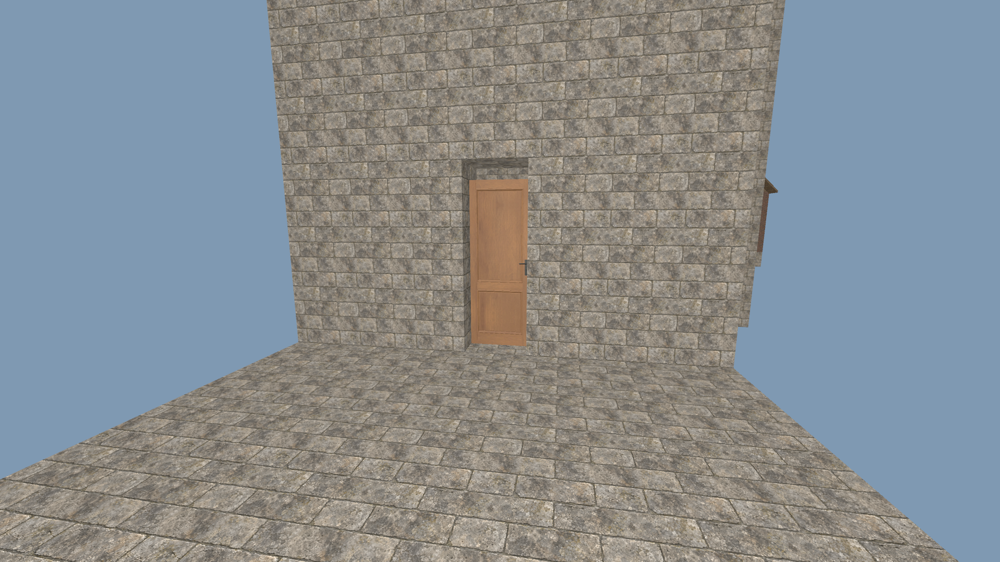
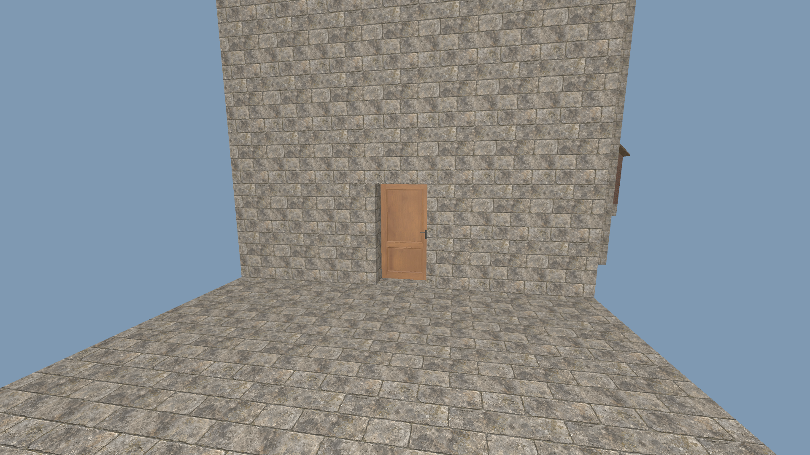

# Doors taller than two blocks

- Status: Fixed for reproduced production assets; source/package checks pass; user review pending.
- Updated: 2026-11-02. User review: pending.
- Symptom: Some city and civic personnel doors span nearly three block courses.

## Cause and correction

The shared city/civic authoring helper cut three rows and scaled the existing
2.2 m leaf by 1.25, yielding a 2.75 m door. Older cottages used a 0.9 scale,
yielding 1.98 m. Production prefab attachments now use 2/2.2, exactly 2 m;
oversized openings receive an independently editable matching lintel block.
Future baking and the standard player placement default use the same dimensions.
The native door definition and save format retain their established identity.

The original review prefabs and earlier images are retained as historical
comparisons. This correction does not apply changes to existing saved worlds:
those contain independent authored cells and model transforms, including player
edits. New generation and newly placed buildings receive the corrected assets.

## Verification and images

Baseline: production E2 church from `0740b507`, 2.75 m door in a three-cell opening.

Correction: same prefab and camera, 2 m door and filled lintel. Both are native
publication renders at 1920×1080 with fixed inspection lighting, without terrain.
The matched images were inspected; broader user visual acceptance remains open.

`tests/door_dimensions.gd` publishes all 15 ordinary city/E2 catalog buildings
through NativePrefabPlacement and checks each door's transformed mesh/collision
height, clear two-cell opening and solid lintel. The check is included in the
required building export gate. The initial 47 checks pass:
[source receipt](../../reports/checks/20261102T194045968776Z/run.json). The final installed executable passes all 48 checks including the rendered production church: [package receipt](../../reports/door_dimensions/20261102T195330266269Z/run.json). All required source/release building export gates pass: [gate receipt](../../reports/building_standards/20261102T195138981632Z/run.json). The first package run passed geometry but could not write its screenshot into the read-only PCK path; the runner now supplies a real output directory. That failed receipt remains retained.

The bake receipt records every before/after asset hash in
[correction.json](correction.json). Changes are original AI-assisted authoring
edits to existing TerraForest assets; new cell/transform data is CC0-1.0 and new
tools/tests are 0BSD. Existing asset notices and provenance remain in force.

## Remaining / reproduce

Generate a new ordinary world or place a new city/civic building, then compare
the door with its adjacent one-metre wall courses. Existing saves require an
explicit, edit-preserving migration before their old doors can be changed;
no such migration is claimed here. User visual review remains open.

Run `python tools/check_door_dimensions.py` for source renders, or add `--pack`
for the installed package after exporting. The baseline comes from the preserved
pre-correction Git revision; current renders use the ordinary production E2 church.
