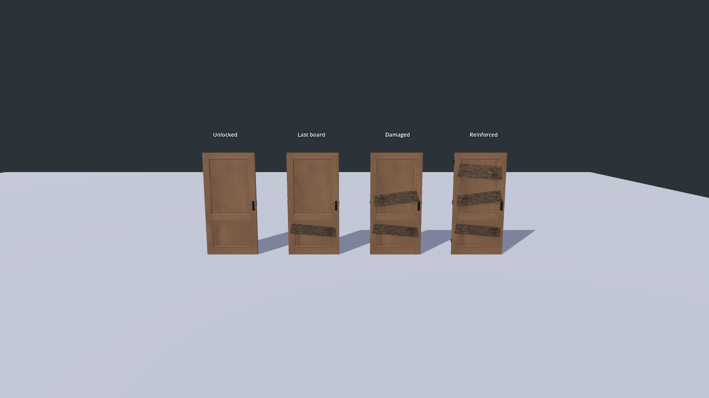
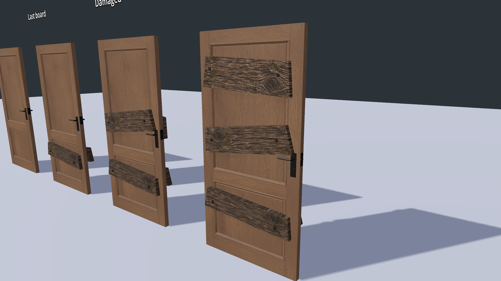
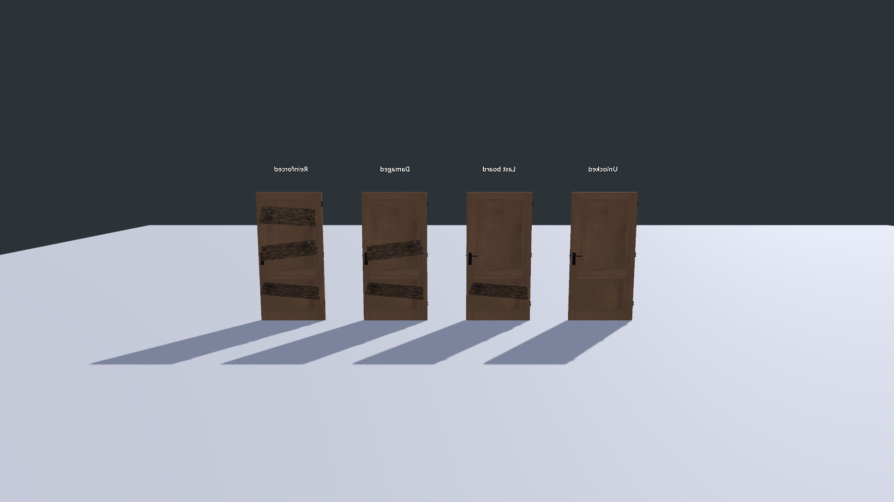
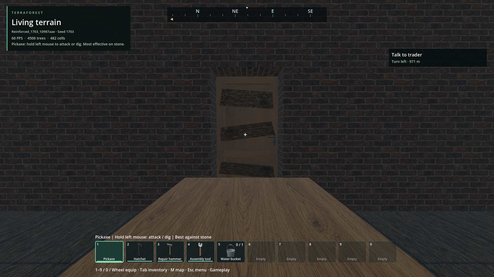
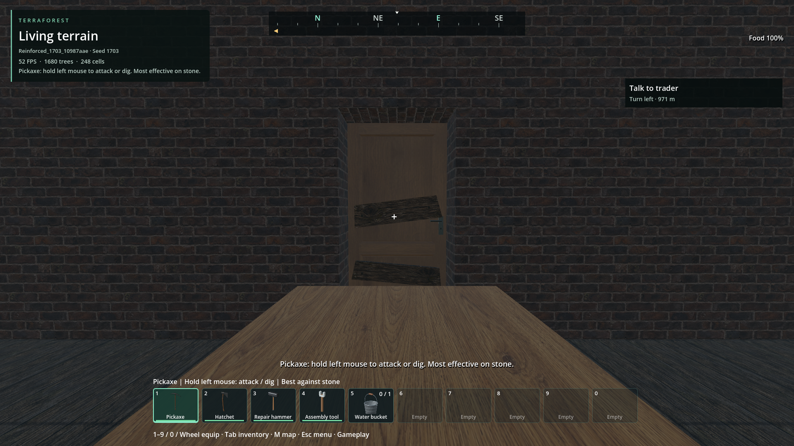

# Improvised door reinforcement

- Status: Installed / scoped checks pass; user visual approval pending.
- Updated: 2026-11-03. User visual review: pending.
- Request: locked doors should look roughly reinforced, not professionally barricaded.

## Images

Isolated production-door mesh, no generated world: unlocked, one, two and three
boards. Actual offscreen Godot captures, inspected front/rear/oblique. The earlier
[rejected texture/contact trial](images/first-detail.png) remains preserved.
Origins, hashes and rights boundary: [image manifest](images/manifest.json).

Normal seed-1703 recipe, owned test world `Reinforced_1703_10987aae`, door 36
at (1836.5, 50, 1002). Three generated doors are reinforced. Same internal camera
before/after damage and fresh reopen; these views were inspected. Destination
travel uses normal teleport; this is not a street-to-interior walking test.

## Changes and verification

- Reuses native lock durability, lockpicking, binary persistence and batched rendering.
- Boards disappear in three damage stages; unlocking removes them. Original door
  geometry, identity, collision and ordinary opening animation stay unchanged.
- [Source receipts and exact scope](evidence.json): 30 lock/render/generation-fixture
  checks, 17 real-picking/player-contact/opening checks, 109 reset-plan checks and
  existing door regressions pass. Reset rollback and legacy originals are covered.
- New-world seeding helper chooses one door in roughly one of eight eligible homes;
  skips the starter house, protected doors, traders and civic buildings. No retrofit.

## Remaining / resume here

- Normal generation/player-contact/save and fresh-process reopen pass 12 + 8 checks;
  native paging hides/restores boards without losing locks. Zombie contact now
  consumes reinforcement before base door durability. Actual zombie contacts,
  destruction and traversal pass 17 checks on an isolated entrance.
- Installed package repeats normal generation/save/reopen (12 + 8) and native
  lock/paging/reset checks (30 + 109); exact hash and resource measurements in evidence.
- Remaining: full street/entry walking, generated-house zombie coverage and visual approval.
- Falling plank animation is not implemented; current stages remove the boards.
- Do not confuse fixture success or these images with user visual approval.
- Runtime: `addons/structures/door_reinforcement*.gd`, `door_locks.gd`;
  tests: `door_reinforcement`, `door_reinforcement_gameplay`, `location_reset_plan`.
