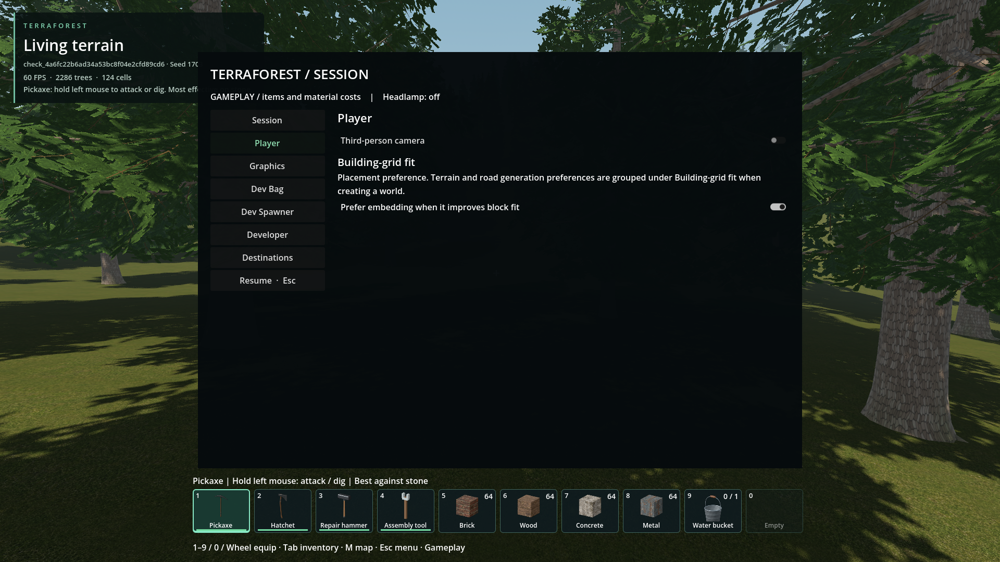
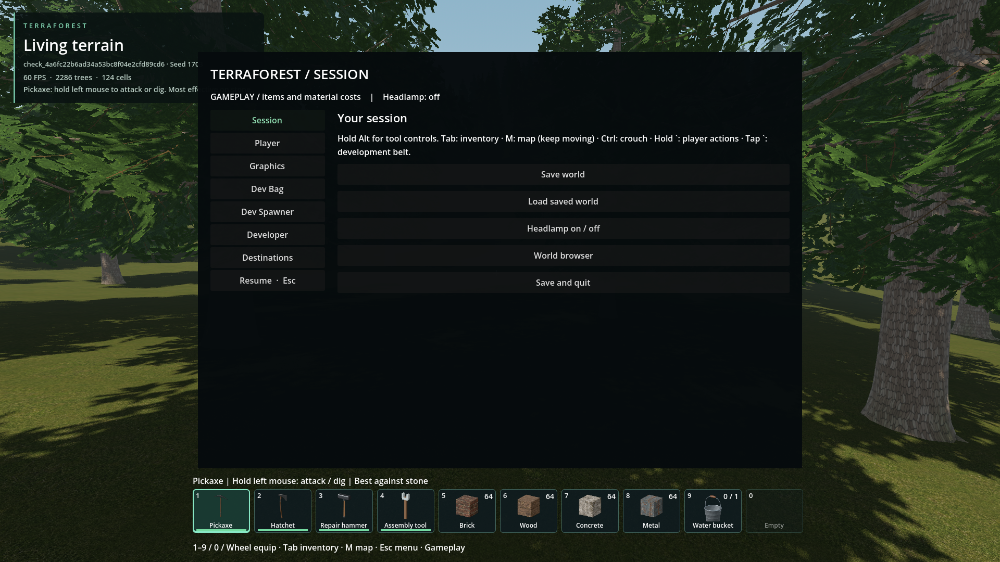

# ESC Player settings

- Status: Implemented / scoped checks.
- Updated: 2026-10-26. Source and packaged build updated; user review pending.
- Request: Separate player preferences from session actions.

## Images

Packaged 1080p, temporary seed 1703: Player contains Third-person camera and
Prefer embedding, including the existing Building-grid fit explanation.

Same test session: Session retains save/load, headlamp, world browser and quit.
Original captures inspected; [provenance](images/manifest.json).

## Verification / resume

- Existing callbacks, defaults and preference storage remain unchanged.
- Source/package checks pass 18/18: page ownership, both live settings, restoration,
  navigation, session actions, ESC close/capture and default Session reopening.
- The generation regression's UI lookup now uses Player; the full world-generation
  campaign was not rerun for this UI-only change. Its generation logic is unchanged.
- Tests use temporary worlds and disable camera preference-file writes. No player
  saves or existing preferences are changed by verification.
- Human/DPI review remains open; reopen for misplaced controls or lost settings.

[Pack result](evidence/pack.json), [command/build](evidence/pack-run.json),
[test](../../tests/session_player_page.gd).

Reproduce: ESC → Player. A fresh ESC opening still defaults to Session.
