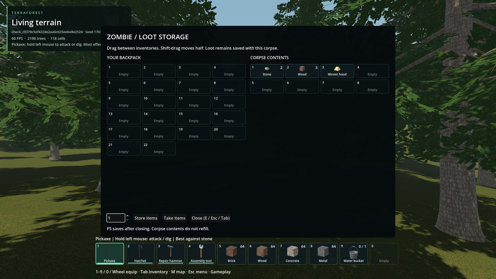
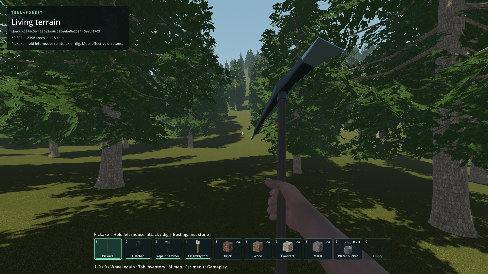
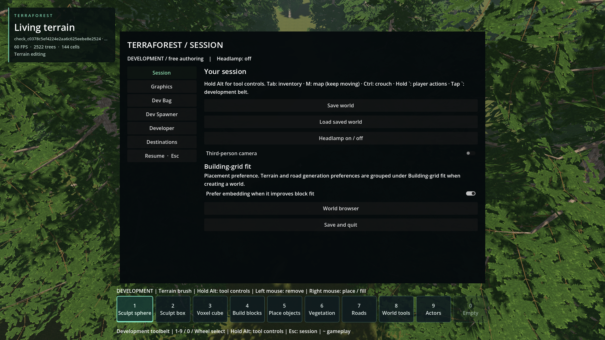

# ESC closes UI before opening pause

- Updated: 2026-10-26. Status: fixed for reproduced/current UI; player review pending.
- Requirement: ESC closes the active inventory/storage/other interface. Only with
  no interactive UI open does a fresh ESC open the pause menu.
- Reproduced cause: session input consumed ESC and tried the disabled backpack
  HUD while corpse storage was active, leaving the UI/cursor blocker open.

## Policy / implementation

- Explicit input-time priority: confirmation, map, player/vehicle action wheels
  (including pending holds), corpse/chest storage, backpack, tool/session window,
  then temporary Alt control access. No active UI means open pause.
- The press is consumed; key repeat/release cannot close UI and open pause on the
  same hold. Cancelling held E/backtick prevents release from activating actions.
- Native dropdown/confirmation handling remains nested: close the popup before
  its parent. Search/quantity focus does not trap ESC.
- Persistent HUD/status panels are not modal UI. No per-frame scan, native/store
  rewrite or player-save change. Standalone HUD/storage close shortcuts remain.
- Code: [policy](../../addons/player_runtime/escape_policy.gd),
  [session input](../../addons/player_runtime/session_menu.gd).

## Images

Packaged temporary seed-1703 test, 1920x1080. The corpse uses real native contents
and storage UI with a test identity picker; not a new corpse death/targeting test.
The pause-menu frame is later in the same matrix at a different camera position.
[Image provenance](images/manifest.json); [qualification](qualification.json).

## Verification / resume

- Baseline control `20261026T161145345058Z`: three failures, reproducing stuck
  corpse UI, disabled HUD and uncaptured camera. Original log/result retained.
- Source follow-up and packaged `escape_ui_priority` pass. Actual input covers
  inventory, chest/corpse, map, dropdown/workspace, focused Dev Bag, Alt access,
  pending/open action wheels, nested confirmation and repeated ESC/pause cycles.
  Vehicle-wheel state is a UI fixture, not a new vehicle-spawn qualification.
- Packaged `container_e_toggle` and `focus_return` pass; camera control restoration
  remains covered through app/window focus changes. Tests use temporary worlds.
- [Input test](../../tests/escape_ui_priority.gd). Re-run with
  `python tools/run_godot_check.py escape_ui_priority --timeout 150 --require "COMBINED_RESOURCE_ROUTE failures=0" -- --gameplay-construction --no-zombies`.

Return when adding a new modal UI or another panel traps ESC. Add it to input
priority and the real-input matrix; retain one-level dismissal, no cascading and
camera/HUD ownership checks. This is scoped to current interfaces, not future
mods or gamepad cancel inputs. Latest human visual review remains open.
