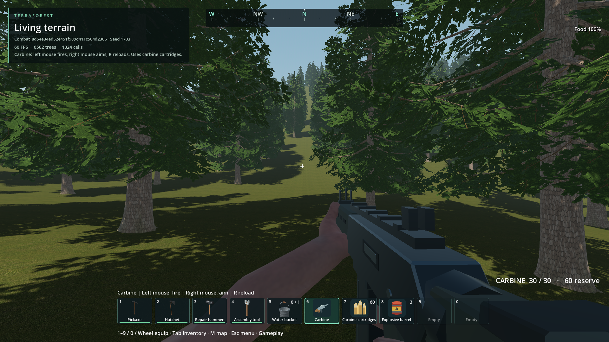
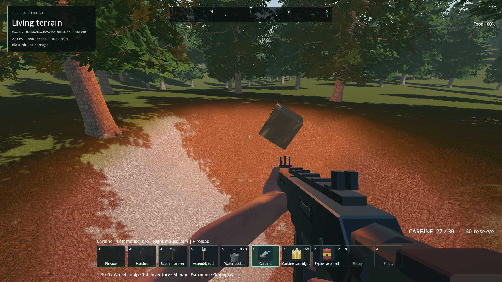
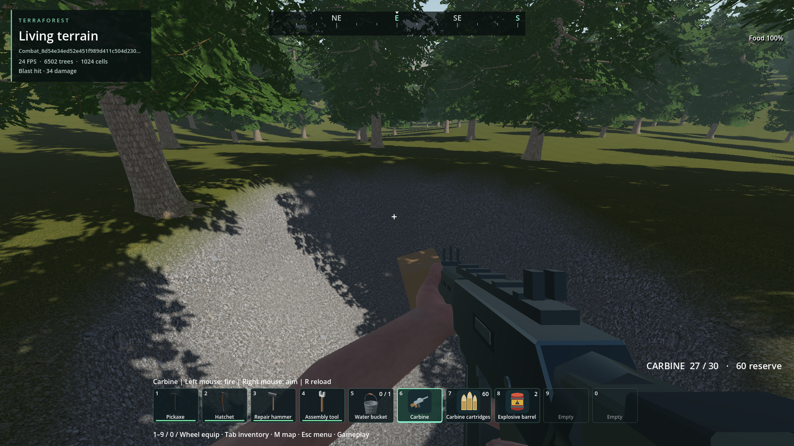
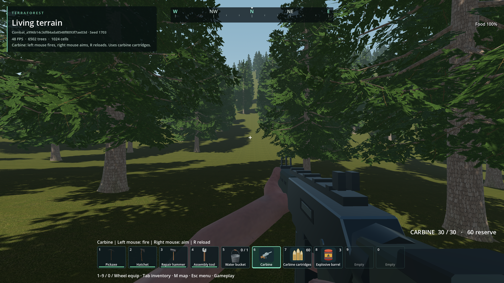
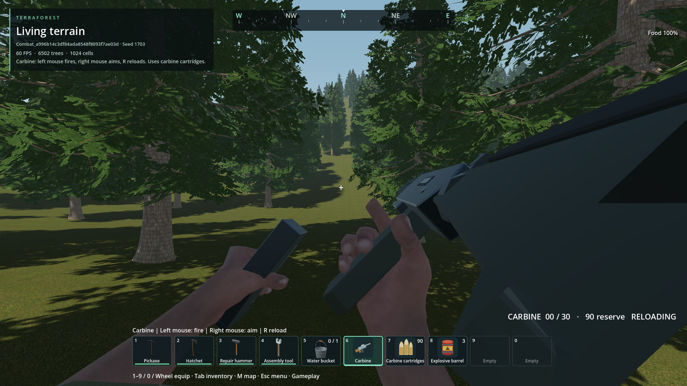
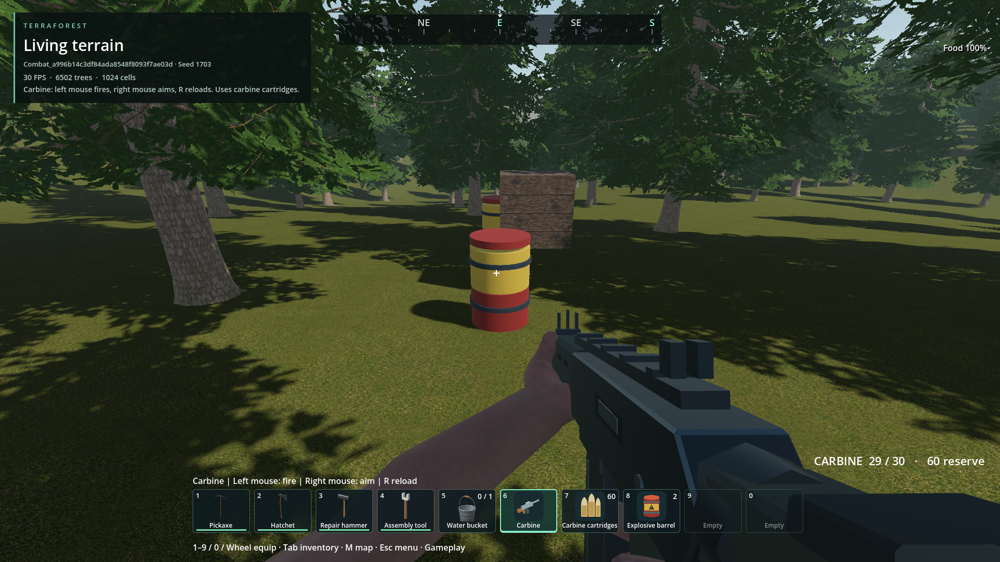
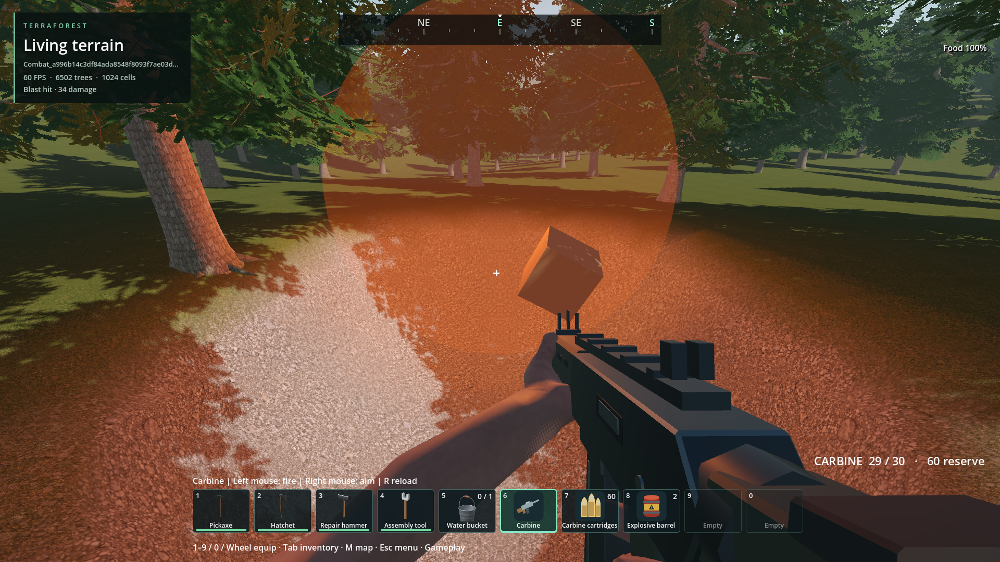
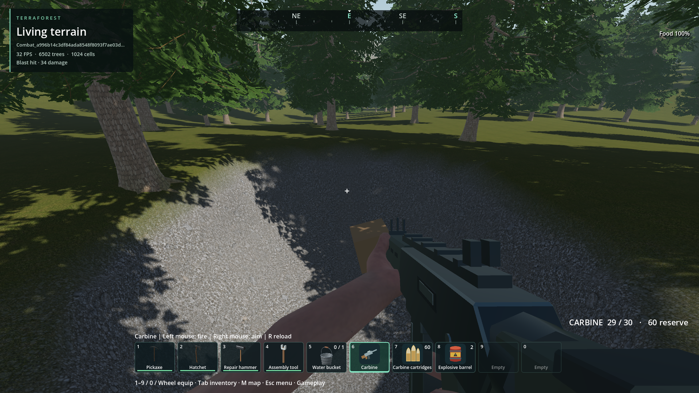
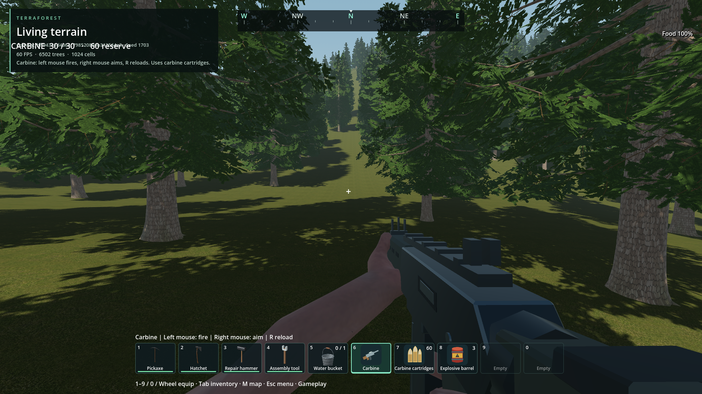
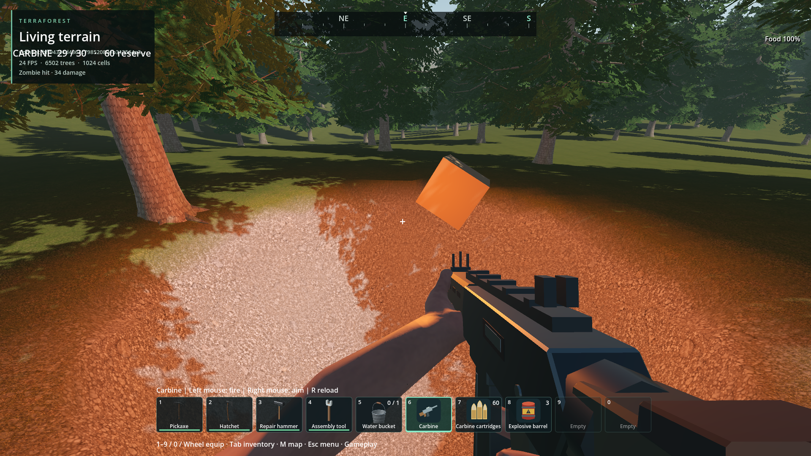

# First firearm and volumetric explosive destruction

2026-11-13: [volumetric water assessment and implementation gates](water-assessment-2026-11-13.md).
The renewed terrain-reactive water request remains open: real 3D storage is
present, but default settling is off, thin-volume surface coverage fails, and
solid deposition deletes displaced water. Assessment only; no runtime rollout.

2026-11-10 follow-up: [distant explosion admission and crater-water settling](distance-water-2026-11-10.md).
The distance fix is installed; packaged combat and the stationary-player distant
chain pass. Installed native libraries are unchanged. Water settling remains an
opt-in source prototype: exact volume evaluation reduces crater settling work
about 37%, but timing bounds and shallow-water surface coverage still block
enablement. Foreground performance and visual qualification remain pending.

- Status: Installed package / scoped engineering checks passed; user visual review pending.
- Updated: 2026-11-01. Source: `165a75b9`; stronger tests: `a48153ed`; combined native artifacts: `579a21c1`.
- User review: Not reviewed.
- Scope: Existing carbine animations, projectiles and zombie firearm responses,
  explosive barrels, volumetric craters, individual block debris, optional integrity.

Performance follow-up, 2026-11-09: [native destructive batching and exact baked
debris collision](../runtime-performance/foundation-2026-11-09.md) remove the
measured repeated runtime convex-decomposition stall. The controlled actual-world
64-cell workload now takes 0.795–2.125 ms per batch, retaining existing physics,
visuals and damage settings. Installed combat passes 51 creation + 12 reload
checks in `reports/combat_world/20261109T091611473955Z`. Dense repeated barrel
chains, streamed-boundary collapse and whole-frame headroom remain unqualified;
this is a scoped performance improvement, not closure of the frame-rate issue.

## Images

Existing root game executable with the installed combined PCK. Rifle and HUD fit
after reloading. The executable was launched and hashed, never replaced.

Two actual carbine shots ignite the barrel; the chain reaction excavates the
volumetric terrain and throws the individual building cell.

After the flash fades, the permanent crater is visible. The same density, destroyed
cell state, magazine and barrel damage survive a fresh-process reopen.

### Earlier source comparisons

The existing carbine, hands and original inventory icons in a private seed-1703
world. The ammunition label now fits within the screen after a complete reload.

The authored magazine-removal pose and visible reload status. Ammunition is
transferred only when this animation completes.

Two original procedural barrels and one building cell before the chain reaction.

Both barrels are removed, the real terrain field is excavated, and the building
cell becomes a spinning rigid body. The damage message correctly identifies a blast.

The crater after the flash fades. Its density is identical after a fresh-process
reopen. These are agent-reviewed source images, not user visual approval.

### Retained earlier comparisons

Temporary generator-1, seed-1703 world, source build, gameplay mode. Existing
carbine and hands appear correctly and inventory icons are present. **Rejected
HUD detail:** the ammo readout overlaps the upper-left world information. This
image is retained as the initial comparison, not visual acceptance.

Same temporary fixture after one barrel blast. Volumetric crater and a simulated
wood block are visible. Flash illumination is still active. The HUD overlap and
the player-damage message saying “Zombie hit” for a blast need correction.
Image source/hash records are in `images/manifest.json`.

## Changes and verification

- Final strengthened source: **33 creation + 11 restore**,
  `reports/combat_world/20261101T183058376372Z`.
- Actual root executable with installed PCK: **33 creation + 11 restore**,
  `reports/combat_world/20261101T185025193271Z`. Both strict resource gates pass:
  peak sampled private commit 2.63 GiB, dedicated GPU allocation 1.12 GiB.
  Zero pointer captures; fourteen native DLL hashes match the package.
  PCK SHA-256: `4295d8f9717cda70175cba36671fc10b259f39e0b8b6454f2fed6211d3a14afe`.
  Executable SHA-256: `981c1a194797a3ebb3153b5e5ece7bcfc6573e874f4cd6250ed120d309b511a5`.
  Reviewed rifle/reload/blast/crater images. This is bounded functional evidence,
  not universal visual approval or a sustained frame-rate guarantee.

The carbine was present in `Human.r11.glb` but was not wired to inventory or
combat. All first-person rifle clips are now used. The existing anatomical hit
system already supports firearm impacts; travelling bullets call that path.

- Final native and animation suite: 66 checks pass,
  `reports/checks/20261101T181553702672Z`.
- Native-only storage/support: 46 checks per debug/release variant,
  `reports/combat_native/20261101T180838822840Z` and `20261101T180838832548Z`.
- Earlier rendered world: 31 creation + 11 fresh-process restore checks pass,
  `reports/combat_world/20261101T181508831902Z`. Includes live zombie anatomical
  projectile response, barrel placement/debit/overlap, chain reactions, no mining
  reward, debris pause, optional collapse, exact ammunition and partial barrel
  damage restore, crater persistence, and interrupted blast resumption exactly once.
  Both phases assert zero desktop mouse captures. Peak sampled private commit
  2.64 GiB and dedicated GPU allocation 1.12 GiB; this is not a general FPS guarantee.
- Melee timing 27 and durability 21 checks pass,
  `reports/checks/20261101T181422340685Z` and `20261101T181422337198Z`.
- Quests: 53 checks per debug/release variant,
  `reports/quests_native/20261101T181422371938Z` and `20261101T181422568570Z`.
- Offline credits include the new original asset notice; 15-notice freshness passes.
- Initial actual rendered world: 18 checks pass, log
  `reports/combat_world/20261101T174717454784Z/console.log`.
  The wrapper then raised a required-text argument type error; that reporting bug
  has been corrected. The successful runtime log is retained, but this is not
  reported as a successful wrapper exit.
- Earlier headless world runs could not acquire a captured mouse and failed the
  input-driven firing checks; crater, debris and integrity checks passed. A test
  helper typo (`skip` instead of `finish`) is also retained in the first failed log.
- Expanded rendered attempts `20261101T181136066222Z`, `20261101T181254742357Z`
  and `20261101T181355980793Z` failed only the zombie fixture admission because
  the launcher omitted the encounter-enabling flag. Ground offsets and an extra
  frame did not solve that cause; the final launcher explicitly enables zombies.
  The second HUD placement was also rejected for right-edge clipping and corrected.

## Remaining / resume here

The source, response/persistence checks, image corrections and installed-package
checks are complete within the declared local-simulation scope. User visual review
remains separate; manual play should assess the authored aim/reload poses, simple
explosion effect and bounded collapse behavior. See `verification.json` for retained
source and package evidence, including exact binaries and resource measurements.

The implementation uses a bounded local support model, conservatively anchors
query boundaries, treats shaped blocks as occupied cells for support, and uses
temporary capped debris. Global multi-neighborhood collapse and engineering stress
simulation are not claimed. Full rules are in
[the combat contract](../../docs/COMBAT_DESTRUCTION.md).

## Reproduce

Run `python tools/check_combat.py` for source or add `--executable` for the existing
root executable and exported PCK, in an available shared validation window.
It creates and reopens a private saved world in a nonactivating render window. For manual
play, craft or obtain Carbine, Carbine cartridges and Explosive barrel from Dev
Bag. R reloads; left mouse fires; right mouse aims or places an equipped barrel.
Esc → Player contains the structural-integrity toggle, off by default.
