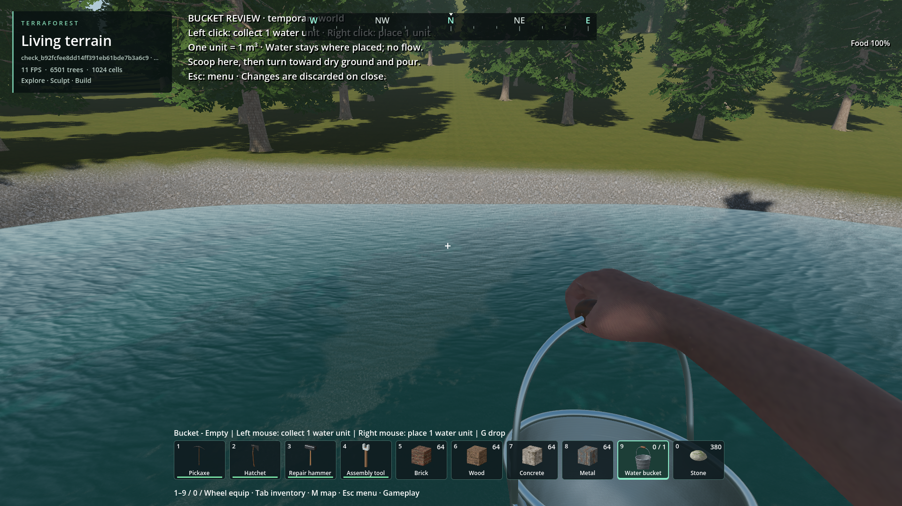
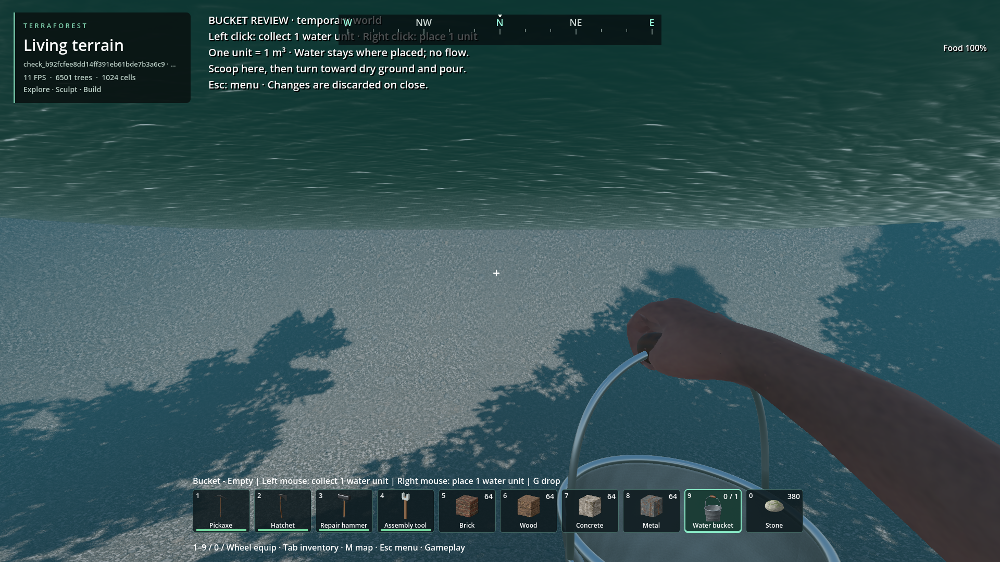
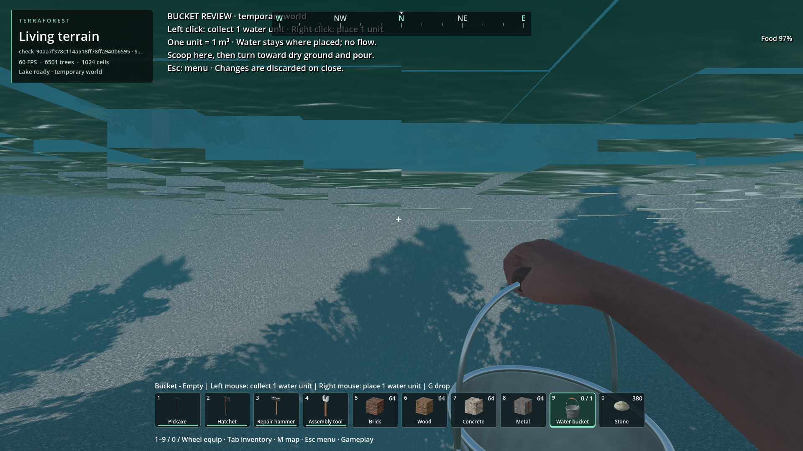

# Terrain-reactive volumetric water implementation plan

Started 2026-11-13. Status: active. User authorized completion, including major
changes where required. [Diagnosis and acceptance contract](water-assessment-2026-11-13.md).

## Architectural reassessment requested by the user

The user rejected the apparent direction after seeing cubical/terraced water and
questioned whether the complexity and performance were justified. Implementation
of further repairs to the current candidate is stopped while the architecture is
reassessed. The goal remains open; this is not completion or accepted visual quality.

Assessment: explicit storage-cell boundary rendering is a poor visual target for
unequal water amounts. Exact integer storage and closed cell boundaries do not
establish a convincing continuous liquid surface. The investigation over-prioritized
microscopic films and exact buried-contact topology before proving the visible
result. The real barrel failures outweigh the isolated engineering passes below.
No comparison has demonstrated that this candidate is better than a smooth
implicit-surface/marching-cubes approach in either total cost or visual quality.

Recommended replacement direction, pending a small measured visual proof:

1. Keep authoritative finite water amounts and 3D terrain/solid connectivity, but
   decouple their storage cells from the visible surface.
2. Reconstruct a smooth implicit liquid boundary and evaluate a chunked marching-
   cubes surface using the existing terrain meshing infrastructure where suitable.
   A radial blob is one test field, not a restriction on the mesher's shapes.
3. For the requested non-flowing/simple water behavior, prefer edit-triggered basin
   equilibrium and explicit connectivity changes over long-running pair diffusion.
   Basin splits, spill thresholds and finite-volume displacement remain real work;
   marching cubes itself does not solve them.
4. First prove the look in a lake, an exposed cut/breach, partially filled sloping
   terrain and a cave/overhang. Compare identical camera/resolution scenes and
   isolate water CPU, GPU, triangle, memory and edit-latency costs. Reject visible
   storage-cell terraces before expanding implementation.
5. Only after that proof, complete conservation, persistence, bounded update jobs,
   actual barrels/mining/deposition and package/default qualification. Reuse verified
   immutable publication and conservation work only where it fits the new design.

Latest unverified candidate status: the connected-patch leveling experiment and
3.815-micrometre mesh-output grid compiled successfully, but have not been tested.
They are not accepted fixes. Source debug remains experimental; settling remains
opt-in and the installed package is unchanged. Do not resume polishing this route
merely because the latest build succeeded. Preserve the failed evidence below.

## Milestones

- [ ] M1: Replace lossy density sampling with occupied-volume boundaries;
  qualify thin films, joined cells, sides/undersides, terrain/building clipping,
  stacked spaces, region seams and mesh/query agreement.
- [ ] M2: Complete conservative terrain-edit response, displacement and wake
  propagation; mining, blasts and solids use the water service.
- [ ] M3: Verify bounded scheduling/publication, idle work, pause, concurrency,
  interrupted saves, reload, unavailable regions and ocean edges.
- [ ] M4: Inspect actual barrel/lake and mining/deposition imagery; measure
  settling latency and frame tails in the real world, including combat.
- [ ] M5: Build matching configurations, package and verify default behavior;
  preserve saves and present evidence plus any remaining human-review limits.

## Working record

M1 in progress. Reuse existing convex clipping primitives where their geometry
matches authoritative capacity; do not increase lattice resolution or thicken
water to hide missing surfaces. Preserve existing failures as baseline evidence.
No runtime acceptance claimed yet. Work remains on master in the main checkout;
unrelated hub UID files remain untouched. No parallel agents requested.

### M1 development evidence

The candidate now extracts convex occupied boundaries, removes shared wet faces
and buried terrain/structure contacts, and splits unequal-height boundary edges.
Source debug library only; installed package is unchanged.

- `reports/checks/20261113T095017755951Z`: material-surface regression passes,
  including 30 thin-film offsets, mesh/query publication and a real bucket pour.
  Fixtures now ignore empty packets when comparing visible geometry and use the
  current full 1 m3 bucket rather than the rejected legacy 10 L item.
- `reports/checks/20261113T095148806979Z`: continuity passes all 510 occupancy
  patterns plus cross-region/vertical cases. Directed-edge closure and triangle
  adjacency distinguish coincident edge/point contacts from open-face connections;
  vertex-position welding incorrectly merged the former. The old removed
  vertical-repair API was replaced by the current explicit settling API.
- `reports/checks/20261113T095044346611Z`: real native-terrain crater passes;
  7,619,860 ml retained, 38,868 us total settling, max solve call 675 us. Maximum
  mesh call is 12,746 us: performance acceptance remains open.
- Natural terrain contacts pass in `20261113T095215950930Z`; cached building
  occupancy passes in `20261113T095242678724Z`; analytic pyramid contact and
  canonical migrated save roundtrip pass in `20261113T095535348027Z`.
- Large captured-envelope topology remains **failed**, most recently
  `20261113T095522055875Z`. It exposes residual boundary conformity problems and
  a difference between stored quantity and reconstructed occupancy. Per-packet
  geometric-volume diagnostics are being added to locate the cause. Earlier
  rejected runs remain retained under their original check directories.

M1 is not complete. Next: close captured shoreline geometry and quantify legacy
over-capacity/zero-capacity quantities, inspect rendered evidence, then continue
M2. Do not enable default settling or claim a performance/visual pass yet.

### Boundary and rendering follow-up

Direct terrain top/bottom/side extraction avoids an internal-prism face cancelling
a legitimate shore face. Structure profiles retain their convex-piece path.
Final clipped vertices, including a one-cell halo, now supply edge subdivision.
`20261113T100853220032Z` has zero unmatched boundary midpoints at the existing
1 mm diagnostic tolerance. **Exact topology still fails**: 541 unpaired edges,
81 nonmanifold edges and 27 very small triangles under the strict test threshold.
No exact-watertight claim is made. Represented geometric volume is about
536.909472 m3; its rendered oriented volume differs by about 15 ml. The older
fixture also retains 22,219,008 ml in zero-capacity cells. Those quantities are
not deleted; M2 must define their conservative migration/displacement.

Material and 510-pattern continuity checks pass again in
`20261113T100603705489Z` and `20261113T100616180268Z`. Boundary work now has fixed
cached/exposed vertex caps and retains the old published geometry on preparation
failure; broader pressure/fairness verification remains M3 work.

The original 35-second visual harness timed out before lake readiness. A second
attempt exposed that Godot removes engine `--log-file` arguments from script
arguments. The launcher now supplies its admitted evidence directory explicitly;
six launcher checks pass. The first capture had stale camera immersion and is
retained in `20261113T101426749231Z`, rejected as underwater presentation evidence.
The corrected capture is `20261113T102102194965Z`, with explicit immersion updates
and camera/world metadata. Both images below were inspected: continuous resting
lake contact and underwater tint in these views. They do not prove blast response,
all shore angles, moving-camera presentation or 60 FPS. The frozen HUD FPS is a
startup sample, not a performance measurement. An existing general-world image
import warning remains in the run log.

Temporary bucket-review lake at (800, 47, 1292), water level 48.25 m, 1920x1080.
Default settling remains disabled in this representation check.

Same temporary lake, corrected camera immersion, contact viewed from below.
Provenance and hashes are in `images/manifest.json`; original assets retain terms.

Storage admission rejected `20261113T101723255061Z` before launch. Standard
retention found no eligible frozen builds/rolling traces. Existing verified-cold
retirement then retained two changed outputs and retired 15 unchanged backed-up
outputs (12,568,013 bytes), receipt
`reports/artifact_retention/cold_outputs_20261113T102052861246Z.json`. No budgets,
player saves or changed/unowned evidence were removed. The next capture passed
normal admission.

### Schedule adjustment: mesh worker prerequisite

The corrected actual-world capture reports `max_mesh_us=325937` and
`max_mesh_publish_us=325962`, with no surface-budget failure. This supersedes
the small-crater fixture as the relevant worst observed preparation cost; it
is unacceptable on the gameplay thread. Spatial indexing of edge cuts and
avoiding unnecessary terrain prism reconstruction are now under test.

Pull the M3 immutable mesh-worker handoff forward before M2 integration. M1 exact
topology, legacy excess quantities, ocean boundaries and user visual acceptance
remain open. The worker must preserve batch revisions, cancel stale work, retain
old displayed/query geometry, bound retained work and join during shutdown.
Close this prerequisite with concurrent-edit/cancellation and publication tests,
then repeat real-world timing. This is not permission to waive any M1/M2 gate.

Every milestone will record commits, checks, evidence paths, failures and the
next dependency here before advancing. Visual success requires inspected images;
performance success requires measured frame costs, not just a solver deadline.

### Worker/publication verification and remaining precision defect

`20261113T103600268394Z` passes the actual-world visual harness with the mesh
worker. Maximum main-thread preparation was 84 us, publication 601 us, and worker
preparation 131,531 us (previous main-thread preparation 325,937 us). These are
startup mesh-stage measurements, not steady frame tails or blast-response latency.
The images remain in that receipt-owned run directory; previous inspected images
remain the visual baseline until the final geometry candidate is recaptured.

Worker snapshot/cancellation checks pass in `20261113T103942595856Z`, including
immersion remaining hidden before publication and matching the frozen state after
commit. Published occupancy now retains shared immutable region payloads alongside
the published triangle cache. Ocean boundary cases pass in
`20261113T104255572396Z`; that run still failed an empty-packet metadata assertion,
subsequently corrected in source (not yet requalified).

The exact topology diagnosis found fan centers rounding onto one-ULP-wide strips.
Boundary-only ear triangulation plus shared raw/render-precision edge cuts reduces
the failure to one unpaired edge and two odd-multiplicity edges in
`20261113T104537120771Z`. This is still a failed gate. An earlier all-polygon float
conversion worsened conformity and was reverted. The test now separately reports
small positive-area triangles and balanced touching edges: neither is a zero-area
triangle or open boundary. The 510-pattern test already distinguishes material
bodies touching only on an edge from open-face connections. No tolerance welding
has been added to the exact edge oracle.

Storage admission rejected `20261113T103752452390Z` before engine launch. Audited
small water checks now declare 16 MiB planned report growth (small logs/JSON or two
1080p PNGs), while other checks retain the 256 MiB declaration. Category limits,
world allowance and all retained evidence are unchanged. Seven launcher checks
pass, including the scoped output declaration. A future larger capture must declare
its actual output separately rather than reusing this small-check allowance.

### Captured terrain closure passed; structure closure still open

`20261113T105625276640Z` closes the captured terrain envelope exactly: zero
unpaired edges, odd edge multiplicities, winding mismatches and zero-area
triangles. It retains 14 small positive-area triangles and 10 balanced touching
edges. Stored quantity is unchanged. The final rule uses boundary-only
triangulation, raw plus renderer-precision cuts, and removal of an inverted
rounding residual only when all three directed edge defects cancel exactly using
the neighboring-cell halo. Blanket reversed-triangle rejection was rejected
because it removed legitimate thin slopes. Intermediate failed traces remain.

The candidate also passes continuity (`20261113T105644619976Z`), material/ocean
(`20261113T105718914523Z`), worker/immersion publication
(`20261113T105732130292Z`), terrain peak contact
(`20261113T105745523954Z`) and real native crater
(`20261113T105758723116Z`). Surface query caches now have explicit 64 MiB published
and 64 MiB staged limits; pressure retains the prior published batch.

A stronger closure replay against the existing actual-world building cache,
`20261113T105810289021Z`, **fails** (381 unpaired and 196 odd-multiplicity edges).
This exposes unresolved convex-piece interfaces, so M1 remains open despite the
terrain-only closure pass. Return gate: structure-envelope conformity and
material/continuity regression, followed by a fresh inspected graphical capture.
No default rollout or M2 conservation claim is made.

### Structure preparation diagnosis

The saved structure fixture and a newly prepared native sphere reproduce the
same problem. Full hull-union subtraction was rejected after exceeding the fixed
preparation budget (`20261113T110337997736Z`); the oracle now explicitly checks
that budget failure cannot masquerade as a completed geometry pass. Plane-triplet
reconstruction and blanket float conversion did not solve the source problem
and were removed.

The current preparation candidate preserves original clipping planes on convex
pieces and their faces instead of deriving constraints from tiny clipped faces.
It uses complementary half-spaces and prepares quantity curves from the same
canonical pieces used for reconstruction. In `20261113T112218043637Z`, fresh
sphere primitive volume and the prepared curve differ by about 0.012 ml over the
captured lake; prior reconstruction differed by litres. This does not close M1:
exact structure connectivity still fails (`20261113T112401743947Z`, 98 unpaired,
15 odd-multiplicity and six winding defects). Renderer-precision edge conformity
is the next check. Earlier cached structure profiles will require an explicit
migration/rebuild policy before rollout; stored quantities must survive it.

The isolated curved-solid probe, extended to compare reconstructed occupied
geometry with the quantity curve at ten heights, passed before the latest plane
provenance changes. It must be rerun on the final candidate. Its existing derived
probe path is reused with explicit storage admission; no isolated source copy or
new saved world is created.

### Region precision and remaining structure boundary gate

Mesh packets now carry a region origin and region-local vertices; rendering,
ray/nearest queries and test consumers apply that origin consistently. This avoids
losing small features merely because a lake lies far from the world origin.
The topology oracle adds origins in scalar double precision and computes exact
triangle area in doubles, avoiding a false degeneracy from its own Vector3 cast.

Preserving face planes fixed the quantity/geometry disagreement, but tighter
plane identity and alternate interface subtraction still fail exact structure
closure (20261113T115350463614Z, 20261113T115519062547Z). The latter has
214 unpaired edges, 97 odd-multiplicity edges and 26 winding defects; no zero-area
triangles. Do not treat volume agreement as closure or visual acceptance.
A bounded binary mesh-precision experiment was rejected: it worsened closure
in 20261113T115648654703Z and was removed. Quantities remain integer millilitres.

M1 remains open. M2 still must replace destructive terrain/structure displacement,
resolve retained over-capacity water conservatively, and enable the common terrain
service only after its persistence and gameplay gates. Latest changes also require
worker/publication, contact-volume and real-terrain replay before a runtime commit.

The sphere contact candidate now creates one plane per authored latitude-band
facet instead of deriving nearly duplicate planes from two rounded triangles.
The clipping primitive also uses a canonical endpoint order for shared-edge
intersections. Fresh structure closure still fails (20261113T115915125253Z),
although primitive and quantity-curve volumes now agree to about 0.000002 ml.
The region-local terrain replay also exposes residual closure defects previously
hidden by world-coordinate float rounding: 36 unpaired, 21 odd-multiplicity and
eight winding defects in 20261113T120301509740Z. This is an open regression, not
a pass. Fix the conforming triangulation before final M1 acceptance.

### Conservative edit response candidate

M2 work proceeded independently of the open meshing gate. Occupancy replacement
no longer subtracts displaced water. The existing bounded settling step now
routes excess into adjacent receiving air intervals, including upward movement;
blocked excess remains owned and serialized in its original cell. This first
candidate does not yet route pressure through multiple full cells. It must not
be described as complete displacement migration. Building edits now wake the
same optional service as terrain edits. Default settling remains disabled.

The 32-case settling check passes in 20261113T120220171967Z, including sealed
receivers, blocked save/reload, upward excess and exact conservation. Material
and thin-film checks pass in 20261113T120345857396Z; immutable worker, cancellation
and immersion publication pass in 20261113T120504611554Z. The native convex probe
passes on the current primitive, including independent curve comparisons at
101 heights and occupied-piece reconstruction. Existing actual-world tests that
explicitly expected deletion must be updated to test conservation and occupied
capacity separately, then rerun; those previous contracts are not evidence for
the new behavior. Actual barrel/mining/deposition acceptance remains pending.

### Integrated barrel failure and scheduler return gate

Actual combat-to-terrain testing is now in `tests/water_barrel_world.gd`.
The run 20261113T121519182354Z conserved water and moved it down into the actual
barrel crater, but failed to reach idle after 120 seconds. The above-water camera
was obstructed by foliage and is rejected. The underwater image was inspected
and is also rejected: it shows stacked uneven surfaces while settling continues.

A clearer-camera diagnostic run, 20261113T122134864331Z, retained all 559,128,094 ml
and reported no occupancy/publication failure, but still had 51 settling regions
after 60 seconds (904,282 face steps, 113,660 transfers). Reload resumed unfinished
work, so equality to the still-moving pre-reload state was not a valid settled
roundtrip pass. This remains failed. Its stationary-player frame p95 was 18.141 ms,
maximum 50.094 ms; these are not moving-combat performance acceptance.

The current scheduler candidate queues wet donors only and raises the face cap
from 256 to 2048 while retaining the native 1 ms time cutoff. Baseline calls used
only 242 us at the face cap, leaving much of that allowance unused. Measure the
actual improvement before selecting a larger equilibrium solver; do not enable
default settling while latency and the rejected visual state remain unresolved.

The terrain-only envelope now passes exact directed closure in
20261113T122028996418Z with 18,494 triangles, zero unpaired/odd/winding edges and
zero degenerate triangles. Output coordinates use a shared binary step below
one micrometre; source quantities and clipping stay unchanged. Sub-grid residual
triangles are removed only when all three directed residuals exactly cancel.
Fresh structure closure remains open (20261113T122111099760Z: ten unpaired,
nine odd-multiplicity, four winding defects). A triangulation change to preserve
the final off-edge vertex is pending verification. Thin-film/material tests must
be rerun on this precision/triangulation candidate.

The separately verified sphere-plane improvement is committed as 5d5537e8.
Block sampling, picking, transformed hulls, and agreement with every rendered
sphere vertex/triangle pass in 20261113T121146051145Z. Only source debug binaries
were rebuilt; release and installed package parity remain M5 work.
