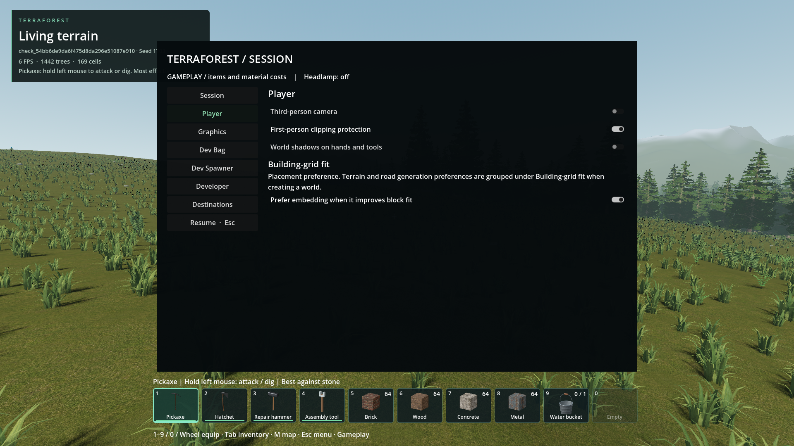
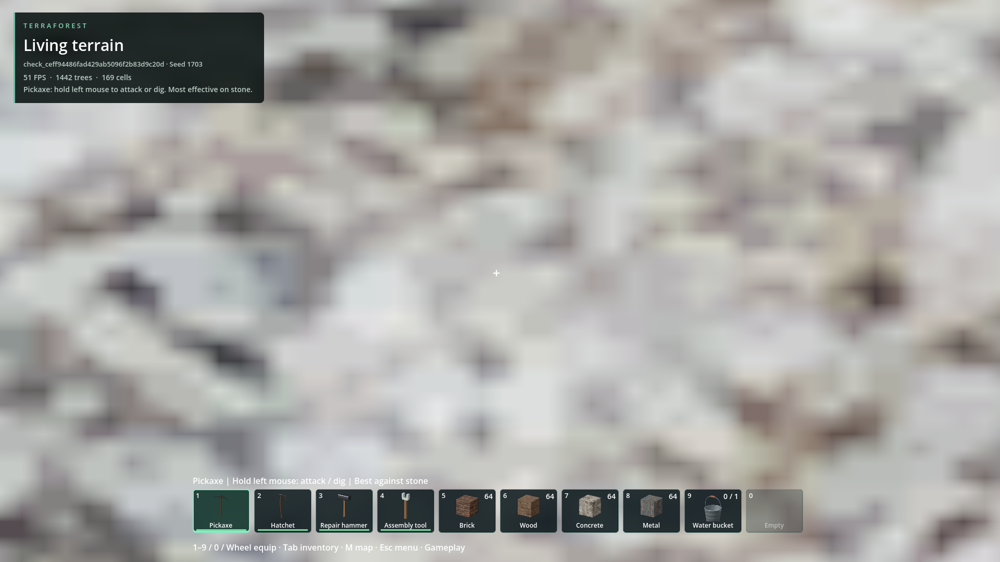
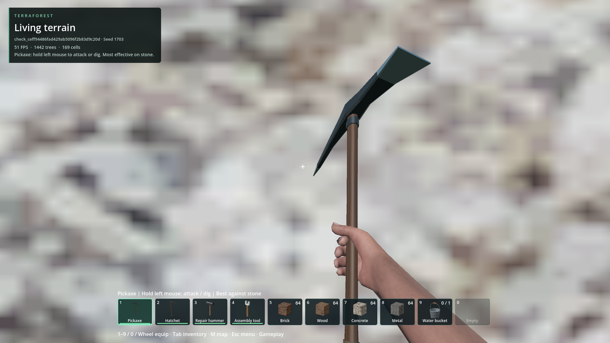
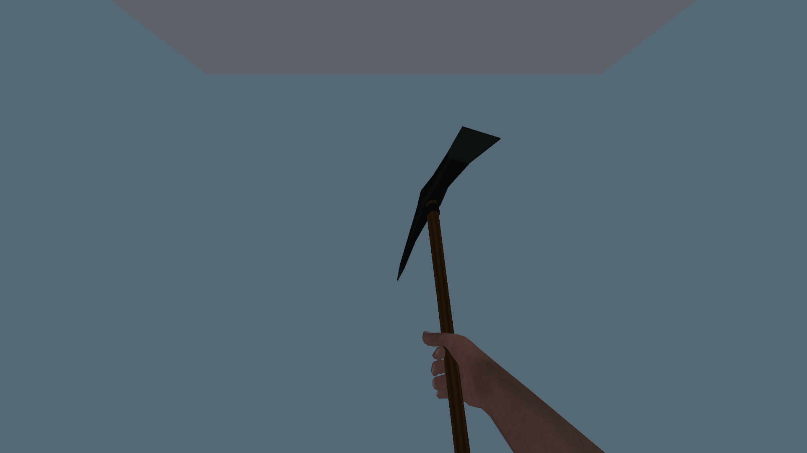
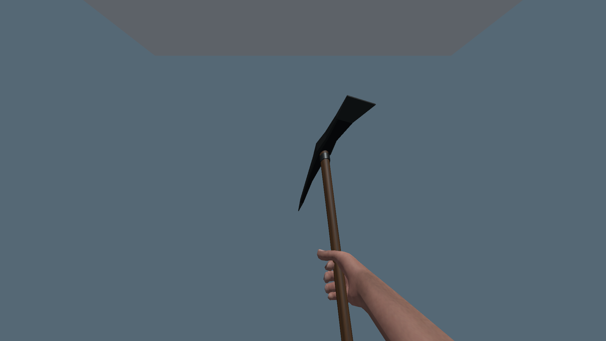
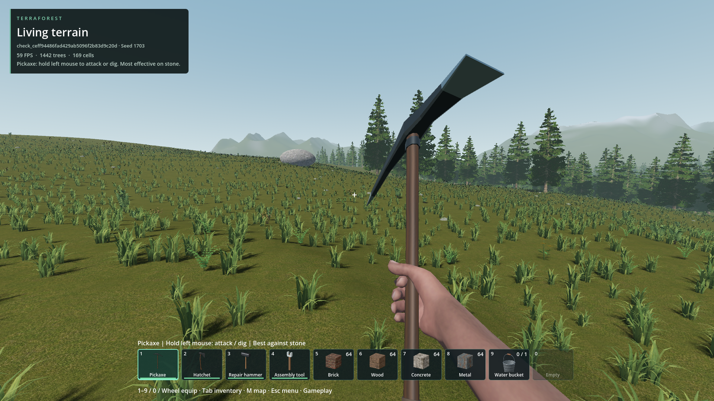

# First-person world clipping

- Status: Implemented and packaged; clipping protection retained, hand shadows now opt-in. 127 focused packaged checks pass; current visual review pending.
- Updated: 2026-10-27. Source baseline: `13c87bca` plus the first-person rendering change.
- Symptom: Nearby terrain/buildings hide parts of held items and hands.
- Agreed scope: Two cameras/layers, default on; optional world shadows; no tool retraction, physical contact system, new swing rules or changed reach.
- History: After discussing apparent wall intersection, the user explicitly chose this simple two-camera approach. Physical retraction is not a hidden prerequisite. On 2026-10-27 the user clarified that world-shadow fidelity on hands/tools is not needed; preventing world-mesh interference is the priority.

## Implementation

- ESC > Player: **First-person clipping protection ON**, **World shadows on hands and tools OFF** by default; saved separately in `user://player_view.cfg`. Explicit saved choices remain respected. Disabling protection restores original rendering.
- One game window, one shared world, one skeleton/animation owner. An offscreen transparent viewport renders only arms/equipment above world depth and below HUD. No extra Godot process.
- Layer 18 is reserved for protected arms/tools; torso/legs remain world-depth tested on layer 19. Third person, driving, loading and hidden tools disable the extra pass.
- Offline, hash-invalidated mesh baking partitions every triangle once and preserves skin/morph channels. No runtime mesh generation. Original materials are rebound at runtime.
- Normal lighting still illuminates the hands pass. Default gameplay does not allocate or refresh hand-shadow casters. Only explicit shadow opt-in enables shared-mesh shadow references: at most 96 instances, 64 m directional reach, refreshed at 5 Hz or after significant movement. World shadows elsewhere are unchanged.
- Export now stages and smoke-checks the pack before replacing the installed pack, preventing failed exports from truncating the working pack.

## Verification

- Shadows-off update: 127 assertions passed across renderer, actual-world and authored-contact checks at `reports/checks/20261027T063457859128Z_first_person_pack`. Confirms clipping still works with shadows disabled, no default caster allocation, older preference fallback and explicit opt-in persistence. [Updated pack hash and qualification](verification/clipping-only-default.json).
- Initial rollout (`6a2363dd`): all seven checks passed, 194 assertions, at `reports/checks/20261027T061732444839Z_first_person_pack`. Includes restart persistence, crouch, actual vehicle entry/exit, real pickaxe input/contact, third-person return, Player menu and 14 matching native DLLs. This retained qualification predates the new shadows-off default: [original hashes](verification/qualification.json).
- `python tools/check_first_person.py`; add `--pack` for exported resources and matching DLL verification. Temporary worlds and isolated preference paths only.
- Mesh integrity: 21 assertions at `reports/checks/20261026T220328066606Z`; exact triangle partition/winding, all selected positions and sampled authored morphs.
- Source renderer: 52 assertions at `reports/checks/20261026T220331330256Z`; near-wall visibility, directional/local shadows, contact timing, settings and transitions. Open-air mean image error 0.000034, changed pixels 0.057% at the test threshold; not universal lighting equivalence.
- Actual world: 38 assertions at `reports/checks/20261026T220202170479Z`, seed 1703; all held tools, torch/headlamp, injected underwater environment, UI, third person, resize and bounded shadow references. Crouch and preference reopening added for final qualification.
- Real mining input/contact and Player menu passed at `reports/checks/20261026T220652166835Z_first_person`; attack timing at `reports/checks/20261026T220521203662Z`.
- Final RTX 4050 Laptop/1080p samples: hands pass ~0.29 ms GPU without world shadows, ~2.02 ms with; sync ~0.09–0.11 ms; shadow-set refresh ~0.47–0.68 ms at 5 Hz. Per-viewport samples, not whole-frame overhead or low-end qualification. Screenshot HUD FPS includes synchronous PNG readback, not a gameplay benchmark.

## Images

All captures are unedited; source paths, settings and hashes: [manifest](images/manifest.json). No user screenshot was provided for this issue. Pack captures use the default approved pickaxe, not the separate crosscut experiment.

Updated packaged build, temporary seed 1703; synthetic wall 0.25 m ahead. No hand-shadow system is required for clipping protection. Earlier comparisons below remain as history.

Same temporary seed 1703, camera `(800,51.83451,1310)`, synthetic wall 0.25 m ahead. This stress fixture demonstrates rendering protection, not physical tool collision.

Same isolated roof/lighting/camera; protection remains on in both. Only hands-pass world shadows change.

Additional retained comparisons: [original open-air](images/open-baseline.png), [corrected protected open-air](images/open-protected.png), [rejected dark prototype](images/rejected-dark-prototype.png). The rejected image is not the installed build.

## Rejected / repaired checks

- `20261026T212640229871Z`: headless bake serialized unusable texture placeholders; fixed by runtime material binding.
- `20261026T212736299962Z`: early assertions passed but protected arms were visibly darker. Rejected; camera culling excluded lights, corrected by explicit light-layer registration.
- `20261026T215347793198Z`: world fixture froze an unfinished equip blend, showing an empty hand despite the HUD. Invalid held-tool evidence; now settles the blend and asserts equipment visibility.
- `20261026T220523832634Z`: old third-person fixture assumed fleet activation even when disabled; updated to the current single-car path and a driving-pass assertion.
- Initial export exhausted C: space and truncated the old pack under the previous exporter. Next attempt hit a malformed editor cache from that failure. Logs: `reports/first_person_export_disk_full.log`, `reports/first_person_export_cache_error.log`. No player save was deleted.

## Remaining / return triggers

- User visual acceptance is pending. This protects against world-depth clipping, **not physical contact**: a held tool may appear in front of a wall where its world-space model intersects it. Attack occlusion and gameplay collision remain unchanged.
- Optional shadows are bounded, not exact parity with every distant caster/custom shader. This is not a blocker for the requested clipping-only default. Revisit shadow fidelity only if requested; extremely dense scenes, particles and unusual light masks remain separately unqualified.
- Low-end GPUs, long travel and exhaustive underwater/postprocessing combinations remain unqualified. Profile these before promising universal performance.

## Alternatives retained

| Option | Why / when to revisit |
| --- | --- |
| Two cameras/layers (chosen) | Reliable hand/item self-depth; extra viewport and optional shadow cost |
| Tool retraction/contact-aware swings | Only if later requested; needs animation/contact design, excluded now |
| Depth-range compression | If the extra pass proves too costly; projection, shadows and postprocessing require validation |
| Disable depth testing | Cheap, but can break hand/item self-occlusion; not chosen |
| Camera collision correction | Prevents the eye entering geometry; separate from long-tool protection |

Code: `addons/player_runtime/first_person_view.gd`, `first_person_meshes.gd`, `first_person_shadows.gd`; `tools/bake_first_person_meshes.gd`, `tools/check_first_person.py`.
