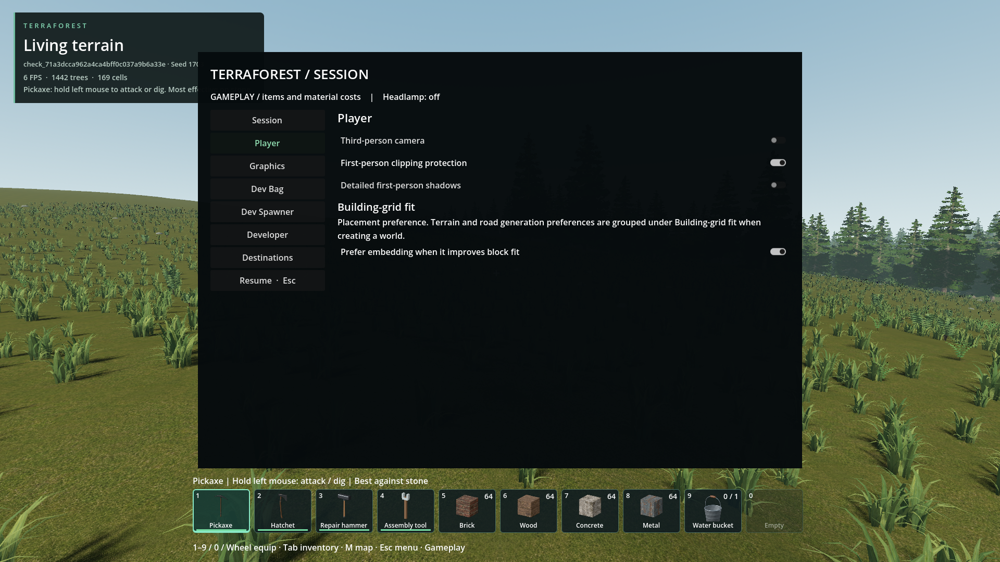
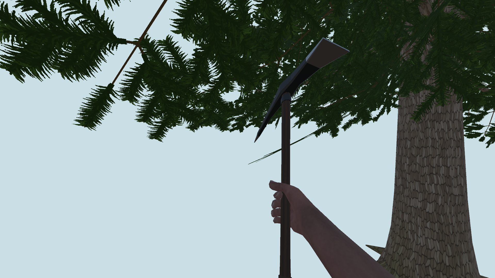
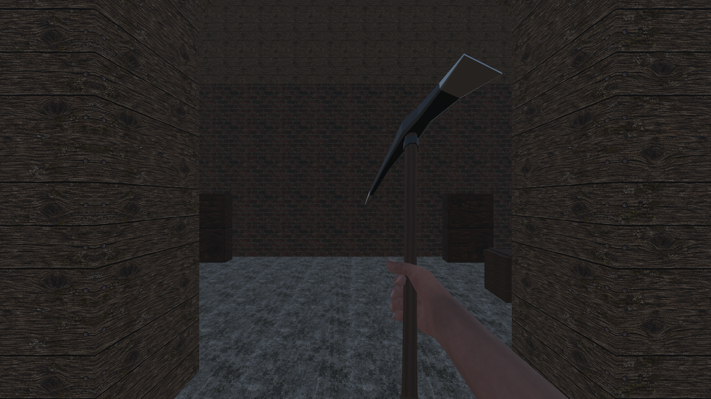
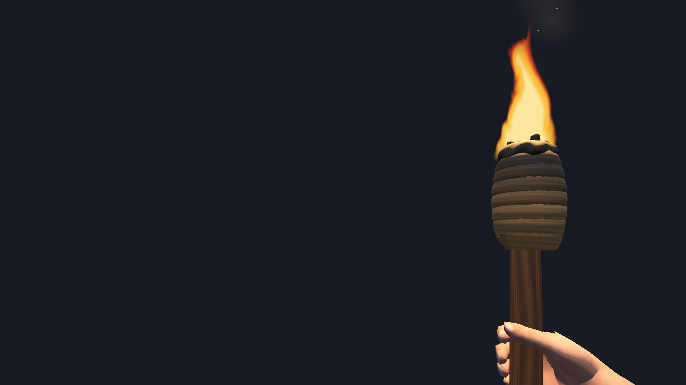

# First-person world clipping

- Status: Native-depth replacement installed; 277 packaged assertions and 13 actual pre-change checkpoint comparisons pass. User visual review pending.
- Updated: 2026-10-27. Working baseline: `53d8cd24` plus the native-depth replacement; historical appearance baseline: `ec05af0c`.
- Symptom: Nearby terrain/buildings hide parts of held items and hands.
- Agreed scope: Default-on clipping protection with unchanged ordinary lighting, including held effects; retain the optional detailed two-camera mode. No tool retraction, physical contact system, new swing rules or changed reach.
- History: After discussing apparent wall intersection, the user explicitly chose this simple two-camera approach. Physical retraction is not a hidden prerequisite. On 2026-10-27 the user clarified that world-shadow fidelity on hands/tools is not needed; preventing world-mesh interference is the priority.

## Implementation

### Current native-depth replacement

- The user requires the original lighting/shadows, not just a current-build toggle comparison. Default protection now uses Godot's native `BaseMaterial3D.use_z_clip_scale` / shader `Z_CLIP_SCALE` at 0.01. Geometry retains its original lighting positions and the original world shadow maps. No default second color pass or duplicated shadow rendering.
- Arms/items keep the same assets, textures, poses and authored contact timing. Body remainder stays world-depth tested; third person/driving restore original materials and geometry.
- Equipment roots are explicitly marked, including the entire torch branch. Flame, embers, smoke and late-added held geometry register automatically, rather than relying only on mesh-name prefixes. Torch shader colors, opacity, animation clock and light remain unchanged; a per-instance depth scale and transparent sorting offset protect its effects from opaque walls and ordinary transparent world geometry.
- The retained checkbox is now **Detailed first-person shadows**: a separate, optional close-up shadow-camera mode, OFF by default. It is not needed to preserve ordinary world shadows with default clipping protection.
- This uses the new `first_person_detailed_shadows` preference. The old `first_person_world_shadows=true` setting no longer silently selects the detailed camera: ordinary world shadows are now retained automatically. The protection on/off preference remains respected.
- Custom first-person shaders must implement the shared `first_person_depth_scale` instance uniform through `Z_CLIP_SCALE`, as both production torch shaders now do. Unknown mod shaders and non-Mesh multi-surface particle materials require separate qualification; do not promise automatic support for every future shader.
- Engine reference: [native depth scaling and its screen-space-effect caveat](https://docs.godotengine.org/en/4.5/classes/class_basematerial3d.html#class-basematerial3d-property-z-clip-scale). Current SSAO/SSR are disabled; enabling them later requires fresh comparison. No claim of physical weapon retraction or camera collision correction.

### Previous two-camera rollout (superseded default)

- ESC > Player: **First-person clipping protection ON**, **World shadows on hands and tools OFF** by default; saved separately in `user://player_view.cfg`. Explicit saved choices remain respected. Disabling protection restores original rendering.
- One game window, one shared world, one skeleton/animation owner. An offscreen transparent viewport renders only arms/equipment above world depth and below HUD. No extra Godot process.
- Layer 18 is reserved for protected arms/tools; torso/legs remain world-depth tested on layer 19. Third person, driving, loading and hidden tools disable the extra pass.
- Offline, hash-invalidated mesh baking partitions every triangle once and preserves skin/morph channels. No runtime mesh generation. Original materials are rebound at runtime.
- Normal lighting still illuminates the hands pass. Default gameplay does not allocate or refresh hand-shadow casters. Only explicit shadow opt-in enables shared-mesh shadow references: at most 96 instances, 64 m directional reach, refreshed at 5 Hz or after significant movement. World shadows elsewhere are unchanged.
- Export now stages and smoke-checks the pack before replacing the installed pack, preventing failed exports from truncating the working pack.

## Verification

- Latest installed package: all eight checks pass, **277 assertions**, at `reports/checks/20261027T081546622815Z_first_person_pack`. Covers depth protection, all equipment/torch effects, ordinary lighting/shadows, transparent geometry, settings migration, third person, crouching, vehicle transitions and real mining contact. All 14 native DLL hashes match. [Package, runtime and test hashes](verification/native-depth-pack.json). Its eight unique successful-run caches were removed automatically; logs and images remain.
- **Actual historical baseline:** `ec05af0ca2cc082c0d6d2cdb8a3e52cf0cee6934`, immediately before `6a2363dd`. Original runtime scripts come from Git objects, not today's protection-off mode. Unchanged binary assets and derived imports are shared in an isolated project to avoid multi-GB copies; runtime source hashes are checked against Git and all 14 native DLL hashes match. Same engine, driver, poses, production tree/house assets, camera/light settings and frozen torch clocks.
- All 13 historical comparisons pass: outdoors; tree shade with pickaxe/torch; approved shop with unarmed, pickaxe, axe, hammer, assembly tool, shovel, torch and bucket; night torch and headlamp. Worst mean hand-region RGB error is below 0.000007 on a 0–1 scale. These are controlled render fixtures using the actual historical runtime, not a restored player save or exhaustive animation/renderer coverage. [Comparison and hashes](verification/historical-checkpoint.json).
- Current source checks: 74 parity assertions cover matching images, hand-region comparison, all torch effects, late-added geometry, opaque wall and transparent-wall protection; 59 renderer/contact/settings assertions also pass. [Parity details](verification/native-depth-parity.json). Reproduce the history comparison with `python tools/compare_first_person_history.py --directory .build/first-person-history-20261027`.
- Shadows-off update: 127 assertions passed across renderer, actual-world and authored-contact checks at `reports/checks/20261027T063457859128Z_first_person_pack`. Confirms clipping still works with shadows disabled, no default caster allocation, older preference fallback and explicit opt-in persistence. [Updated pack hash and qualification](verification/clipping-only-default.json).
- Initial rollout (`6a2363dd`): all seven checks passed, 194 assertions, at `reports/checks/20261027T061732444839Z_first_person_pack`. Includes restart persistence, crouch, actual vehicle entry/exit, real pickaxe input/contact, third-person return, Player menu and 14 matching native DLLs. This retained qualification predates the new shadows-off default: [original hashes](verification/qualification.json).
- `python tools/check_first_person.py`; add `--pack` for exported resources and matching DLL verification. Temporary worlds and isolated preference paths only.
- Mesh integrity: 21 assertions at `reports/checks/20261026T220328066606Z`; exact triangle partition/winding, all selected positions and sampled authored morphs.
- Source renderer: 52 assertions at `reports/checks/20261026T220331330256Z`; near-wall visibility, directional/local shadows, contact timing, settings and transitions. Open-air mean image error 0.000034, changed pixels 0.057% at the test threshold; not universal lighting equivalence.
- Actual world: 38 assertions at `reports/checks/20261026T220202170479Z`, seed 1703; all held tools, torch/headlamp, injected underwater environment, UI, third person, resize and bounded shadow references. Crouch and preference reopening added for final qualification.
- Real mining input/contact and Player menu passed at `reports/checks/20261026T220652166835Z_first_person`; attack timing at `reports/checks/20261026T220521203662Z`.
- Earlier two-camera RTX 4050 Laptop/1080p samples: hands pass ~0.29 ms GPU without world shadows, ~2.02 ms with; sync ~0.09–0.11 ms; shadow-set refresh ~0.47–0.68 ms at 5 Hz. The current native-depth default disables that viewport and caster refresh entirely; latest measurements remain in the packaged world result. Per-viewport samples are not whole-frame overhead or low-end qualification. Screenshot HUD FPS includes synchronous PNG readback, not a gameplay benchmark.

## Images

All captures are unedited; source paths, settings and hashes: [manifest](images/manifest.json). No user screenshot was provided for this issue. Pack captures use the default approved pickaxe, not the separate crosscut experiment.

### Actual checkpoint versus updated native-depth default

Ordinary lighting and world shadows are retained automatically; the detailed-camera checkbox is not required. Explicit saved protection choices remain respected.

Before is genuine `ec05af0c`; after uses native depth protection with detailed shadows OFF. Same camera, production tree meshes/casters, lighting and pose. Minor weapon-edge differences can arise where world geometry previously occluded it; hand-region shading matches.

The original approved destructible-block shop is unchanged. Identical fixture placement and camera.

Additional evidence: [transparent-wall protection](images/native_depth_torch_glass_on.png), [historical night torch](images/checkpoint_night_torch_before.png), [updated night torch](images/checkpoint_night_torch_after.png). Older rollout images below remain historical, not current-default evidence.

Earlier packaged build, temporary seed 1703; synthetic wall 0.25 m ahead. These images precede the native-depth replacement; they remain historical evidence, not the current shading or settings.

Same temporary seed 1703, camera `(800,51.83451,1310)`, synthetic wall 0.25 m ahead. This stress fixture demonstrates rendering protection, not physical tool collision.

Same isolated roof/lighting/camera; protection remains on in both. Only hands-pass world shadows change.

Additional retained comparisons: [original open-air](images/open-baseline.png), [corrected protected open-air](images/open-protected.png), [rejected dark prototype](images/rejected-dark-prototype.png). The rejected image is not the installed build.

## Rejected / repaired checks

- `20261026T212640229871Z`: headless bake serialized unusable texture placeholders; fixed by runtime material binding.
- `20261026T212736299962Z`: early assertions passed but protected arms were visibly darker. Rejected; camera culling excluded lights, corrected by explicit light-layer registration.
- `20261026T215347793198Z`: world fixture froze an unfinished equip blend, showing an empty hand despite the HUD. Invalid held-tool evidence; now settles the blend and asserts equipment visibility.
- `20261026T220523832634Z`: old third-person fixture assumed fleet activation even when disabled; updated to the current single-car path and a driving-pass assertion.
- Initial export exhausted C: space and truncated the old pack under the previous exporter. Next attempt hit a malformed editor cache from that failure. Logs: `reports/first_person_export_disk_full.log`, `reports/first_person_export_cache_error.log`. No player save was deleted.

## Remaining / return triggers

- User visual acceptance remains pending; the updated package is installed and qualified within the scope above. This protects against world-depth clipping, **not physical contact**: a held tool may appear in front of a wall where its world-space model intersects it. Attack occlusion and gameplay collision remain unchanged.
- Optional shadows are bounded, not exact parity with every distant caster/custom shader. This is not a blocker for the requested clipping-only default. Revisit shadow fidelity only if requested; extremely dense scenes, particles and unusual light masks remain separately unqualified.
- Low-end GPUs, long travel and exhaustive underwater/postprocessing combinations remain unqualified. Profile these before promising universal performance.

## Alternatives retained

| Option | Why / when to revisit |
| --- | --- |
| Native depth scaling (current default) | Original lighting and shadow maps; screen-space effects need qualification if enabled |
| Two cameras/layers (retained optional mode) | Separate close-up shadow detail; extra viewport and shadow cost |
| Tool retraction/contact-aware swings | Only if later requested; needs animation/contact design, excluded now |
| Disable depth testing | Cheap, but can break hand/item self-occlusion; not chosen |
| Camera collision correction | Prevents the eye entering geometry; separate from long-tool protection |

Code: `addons/player_runtime/first_person_view.gd`, `first_person_depth.gd`, `first_person_meshes.gd`, `first_person_shadows.gd`; `tools/bake_first_person_meshes.gd`, `tools/check_first_person.py`, `tools/compare_first_person_history.py`.
