# Gameplay expansion: encounters, exploration and progression

- Status: In progress; generated house/underground/lookout sleepers and supplies, not a completed expansion.
- Updated: 2026-11-01.
- User review: implementation requested; no new asset/animation approval claimed.
- Scope: [full requirements and acceptance](../../docs/GAMEPLAY_EXPANSION.md).

## Images

### Container locks — source and package verified, 2026-11-01

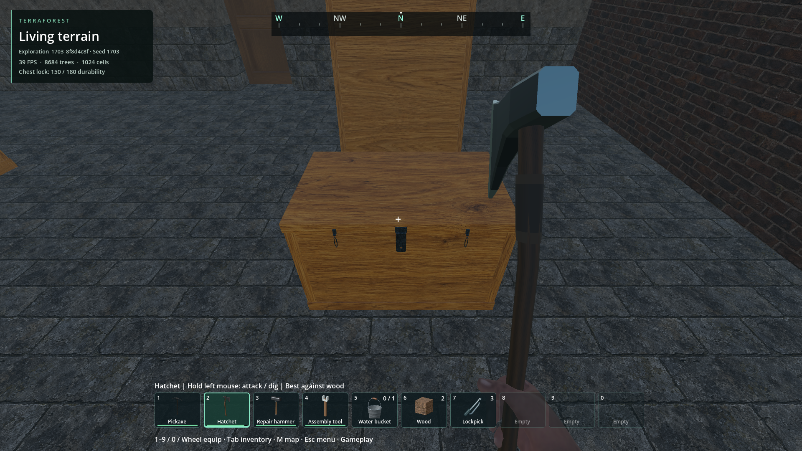
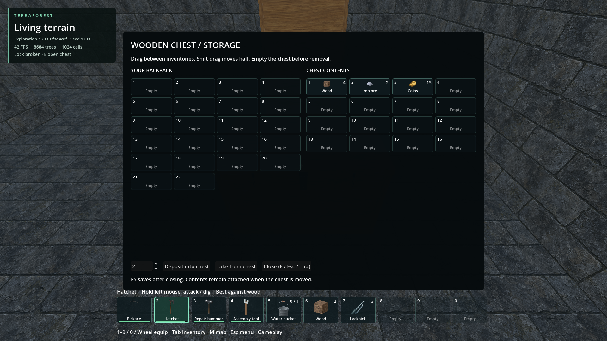

New-world generation selects one in five chests deterministically; selected empty
house chests receive supplies, while existing exploration supplies are retained.
Locks have 180 health (twice the normal chest). E uses a craftable/tradable pick,
with a 10% chance of breaking one; success retains the pick. Tool damage opens the
lock without deleting the container or its contents. Existing saves are not
retroactively locked or replenished. Lock state, partial damage and random state
are native, bounded and binary; no idle polling or replacement model is added.

- Native debug/release: `reports/container_locks/20261101T130327483421Z` and
  `20261101T130330320349Z`: 56 lock assertions each plus legacy container/drag/
  capacity/transfer suites. 1,000 deterministic attempts give 105 broken picks;
  4,096 lock-only records use 98,328 bytes. This is not gameplay frame timing.
- Real HUD/storage/attack/crafting adapter, fake collection/picking:
  `reports/checks/20261101T130906940034Z`, 24 assertions. Icon visually inspected.
- New ordinary generation succeeded in
  `reports/exploration_world/20261101T130043255160Z`, but the broad traversal test
  failed at the previously observed second-lookout return walk before checking
  locked chests. Retain this recurrence, not a passing world qualification.
- Actual generated-world interaction: `reports/container_lock_world/20261101T131517785107Z`,
  30 assertions plus 11 fresh-process assertions. Native scene rays select real
  generated chests; hatchet contact adapter breaks the first lock, ordinary chest
  UI collects iron, backpack crafting converts iron → metal → picks, E unlocks
  another chest, and a third lock retains partial damage across compound saves.
  Images inspected; [capture provenance](container-lock-evidence.json). Peak
  sampled private commit 3,681,587,200 bytes, dedicated GPU 1,490,513,920 bytes.
  These offscreen interaction captures do not establish 60-FPS frame pacing,
  street-to-interior traversal or authored animation/input timing.
- Retained fixture failures: `20261101T131146397565Z` refused launch at the free-space
  safety reserve; `20261101T131255627535Z` assumed starter metal and omitted the
  existing offscreen scene-transition hook. Corrected fixture collects real loot
  and records zero pointer captures in both passing phases. No limit was disabled.
- Combined door/lock package restores the same owned world with 11 passing
  assertions: `reports/container_lock_world/20261101T132734256039Z`. Exact remaining
  lock damage, contents, picks and worn tool match; no desktop pointer capture.
- Remaining: main installation and direct player animation-input playtest. The dedicated lock-world check reuses only that owned
  `Exploration_*` save; it does not replace the failed lookout route requirement. Locked doors,
  barricades and POI quest reset ownership remain separate unfinished work.

### Generated W1 lookouts — 2026-11-01

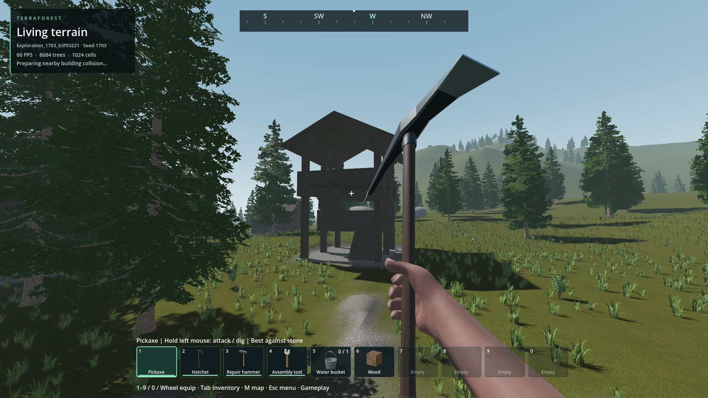
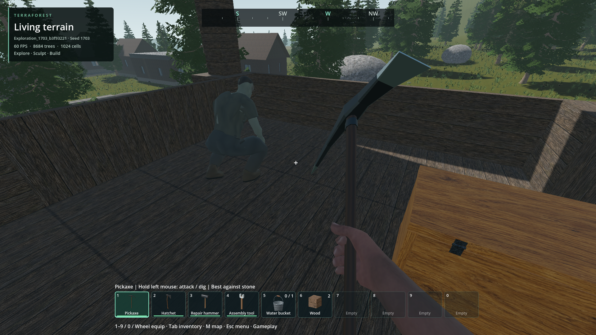

The ordinary unchanged default Generate & play recipe now includes up to two
separated lookouts. Shared native fitting handles diagonal/curved regional roads,
retains the existing 2 m fill / 3 m cut limits and protects lakes, buildings and
underground sites. At most 192 candidates are tested once during planning. Two
sites fitted in 12.704 ms in the isolated seed-1703 planning measurement; this is
not whole-world generation time. No existing save or approved house is replaced.

Construction remains 385 individually destructible cells, batched by the existing
native world. The deck chest has actual thin-floor support and clear-bound checks,
stocked supplies and a stable sleeper; native binary storage preserves withdrawals
and cleared residents. New roof geometry appears in generation preview, and actual
entrances/approaches are in the native regional plan. There is no frame-loop survey.

- Source ordinary world: `reports/exploration_world/20261101T120954902588Z`, 76
  generation/travel/loot/wake assertions and fresh-process restoration. Both towers
  are reached from their real roads, climbed, looted and descended; the cave/mine
  interactions remain covered in the same populated world.
- Fifteen siting/cache/malformed-road assertions:
  `reports/checks/20261101T120953037834Z`. Seven-seed legacy lot planning passes at
  `reports/checks/20261101T121405129828Z`. Required source/release building gates:
  `reports/building_standards/20261101T121730382946Z`.
- Source travel: 2,157 samples, p95 18.340 ms, worst 38.854 ms; peak private commit
  3,802,275,840 bytes and dedicated GPU 1,490,579,456 bytes. Offscreen 1080p, capped
  60 FPS/VSync, Quiet Mode unchanged. This does not qualify smooth foreground 60 FPS.
- Retained failures: first road-return timeout (`20261101T120104107970Z`, not
  reproduced in subsequent source traversal); a test-owned shared route was
  reversed in-place (`20261101T120630769200Z`, fixed by duplicating before mutation).
  A headless material-startup crash remains recorded in
  `reports/watchtower/20261101T115429631373Z`; rendered review passes separately.
- The legacy raw earthworks test reports two pavement-support failures, reproduced
  identically in the old installed pack at
  `reports/watchtower_baseline/20261101T121702667145Z`. Do not present that check as
  green; the current production source/release contact gate passes.

Installed-package generation and fresh restoration pass 76 + 15 assertions at
`reports/exploration_world/20261101T122106715365Z`. Package travel p95 is 17.014 ms,
worst 38.401 ms across 2,157 samples; peak private commit 3,862,499,328 bytes and
dedicated GPU 1,490,579,456 bytes. These remain offscreen measurements, not a claim
of seamless foreground frame pacing. Exact shipped W1 resource, four rotations,
missing-deck/obstructed-prop rejection and local destruction pass 55 assertions in
source (`reports/watchtower/20261101T122522042640Z`) and package
(`reports/watchtower/20261101T122557845008Z`). Distribution budget: 476,824,047 bytes.

The coordinated browser update is also included; packaged responsiveness and
credits UI checks pass. A first credits harness incorrectly wrote into read-only
`res://` and used headless screenshot capture; its failed evidence is retained,
then the unchanged assertions pass with an external output directory and renderer.
Exact package, resource and image provenance: [integration evidence](watchtower-world-evidence.json).
Return for broader seeds, full NPC routes, final visual review and foreground
performance. Quest/reset/lock ownership and the full expansion remain unfinished.

### Watchtower W1 review — 2026-11-01

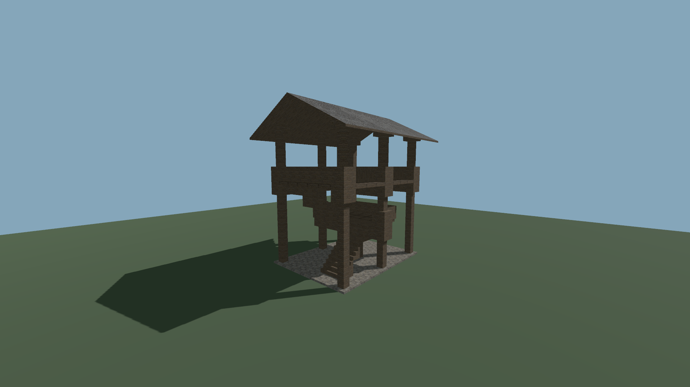
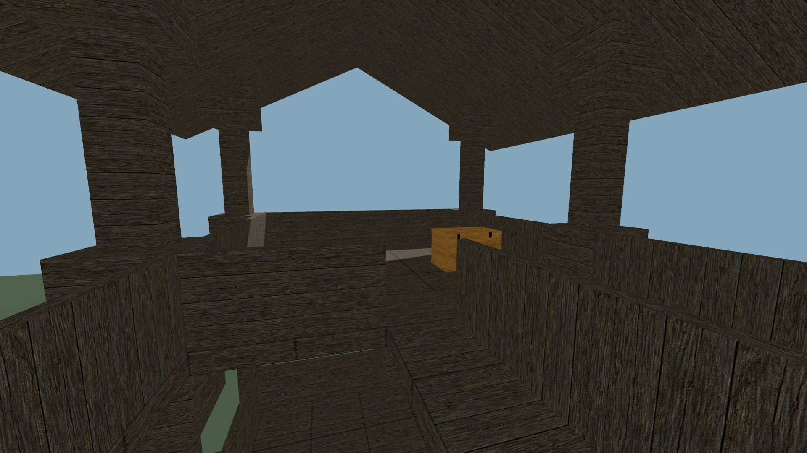

Original `addons/exploration/watchtower.gd` authors the CC0 baked
`watchtower_w1.tres`: 385 independent native cells, smooth shallow metal roof,
weathered timber supports/guards, switchback stairs and one existing chest model.
No houses were replaced. At this historical isolated-review checkpoint the chest
was only an attachment; current generation/loot evidence is recorded above.
This isolated review alone does not qualify natural terrain fit or generation.

Checks use actual `NativePlayerMovement` and native block/model collision: climb
both flights, cross the deck and descend in all four grid rotations. They also
check continuous support columns, exact baked-resource correspondence, independent
roof-cell removal and binary restoration. No whole-tower runtime mesh/Node per
piece, per-frame authoring or new native library is required.

- Source render: `reports/watchtower/20261101T112343447658Z`, 35 checks, including
  baking the corrected resource. Final exact-resource parity is checked separately.
- Final source headless: `reports/watchtower/20261101T112757477833Z`, 35 checks,
  including exact baked-resource parity. Godot import succeeds and generated both
  new script UIDs: `reports/watchtower_import/20261101T112627831928Z`.
- Release-native render: `reports/watchtower/20261101T112536612254Z`, 35 checks.
  The external review recipe/driver uses installed pack materials, models and
  release DLLs; this does **not** mean the watchtower is in the installed catalog.
  Sampled private commit 1,342,844,928 bytes / dedicated GPU 662,040,576 bytes for
  this isolated scene, not populated-world headroom evidence.
- Initial failures retained: `20261101T111351568799Z` (low beam obstructed stairs),
  `20261101T111449111215Z` (guard mounted across upper landing),
  `20261101T112141544296Z` / `20261101T112305547662Z` (discontinuous support column).
  Fixes change authored cells, not controller tolerances or grid rules.

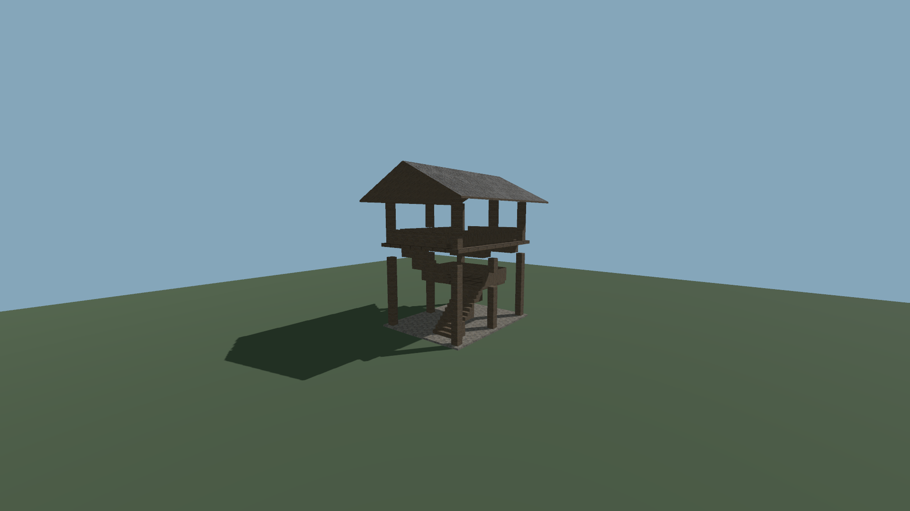

The integration entry above supersedes this checkpoint's pending fitting,
publication, supplies and persistence work. Existing saves remain untouched;
broader quality/performance and final user visual approval are still not claimed.

### Portal correction — 2026-11-01

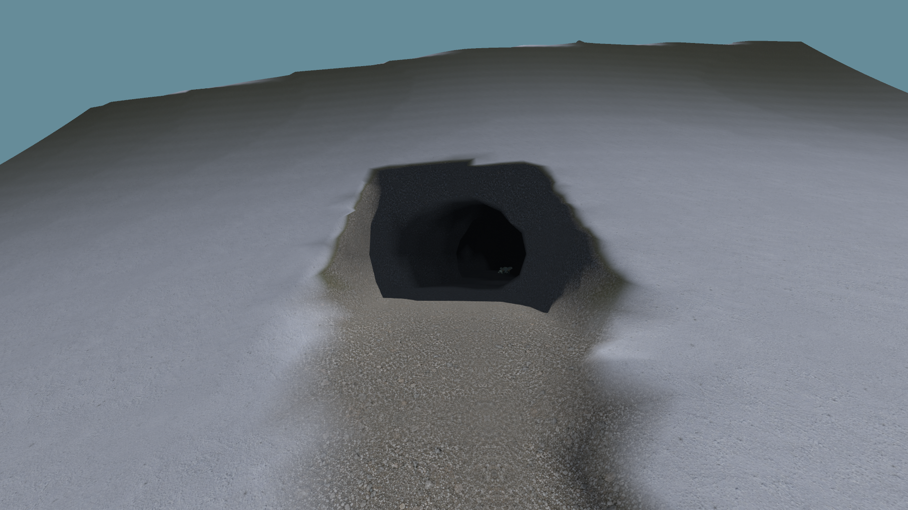
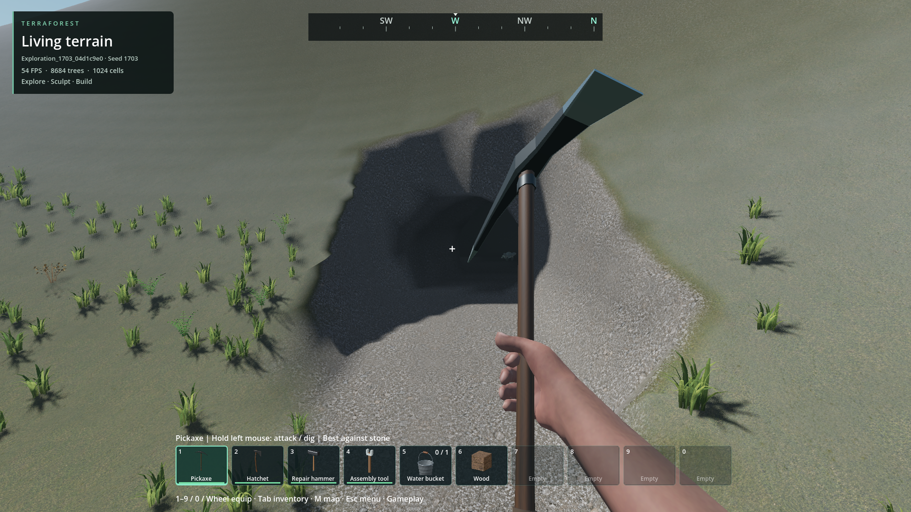
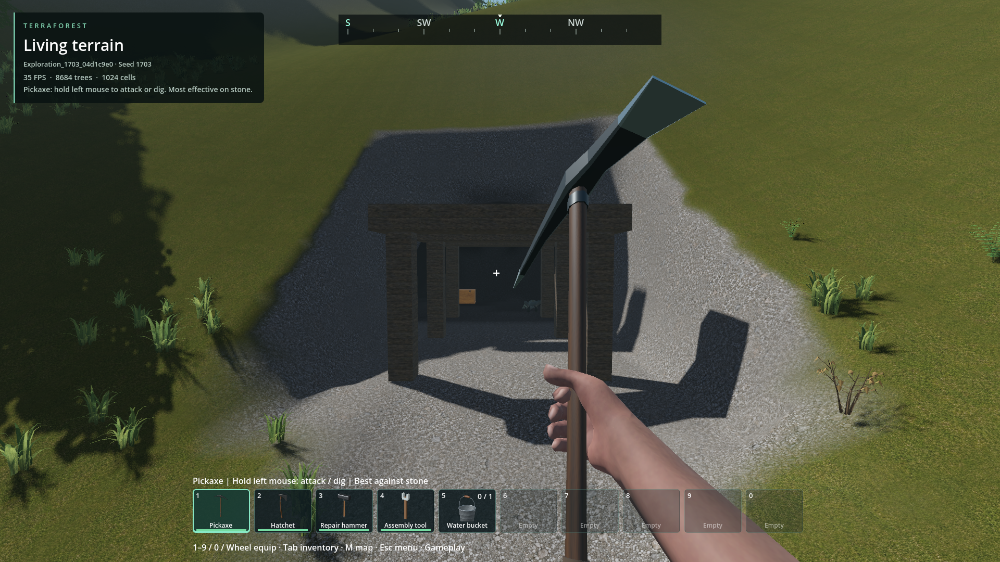

The isolated patch above the old entrance was not missing mesh. Density sampling
found only 0.1–0.2 m of rock at the affected roof column, thinner than the metre
density lattice. The authored open-air recess removes that layer and leaves a
readable rock face before the covered passage. No shader, global lighting, grid
or load-time terrain patch changed. The first image uses the **original** bad
site `(1425,183,1348)` and camera; comparison source before:
`reports/exploration_review/20261101T102303021939Z/split_rock_cave_0.png`, after:
`reports/exploration_review/20261101T105118945887Z/split_rock_cave_0.png`.
This prototype was then moved into the validated ordinary catalog/native planner,
not left as a test-only correction. Stronger footprint support fitting selects
`(1629,158,569)`, rotation 1, for the new seed-1703 cave. The mine stays at its
original site. Existing saved worlds retain their original excavations.

- Native debug/release: `reports/exploration_native/20261101T105746209194Z` and
  `20261101T105748357629Z`; 25 + 74 + 23 checks each. A regression reproduces the
  old solid wafer, checks its actual removal, retains floor/covered roof support,
  and rejects malformed/nonfinite/oversized mod entrance cuts without mutation.
- Actual final-catalog collision/waking review: `reports/exploration_review/20261101T105630297579Z`,
  26 checks. All four layout rotations and five native fit seeds still pass.
- Source ordinary Generate & play + fresh restore:
  `reports/exploration_world/20261101T105825197235Z`, 28 + 11 checks. Physical
  entrance walks, chest withdrawal, sleeper wake, saved clearing and zero cursor
  captures pass. Sampled peak private commit 3.44 GiB / dedicated GPU 1.39 GiB.
  Offscreen walking p95 20.070 ms, worst 33.080 ms, 466 samples; not smooth-60 or
  foreground headroom acceptance. Quiet Mode and 60 FPS/VSync remain unchanged.
- Required source/release building gate: `reports/building_standards/20261101T110254579860Z`.
- Packaged ordinary generation + fresh restore:
  `reports/exploration_world/20261101T110609763419Z`, 28 + 11 checks; entrance
  screenshots inspected. Sampled private commit 3.56 GiB / GPU 1.39 GiB; walking
  p95 19.857 ms, worst 30.663 ms across 466 samples. Full harness 103.68 s create /
  29.14 s restore, not generation-only timings. Distribution 476,782,715 bytes.
  Installed pack hash and capture provenance are in `portal-evidence.json`.

This closes the reproduced isolated portal wafer, not all terrain shading/art.
The cave still needs richer natural detail; the mine needs more authored dressing,
and external paths/NPC routes plus broader performance remain unqualified.

### Generated underground locations — 2026-11-01

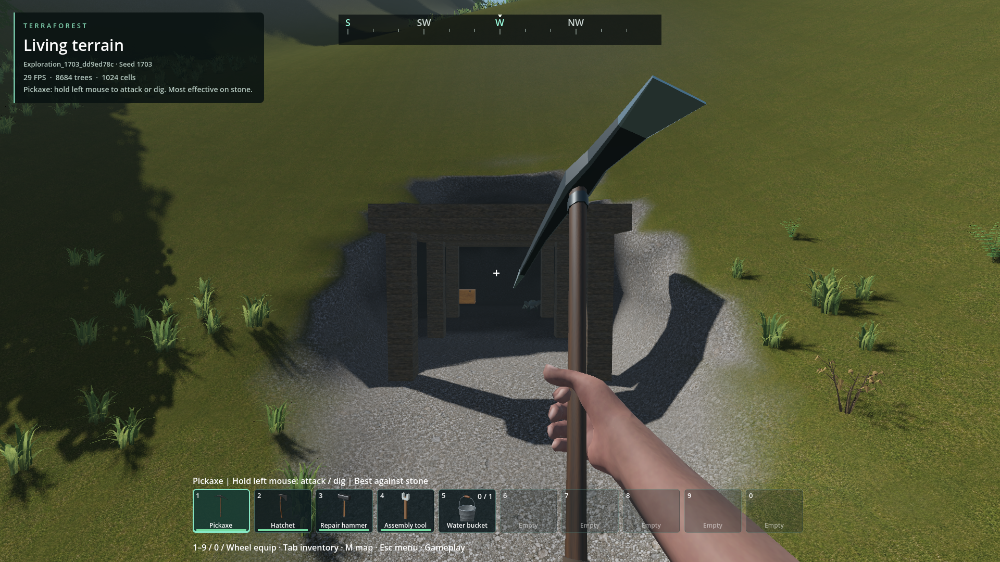
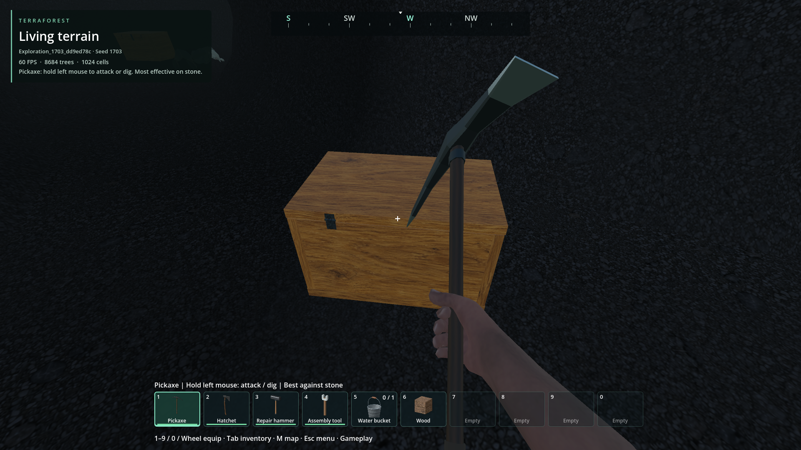
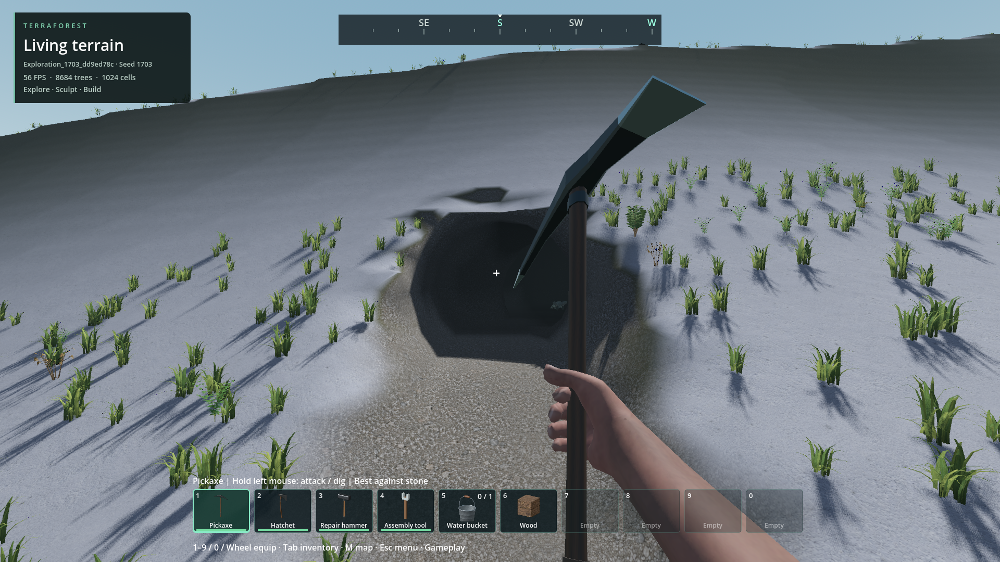
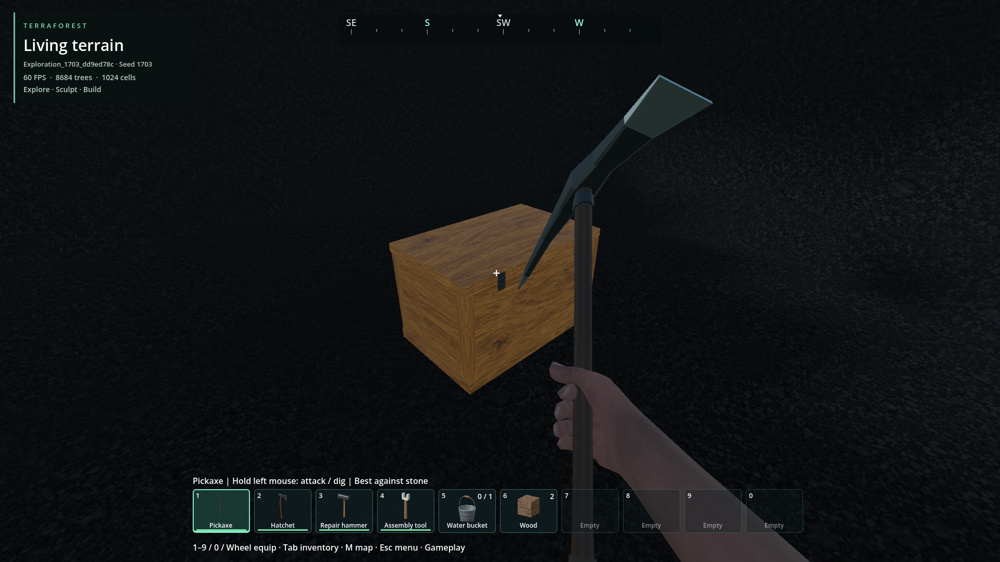

Seed 1703, normal default browser recipe, source run
`reports/exploration_world/20261101T102919511519Z`. Captures are unedited; existing
materials/models retain their original provenance. Timbers are 33 destructible
grid blocks, not one mine mesh. The mine branches and loops; the smaller cave has
two connected chambers. Actual collision-driven approach/room walks, chest UI,
withdrawal, hearing/wake and separate-process restoration pass. Teleporting to the
approach does not qualify travel from town. Dark angular cave-rim patches and
sparse dressing remain visible defects, **not final art approval**. The separate
[unshaded diagnostic](images/cave-entrance-geometry.png) shows surface geometry at
that patch; the later portal correction above supplies the density diagnosis.

- Native debug/release: `reports/exploration_native/20261101T103315815064Z` and
  `20261101T103318338898Z`; 25 arched-density, 66 layout/route/fitting and 23
  model-only atomic-placement checks each. Includes flat-floor exact-cube safety,
  five deterministic seeds, all rotations, reject/no-mutation and binary reload.
- Standalone visual/collision: `reports/exploration_review/20261101T102303021939Z`,
  26 checks, shared production support/clearance gate and native sleeper wake.
- Ordinary world create/restore: `reports/exploration_world/20261101T102919511519Z`.
  Two sites, five stocked chests, five keyed sleepers; actual looted contents and
  killed resident survive a fresh process. Old saves are not repopulated.
- Matching installed pack create/restore passes:
  `reports/exploration_world/20261101T103815729207Z`, SHA-256
  `852158e09857496452c1723074dbdab39166c1fc668c9c2a6eb0ced23db6b305`.
  Pack size 447,074,612 bytes; source/package entrance images inspected. Its 466
  offscreen walking frames have p95 22.018 ms and worst 78.687 ms: **remaining
  performance work**, not a smooth-60 claim. Sampled peak private commit 3.566 GiB,
  dedicated GPU 1.401 GiB. Controlled foreground comparison remains necessary.
- Source walking window: 466 frames, p95 18.325 ms, worst 32.883 ms. These are
  offscreen physical-controller walks, **not** foreground pacing or smooth-60
  approval. Sampled peak private commit 3.442 GiB and dedicated GPU 1.387 GiB;
  0.5-second process-specific counters do not capture every instantaneous peak.
  FPS shown during screenshot readback is not a benchmark. 60 FPS/VSync and
  Quiet Mode are unchanged.
- Existing container, real-prefab, frontage and terrain contract tests pass;
  required source/release building gate: `reports/building_standards/20261101T103446324792Z`.
- First ordinary-world run `20261101T102618255608Z` is retained as **failed**:
  the test's initial offscreen flag was reset during scene transition, permitting
  mouse capture. The harness now sets it before the world enters the tree and
  asserts zero captures both at readiness and exit. Passing rerun retains normal
  collision but opens the movement gate without OS capture; it is not an input
  or foreground-performance qualification.
- Other retained rejects: `exploration_review/20261101T095955750134Z` (wrong
  approach material/camera inside wall); `exploration_native/20261101T100715626549Z`
  (stale release binary launched before build ended); `exploration_native/20261101T102238121129Z`
  (test Variant-inference parse error). Earlier native/visual failures remain in
  `reports`; no failed cache or review image is silently removed.

Next: rim/art refinement, watchtower and external paths, then persistent location
ownership/reset and locked access. Loot seeding is generation-only, not quest
reset. Dense encounter balance, general NPC routes, broader seeds/recipes and
foreground/doubled-content performance remain open.

Implementation: `addons/exploration/`, native `exploration_sites.hpp`, native
arched terrain profile, `NativePrefabPlacement.ground_model_samples`, the shared
foundation state machine, exact committed-model IDs and native container grants.
`custom_world_plan.gd`/`generate_world_task.gd` are the ordinary-generation hook;
there is no load-time regeneration or new frame-loop excavation.

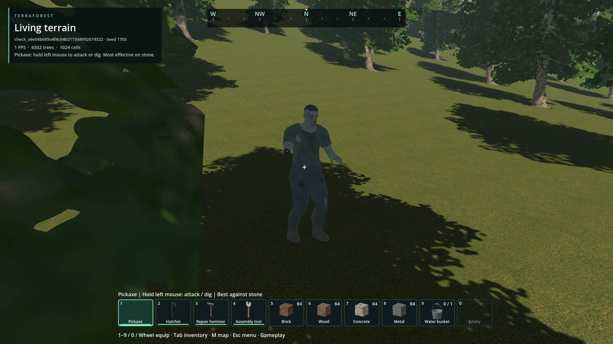

Seed 1703, ordinary population resident 1622, installed pack `62f9267e618e`.
The missing right forearm/hand has a closed stump; remaining anatomy is unchanged.
Two source angles and this packaged front view were inspected. This is an anatomy
image, not new character art or animation approval. Screenshot readback/off-screen
capture is outside the timed intent samples; the HUD FPS is not performance evidence.
Jogging, new POIs/models and populated-world balance remain unreviewed.

### Sleeper animation checkpoint

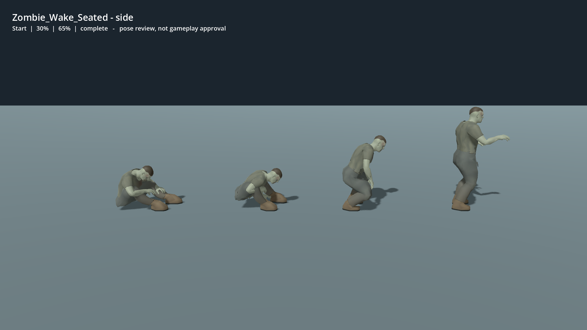
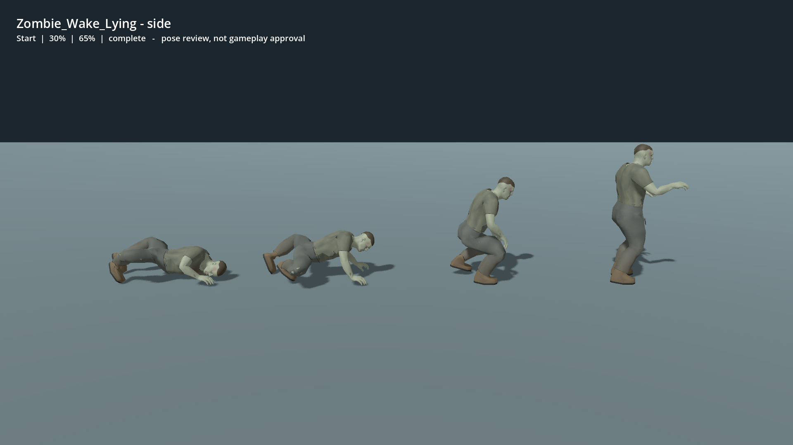
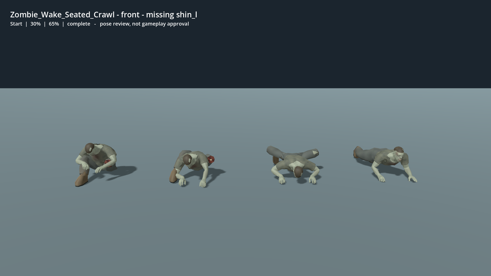

Actual original R4 runtime skin, flat authoring stage, 2026-11-01. Left to right:
start, 30%, 65%, completion. Assistant inspected front/side, forearm-loss and
shin-loss views. These are authored animation reviews, not live sleeper behavior,
physical clearance, terrain/POI suitability or user approval.
[Normal-speed front/side video](images/sleeper-wake-normal-speed.mp4) contains all
four wake clips, 480 frames at 30 FPS; readback/encoding is not gameplay timing.

Rejected trials are retained: [initial floating hips](images/rejected-sleeper-v1-floating.png)
and [linear seated-to-crawl leg penetration](images/rejected-seated-crawl-v2-floor.png).
The latter is replaced by authored leg arcs, not hidden geometry or a runtime lift.

## Changes and verification

- Native configurable temperaments, sustained-notice and finite-pursuit rules.
- Native sleeping/waking handshake: sound or hit begins wake; no combat/movement
  until the host acknowledges elapsed animation and safe physical transition.
- Stable native initial limb-loss recipes, using existing binary health storage.
- Restoring missing limbs no longer allocates throwaway detached ragdolls.
- Debug and release: 58 new native checks, 31 awareness, 33 population and 50
  anatomy checks pass; release fresh-process population restoration passes four.
  Existing actual-body crowd/contact (17) and navigation (15) checks also pass.
- Ordinary seed-1703 source and installed-pack scenes each pass 47 admission,
  anatomical presentation and scene-reload checks. All three temperaments appear;
  two of six admitted residents have generated missing forearm/hand chains.
- Short installed six-resident sample: intent p95 159 microseconds; process private
  commit 2,738,499,584 bytes, dedicated GPU 1,221,558,272 bytes. This does not prove
  crowded combat, frame pacing, dense POI streaming, driving or endurance headroom.
- Export/mandatory building gates pass; installed content is 476,294,851 bytes.
  60 FPS, VSync and Legion Quiet Mode are unchanged. All 33 pre-existing local
  import/project/icon files are hash-preserved; no user save was opened for writing.
- Exact evidence: [first milestone record](encounter-evidence.json).

- Sleeper asset checkpoint: two breathing poses, two standing wakes, two crawling
  exits; 59-bone rest match, exact original-idle endpoints, seven neutral morph resets.
  All six clips are original key-pose/IK work with retained rig provenance.
- 57 pose assertions inspect every 60-Hz frame, finite transforms, fixed root,
  floor clearance, endpoints and native skin/envelope containment. Lowest skin is
  about -0.51 mm at the inherited crawling-hand endpoint, within the 5 mm test
  tolerance. Tests do not qualify self-contact, arbitrary slopes or live collision.
- Shared runtime library: 316,364 bytes, reduced from an approximately 1.5 MB
  unoptimized intermediate. Native bounds are baked offline into 12-Hz groups;
  no runtime per-frame vertex sampling has been added.
- Preserved failed checks include an initial converter ready-order error and two
  launcher expectations (GPU telemetry in headless mode; a guessed assertion count),
  plus an initially read-only packed report destination. All are corrected without
  changing pose acceptance thresholds; packed runs use explicit writable reports.

Asset checkpoint evidence: [source/pack checks, hashes and retained failures](sleeper-evidence.json).
That animation-only checkpoint's pack passes 57 pose assertions and 47 ordinary
resident world assertions; it does not test live sleepers. Its content size is
476,617,743 bytes. Quiet Mode and the 60-FPS cap are unchanged.

### Live sleeper checkpoint

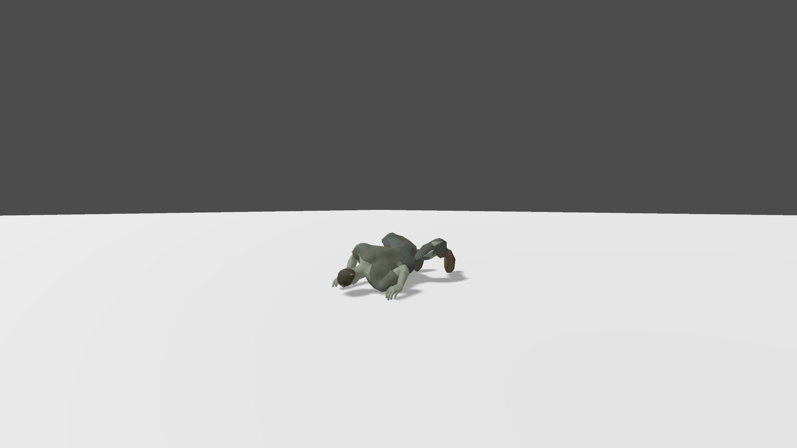
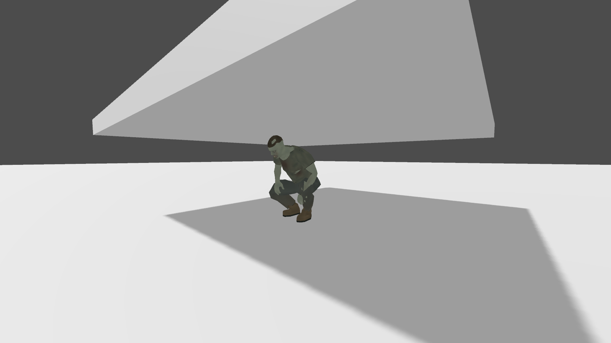
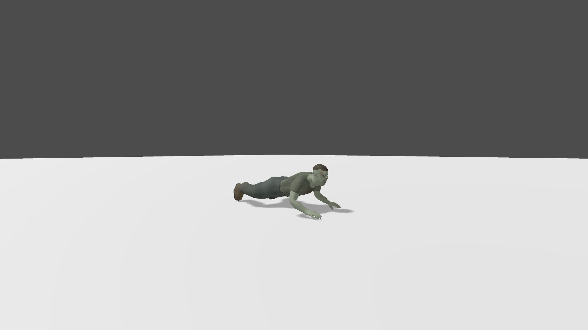

Source and packaged runtime runs each pass 47 live checks plus five fresh-process
checks. The matching pack also passes 58 pose checks, 25 binary-state checks plus
three fresh-process checks, and 47 ordinary-resident world regressions. Details,
hashes, limits and retained failures: [runtime evidence](sleeper-runtime-evidence.json).
These images are a flat collision fixture, not approved cave/house placement.

### Generated house checkpoint

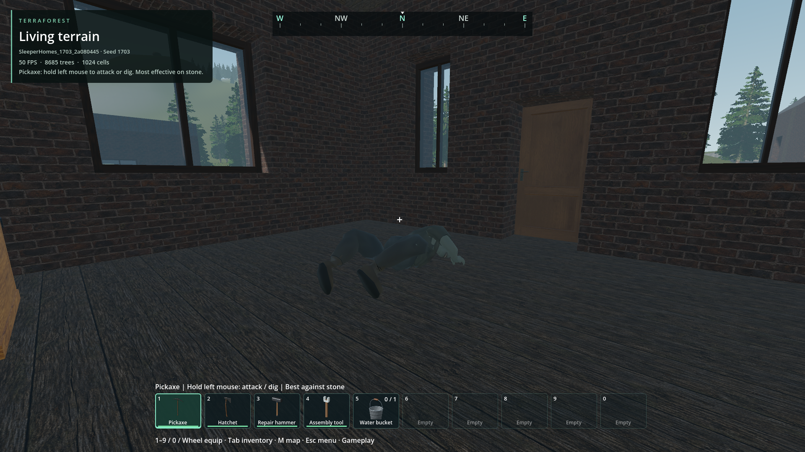
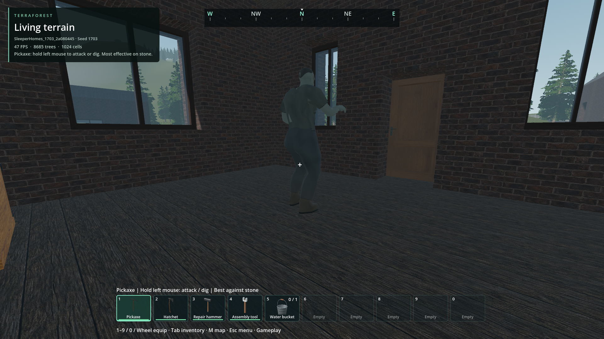

Installed pack `d6aac5e88aa9`, default browser recipe, seed 1703,
`SleeperHomes_1703_2a080445`, resident 2501. Exact approved A2 house; no geometry
replacement. Assistant inspected both captures; no user visual approval claimed.
Source and pack pass generation/wake/injury/clearing restoration. The packed
four-process sequence passes 41 assertions including hidden nonloading admission;
both native DLL variants pass key/capacity/legacy tests. Existing live sleeper
47+5 and surface-resident 47 checks still pass. Exact reports, hashes and retained
failures: [house integration evidence](house-sleeper-evidence.json).

Whole packed phases peak at 3.45 GiB process private commit and 1.37 GiB dedicated
GPU memory. These are short functional tests, not endurance/headroom proof.
The offscreen captures show 47–50 FPS shortly after loading; they do not establish
locked 60-FPS gameplay. The 60-FPS cap, VSync and Quiet Mode remain unchanged.

## Remaining / resume here

Live wake coordination now uses the real encounter host and one collidable body,
native clearance, bounded retries, physical completion before combat, damage/noise,
leg-loss reversal and the existing ragdoll death path. Binary version-three resident
records preserve sleep pose, animation cursor, elapsed wake time and heard source;
legacy saves retain their layout. Flat-host reload exposed a float32 envelope-bin
boundary bug; the runtime lookup now uses the same boundary across serialization.

House sleepers now use stable native keys and authored anchors in unchanged A2/C1
resources. Default ordinary generation creates them before player arrival; loading
an older world does not add enemies. V4 binary records retain cleared-house
tombstones and exact awake/sleeping state. A short floor probe fixes interior
restoration selecting the roof. Both poses clear the actual furnished prefabs in
all four rotations (80 collision/admission assertions); default source cottage
generation, waking, damage, death and fresh-load clearing pass. Nonloading hidden
admission is checked separately, without changing the six-active-body budget.

Next: crafted off-road watchtower/mine/cave locations, their terrain-fit and route
review, then quest ownership/reset, supplies and locks. Populated C1 arrival,
natural street-to-room walking, arbitrary slopes and moving obstacles still need
evidence; prefab collision coverage is not world-quality acceptance. Continue
every remaining row in the linked full contract. Existing
60-FPS frame-pacing defects remain separately tracked, not reset by this work.

## Reproduce / history

Use `tests/zombie_expansion.gd` for native profile/sleep/variety contracts, alongside
existing awareness, population, anatomy, encounter and navigation checks. Use
temporary worlds or explicit test clones, never mutate user saves for evidence.

Repeat: `python tools/check_zombie_expansion.py native --release` and
`python tools/check_zombie_expansion.py world --pack`. The world runner is
nonactivating and disables mouse capture. Native checks do not inspect animation.
World checks use the real scene/admission path without review-spawn overrides,
but are not a new Generate & play recipe or POI acceptance.

Sleeper assets: `python tools/check_zombie_sleepers.py poses`, `review`, or
`review --missing shin_l`; add `--pack` after a matching export. Rebuild instructions
are in [the editable animation source](../../addons/characters/authoring/Zombie.sleepers.README.md).

Live checks: `python tools/check_zombie_sleepers.py runtime` and `state`, also with
`--pack`. Each launches a second process for restoration evidence. The runtime
fixture uses real characters, awareness, collisions and the contact-noise adapter;
the adapter's input/target acceptance is stubbed to avoid taking the user's mouse.
It is not an end-to-end player input or ordinary generated-world sleeper test.

House checks: `python tools/check_house_sleepers.py`, then `--pack` after a matching
export. These use normal Generate & play and My worlds in owned `SleeperHomes_*`
worlds, then fresh processes for awake/injured restore, clearing and hidden
nonloading admission. Arrival uses the normal teleport/loading path; it is not a
walking/door-interaction playtest. `tests/house_sleepers.gd` checks native keys,
capacity, legacy restoration and the real default plan; `--native-only` is also
run against the release DLL. `tests/house_sleeper_visibility.gd` checks actual
furnished prefab collisions and wall/window admission.
