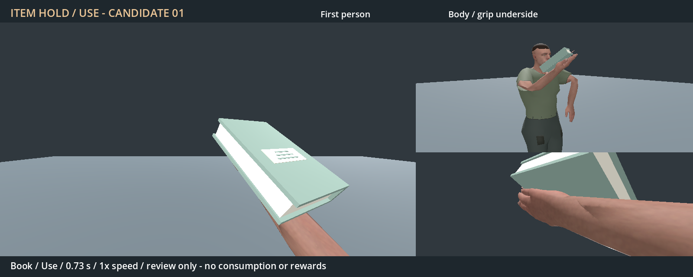
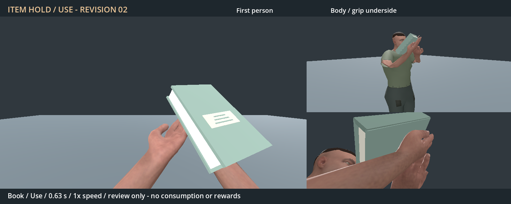

# Generic held-item hand posing

- Status: First version selected and active; revision 02 rejected; further tuning deferred.
- Updated: 2026-11-04. Original baseline source/preview: `bc5de4ae`.
- User review: Idea is great, but the arm/hand looks like a static stick. Requested committing/integrating that baseline and trying to improve it.
- Follow-up review: The first version was better as an animation; keep using it. Revision 02 remains an archived comparison.
- Symptom: Almost-fixed fingers and an exactly neutral wrist make the palm-up lift read as a rigid platform.

## Images

Candidate 01 book use, controlled neutral Godot 4.7.2 Forward+ stage on RTX 4050;
75-degree 16:9 first person plus side/front body and underside grip views. No
world/seed or saved-player state. Original images, video and hashes remain in
[baseline evidence](../../docs/evidence/item_use/README.md).

## Changes and verification

The unchanged baseline library is now in runtime as `Human.item_hold.res`.
Existing six book/food meshes appear in the right hand; other ordinary items
use the original neutral fallback. Existing native item identity, metadata,
inventory, rewards, consumption and drops remain authoritative. One completed
world gesture commits one native use; UI/equip/focus/ownership changes cancel
pending use. [Integration and scoped checks](../../docs/evidence/item_use/integration/README.md).

## Remaining / resume here

Revision 02 adds finger readjustments, wrist articulation and a free-hand
approach, preserving the integrated baseline (`26f332e1`). Its 28 scoped checks
pass across 555 poses; wider contact checks exposed earlier clipping/separation
and the failed logs are preserved. [Revised preview, exact checks and limits](../../docs/evidence/item_use/revision02/README.md).

Same neutral stage/camera arrangement as the baseline; this is the revised
candidate's use pose with the free hand approaching beneath the closed book.
The user reviewed revision 02 and preferred the first version. Keep the exact
integrated candidate 01 active; no promotion or further tuning is requested.
The original stiffness remains a known limitation, not a resolved defect.
Reopen on new animation feedback; any future replacement needs a comparative
preview, explicit player acceptance and live-world checks. Dedicated
eating/page-turning and broad third-person art acceptance remain separate.

## Reproduce / history

Equip a book/food in the real belt and left-click to use it. Candidate 01 remains
in `docs/evidence/item_use`; its editable sources remain in `authoring/Human.item_use.*`.
The art revision is stored separately as `Human.item_use_v2.*` and cannot silently
replace the runtime baseline. New motion/data/assets are CC0; new code is 0BSD;
inherited notices remain identified in the respective asset notices.
