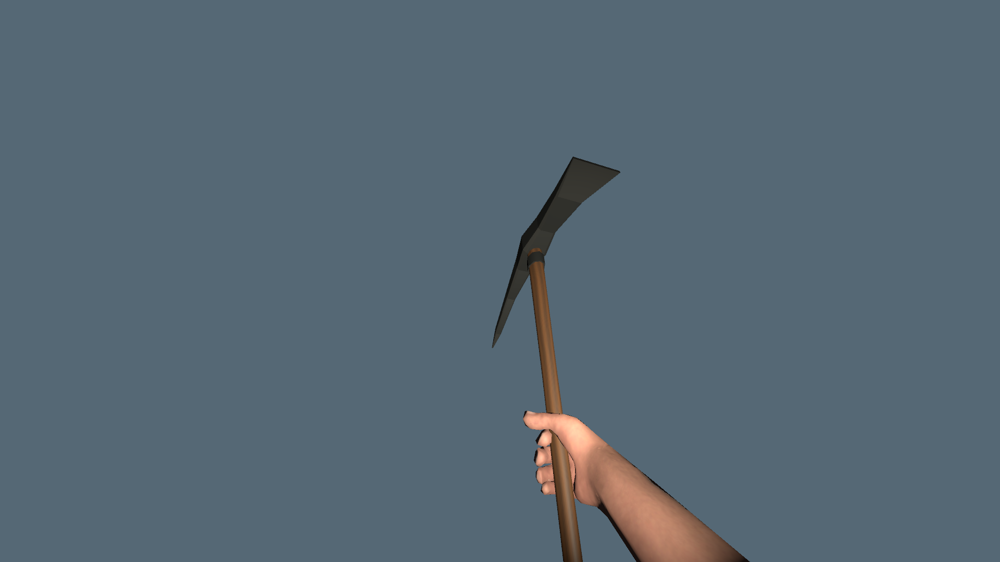
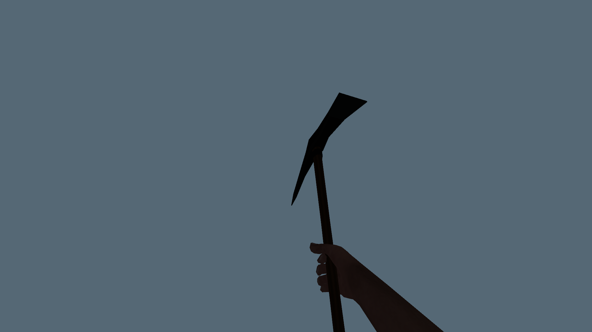

# Headlamp lighting the player's hands and equipment

- Status: Corrected and installed; scoped packaged checks pass. User visual review pending.
- Updated: 2026-10-27. Baseline: `8c1ddbb3` plus this receiver-mask correction.
- Symptom: Toggling the player's headlamp brightly relights their hands and held tool.

## Cause and correction

- This predates clipping protection: the original headlamp in `e6225b74` and the pre-clipping checkpoint `ec05af0c` both use the default all-layer light receiver mask. The previous historical comparison correctly preserved this older behavior; it was not a new clipping regression.
- `addons/player_runtime/headlamp.gd` now excludes player-presentation layers 19 and 20 from its light receiver mask. World layers, color, energy, range, cone and shadow rendering remain unchanged. No additional light, rendering pass or per-frame script work.
- The existing optional hands-camera registration respects the exclusion; it does not silently re-enable the headlamp for protected arms. Ordinary sunlight, world lights and the held torch light are not changed.
- The previous night-headlamp appearance is intentionally no longer the visual target. The earlier 13-scene historical comparison belongs to `8c1ddbb3`; its images and hashes remain in the [clipping issue](../first-person-clipping/README.md).

## Verification and images

- Latest installed package passes all eight checks, **305 assertions**, at `reports/checks/20261027T083537982032Z_first_person_pack`; 85 renderer assertions include the focused headlamp controls and 45 actual-world assertions verify the real headlamp's masks/registration. Other first-person lighting, torch effects, settings, third-person/vehicle transitions and real mining checks still pass. All 14 native DLL hashes match; [package, source/test hashes and headlamp metrics](verification.json). Successful temporary caches were pruned; logs/images remain.
- Source renderer passes 85 assertions at `reports/checks/20261027T083245812196Z_first_person/first_person_protection`. Headlamp on/off produces zero sampled image difference on isolated hands/equipment with protection off, native-depth protection and optional detailed-shadow mode. An all-layer positive control visibly reproduces the unwanted lighting in all three modes. World illumination remains identical to the original mask.
- Initial fixture run `20261027T083115261043Z_first_person` failed because its positive control repeatedly registered one light without disconnecting the exit signal. The fixture now switches the test light's visibility layer directly; no production registration behavior was altered to silence the failure. Failed evidence remains retained.

Same isolated 1080p packaged fixture, frozen pose and dim ambient light; native-depth protection enabled. The first image recreates the legacy mask as a positive control, not an independent historical run. No player save is involved.

World-only comparison: the beam matches the original mask exactly at sampled pixels. Captures are unedited; [paths, captions and hashes](images/manifest.json).

## Reproduce / remaining

- In first person, equip any tool and toggle the headlamp with F, especially inside a dim house or cave. The beam must light the world without brightening the hands/tool. Repeat with clipping protection off and with optional detailed shadows enabled.
- User visual acceptance remains pending. Future player equipment must retain a player-presentation layer rather than a world layer; third-party layers need separate checks. Existing player saves and preferences are not changed.
- Source tests: `tests/first_person_protection.gd` and `tests/first_person_world.gd`. Run `python tools/check_first_person.py --pack` against the installed package; successful test caches are pruned, diagnostic logs/images retained.
