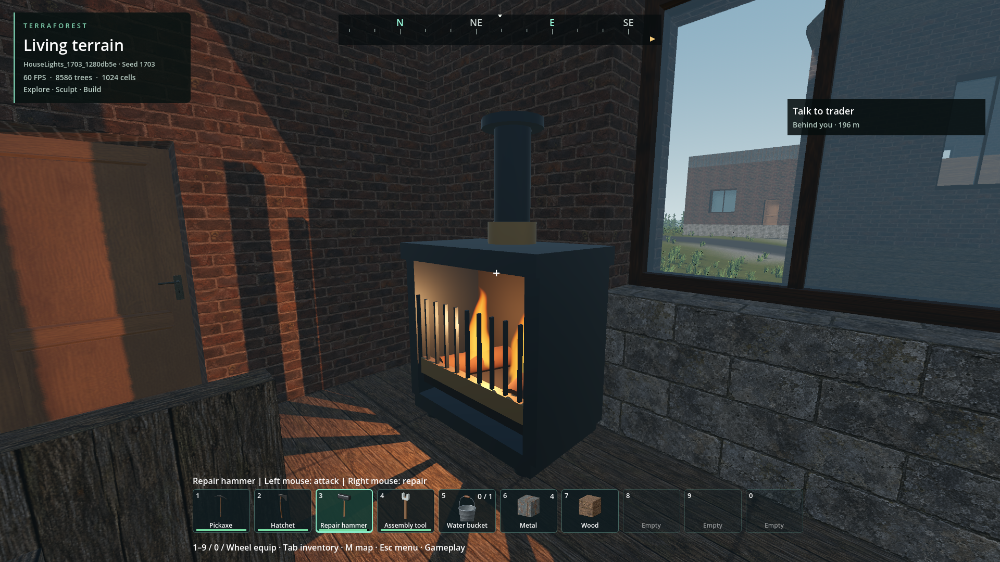
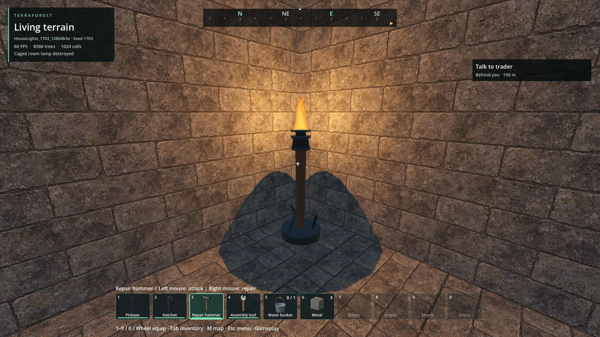
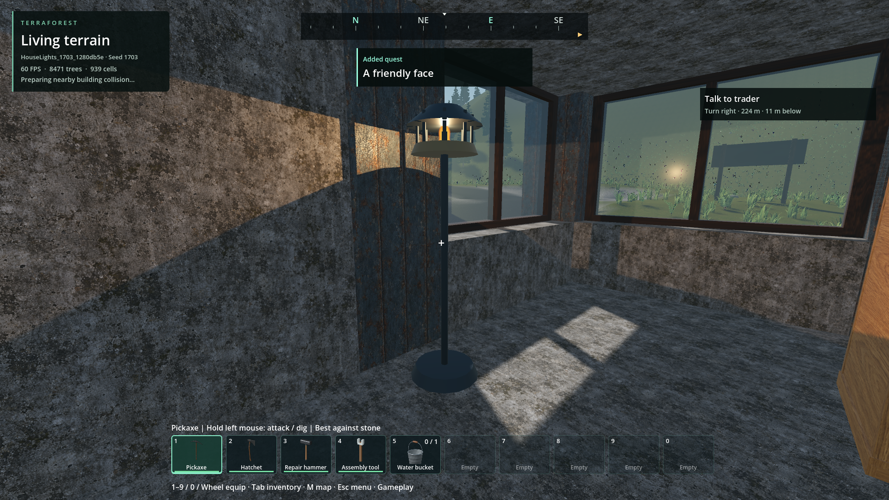

# Breakable room-light objects

- Status: Installed / scoped engineering verification; wider acceptance remains open.
- Updated: 2026-11-03. User art review: pending.
- Direction: GLB object props, not building-block fireplaces. Existing building
  grid, approved house cells and player saves remain unchanged.

## Changes and verification

- Three original CC0 GLBs, GPU-animated flame surfaces and shared native model
  collections. Data-driven health, construction cost and ordinary salvage.
- One native four-light shadowed pool. Bounded spatial selection, dense-group
  continuation, immediate removal/readmission and no per-object light nodes/ticks.
- Native room survey and generation-time support/occupancy/encounter/access checks.
  Source default seed 1703: 203 detected rooms, 203 props, no skipped positions;
  publication 85.388 ms. This is not proof of every room in every possible prefab.
- [Native source checks](../../reports/checks/20261103T072958034870Z/run.json): 32/0,
  including all approved prefab room surveys and a 1536-object dense group with
  only four real light nodes and at most 512 candidate visits per update.
- [Normal source Generate & play/fresh restore](../../reports/house_lights_world/20261103T073001387714Z/run.json):
  27/0 create, 14/0 fresh reopening. All three prop types break through the actual
  player hit/salvage adapters, stop emitting and stay removed; salvage restores.
  Input is driven through adapters without taking the user's mouse, not a focused
  animation/contact-key qualification. New-world publication only; no save retrofit.
- Same-view source 120-frame offscreen samples: pool off/on p95 16.721/16.775 ms,
  worst 16.808/17.319 ms, native pool maximum 146 us. Capped 60 FPS samples cannot
  establish GPU headroom, low-end suitability, long travel or foreground smoothness.
- [Final package](../../reports/house_lights_world/20261103T074114692671Z/run.json):
  27/0 creation/interaction, 14/0 fresh reopening, strict checks and sampled resource
  gates pass. All 203 detected rooms receive props, zero skipped positions, 60.411 ms
  generation work. Installed PCK `5b54b611856efdb8315707f21e48a95fc1f59735320516d381e501c36e38ff6a`,
  471431196 bytes; all 14 external DLLs match, both structures targets rebuilt.
- Package off/on 120-frame samples: p95 16.860/16.732 ms, worst 17.015/16.850 ms.
  Native pool max 84 us; these capped offscreen samples do not prove spare GPU
  capacity. Peak private commit 3.59 GiB and dedicated GPU 1.41 GiB are within the
  provisional project limits, not proof of full-game compatibility on a 4 GiB GPU.
- [Older owned parking world](../../reports/house_lights_legacy/20261103T074903546600Z/run.json):
  16/0 strict package checks, exact saved positions/vehicle state, no retrofitted
  props and no unfinished audio in the installed package. Native packaged fixture
  also passes 32/0 in its `pack-gate/run.json`. The first legacy fixture's 15
  functional assertions passed but strict teardown reported two ObjectDB instances;
  the retained retry releases its native fleet reference and drains render teardown.

## Images

Actual packaged default seed 1703 at 1920x1080. Three current prop views inspected;
the first rounded overbright flame trial is retained as rejected. First-person-only
body layers are excluded by the review camera. Surrounding building/terrain quality
and user visual approval are separate. [Hashes and sources](images/manifest.json).

## Retained failures and remaining work

- Initial test harness used a void assertion result, then attempted to call a
  native virtual `_process` directly. Retained checks `20261103T070122001935Z` and
  `20261103T070159680944Z`; corrected tests run the actual host update loop.
- First art trial used overbright rounded flame geometry. Source images in
  `reports/house_lights_world/20261103T071138483469Z` are rejected, not the current
  GPU-flame appearance. No user art approval is claimed.
- The updated torch initially exceeded its collision/placement envelope; native
  admission rejected startup in `20261103T072103509674Z`. Its envelope is corrected;
  that known failed generation was stopped and retained, not rerun indefinitely.
- Earlier source reopen checks completed functional assertions but failed strict
  cleanup for one ObjectDB instance. Headless and rendered verbose diagnostics
  did not reproduce it. Current source test drains render teardown and passes;
  do not call the earlier strict runs passed or claim a universal shutdown fix.
- First package `20261103T073510443146Z` rejected the raw GLB runtime path because
  Godot remaps imported GLBs. Shipped props now load offline baked shared native
  meshes/LODs, retaining editable original GLBs and source checksums. The failed
  generation and `reports/house_lights_pack_diagnostic` remain as evidence.
  Future exports run the native light fixture against the PCK before installation.
- User art review remains outstanding; no existing house geometry was redesigned.
- Broader seeds, authored semantic room coverage, every entrance/NPC route with
  new props, long travel, focused FPS and dense night-light GPU costs remain open.
  Return with representative populated source/package comparisons; unsafe rejected
  positions must remain explicit. Four real lights are a performance budget, not
  simultaneous illumination of every room visible from a strategy camera.

## Reproduce

- `python tools/run_godot_check.py house_lights --headless --timeout 60 --require 'HOUSE_LIGHTS checks=32 failures=0'`
- `python tools/check_house_lights_world.py` or `--pack`; owned `HouseLights_` worlds only.
- [Runtime/module contract](../../addons/house_lights/README.md).
