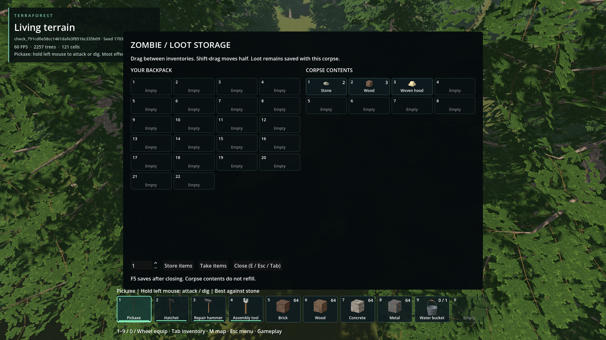

# Inventory never duplicates the toolbelt

- Updated: 2026-10-26. Status: implemented; scoped checks, player review pending.
- User requirement: inventory panels must not show items occupying toolbelt slots.
- Cause: normal Tab inventory already used slots 10–31, but the shared chest/corpse
  player grid rendered all 32 native player slots.

## Correction

- Container player panels show 22 backpack slots, labeled YOUR BACKPACK; the belt
  remains its own bar. Refresh cannot reveal the ten excluded cells again.
- Selection/drag preserve actual native indices 10–31, not display indices 0–21.
  Hidden belt cells are not valid backpack selection/drop targets.
- No deletion, item-type filtering, capacity reduction or save-format change.
  Separate stacks of the same item can legitimately occupy backpack and belt.
- Container contents still start at slot zero and respect their own capacity;
  legacy high-slot contents stay visible/retrievable before compacting again.

## Evidence / checks

[Before: corpse inventory repeats the belt](../world-interaction-hints/images/corpse-open.png).
That historical capture is retained in its original issue; later captures are
different temporary runs, not a saved-world replay.

Packaged temporary-world fixture, seed 1703, 1920x1080. Belt items remain in their
own bar; none are duplicated in the 22-cell player panel. Corpse targeting uses
the existing test identity picker, not a new skinned-corpse test.
[Image provenance](images/manifest.json); [qualification](qualification.json).

- `backpack_storage`: first/last slots, same-type stacks, hidden-cell guards,
  unchanged inventory on open, exact deposits/drags, belt preservation and legacy
  overflow rendering/retrieval.
- `container_capacity`, `container_drag`, `player_inventory`: native capacity,
  transfer and persistence contracts stay unchanged.
- `container_e_toggle`: actual temporary-world chest/corpse UI, 22-slot visibility
  and returning to gameplay. No new corpse targeting/death qualification implied.
- Focused source and packaged checks pass. The broader source
  `inventory_presentation` reports 32/33 passes; its old eleven-recipe assertion
  conflicts with the concurrent torch recipe addition. That unrelated fixture
  and torch files are not edited by this change. Failure/logs are retained.

Return if another inventory panel duplicates belt slots or a transfer targets the
wrong native cell. Compare inventory snapshots before/after, including belt cells
0–9. Player saves must stay intact; latest visual review remains open.
After torch recipe integration, update that older fixture's recipe-count contract
and rerun its complete UI suite; it is not counted as a passing qualification.
