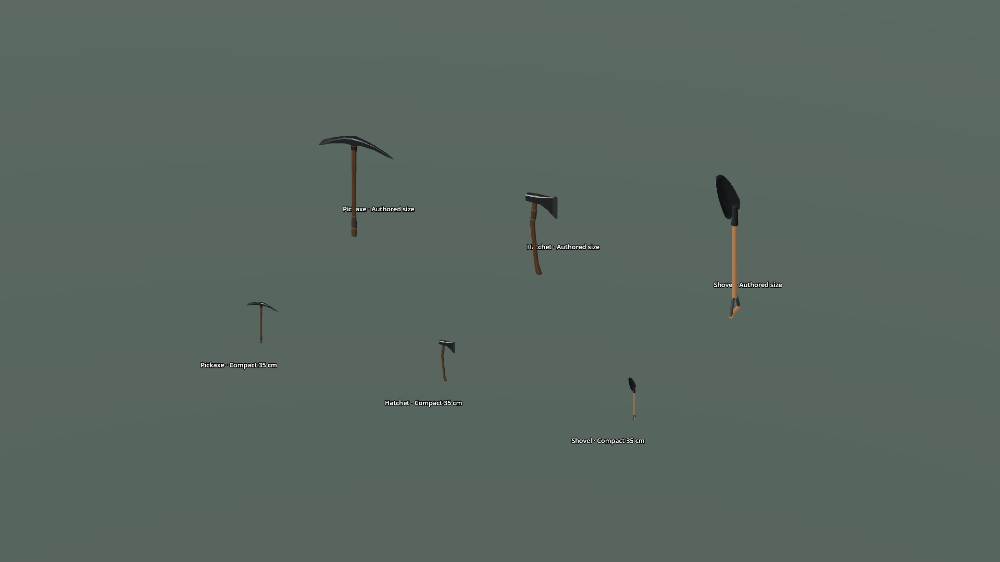
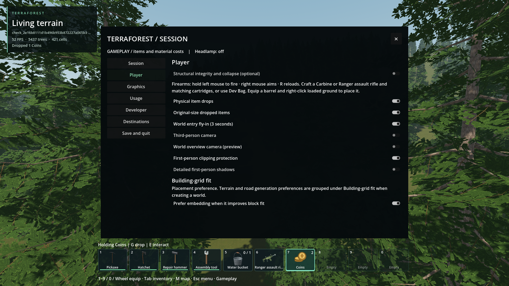
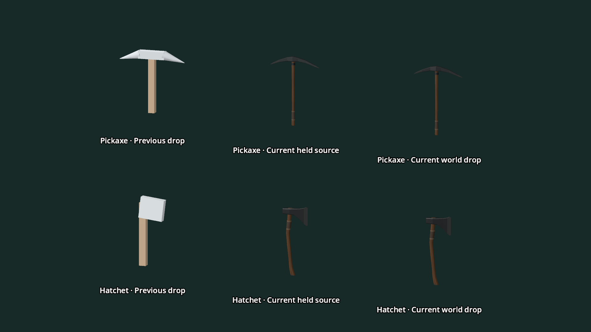
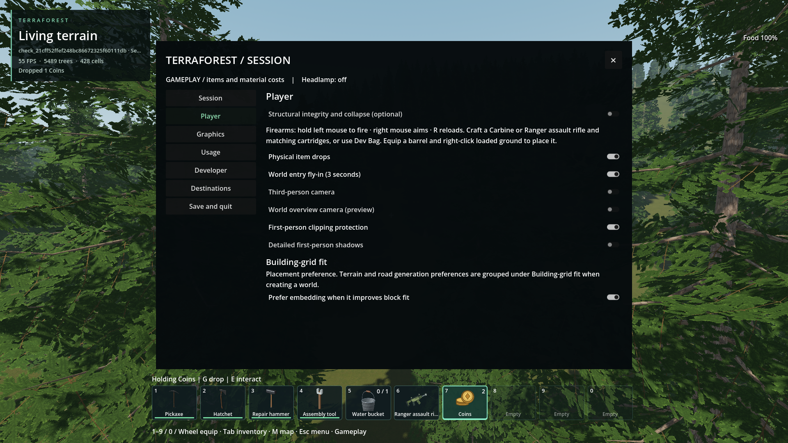
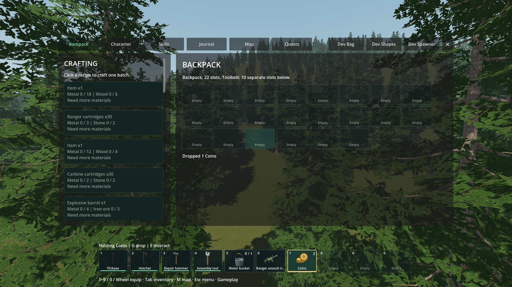

# G drops the held gameplay item

- Status: Implemented / installed; functional checks pass, targeting timing open.
- Updated: 2026-11-04. Base fix: `436d3022`; physical-drop follow-up below.
- User visual review: Pending. Agent inspected the final packaged capture.
- Symptom: New inventory IDs were missing from a separate pickup whitelist,
  preventing guns, coal, ammunition, barrels and coins from being dropped.

## Required behavior and changes

### Original-size dropped tools — 2026-11-04 follow-up

The small tools came from a shared bake that normalized every drop to 35 cm.
**ESC → Player → Original-size dropped items** is now optional, enabled by
default and saved globally. Pickaxe, hatchet, repair hammer, assembly tool,
shovel and torch use their authored held-model dimensions (approximately
84 / 69 / 59 / 49 / 115 / 60 cm tall). Turning it off restores compact drops.
Existing drops resize immediately; items without authored-size metadata keep
their existing representation. All registered items remain droppable.

The native instance basis scales the shared mesh, with matching per-batch
upright physics boxes, readiness/placement bounds and pickup targeting. A bottom
offset preserves canonical pickup coordinates, identities and the existing motion
snapshot format, so compact and existing saves need no migration. The bake receipt
now verifies sizing metadata against the retained tool sources. No new external
assets or license exception was introduced.

Actual executable with the final installed PCK passes
[28 size/physics/preference/save assertions](../../reports/original_size_drops/packed/20261104T033819909022Z/original_size_drops/run.json),
[32 gameplay G and option assertions](../../reports/original_size_drops/packed/20261104T033819909022Z/drop_key_standard/run.json), and
[15 current-model assertions](../../reports/original_size_drops/packed/20261104T033819909022Z/current_drop_models/run.json).
Source [77 physical](../../reports/checks/20261104T033308210472Z/run.json) and
[440 universal assertions](../../reports/checks/20261104T033308205060Z/run.json)
pass. Both native configurations build and [export gates pass](../../reports/drop_size_export_final.log).
PCK SHA-256: `8a8f3b69c474e5630fe9d695b0a59442ab162499b152383642522c2ecb2415d4`;
all 14 external native libraries match source.

Actual executable/PCK, controlled studio, 1920×1080. Upper row: authored-size
pickaxe, hatchet and shovel rendered by the native pickup batches. Lower row:
the same compact meshes. Agent inspected; user appearance acceptance remains open.

Actual executable/PCK, temporary seed-1703 woodland with support fixture,
1920×1080. Player settings show both drop options enabled; real full-size G
drop/recovery was checked with physics on and off before capture.

**Open performance check:** size-aware targeting correctness and the 1,024-candidate
limit pass, including movement, changed ray, live occlusion, resize and removal
cache invalidation. The unchanged 500-microsecond p95 goal does **not** pass:
[latest pressure run](../../reports/checks/20261104T033114619491Z/run.json) reports
1,012 / 1,018 / 940 / 210 microseconds for local / universal / full distant /
dense refusal. A bounded per-batch spatial cache reduces repeated native work but
does not qualify timing. Earlier failures remain at
[initial size-aware query](../../reports/checks/20261104T032539382414Z/run.json),
[precomputed layout](../../reports/checks/20261104T032645032091Z/run.json), and
[first cache run](../../reports/checks/20261104T032949344860Z/run.json).
Further targeting optimization and frame-pacing qualification are deferred from
this sizing change. Return before claiming the targeting performance gate closed,
or when profiling/feedback identifies pickup overhead; close only with the same
pressure fixture below 500 microseconds in all cases plus moving-ray world checks.
Upright conservative boxes do not tumble; broader endurance and user visual
approval remain unqualified. The earlier pressure pass below is historical.

### Current pickaxe/hatchet models — 2026-11-04 follow-up

The user reported that drops still showed initial placeholder tool shapes.
Confirmed: `tests/bake_item_icons.gd --current-models` deliberately updated icons
without writing pickaxe/hatchet pickup meshes. The old `1.res` / `2.res` remained
10 KB / 5 KB primitive representatives. Drop/physics conservation tests did not
compare them to current tool art, so the visual mismatch was missed.

Both assets now use the exact current held R11 tool triangles: pickaxe 376,
hatchet 380. One-surface batching, 35 cm normalization, item IDs and existing saves
are retained. The shared shader preserves wood texture/normal detail and distinct
wood/metal color, metallic and roughness parameters. No player rig is baked into
the drop. Existing hammer, shovel and torch triangle counts already match their
current standalone models (10,544 / 17,096 / 40,032); that count audit does not
claim a complete visual/material comparison of every other item.

`tools/bake_tool_drops.gd` is a separate headless authoring pass. Its receipt tracks
model/import, equipment selector, recipe/shader and output SHA-256 values. Normal
launch/export preflight checks it even when icon textures are already current.
A forced stale-output receipt was repaired successfully in
[the preflight log](../../reports/current_drop_refresh.log), with a passing
[freshness recheck](../../reports/current_drop_freshness_check.log). Restart an
already running game to replace cached meshes.

Source and actual-executable/PCK geometry/material/render comparisons each pass
15 checks: [source](../../reports/checks/20261104T024006957193Z/run.json),
[package](../../reports/current_drop_models/packed/20261104T024348221455Z/current_drop_models/run.json).
The same package passes [26 real G/physics-option checks](../../reports/current_drop_models/packed/20261104T024348221455Z/drop_key_standard/run.json);
[77 physical](../../reports/checks/20261104T024249024210Z/run.json) and
[440 universal item checks](../../reports/checks/20261104T024249022299Z/run.json)
also pass. Export gates pass in [the export log](../../reports/current_drop_export.log).
Installed PCK SHA-256:
`6f7a673085ea8fe064227a6c192276a7b5adda2a733a0e8aef479f360e6bc1f5`,
14 matching native libraries. No native rebuild or save migration.

Actual executable/PCK, controlled studio, 1920×1080 viewport. Left: previous
committed drop assets; centre: current held model detached from the rig; right:
new geometry in real native pickup batches. All columns use the same normalized
size and lighting. Camera angle creates small screen-position differences.
Agent inspected the final comparison; player visual approval remains pending.

The [initial conversion check](../../reports/checks/20261104T023809210770Z/run.json)
is retained: forcing bundled shader resources caused broken external texture
references. Keeping the shader as a normal resource dependency and embedding
only copied texture images fixed it. sRGB material colors are converted to linear
vertex data to retain the current dark leather/steel appearance.
Asset/source hashes and inherited license qualifications are retained in
`addons/player_runtime/art/drops/CURRENT_TOOLS_PROVENANCE.md`; no external model,
texture or code was imported. New recipe/test/shader code is original 0BSD.

### Optional physical dropping, enabled by default

**ESC → Player → Physical item drops** now persists an optional default-on global
preference. New drops receive gravity, a slight forward impulse, collision,
bounce and sleep. Off keeps the previous static placement for new drops; existing
physical drops continue. The gameplay-only G rule is unchanged.

The engine owns up to 64 native linear rigid proxies with continuous collision;
there are no per-pickup scene nodes. Pickup IDs, stack metadata and batched art
are retained. Motion and sleep state save in one bounded `pickup_physics` section;
old worlds receive its empty default. Pause/readiness freezes integration while
retaining collision registration, and collection retires its body after the
inventory transfer succeeds. Sleeping proxies may retire for new drops; a full
awake pool rejects new drops without debiting inventory.

At this checkpoint: upright 34 cm box proxies, so artwork does not tumble. The
original-size follow-up above replaces these with per-batch boxes. Long-range
physics residency is bounded; retired sleeping pickups remain ordinary static
pickups. Exact per-model collision, tumbling and large-population frame pacing
are not qualified. These are explicit limits, not claims of a complete loose-body
world simulation.

Passing follow-up evidence:

| Check | Evidence |
| --- | --- |
| Defaults/preference reload, gravity, bounce, floor CCD, pause/readiness, in-flight restore, metadata, every item plus a future item, pool/corruption rejection: 77 assertions | [Source](../../reports/checks/20261104T022327752202Z/run.json), [actual executable/PCK](../../reports/physical_item_drops/packed/20261104T022459733983Z/physical_item_drops/run.json) |
| Real gameplay G falls; checkbox off restores static placement; inventory/menu/developer exclusions remain: 26 assertions | [Source](../../reports/checks/20261104T021916842233Z/run.json), [actual executable/PCK](../../reports/physical_item_drops/packed/20261104T022459733983Z/drop_key_standard/run.json) |
| Physical state through two disk autosaves / three provider lifetimes: 15 assertions | [Disk](../../reports/checks/20261104T021954921230Z/run.json) |
| Existing universal items: 440 assertions; atomic setup / failed-drop conservation | [Universal](../../reports/checks/20261104T022327750382Z/run.json), [setup](../../reports/checks/20261104T022152040872Z/run.json), [drops](../../reports/checks/20261104T022152068310Z/run.json) |

Both native debug and release builds pass in
[the build log](../../reports/drop_physics_builds_final.log); export gates, smoke
startup and packaged house-light gate pass in [the export log](../../reports/drop_physics_export.log).
Installed PCK `b4bf193145beadba5a12f92412ade66bcb946ae242295299936cd337e8498ea9`,
14 matching native libraries. The first physical fixture
[failed by retaining stale native handles after restore](../../reports/checks/20261104T021728702445Z/run.json);
resolving the persistent identity again fixes the harness. Final runs have no
script errors, leaks or assertion failures. New native code is original
AI-assisted 0BSD; existing engine/binding notices remain unchanged.

Actual executable/PCK, temporary seed-1703 woodland, 1920×1080 viewport. Player
settings show the option on after real G / on-off checks. Agent inspected;
user visual/motion acceptance remains pending. Provenance is in the image manifest.

### Original universal-drop implementation

**G drops one held item only during active gameplay.** Inventory selections,
menus, text entry and developer tools never invoke this shortcut. G never toggles
flight. All current and future inventory definitions inherit drop support when
equipped, without an item-type permission flag or mandatory custom ground art.

The user's follow-up explicitly narrowed the key to active gameplay and held
items. An initial selected-backpack G extension was removed before committing.
Existing inventory drag/drop controls remain available.

The player and pickup containers share `item_catalog.gd` and the same native
schema. Legacy pickup save identities remain intact; other IDs use the fixed
`pickups_0` / `pickup_stacks_0` sections and one code-built parcel mesh batch.
Native transfers preserve quantity, wear and exact bucket water. Rejections
preserve inventory. [Required standard](../../docs/ITEM_DROP_STANDARD.md).

## Verification

| Check | Evidence |
| --- | --- |
| Every current definition and two synthetic future definitions; metadata, reload, stacks and rejection: 440 assertions | [Universal drop](../../reports/checks/20261104T015656889402Z/run.json) |
| Actual world G input; held rifle/coins; inventory, typing, menus, developer tools, death and flight exclusions; rendering: 21 assertions | [Gameplay-only G](../../reports/checks/20261104T020302696852Z/run.json) |
| Actual executable with corrected installed PCK, same 21 assertions, no errors/leaks or sampled resource-budget violations | [Final packaged G](../../reports/universal_item_drop/packed/20261104T020440475918Z/run.json) |
| Universal coins through two autosaves and three fresh worker/provider lifetimes: 13 assertions | [Disk persistence](../../reports/checks/20261104T015330799462Z/run.json) |
| Existing native inventory / transfers: 32 / 29 assertions | [Inventory](../../reports/checks/20261104T015656898220Z/run.json), [transfer](../../reports/checks/20261104T015656922191Z/run.json) |
| Atomic pickup setup and real item labels | [Initialization](../../reports/checks/20261104T015020563809Z/run.json), [labels](../../reports/checks/20261104T015723103293Z/run.json) |
| 42 batches / 172,032 distant records and dense local refusal; p95 267 / 226 / 444 / 73 microseconds for legacy / universal / distant / dense | [Pressure](../../reports/checks/20261104T015636342091Z/run.json) |

The [gameplay-only export log](../../reports/universal_drop_gameplay_only_export.log)
retains export gates and packaged smoke checks. No native rebuild or player-save
rewrite is required.
Installed PCK SHA-256:
`55344a349e3dd176414306f2d9109a9bc712a5723c57e996a0d0da37a8b73b1a`;
all 14 native libraries match source.

## Images and retained history

Images and provenance are recorded in [the manifest](images/manifest.json).

Actual executable/PCK, temporary seed-1703 woodland with elevated support fixture,
1920×1080 viewport. Three coins were equipped and G pressed during gameplay;
inventory opened afterward shows two coins in the equipped belt stack. G while
inventory is open was separately verified to leave contents unchanged.

The earlier packaged-backpack capture records the superseded shortcut scope;
it is not evidence for the final gameplay-only behavior.

Early harness failures remain at [restore setup](../../reports/checks/20261104T015004673343Z/run.json),
[mode / text Unicode](../../reports/checks/20261104T015119699484Z/run.json),
[initial mode](../../reports/checks/20261104T015215553751Z/run.json),
[stale hint stubs](../../reports/checks/20261104T015656903464Z/run.json), and
[read-only pack capture](../../reports/universal_item_drop/packed/20261104T015900120723Z/run.json).
Corrected fixtures pass. The [earlier packaged 19-check run](../../reports/universal_item_drop/packed/20261104T020009726029Z/run.json)
passes its original behavior but is superseded by the gameplay-only requirement.

Pressure failures remain at [initial lookup](../../reports/checks/20261104T015351884121Z/run.json),
[uncached universal lookup](../../reports/checks/20261104T015529761613Z/run.json), and
[503-microsecond marginal distant sample](../../reports/checks/20261104T015606559222Z/run.json).
A single derived winner-label cache, invalidated on restore, avoids repeated
32-slot dictionary construction. The final complete pressure run passes the
unchanged 500-microsecond threshold. This is component evidence, not a general
frame-pacing guarantee.

## Remaining / reproduce

Player visual review and wider endurance remain unqualified. New items without custom
ground art intentionally appear as parcels. The universal store retains the
existing 4,096-record bound and 256-visible cap; full/blocked/unready drops retain
the item. Resume on player feedback or capacity changes.

In a ready world on foot, equip a rifle or coins and press G. One unit drops;
use E to recover it. Open inventory and select another slot: G must do nothing.
Menus, typing and developer tools must also leave the inventory unchanged.

New code/tests are original AI-assisted implementation for this user's request,
under 0BSD. The parcel is authored procedurally in code; no external artwork or
implementation was imported. Runtime captures retain inherited project notices.
