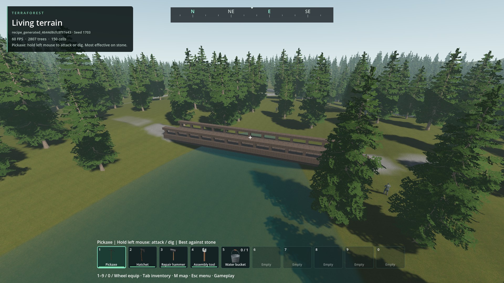
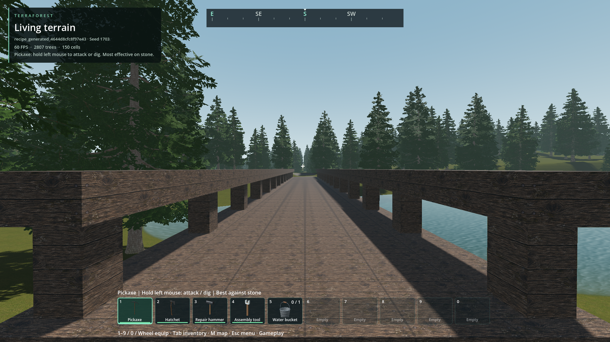
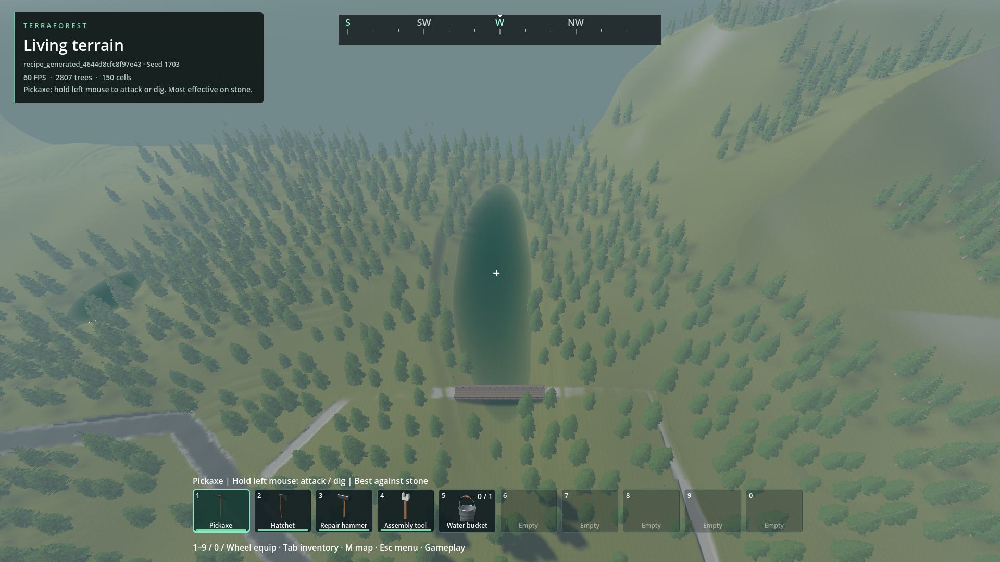
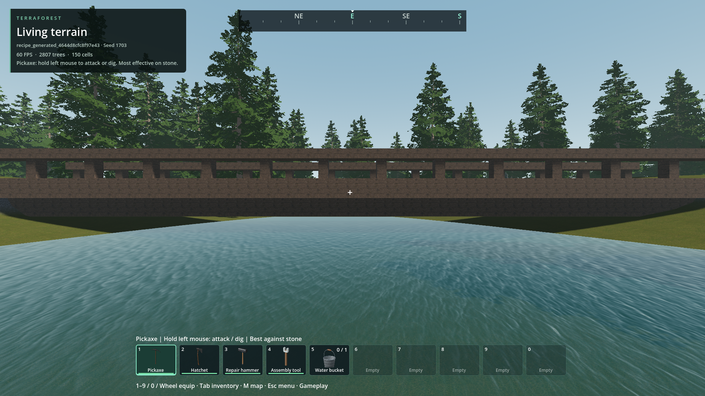
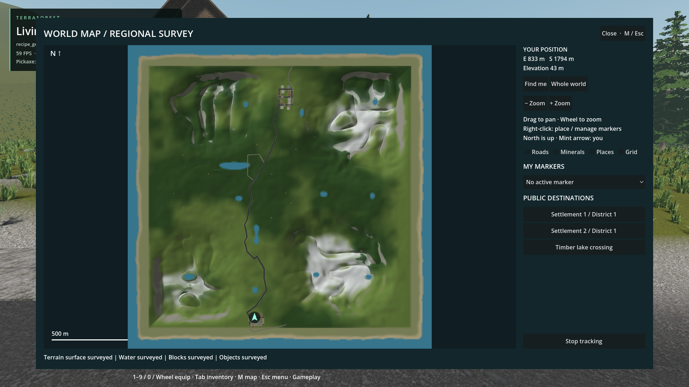
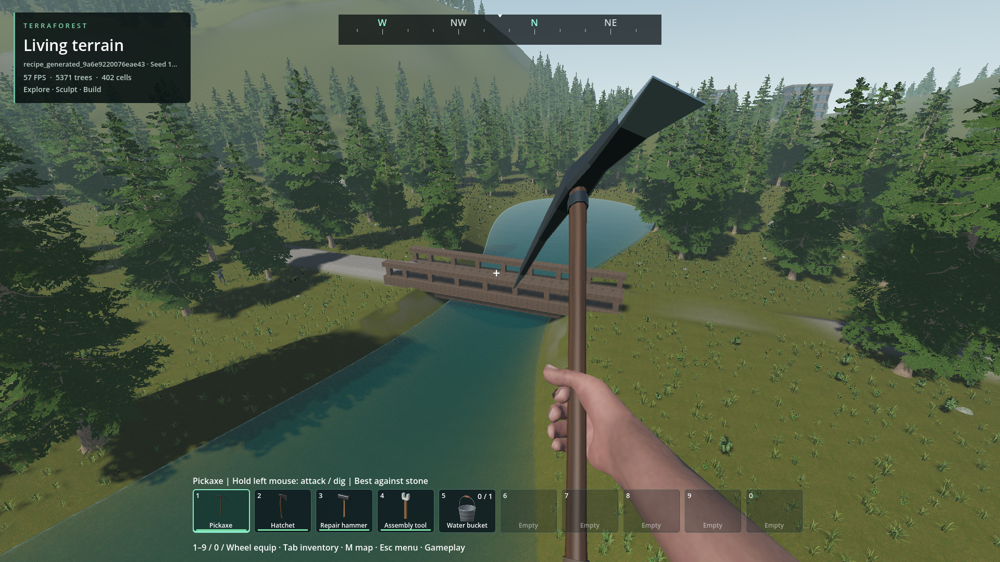

# Varied lakes and generated bridges

- Status: Installed / scoped engineering checks passed.
- Updated: 2026-10-28. User visual review: pending.
- Request: larger, less repetitive water bodies and real bridges in generated worlds.

## Implementation

- New profiles 28–31 preserve existing saved generators. New worlds select them by default; ocean and terrain-grid preferences remain independent.
- Native elongated, curved and two-lobed basins, plus smaller ponds. Twelve lakes in each tested seed; the largest measured wet extent is 190–196 m.
- Reuses static 0.5 m volumetric water, cached maps and binary storage. No per-frame script water simulation or new river system.
- Existing manually placed 12 m footbridge stays unchanged. New 24–44 m timber footbridges consist of individual destructible grid cells, including deck, beams, rails and abutments.
- At most two generated crossings; dry banks, water clearance, 12% approach grades, 2 m fill / 3 m cut and connections to regional roads are required. Unsafe sites are omitted, not forced.
- Large basins use the western corridor to preserve eastern urban expansion space. This is a bounded layout choice, not unrestricted hydrological generation.

## Images

Seed 1703, generator 29, two-settlement default. These are actual installed-build
frames; tool hidden only for inspection. Different camera views, not before/after
lighting comparisons. Sources and hashes: [manifest](images/manifest.json).

40 m crossing at (788, 47, 792), 436 separately destructible blocks; both banks connect to regional roads.

Deck-level view. Player and native NPC crossings passed both directions in the production-generated world.

Full elongated lake and its bridge; high aerial camera with ordinary world fog retained.

Actual water remains below the bridge girders; no terrain foundation fills the channel.

Production map from initial generation: different lake shapes, actual bridge footprint and bank paths. Optional annotations are off.

Earlier 24 m trial at a different site, rejected for the NPC approach snag; retained as history, not the installed crossing.

## Evidence

- [Lake fields/storage](../../reports/checks/20261028T172917133406Z/run.json): 202 checks, seeds 0/42/1703, four new profiles, unchanged sampled legacy fields/catalogs, native water bake and exact persistence.
- [Bridge plans](../../reports/checks/20261028T172811441076Z/run.json): 105 checks, all 11 even spans and four rotations, binary roundtrip, generation admission and exact cache reuse.
- [All five UI presets](../../reports/checks/20261028T172839364008Z/run.json): 46 checks, including the largest nine-district region and all district connections.
- [Legacy distributed fields](../../reports/checks/20261028T172916056163Z/run.json): 49 checks.
- [Production generation/play/save/reload](../../reports/checks/20261028T172920717433Z/run.json): 51 checks, including player and native NPC crossing in both directions, entrance support, exact published cells, single-block removal and persistence. First M: 3.463 ms, zero water-source calls or terrain patches.
- [Packaged fresh-process reopen](../../reports/checks/20261028T173743016035Z_lake_pack/run.json): 12 checks, original save hash preserved, exact bridge cells and bank contacts restored. Metrics-only mode does not repeat walking; the preceding production check covers it.
- Water bake stays within the unchanged 128 MiB native-state and 64 MiB serialized limits. Integrated seed-1703 bake: 2.56 s, 75.6 MiB peak state, 40.7 MiB snapshot; not a weak-hardware guarantee.
- Stationary source scene: 180 frames, p95 16.941 ms, maximum 18.179 ms on RTX 4050 Laptop. This excludes screenshots and is not a streaming/endurance benchmark.
- Export and headless startup passed with 14 matching source/installed native DLLs. Godot import retains unrelated duplicate-UID warnings in old rejected-paving report snapshots; no new identity conflicts were added.

## Remaining / resume here

- User review of lake outlines, timber appearance and generated approaches. Screenshots and engineering checks do not grant visual approval.
- More seeds, long travel, weak hardware, and whole bank-path NPC/vehicle traversal remain unqualified. These are footbridges, not certified vehicle bridges.
- Seeds 0 and 42 have no accepted bridge under current conservative siting. Seed 1703 has one. Do not promise a bridge in every world.
- Existing worlds are not regenerated or migrated. No flowing rivers, waterfalls, dams or ocean bridges were added.
- Resume in `addons/volumetric_terrain/native/world_generation.cpp`, `addons/structures/lake_crossings.gd` and `tests/lake_crossing_world.gd`.
- Reproduce safely: `python tools/check_lake_crossing.py --pack` creates a disposable new world without activating/capturing the desktop. `--snapshot recipe_generated_4644d8cfc8f97e43 --metrics-only` inspects the retained test save read-only. Never substitute a player world.

## Rejected trials

- Earlier large-lake placement blocked a maximum-preset city lot; axis-specific exclusions and western large-basin allocation corrected it without relaxing terrain budgets.
- [Initial integrated trial](../../reports/checks/20261028T165629113643Z/run.json): NPC approach snag; retained images in `reports/lake_crossing_world/first_trial/`.
- [Second trial](../../reports/checks/20261028T171708767551Z/run.json): test player parked in the walking route, plus a real terrain lip at the abutment.
- [Read-only diagnosis](../../reports/checks/20261028T172555104578Z/run.json): support rays found a 40 cm dip immediately before the deck. The native landing now extends 1 m under the abutment. Movement limits were not loosened; route endpoints use actual collision heights.
