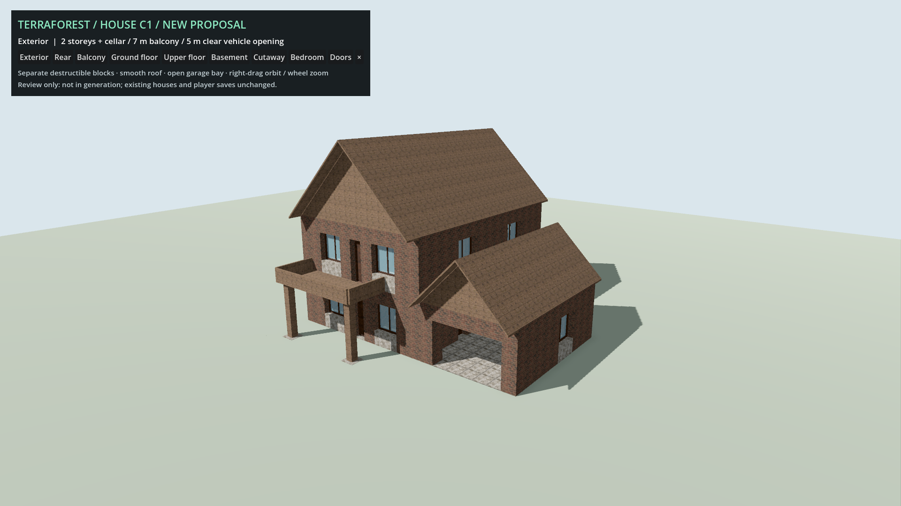
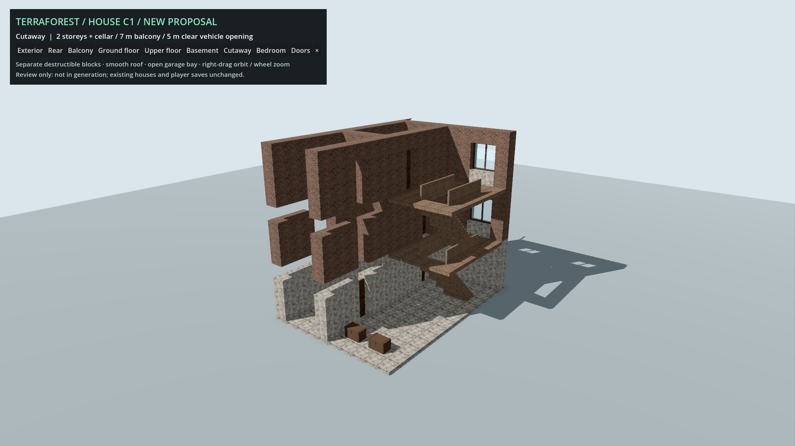
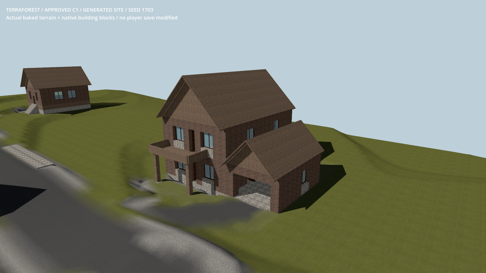
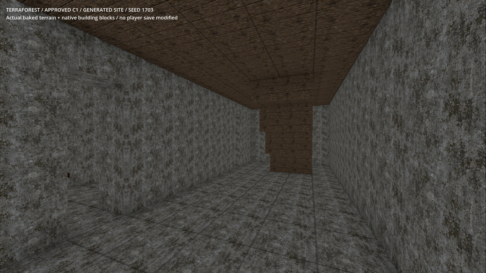

# Additional large house C1

- Status: Approved addition / production integration; generated-site review remains separate.
- Updated: 2026-10-28. User approved the `8a61a7e8` design: “I approve it's not too bad”.
- Original review source/image hashes remain in `images/manifest.json`.
- Two above-ground storeys, 7 × 3 m supported balcony, open 5 m garage entrance,
  two upper rooms with simple timber bed frames and a stair-accessed storage cellar.
- 1,914 native destructible grid cells; 41 attached doors/windows/furniture/storage
  objects. Offline recipe bakes once; no per-frame scripted building generation.
- Production copy preserves every reviewed cell/attachment, translated together +4 m
  to normalize the basement foundation. New terrain-fitted neighborhoods use one C1;
  it is also appended to the construction palette. Existing designs/saves are unchanged.

## Images

Approved isolated C1 design, 1920 × 1080, TerraForest materials/daylight; no world/seed.
Both roofs use existing thin slope/ridge/seam blocks, not one building-sized mesh.

Same proposal/settings. Deliberately removed roof, near walls and front floor
sections expose three levels and stairs. It is a reversible illustration, not the
actual damaged/save state. Attached objects over removed parts are hidden too.

Seed 1703, fitted origin `(1007, 50, 416)`, rotation 2, actual native baked terrain
and blocks. Bounded site fixture, without vegetation/actors; not a whole-town review.

Same site, with the soil/slab overlap corrected. Review lighting is explicit ambient
daylight, not a first-person gameplay-lighting comparison. Additional hashes and
capture settings: `images/generation_manifest.json`.

## Verification / reproduce

- Review: `python tools/review_modular_buildings.py --large-house`.
- `python tools/run_godot_check.py large_house --headless --timeout 60 --require "LARGE_HOUSE checks="`.
- Final [native check](../../reports/checks/20261027T124625429496Z/console.log): 43/43;
  both stairs up/down, nine opening doors, all room routes, balcony, garage link,
  a vehicle-sized clearance envelope, individual roof removal and compound storage.
- [Fresh-process restore](../../reports/checks/20261027T124637292469Z/console.log): 21/21.
  [Eight rendered views](../../reports/large_house/render_final/console.log): 28/28;
  exterior, cutaway, ground floor and bedroom inspected. Review launcher also passes.
- Earlier parse/attachment/route failures remain in `reports/checks/20261027T1232*`
  through `20261027T1243*`; first renders remain in `reports/large_house/render_r1`.
  Corrected furniture positions, door swing direction and rear bedroom entrance.

## Production integration

- `addons/structures/prefabs/large_house_c1.tres` is the approved production resource.
- The native lot fitter surveys garage/porch support too. Basement, garage-floor
  soil recess and driveway are baked with other earthworks before block publication.
  Terrain touches slab undersides rather than z-fighting with their visible tops.
- Native clearance keeps buried room air checks while allowing soil inside solid
  below-grade walls/footings. Legacy four-argument clearance behavior is unchanged.
- Generation no longer assumes one door per building. C1 has nine functional doors.
  Plan versions 8/15 invalidate old derived layouts, not canonical player saves.
- Native fitting, density, compound publication, seven actual terrain/block walking
  routes and default-world cache are checked by `tests/approved_large_house.gd`.
  Seeds 1703 and 42 are covered. Installed PCK: 56/56 assertions in
  [packaged/console.log](../../reports/approved_large_house/packaged/console.log).
  Rendered fixture: 58/58 in
  [verified_site/console.log](../../reports/approved_large_house/verified_site/console.log).
  Exterior and basement images inspected; complete default plan and binary-cache
  reconstruction pass. This is not universal settlement quality/performance approval.
- Regression checks: previous house 43/43, B1 palette 12/12, B2 generation 26/26,
  legacy cellar and native clearance paging pass; release structures suite 294/294.
  Debug/release native builds and export smoke pass. Export still reports pre-existing
  duplicate-UID warnings in archived rejected-ramp snapshots; no new error is claimed.
- Failed integration runs remain in `reports/checks/20261027T131414216759Z/` and
  `reports/approved_large_house/render_final/`. Earlier `render/` and `render_lit/`
  captures exposed missing fixture lighting and coplanar soil/floors. They are not
  passing visual evidence; `verified_site/` is the corrected result.
- Resume verification, 2026-10-28: recovered source, libraries and images match all
  ten recorded hashes. Source and installed PCK each pass 56/56 checks again;
  release structures pass 294/294, with clearance and B1 palette regressions passing.
  [Packaged rerun](../../reports/approved_large_house/resumed_packaged_20261028/execution.json).
  The first clearance rerun used an incorrect launcher completion string: all eleven
  assertions passed, but that wrapper result failed. Corrected rerun is retained in
  `reports/checks/20261028T065506440629Z/`; the original log remains alongside it.

## Remaining / resume here

- Original approval/integration prerequisites are complete. Keep explicit user site
  review separate; test additional seeds/biomes and fully populated driving/performance
  before claiming universal acceptance. Never retrofit existing saves automatically.
- Garage is intentionally open; no functioning sectional garage door is claimed.
  Vehicle-envelope clearance is not an integrated driving/terrain qualification.
- Beds are timber frames, not finished mattress/linen models. Older ungraded
  generation recipes deliberately retain their original house mix.
- Authoring: `reviews/modular_buildings/large_house_recipe.gd`; baked native resource:
  `reviews/modular_buildings/baked/large_house_c1.tres`; checks: `tests/large_house.gd`.
