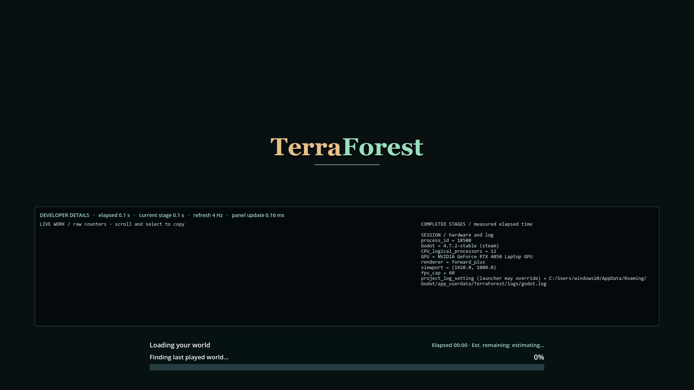
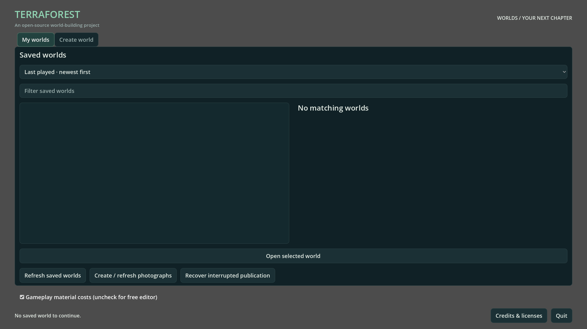

# Saved-world browser flashes during Last World startup

- Status: Fixed for reproduced presentation path / desktop review pending.
- Updated: 2026-11-04. Source: `demo/worlds.gd`, `addons/world_runtime/world_session.gd`.
- User report: TerraForest Last World briefly shows saved worlds before loading.

The Steam shortcut opens `worlds.tscn` with `--continue-last`. Previously that
scene built and drew the browser, scanned the save catalog on a worker, then
deferred continuation until a later frame. The world-loading cover was created
only after selection. The flash came from this presentation ordering; catalog
resolution is still needed to determine the last played save.

Last World now creates the shared opaque loading cover before browser setup and
catalog work. Its first phase says “Finding last played world…”. The same cover
continues into game-resource loading, including the catalog time in elapsed time.
Auto-continue skips selected-world thumbnails/details. Empty/vanished saves or
load failure reveal the browser with feedback. The process startup request is
consumed once, so returning from gameplay cannot immediately reopen the world.
Shortcut registration, save selection order and saved-world contents are unchanged.

## Evidence

Source fixture, Forward+ 1920×1080, first rendered frame after ready. The opaque
cover hides browser controls while the catalog resolves. Developer-details
visibility reflects existing local preferences, not a presentation change here.

Same rendered fixture with an empty isolated catalog: the browser is deliberately
revealed with “No saved world to continue.” Both images were inspected.
[Image sources/hashes](images/manifest.json), [verification](evidence.json).

The focused rendered fixture passes 11 checks in source and the actual exported
executable: synchronous cover, real initial phase, same-cover dispatch, newest
save selection, no thumbnail work, one-time request, empty/vanished/error fallback
and uncaptured pointer. Routing is intercepted before initialization of unique
dummy test saves; user worlds are not opened or changed. Export smoke and house-
light gates pass. The installed desktop link was read and still uses Steam.

Existing browser suites retain unrelated failures: nine generator/default-policy
assertions and two preview assertions. Both sets reproduce with the pre-change
browser script; they are not reported as passing here. Their logs are linked in
the evidence record. Refresh those policy/preview contracts in their own scope
before claiming the whole browser suite passes. The first focused harness also
used an isolated catalog without matching canonical fixtures; corrected before
passing runs, with its failed log retained.

## Remaining / resume here

Confirm the real desktop/Steam launch visually on the user's system. If any
browser frame remains visible, capture the first frames and launch arguments;
verify the loaded source/PCK and cover lifetime. This does not claim faster
catalog scanning or whole-world load completion/performance acceptance.

Run `python tools/check_continue_last.py`, or add `--executable` after export.
Code/tests are original Codex-assisted 0BSD work; no new media was imported.
Diagnostic screenshots preserve the existing game's asset terms. The existing
unused Kaino source folder was temporarily excluded during export as in preceding
builds; original recordings remain intact and the marker was removed afterward.
