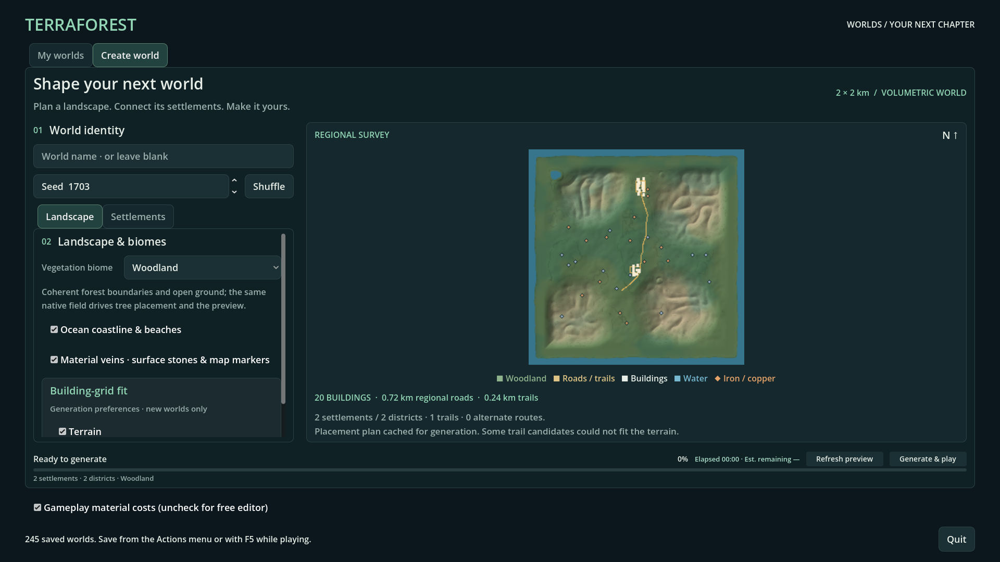
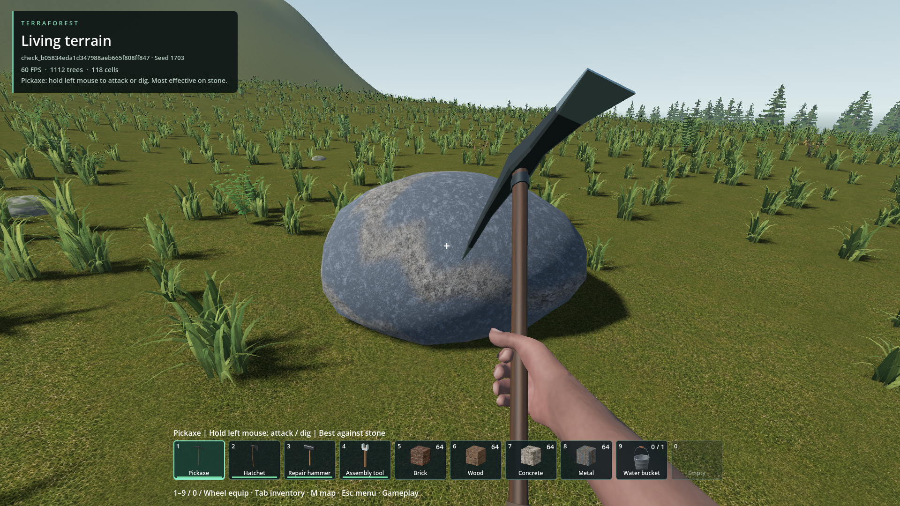
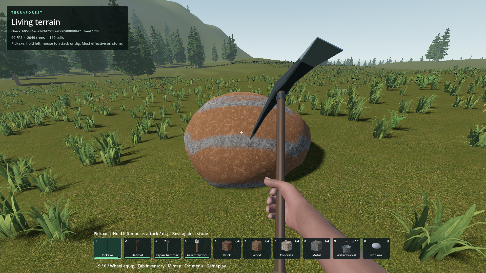
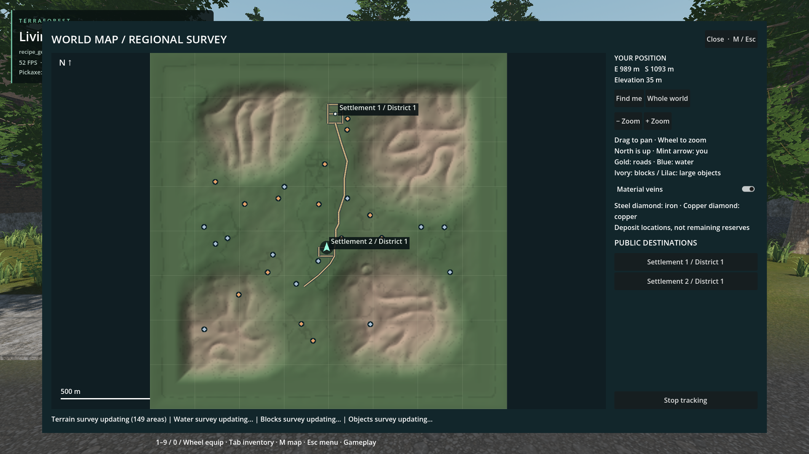

# Discoverable material veins

- Status: Implemented; scoped source/package checks pass.
- Updated: 2026-10-26. User appearance/balance review: pending.
- Request: find buried materials through durable, material-textured surface stones and world-map markers; default-on generation option.

## Changes

- Reuse the existing native iron/copper capsule field, not a disconnected decorative ore system. Each marker is directly above a real solid vein of that material, 10–38 m below the surface.
- Native planner: at most 100 deposits, dry gentle ground, conservative lake/coast exclusion and separation from planned road/foundation earthworks. No added voxel pages or runtime geological scans.
- Cached descriptors, native binary metadata, shared LOD meshes/materials, native model paging/collision/durability. Medium stones have 360 health (ordinary boulders: 240); a fresh pickaxe needs 12 hits. Destruction yields 8 matching ore.
- New-world Landscape option **Material veins · surface stones & map markers** defaults on. Off omits new surface clues/markers; existing underground geology is deliberately unchanged. Legacy recipes and existing saves do not gain stones automatically.
- Generation preview and M map show iron/copper diamonds. Zoom reveals labels; click to track a deposit. M map also has a default-on visibility toggle. Markers denote geology, not remaining ore, and remain after mining the surface stone.
- Plan timings are diagnostics only, excluded from the content digest. Independent cold plans and warm cache reuse retain the same identity.

## Images

See `images/manifest.json` for original paths, test/build manifests and SHA-256 hashes. These are actual game captures, not mockups.

Packaged Create world screen at 1920×1080, seed 1703, default recipe. The Landscape toggle is visible and enabled; the actual cached generation preview includes the mineral markers.

Seed 1703 / generator 23, temporary gameplay fixture, new iron-bearing surface stone before mining. Same shared rock geometry as copper; material colors match the underlying terrain ore palette. Appearance not yet player-approved.

Same seed/profile, different deposit and viewpoint. Durable copper-bearing stone before mining. This is not a before/after comparison with the iron image.

Actual two-settlement generated world, seed 1703 / generator 23. Mineral diamonds coexist with roads and settlement labels. Dynamic terrain/water/object map layers were still refreshing during this capture.

## Verification / history

Packaged checks: **172 passed / 0 failed** across six suites: native deposits 69, recipe codec 26, production plan 8, gameplay 26, full generation/reload 38, generator UI 5. All 14 external native DLL hashes match source. Source geology regression also passes, including preservation of the previous generator's original material field. Binary metadata, removed model state and partial durability have roundtrip coverage; full world generation/reload is tested separately from the targeted damage fixture.

Seed 1703's complete default plan contains **27 deposits**; the dedicated native deposit search took **2.89 ms** in the packaged cold-plan check. Across eight bare seed/profile cases it finds 26–72 deposits in roughly 1.1–1.4 ms. Packaged non-destructive strike handlers measured 0.43–1.09 ms across 22 calls; this excludes later rendering/streaming and is not an end-to-end frame-time qualification. Evidence: `evidence/pack-*.json`, `evidence/source-native.json` and associated run manifests/logs. Images were inspected; user approval remains separate.

- `tests/material_deposits_native.gd`: bounded deterministic plans across seeds 0, 42, 1703, 2147483647 and generators 17/23; correct real ore, unique IDs, metadata roundtrip, exclusions, malformed inputs, mining and edited-terrain persistence.
- `tests/material_deposits_plan.gd`: default/disabled recipes, exact cold/warm cache identity, actual baked earthworks preserve stone supports and buried materials, preview option.
- `tests/material_deposits_world.gd`: actual-world ray targeting, collision streaming, both materials, 11 surviving hits then matching reward/removal, native model/damage roundtrip and map layer behavior. Temporary world only.
- `tests/world_recipe_native.gd`: v1–v5 recipe compatibility and invalid-field rejection.
- `tests/world_recipe_generation.gd`: actual selector → full generation → play → save → selector → reload in one window, plus existing approved-house checks and mineral metadata/count verification. Only uniquely named test worlds are created.
- `tests/material_deposits_ui.gd`: default-on and independent-off behavior, visible checkbox, real preview completion and a packaged screenshot.
- Reproduce with `python tools/check_material_deposits.py` or `python tools/check_material_deposits.py --pack`. Package mode checks native-library hashes and uses external test drivers, never exports tests.
- Earlier harness failures are retained in `evidence/`: wrong point-query packet (missing ore channel); a typed-Variant parse error; an incorrect assumption that a floored lattice density sample must be zero at an analytic surface. These were test defects, not discarded product failures. The support check now compares the same authoritative samples before/after baking.

## Remaining / resume here

- Player review of stone appearance, distribution, mining duration and reward balance. Return after trying a new world with the Landscape option enabled; compare both materials and map visibility.
- Markers are not a depletion survey. Add depletion tracking only if requested; current map explicitly states this limitation.
- No retroactive migration of existing worlds, new mineral types, new crafting progression, or changes to base vein abundance were requested or implemented.
- Large-world/endurance/lower-end hardware coverage remains unqualified. Short native planning/strike timings do not establish overall gameplay frame-time improvements.

Runtime: `addons/volumetric_terrain/native/material_deposits.hpp`, `addons/world_runtime/material_deposits.gd`, `addons/world_ecosystem/mineral_stone.gdshader`, and the existing native model/terrain stores.
