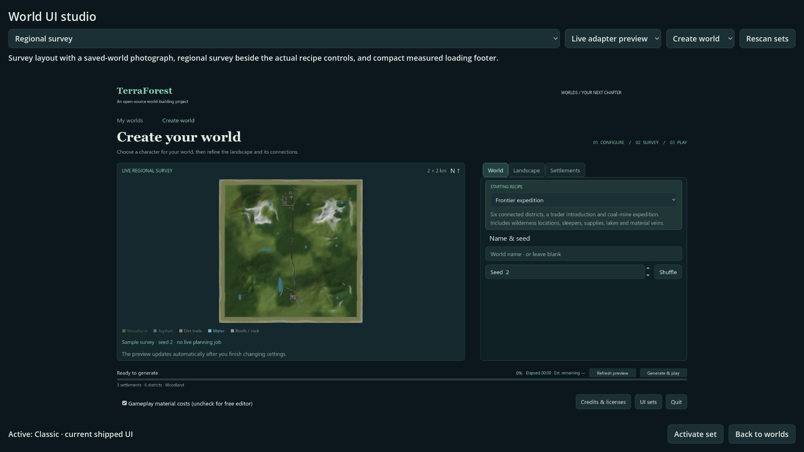
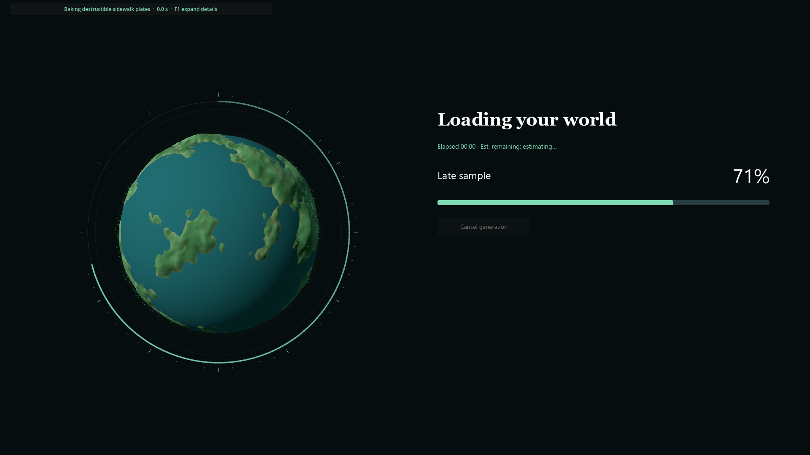
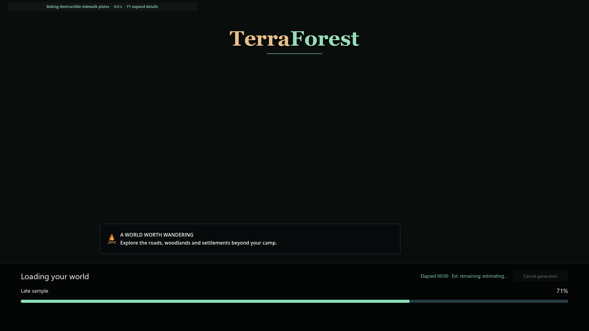

# Modular world-screen UI and mockup studio

- Status: Activation corrected and installed; source/exported checks pass; player review pending.
- Updated: 2026-11-05.
- User review: Requested preserved, selectable, pluggable mockup/UI sets. Explicit scope: world screens first. Rejected palette-only activation: neither mockup appeared to activate.
- Symptom: Current world UI was built inside controllers; alternatives were unrelated standalone mockups without discovery or activation.

## Changes

The current browser construction is extracted into the Classic set while its
controller retains library data, recipes, actions and async jobs. Five manifest
Resources register the original Classic, Planet, Survey, Diorama and Campfire
references. The studio discovers folders and presents the reference or isolated
live-adapter preview, with page names and canvas sizes declared in each manifest.
The world browser provides the **UI sets** entry. **Activate set** now saves the
selection and immediately opens the selected world screens. Selection persists
independently of world saves; removing
or invalidating a selected module falls back to Classic.

Working browser/creation/generation/Last World/gameplay loading hosts resolve
presentation scripts through the registry. A new set can inherit missing roles
and override only its own modules; no set-ID dispatch table needs editing. The
registry validates identity, inheritance, role base types and required APIs before
activation. [Authoring contract and examples](../../addons/ui_sets/README.md).

All five choices have working adapters. The earlier implementation saved a
preference but only themed Classic layouts, leaving the studio unchanged after
activation. That did not meet the requested switching behavior. The follow-up
adds Survey/Planet library compositions and map-left/recipe-right creation,
compact Survey loading with a stage rail, Planet/Diorama loading with an animated
portrait beside the measured rail, and Campfire loading with its tip card and
full-width footer. Loading diagnostics collapse into a ribbon; F1 or clicking
expands the original counters and measured history.

These are functional adaptations, not pixel-identical reference ports. Live lists
use ItemList, recipe categories use the actual form tabs, and loading displays
real current stages instead of the references' invented counts/metadata. Planet
portraits are decorative, not generated-terrain previews. Diorama/Campfire are
loading-only designs and inherit Classic browser/forms. Original reference scenes
remain intact and can still be previewed without changing the active set.

Preview input is isolated; the actual Classic view is constructed in a sample
controller mode without the library or generation/photo jobs. Original layouts
and scenes are preserved. Two reference media functions now use import-aware
access, so source-only/local photographs can be absent in a PCK without errors;
existing imported survey art loads normally. No personal world photograph or
report folder is bundled to fill those missing samples.

## Images and verification

[Exact checks and retained failures](evidence.json). Source/executable checks
cover discovery/inheritance, persistence/fallback, all five working adapters,
real generation option defaults, monotonic measured loading and isolated gallery
previews. Real Survey open/save/reopen/return/photographs run in one native window.
Live loading/diagnostics and Last World startup cover the shared production hosts.
The new regression injects actual mouse press/release events into Activate and
requires a transition into each selected live browser, rather than only checking
the saved preference. It also checks map/form columns, expanded counters and real
cancel requests. Final source/package suites pass 72 each; Survey world flows pass
24 each, live loading passes in both, and packaged Last World passes 11. One earlier
fixed-frame transition miss is retained in evidence; the final test waits up to
five seconds for the actual scene transition.

The earlier images below are retained as rejected palette-only comparisons. New
follow-up images are appended after them. They distinguish reference
mockups from the functional adapters; image inspection is scoped layout evidence,
not a declaration that all original art targets have shipped.

Classic view modules displayed in the studio, source 1920x1080 Forward+.

Original Survey reference retained for layout review; source run has local world
photographs. Exported previews leave optional local photographs empty.

Live adapter preview uses real creation widgets with sample state and no jobs.
The original captured survey is labelled as sample seed 2.

Planet adapter retains the working loading panel and diagnostic owner. Percentage
is a controlled test input, not a fabricated runtime progress animation. All images
inspected; [source/hash/provenance](images/manifest.json).

## Activation follow-up images

Actual recipe widgets beside the survey, with explicitly labelled sample state in
an isolated preview; no generation job. The original layout remains above.

Animated portrait beside the real measured-progress API. The 71% is a controlled
regression input, not an elapsed-time animation or actual generation run.

Campfire tip card and full-width measured footer. The test has no world photograph;
the real host supplies the saved/generated photograph when available.

## Remaining / resume here

Player visual/usability review remains pending. Pixel-identical reference art is
not claimed. Resume further layout refinement by replacing individual view modules
against the documented controller contract and requiring the same open/generate/
cancel/load/save/reopen checks. In-game HUD, inventory and menus are outside this change
at the user's direction. Larger plugin collections and long-run graphics budgets
are not broadly qualified by five-set previews.

Original module/code/test/tool changes were authored with OpenAI Codex for the
maintainer request under 0BSD. Original manifests/scenes use CC0-1.0; existing
referenced UI/art/planet terms are preserved in place. No external assets/code or
font files were imported. See [origin record](../../addons/ui_sets/ORIGIN.txt).
